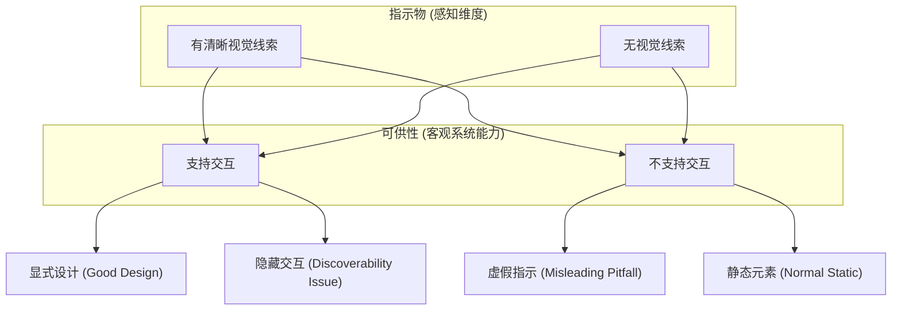

# 指示物与可供性

## 问题情境

日常生活中最令人尴尬的体验之一是面对一扇装有把手的门：你走上前去用力拉把手，门却纹丝不动；直到你注意到门上贴着一张微小的打印贴纸，上面写着“推”。这就是设计界著名的“诺曼门（Norman Door）”。

在 Web 与数字界面中，这类困境更加泛滥：
- 一个看起来像不可点击纯文本的短语，点击后却弹出了侧边栏；
- 一个具有立体阴影和边框、长得极其像“按钮”的装饰性卡片，用户反复点击却没有任何反应；
- 扁平化设计（Flat Design）兴起后，大量界面去除了按钮的高光、阴影与边框，导致用户根本无法分辨页面上哪些区域是可点击的，陷入“踩雷式探索”的疲劳。

这种用户直觉与系统实际行为之间的脱节，暴露了设计在传递“如何操作”信息时的核心失败。

## 概念界定

::: definition [可供性（Affordance）与指示物（Signifier）]
- **可供性（Affordance）**：物理客体或软件环境与行动主体（人类或智能体）之间的**实际可执行关系**。它决定了主体在客观物理或系统层面上**可能执行什么动作**（例如椅子客观上允许坐下，开关客观上允许通断）；
- **指示物（Signifier）**：任何可被感知的符号、标记、形状、纹理或信号，用来**向用户显式传达哪里存在可供性以及应该如何进行交互**（例如门把手的凹槽提示“抓拉”，扁平门板提示“推”，超链接下划线提示“点击”）。
:::

可供性关注“实际能做什么”，指示物关注“如何让人知道能做什么”。在软件和图形用户界面（GUI）中，设计师几乎永远是在设计**指示物**。

## 解释与依据

### 1. 概念演进：从吉布森的生态心理学到诺曼的人机工程

概念源流的分化解释了长久以来的术语混淆：

1. **J.J. 吉布森（James J. Gibson, 1977）的原始定义**：
   在生态心理学中，可供性是独立于个体感知而客观存在的环境属性。不论一个人是否看见悬崖边缘，悬崖都客观具备“跌落的可供性”；
2. **唐·诺曼（Don Norman）的重新校准（2008）**：
   诺曼最初在 1988 年《日常事物的设计》中引入该词，却发现计算机行业滥用了“Affordance”——屏幕上的像素并不是物理实体，一块平滑的玻璃屏幕物理上只具有“触摸、滑动、反光”的可供性，并不具有物理意义上的“点击按钮”可供性。
   因此，诺曼在修订版中做出了决定性澄清：**把屏幕上的视觉线索统称为指示物（Signifiers）**。

### 2. 关系象限模型

根据客观功能与主观感知的匹配关系，界面元素可划分为四个象限：

| 状态分类 | 客观可供性 | 感知指示物 | 典型交互场景与后果 |
| :--- | :--- | :--- | :--- |
| **显式直觉（Explicit）** | **存在** | **清晰** | 设计标杆：立体按钮、带下划线的蓝色文字，用户一眼看懂且操作符合预期 |
| **虚假可供（False）** | **不存在** | **强烈** | 误导反模式：不可点击但带按钮样式的横幅，引发用户无效点击与挫败感 |
| **隐藏可供（Hidden）** | **存在** | **缺失** | 发现灾难：某些手势滑动（如右滑删除）、需将光标悬停才出现的隐藏按钮，新手极难发现 |
| **正当排斥（Correct Rejection）**| **不存在** | **无** | 正常静态文本、普通背景色，不产生任何虚假交互暗示 |

## 边界与辨析

### 1. 拟物化（Skeuomorphism）vs 极度扁平化（Flat Design）的指示物摇摆

- **拟物时代的指示物冗余**：
  早期 iOS 广泛采用渐变、阴影、凹凸质感来模拟物理世界中的机械按钮和纸张边缘。这种强指示物极大降低了触屏新手的学习成本，但随着用户心智成熟，大量装饰性纹理变成了视觉噪点；
- **纯粹扁平化的指示物贫血**：
  极度扁平化走向了另一个极端：取消所有边框与背景色，仅用纯色文字作为按钮。这直接摧毁了可交互性的指示物，导致用户的认知负荷和错误点击率大幅飙升；
- **现代折中方案：微质感扁平（Flat 2.0 / Fluent / Material You）**：
  保留扁平界面的清爽，但通过精细的微阴影（Elevation）、边框线、悬停状态（`:hover`）和可见聚焦轮廓（`:focus-visible`）恢复关键指示物。

### 2. 隐喻（Metaphor）的边界与反噬

指示物通常借助生活中的隐喻来传递意义（如“垃圾桶”代表删除、“齿轮”代表设置、“放大镜”代表搜索）。
- **隐喻的优势**：利用用户头脑中已有的物理心智模型，达成零成本知识迁移；
- **隐喻的陷阱**：物理世界的局限不等于软件的局限。如果在软件中完全复制物理实体（如逼真翻页书动画阻碍快速跳转、模拟真实磁带录音机倒带耗时），隐喻就会反过来束缚软件的数字化优势。

::: insight
好的设计不需要说明书。如果一个简单的网页按钮必须依靠一段文字提示“点击此处进行提交”，这说明它的几何形状、色彩对比和布局位置在指示物层面已经彻底失败。
:::

## 提取与迁移

- **在 Web 前端开发中**：
  - 为可点击元素使用语义标签 `<button>` 而非纯 `
`，它不仅为视力正常用户提供鼠标指针（`cursor: pointer`）指示物，更向屏幕阅读器暴露可供性角色（`role="button"`）；
  - 始终为键盘用户保留不可妥协的指示物：高对比度的 `:focus-visible` 焦点圈。
- **在工业与服务设计中**：
  - 汽车门把手从内凹式物理把手转向隐藏式电动按键时，必须增加光效与微震动指示物，否则乘客在紧急情况下会陷入恐慌。

## 关联与来源

- **课程讲义关联**：
  - [Lec 3 可学习性](../lec3.md)：诺曼门案例、指示物与可供性详解；
  - [Lec 6 CSS 的基本概念 I](../lec6.md)：`:hover`, `:focus` 状态伪类；
  - [Lec 13 统一 Web 设计](../lec13.md)：无障碍树与语义可供性传达。
- **经典文献**：
  - Gibson, J. J. *The Ecological Approach to Visual Perception*. Houghton Mifflin, 1979.
  - Norman, Don. "Signifiers, not affordances." *interactions* 15.6 (2008): 18-19.
  - Norman, Don. *The Design of Everyday Things: Revised and Expanded Edition*. Basic Books, 2013.

## TL;DR

- 可供性是系统与用户之间客观存在的可执行关系（“实际能做什么”），而指示物是向用户传达该能力存在的感知线索（“如何知道能做什么”）。
- 在数字界面中，屏幕物理上是一块玻璃，设计师的核心任务是绘制清晰、准确、一致的指示物（按钮轮廓、悬停微动、聚焦环）。
- 虚假指示物会导致无效误触，隐藏可供性会导致功能难以被发现；优秀设计应消除指示物与真实能力之间的鸿沟。
