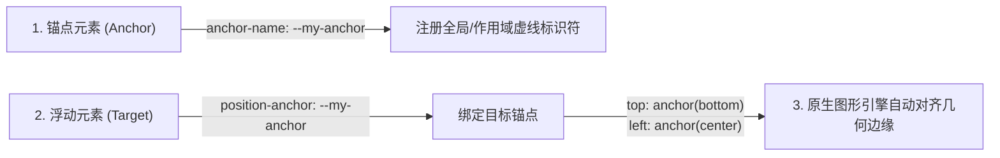

# CSS 锚定定位

## 问题情境

在 Web 交互设计中，悬浮提示框（Tooltip）、下拉菜单（Dropdown Menu）、上下文动作面板（Action Popover）和用户资料悬浮卡片是最常见却也是工程实现最繁琐的组件类型。

长期以来，这类“浮动层（Floating UI）”面临致命的架构困境：
- **父级裁剪冲突（The Overflow Dilemma）**：为了避免浮层被祖先元素的 `overflow: hidden` 或 `overflow: scroll` 截断，浮层必须从原生 DOM 树中被剥离出来，传送到 `document.body` 顶层节点（React Portal 或 Vue Teleport）；
- **繁重脆弱的 JavaScript 计算**：浮层一旦脱离祖先，就丢失了常规流的相对位置。开发者必须引入 Popper.js 或 Floating UI 等几十 KB 的第三方库，在 `scroll`、`resize` 和内容变动时高频监听事件，反复调用 `getBoundingClientRect()` 计算像素绝对坐标并手动写入内联样式；
- **渲染异步与跟手脱靶（Visual Lag）**：由于主线程 JavaScript 计算、垃圾回收与浏览器底层图形管线（Compositor Thread）存在帧率时差，在页面惯性快速滚动时，浮层往往会出现肉眼可见的漂移、延迟或脱离锚点。

## 概念界定

::: definition [CSS 锚定定位（CSS Anchor Positioning）]
由 W3C CSS 工作组（CSSWG）制定的原生规范。它允许脱离常规文档流的绝对定位（`absolute`）或固定定位（`fixed`）元素，通过声明式的 CSS 语法直接将其几何边缘“锚定”到页面中任意指定的参考元素（锚点）上，由浏览器图形引擎在合成阶段直接完成几何贴合渲染。
:::

锚定定位将浮层与触发源之间的空间依附关系从“命令式 JavaScript 算坐标”彻底提升为“声明式 CSS 原生几何约束”。

## 解释与依据

### 1. 核心架构三步走：注册、绑定与几何对齐

CSS 锚定定位将传统的空间计算拆解为三个正交的声明式步骤。开发者无需关心微观像素坐标，只需描述元素之间的拓扑依附关系：



具体语法工作流如下：

1. **注册锚点（Anchor Registration）**：
   在触发者元素上定义一个以 `--` 开头的 CSS 虚线标识符（Dashed Ident）。该标识符遵循类似 CSS 自定义属性的树状作用域规则：
   ```css
   .trigger-button {
     anchor-name: --action-menu;
   }
   ```
2. **声明依附关联（Target Binding）**：
   在浮动层上显式指定要吸附的目标锚点。浏览器渲染器据此在两个独立节点之间建立内部渲染拓扑图：
   ```css
   .dropdown-menu {
     position: fixed;
     position-anchor: --action-menu;
   }
   ```
3. **空间几何吸附（Coordinate Alignment）**：
   在定位属性中调用 `anchor()` 函数，将其指定边缘对齐至锚点的对应几何位置。例如将浮层顶部对齐至锚点底部，水平方向居中对齐：
   ```css
   .dropdown-menu {
     /* 将下拉菜单的顶部，贴合到锚点按钮的底部边缘 */
     top: anchor(bottom);
     /* 将下拉菜单的水平中心，对齐到锚点的中心 */
     left: anchor(center);
     transform: translateX(-50%);
     margin-top: 8px; /* 声明外边距间隔 */
   }
   ```

### 2. 动态视口防溢出与碰撞回退：`@position-try`

浮动层最复杂的工程难题是**视口边界碰撞（Collision Handling）**——当触发按钮靠近屏幕底部时，默认朝下弹出的菜单会被屏幕下边缘截断。

在传统方案中，JavaScript 必须在每一帧监听滚动并检测边缘，动态切换类名进行位置翻转。这往往带来代码膨胀与布局重排。而 CSS 锚定定位引入了专属的 `@position-try` 规则块，允许开发者用纯 CSS 预先定义一组空间降级策略：

```css
/* 声明备选回退方案：翻转到锚点上方 */
@position-try --flip-to-top {
  top: auto;
  bottom: anchor(top);
  margin-top: 0;
  margin-bottom: 8px;
}

/* 声明备选回退方案：贴到锚点右侧 */
@position-try --side-right {
  top: anchor(top);
  left: anchor(right);
  transform: none;
  margin-left: 8px;
}

.dropdown-menu {
  position: fixed;
  position-anchor: --action-menu;
  top: anchor(bottom);
  left: anchor(center);
  transform: translateX(-50%);
  
  /* 当下方空间不足以容纳内容时，按顺序自动应用回退位置 */
  position-try-fallbacks: --flip-to-top, --side-right;
}
```

浏览器内核在排版渲染阶段会自动感知容器与视口边界。当默认的朝下弹出产生溢出时，渲染引擎会自动尝试应用 `--flip-to-top`；若上方依然空间不足，则无缝继续尝试 `--side-right`。整个碰撞回退判定完全在合成阶段进行，无需任何主线程 JavaScript 计算。

### 3. 动态尺寸跟随：`anchor-size()`

不仅是坐标，浮动层的宽高也可以直接镜像锚点的尺寸：
```css
.auto-complete-results {
  position: fixed;
  position-anchor: --search-input;
  top: anchor(bottom);
  left: anchor(left);
  /* 强制下拉搜索框的宽度严格等于输入框的实时宽度 */
  width: anchor-size(width);
}
```

## 边界与辨析

### 1. 传统 JS 库（Popper / Floating UI）vs 原生 CSS 锚定定位

| 比较维度 | 传统 JavaScript 方案（Popper / Floating UI） | 现代原生 CSS 锚定定位 |
| :--- | :--- | :--- |
| **运行时体积** | 需引入 15–30 KB 的外部脚本体积 | **0 KB 额外包体积**，浏览器引擎内置原语 |
| **滚动跟手性能** | 主线程高频监听，滚动过快时容易发生 1–2 帧延迟脱节 | **完全在合成器线程（Compositor）运行**，60/120fps 绝对同步贴合 |
| **代码维护性** | 复杂的生命周期挂载、实例销毁与 ResizeObserver 绑定 | 纯 CSS 声明，状态完全与业务组件逻辑解耦 |
| **浏览器兼容性** | 支持全部历史遗留浏览器 | 现代 Chromium（Chrome 125+）已原生实装，Safari/Firefox 快速推进中（可用 polyfill 回退） |

### 2. 原生 HTML `popover` 属性与 CSS 锚定定位的完美共生

- `popover` 属性（HTML5 原生）：
  解决了**层级与交互状态**——自动将元素提升至顶层渲染上下文（Top Layer，无需担心 `z-index`），并免费提供轻量关闭（Light Dismiss，点击空白或按 Esc 自动关闭）；
- `CSS Anchor Positioning`：
  解决了**空间几何贴合**——将处于顶层上下文的 Popover 精准锁定在触发按钮下方。
- 两者结合，宣告了长达二十年的“弹窗与下拉菜单组件繁琐封装”时代的终结。

::: insight
CSS 锚定定位的诞生体现了 Web 标准的演进哲学：把开发者在应用层用 JavaScript 经过数十年试错、反复打补丁证明为刚需的通用模式，下沉固化为浏览器底层的原生声明式标准。
:::

## 提取与迁移

- **在现代 Design System（如 Radix / Shadcn / Floating UI 原生化）中**：
  渐进增强策略是首选模式。利用 `@supports (anchor-name: --test)` 特性查询，在支持的现代浏览器中启用纯 CSS 锚定定位，在旧版环境中无缝降级加载微型 JS 定位引擎；
- **在图表与数据可视化标注中**：
  无需在 Canvas 或 SVG 内部重度手绘信息提示框，直接将 HTML Tooltip 锚定到 SVG 的特定 `<circle>` 数据点上，充分利用 HTML/CSS 强大的排版能力。

## 关联与来源

- **课程讲义关联**：
  - [Lec 10 布局](../lec10.md)：Web 布局机制演进与锚定定位实战；
  - [Lec 8 CSS 的基本概念 II](../lec8.md)：层叠上下文与传统脱离文档流的缺陷；
  - [Lec 23 Web 标准](../lec23.md)：W3C 规范从提案到标准实现流程。
- **经典规范**：
  - W3C CSS Anchor Positioning Module Level 1.
  - Verou, Lea. "CSS Anchor Positioning: The Future of Floating UI." *W3C CSSWG Drafts*, 2023.

## TL;DR

- CSS 锚定定位是 W3C 原生声明式标准，彻底解决了浮动提示层（Tooltip/Dropdown）脱离常规流后的坐标定位难题。
- 通过 `anchor-name` 注册锚点，`position-anchor` 关联目标，并在定位属性中使用 `anchor()` 函数进行几何吸附。
- 借助 `@position-try` 规则可实现完全由浏览器图形引擎接管的无 JS 视口避障与智能翻转，消除了传统库的性能延迟与包体积开销。
