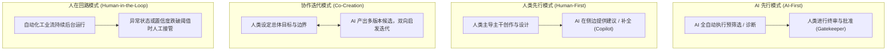

# 人机协作模式与校准信任

## 问题情境

随着以大语言模型（LLM）与生成式人工智能为代表的技术席卷软件工程，人机交互领域迎来了半个世纪以来最激烈的范式剧震：
- 传统交互建立在**确定性（Deterministic）**契约之上：用户点击“保存”按钮，系统保证百分之百写入磁盘；相同的输入永远产出完全一致的输出，失败伴随响亮的报错（Fails loudly）；
- 生成式 AI 建立在**概率性（Probabilistic）**底座之上：相同的提示词可能生成风格迥异的文本；模型以极其流利自信的语气产出无中生有的虚假事实（静默失败 / Fails silently）；其推理过程是黑盒且无法用单一代码断点进行排查。

如果继续套用传统软件的“无脑一键执行”模式，将导致灾难性的后果：
- **自动化偏见（Automation Bias）**：初级程序员盲目运行 AI 生成的代码，直接引发生产环境权限漏洞与数据被删；
- **极端算法厌恶（Algorithmic Aversion）**：用户在经历了一次微小的幻觉欺骗后，彻底对智能系统丧失信心，弃用强大的自动化生产力。

人机工程学必须为概率性系统建立全新的人机合作范式与信任校准机制。

## 概念界定

::: definition [人机协作模式（Human-AI Collaboration）与校准的信任（Calibrated Trust）]
- **人机协作模式（Human-AI Collaboration）**：指人类与具备自主推断能力的智能体在共享任务空间中，根据任务风险、认知负荷与控制权归属，动态划分决策权与执行权的交互架构；
- **校准的信任（Calibrated Trust）**：用户对 AI 系统能力的主观信任度与期望值，与 AI 系统在真实物理世界中的实际工程可靠性曲线**完全吻合的心理契约状态**。
:::

优秀的设计既不诱导过度信任，也不引发信任赤字，而是诚实透明地将系统置信度与能力边界暴露给人类。

## 解释与依据

### 1. 人机协同四大经典模式

根据自主权与控制时序的流动方向，人机协作解构为四类架构模式：



1. **AI 先行模式（AI-First / 机器起草，人类审核）**：
   - **适用领域**：高风险、大规模筛查任务（如医学影像结节自动标记、反洗钱交易预警）；
   - **交互机制**：AI 负责大海捞针，呈现高亮候选集，但**最终的破坏性或生效动作必须由人类物理签名批准**。
2. **人类先行模式（Human-First / 人民主导，机器伴随）**：
   - **适用领域**：低摩擦、高创造性任务（如文档撰写、代码辅助编程）；
   - **交互机制**：人类掌握编辑光标主导权，AI 仅在周围环境呈现幽灵文本（Ghost Text）提供辅助建议。
3. **协作迭代模式（Mixed-Initiative / 目标委托与多路发散）**：
   - **适用领域**：探索性原型设计、头脑风暴；
   - **交互机制**：人类设定高层目标与约束，AI 并行给出 3–5 组不同权衡的设计提案，人类选择最优分支并继续微调。
4. **人在回路监控模式（Human-in-the-Loop / 自动化运行与异常接管）**：
   - **适用领域**：自动驾驶、智能客服分流、大规模内容审核；
   - **交互机制**：系统大部分时间在稳态自主巡航；一旦传感器数据冲突或模型置信度低于预设安全阈值，系统必须以毫秒级响应发出多模态警报并请求人类安全员接管。

### 2. 信任校准曲线与动态平衡

人机信任不是静态的二进制开/关，而是一条随着使用体验持续波动的动态曲线。如果用户的预期与系统实际能力脱节，系统就会陷入失效的两极：

```text
主观信任度
  ^
  |               [过度信任区 (Over-trust)] ──> 盲信、放弃思考、引发致命事故
  |                    /
  |                   / 
  |                  /  <── 黄金基准线: 校准的信任 (Calibrated Trust)
  |                 /
  |                /
  |  [信任赤字区 (Under-trust)] ──> 怀疑、抵抗、弃用先进工具
  +--------------------------------------------------------------------> 实际系统可靠性
```

两极偏差的危险性分析：

- **过度信任（Over-trust / 自动化偏见）**：当模型以毫无迟疑的文笔生成一段完全伪造的数据时，过度信任的用户会跳过批判性复核，直接将其采纳并发布。在医疗诊断、民航驾驶、法律合同或金融结算场景中，这种盲目放任会酿成毁灭性的人身与财产事故；
- **信任赤字（Under-trust / 算法厌恶）**：由于模型在某次代码补全中拼错了一个变量名，用户便认定“整个 AI 助手根本不可信”，退回原始的纯手动搬砖模式，彻底错失现代人机协同带来的十倍生产力跃升；
- **设计干预的使命**：优秀的用户界面必须像一个精密的气压计，通过动态视觉线索（如置信度微弱高亮、概率分布展示、显式标注知识来源与最新更新时间），主动“推拉”用户的心理预期，使其随时与客观可靠性保持同频。

## 边界与辨析

### 1. 应对不确定性的四套具象 UI 模式

为了在界面中建立校准的信任，现代人机交互沉淀了四种核心防御范式：

| 交互设计模式 | 核心设计规则 | 解决的心理学痛点 |
| :--- | :--- | :--- |
| **置信度外显（Confidence Display）** | 当生成置信度较低时，主动使用虚下划线或较淡文字标注；对概率进行区间展示 | 破除文本流利性造成的虚假权威感 |
| **多候选呈现（N-best Alternatives）** | 避免直接提供唯一的绝对答案，为歧义任务并列呈现 3 组候选方案供用户挑选 | 明确向用户心智传达“此处存在探索空间” |
| **细粒度局部采纳（Granular Control）** | 允许用户通过 `Tab` 逐词、逐行采纳，或通过 `Esc` 局部拒绝，杜绝非全即无 | 消除“必须全盘接受或全盘重写”的认知高摩擦 |
| **来源可溯与引用锚点（Source Grounding）** | 生成结果必须附带可点击的文献或知识库原文锚点链接，点击即弹出对照面板 | 将验证虚假幻觉的核对成本从数分钟压低至两秒 |

### 2. 自动化（Automation）vs 用户自主权（Agency）的博弈

- **侵入式自动化的恶果**：某些工具未经用户明确授权，就擅自改写用户原本的代码结构或直接发送自动生成的邮件。这种强夺控制权的行为会给用户带来极度强烈的失控感与侵犯感；
- **良性协同原则**：永远将人类定义为**总指挥（Informed Driver）**，AI 始终扮演**领航副驾（Copilot）**。所有不可逆的高危物理操作，系统的默认状态必须是“停下来等待人类批准”。

::: insight
AI 时代最核心的交互任务不是“展示技术的无所不能”，而是“管理人类的心理委托契约”。一个诚实告知“我并不确定答案、请重点核对第 3 条引用”的系统，远比一个表面无懈可击却偶尔暗度陈仓的黑盒更值得托付。
:::

## 提取与迁移

- **在现代 AI 辅助研发（如 Cursor / GitHub Copilot）中**：
  代码生成不仅展示代码本身，更以 `Diff View` 形式将“行增、行删”清晰对比，并提供“逐行接受（Accept Line）”快捷键，让工程师维持绝对的代码掌控权；
- **在金融与法律大模型应用中**：
  严禁直接输出判决或放款决定，系统界面被强制设计为“证据链清单面板”，AI 只负责整理相关法条与资产流水账目，法官与信审员拥有最终裁量权。

## 关联与来源

- **课程讲义关联**：
  - [Lec 24 面向 AI 系统的设计](../lec24.md)：范式转变、不确定性模式与校准信任；
  - [Lec 7 安全性](../lec7.md)：差错分类学与强制拦截功能；
  - [Lec 11 原型和用户测试](../lec11.md)：出声思维与心智模型探测。
- **经典文献**：
  - Amershi, Saleema, et al. "Guidelines for human-AI interaction." *Proceedings of the 2019 CHI Conference on Human Factors in Computing Systems*. 2019.
  - Parasuraman, Raja, and Victor Riley. "Humans and automation: Use, misuse, disuse, abuse." *Human Factors* 39.2 (1997): 230-253.
  - Lee, John D., and Katrina A. See. "Trust in automation: Designing for appropriate reliance." *Human Factors* 46.1 (2004): 50-80.

## TL;DR

- AI 系统从确定性演进为概率性，界面设计必须放弃“输出必定绝对可靠”的虚假假设。
- 人机协作分为 AI 先行（机器初筛，人类终审）、人类先行（人类主导，机器伴随）、协作迭代与人在回路四大范式。
- 校准的信任要求用户的心理预期与系统的实际工程能力精准重合；通过置信度外显、多候选生成、细粒度逐行采纳与引用溯源，防止盲目放任的自动化偏见与彻底弃用的算法厌恶。
