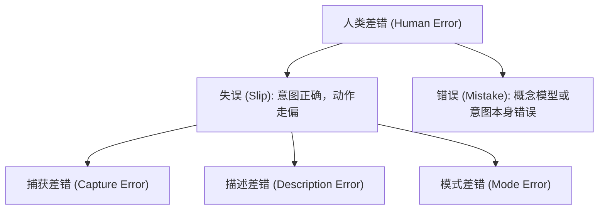

# 差错分类与强制功能

## 问题情境

在系统设计中，当灾难性事故发生时（如工程师删除了生产数据库、飞行员误关了发动机供油管、用户误把未公开的私人草稿一键发布到了公开社交广场），管理层的第一反应往往是责怪操作者：“这是人类操作失误（Human Error），需要加强培训和惩戒”。

然而，认知心理学与人机工程学明确指出：**人类犯错是生理与认知结构的必然产物，责怪个人无法防止下一次悲剧的发生**。

如果一个系统的设计：
- 允许用户在不知不觉中切换到破坏性模式（如未察觉的大写锁定键或静默覆盖模式）；
- 把危险的“清空全部”按钮与日常的“保存”按钮涂成相同颜色并紧挨着并列摆放；
- 依赖脆弱的记忆力，要求用户在长达 10 步的流程中不能遗漏任何一个隐蔽步骤。

那么这个系统本质上是在诱导人类犯错。真正的安全工程必须深入差错发生的心理学根源，通过物理和逻辑的“强制功能”筑牢安全堤坝。

## 概念界定

::: definition [人类差错分类学（Slips vs Mistakes）与强制功能（Forcing Functions）]
- **人类差错二元论（James Reason）**：
  - **失误（Slip / Lapse）**：用户的意图与目标完全正确，但在具体的**动作执行阶段发生了偏离或执行失败**（通常发生在注意力涣散或高度自动化的日常熟练动作中）；
  - **错误（Mistake）**：动作本身按照计划严格执行，但用户的**意图、概念模型或规则判断本身就是错误的**（属于认知决策层面的失败）。
- **强制功能（Forcing Function）**：一种物理或界面逻辑约束，使得**如果不先完成特定的前置动作，下一个动作在物理或逻辑上就根本无法执行**。
:::

安全设计的终极使命不是训练超人，而是让失误在物理上不可能发生，或者在失误发生后让后果完全可逆。

## 解释与依据

### 1. 经典失误（Slips）的三大子类型与工程表现

根据唐·诺曼（Don Norman）的归纳，熟练用户最容易犯的三类失误具有清晰的触发模式：

1. **捕获差错（Capture Error）**：
   - **机理**：两个操作序列具有相同的前置动作，但其中一个是非常高频、高度自动化的习惯动作。大脑无意识地被习惯路径“捕获”，顺手执行了老动作；
   - **Web 示例**：用户本意是在文档中键入换行，但由于平时高频使用 `Enter` 发送消息，大脑顺手敲击了回车，导致半成品的草稿被直接发送了出去。
2. **描述差错（Description Error）**：
   - **机理**：当两个不同的目标在空间布局、外观形状或操作方式上极其相似（描述模糊）时，动作落在了错误的目标上；
   - **Web 示例**：红色的“取消”按钮与红色的“删除”按钮紧挨摆放，用户看错并点击了“删除”。
3. **模式差错（Mode Error）**：
   - **机理**：同一个物理输入根据系统当前的“内部状态模式”产生完全不同的效果，但系统未能向用户显式暴露当前处于何种模式；
   - **Web 示例**：在 Vim 编辑器中以为处于“插入模式”而键入文字，实际上处于“普通命令模式”，导致文本被大段误删。

### 2. 强制功能（Forcing Functions）的三大防御机制

为了彻底终结特定危险动作，人机工程设计了三种强制约束机制：

| 机制类型 | 约束机理与目标 | 现实生活经典案例 | 软件与 Web 界面最佳实践 |
| :--- | :--- | :--- | :--- |
| **互锁（Interlock）** | 强制操作必须按照严格时序发生，**前置动作未完成，后续动作硬件阻断** | 微波炉门未关好时绝对无法接通微波发射；自动挡汽车必须踩下刹车才能挂入 D 挡 | 表单中未勾选“同意协议”或必填项校验未通过时，提交按钮处于硬件级不可点击态（`disabled`） |
| **闭锁（Lockout）** | 在危险状态解除前，**物理阻止用户进入该危险区域** | 楼梯间的安全出口门只能单向从内推开，防止火灾时人员误入地下储藏死角 | 对敏感配置页面引入多因素生物认证（Passkey / MFA）阻断拦截；分支保护规则禁止直接 Push 进 main 分支 |
| **锁入（Lockin）** | 物理阻止用户在完成必要收尾工作前**过早离开或终止会话** | ATM 机必须先吐出银行卡并被用户取走，才开始吐出钞票（防止用户拿了钱忘记取卡） | 浏览器原生的 `beforeunload` 弹窗：“当前表单有未保存的修改，确定离开此页面吗？” |

## 边界与辨析

### 1. 弹簧模式（Spring-Loaded Modes）化解模式差错

并非所有系统都能彻底摒除“模式”。当必须使用模式时，**弹簧模式（Spring-Loaded Mode）**是最佳解药：
- **传统模式的弊端**：如大写锁定键（Caps Lock），按一次进入，再次按才退出。用户极其容易忘记当前状态；
- **弹簧模式的物理约束**：如同按住物理弹簧一样，**用户必须持续施加物理压力才能维持该模式，一旦松手立刻自动回弹到默认状态**（如按住 `Shift` 键输入大写字母，松开即恢复小写；Photoshop 中按住空格键临时拖拽画布，松开鼠标即恢复画笔）。用户的大脑肌肉记忆持续处于唤醒状态，模式差错率归零。

### 2. 确认弹窗（Confirmation Dialog）的虚假安全性

绝大多数初级工程师习惯通过弹窗解决一切安全性问题：`确定要删除该项目吗？[取消] [确定]`。
- **习惯化陷阱（Habituation）**：由于用户每天遇到几十次这种弹窗，大脑会将其自动编码为无意义的阻碍，形成“看到弹窗一秒内条件反射敲击回车”的肌肉记忆；当真正的毁灭性操作发生时，弹窗根本起不到警示作用；
- **撤销优先原则（Undo over Confirmation）**：
  将危险动作默认设计为**即时发生但随时可逆**。例如 Gmail 删除邮件不弹窗，而是删除后在屏幕底部常驻浮条：“已移至回收站。[撤销]”。

::: insight
防御性工程的关键法则：**波斯特定律（Postel's Law / 稳健性原则）**——“对自己的输出要保守严谨，对他人的输入要宽容豁达（Be conservative in what you do, be liberal in what you accept from others）”。在表单中，不要因为用户多输了一个空格或括号就直接弹报错拦截，而应由系统在后台自动格式化清洗。
:::

## 提取与迁移

- **在云原生与基础设施工程中**：
  执行高危破坏性命令（如 `terraform destroy` 或生产数据库迁移）时，系统不再仅仅要求输入 `y/n`，而是强制要求用户亲手敲入完整的存储库全名或随机生成的确认短语，强迫大脑从自动化的“失误”状态脱离，进入慢思考认知。
- **在前端表单防灾备忘中**：
  利用浏览器的 `localStorage` 或 `IndexedDB` 实时对未提交表单执行本地自动草稿暂存（Auto-Save），哪怕用户误触关闭窗口或断网崩溃，重开页面也能瞬时恢复，彻底终结数据丢失灾难。

## 关联与来源

- **课程讲义关联**：
  - [Lec 7 安全性](../lec7.md)：差错分类全景、强制功能与波斯特定律；
  - [Lec 3 可学习性](../lec3.md)：模式与心理模型；
  - [Lec 9 启发式评估](../lec9.md)：尼尔森第 5 原则（防错）与第 9 原则（协助纠错）。
- **经典文献**：
  - Reason, James. *Human Error*. Cambridge University Press, 1990.
  - Norman, Donald A. *The Design of Everyday Things: Revised and Expanded Edition*. Basic Books, 2013.

## TL;DR

- 人类差错分为执行层面的“失误”（意图正确但动作走偏，如捕获差错、模式差错）和认知层面的“错误”（心智模型或目标本身错误）。
- 强制功能通过互锁（前置未完成不可后续）、闭锁（危险未解除阻断进入）和锁入（未收尾阻断离开）在物理和逻辑层面上消灭犯错空间。
- 确认弹窗因人类习惯化反射往往沦为虚假安全；现代系统应优先采用弹簧模式、自动本地草稿暂存与可逆的撤销机制（Undo）。
