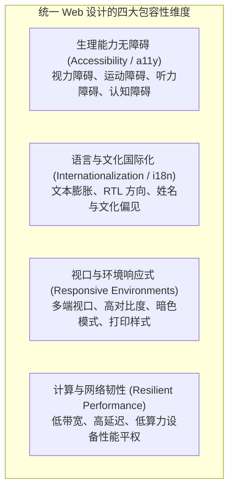
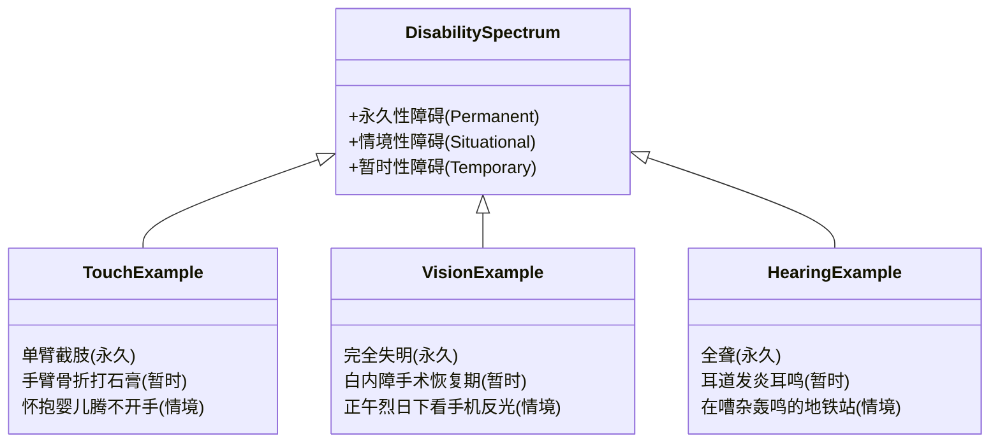
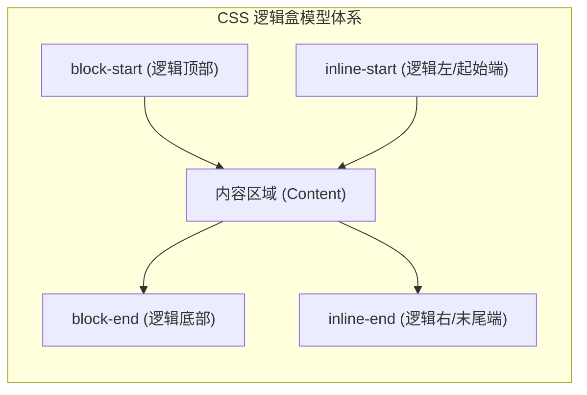

# Lec 13 统一 Web 设计（Universal & Inclusive Web Design）

## TL;DR

- **万维网的通用本质**：蒂姆·伯纳斯-李确立的 Web 核心信条在于其无处不在的通用性（Universality）——消除因生理残障、语言文化、设备算力与网络带宽带来的数字鸿沟；
- **包容性设计原则**：超越传统印刷品的刚性排版，以包容性设计（Inclusive Design）拥抱人类能力的连续谱，遵循 WCAG 规范的四大基石（POUR：可感知、可操作、可理解与鲁棒性）；
- **国际化与 CSS 逻辑属性**：通过 CSS 逻辑属性（Logical Properties）彻底解耦物理方向，使页面能自适应文字膨胀与从右到左（RTL）书写方向，坚决杜绝把文本固化在光栅图片中；
- **真实表单的无偏见抽象**：打破对姓名、性别和地址格式的技术偏见，结合响应式流式布局与性能轻量化，实现面向全球多元受众的真正无障碍界面。

---

## 1. 统一设计哲学：从“印刷特权”到“全人类的 Web”

在传统平面设计（Graphic Design）领域，设计师习惯于针对固定规格的物理纸张（如 A4 纸、杂志跨页、海报广告牌）进行极其严密的绝对排版。纸张的尺寸、视距与光线环境在印刷完成后即被固化。

然而，万维网（World Wide Web）的诞生彻底瓦解了这一物理前提：

::: definition 蒂姆·伯纳斯-李的万维网宪章
> “Web 的力量在于其通用性。让每一个人都能够访问它，而不论其身体是否存在残障，这是 Web 不可或缺的本质属性。”  
> —— Tim Berners-Lee，万维网发明者、W3C 创始人
:::

MIT 6.4500 课程明确提出了一句警醒所有现代前端工程师的核心格言：
**“It's the World Wide Web, not the Wealthy Western Web（这是属于全世界的万维网，而不是仅属于富裕西方世界的局域网）。”**

统一 Web 设计（Universal Web Design）要求我们在构建系统时，深刻理解访客的多样性：
- 访客可能使用搭载最新 M 系列芯片的高清视网膜屏幕，也可能使用非洲发展中国家价值 30 美元的百元低端安卓机；
- 访客可能拥有千兆光纤宽带，也可能身处高时延、频繁丢包的 2G/3G 移动蜂窝网络中；
- 访客可能是视力健全的母语使用者，也可能完全失明依赖屏幕朗读器，或是使用阿拉伯语（从右向左阅读）的用户。



---

## 2. 包容性设计（Inclusive Design）与无障碍（a11y）

包容性设计是一种根本性的设计方法论，其核心目标是：**在设计系统或产品时，绝不因为生理残障、种族、民族、宗教、语言、性别认同、性取向和年龄等任何先天的或后天的因素而将任何人排除在外**。

### 2.1 人类能力的连续谱模型（The Ability Spectrum）

传统医学常将“残疾”视为孤立群体的永久性身体缺陷。但在现代人机交互理论中，微软包容性设计团队提出的“能力连续谱”深刻揭示了无障碍设计的通用普惠价值：



当你为一个视力障碍者优化页面的色彩对比度并增大字号时，你同时也帮助了在刺眼阳光下使用手机的健康人；当你为失聪人士提供视频的文字字幕时，你同时也便利了在图书馆或嘈杂会议室里无法开启外放音量的普通上班族。**为边缘极端场景设计的方案，最终会让所有人受益。**

### 2.2 WCAG 核心基石：POUR 原则

W3C 制定的《Web 内容无障碍指南》（Web Content Accessibility Guidelines, WCAG）是全球数字产品的法律与工程合规基准，其核心体系围绕四大原则展开：

| 原则 | 核心内涵 | 典型工程落地规范 |
| :--- | :--- | :--- |
| **P - 可感知性（Perceivable）** | 信息与用户界面组件必须能够通过感官被用户察觉（不能依赖单一感官） | 为所有 `` 提供具有实际描述意义的 `alt` 文本；文本与背景对比度达标（WCAG AA 要求普通文本至少 $4.5:1$）；提供视频字幕 |
| **O - 可操作性（Operable）** | 用户界面组件与导航必须能够通过各种输入设备顺畅操作 | 页面所有功能必须**完全支持纯键盘导航**；提供明显的 `:focus-visible` 焦点光标环；支持“跳过导航链接（Skip Links）” |
| **U - 可理解性（Understandable）** | 信息与界面操作逻辑必须清晰易懂，避免引起认知混淆 | 声明页面根语言 `<html lang="zh-CN">`；交互保持内部与外部一致性；提供清晰、具体的表单校验报错与修复提示 |
| **R - 鲁棒性（Robust）** | 内容必须具有足够的韧性，能够被包括辅助技术在内的各种用户代理可靠解析 | 编写语法合规的标准语义化 HTML；不遗漏关键闭合标签；在必要时采用 ARIA 属性弥补复杂动态组件的无障碍语义 |

---

## 3. 语义化 HTML：无障碍与辅助技术的基石

许多前端工程师滥用 `<div>` 和 `<span>`，并试图通过绑定 `click` 事件将其充当交互控件：

```html
<!-- 糟糕的反模式：无障碍树眼中的“数字荒漠” -->
<div class="fake-button" onclick="submitForm()">立即购买</div>
```

屏幕阅读器（Screen Reader，如 macOS 的 VoiceOver、Windows 的 NVDA）依赖浏览器构建的**无障碍对象模型（Accessibility Tree, AOM）**。当阅读器遇到上述代码时，它只能读取到一段无意义的纯静态文本，盲人用户根本无法知道这是一个可以被按下的按钮，键盘光标使用 `Tab` 键也根本无法聚焦于其上。

::: definition 语义化 HTML 带来免费的无障碍基础设施
当使用原生 `<button type="button">立即购买</button>` 时，浏览器自动免费提供了：
1. **键盘焦点（Keyboard Focusability）**：自动加入 `Tab` 键导航链路；
2. **键盘触发（Keyboard Activation）**：原生支持按下回车（Enter）与空格键（Space）触发点击事件；
3. **角色声明（Role Announcement）**：向屏幕阅读器明确通报这是一个“按钮（Button）”；
4. **状态流转（State Management）**：原生支持 `disabled` 属性，并在禁用时自动阻止事件传播与焦点停留。
:::

### 常用原生语义标签对照

```html
<header>
  <nav aria-label="全站主导航">
    <a href="#main-content" class="skip-link">跳转至主要内容</a>
    <ul>
      <li><a href="/">首页</a></li>
      <li><a href="/docs">文档</a></li>
    </ul>
  </nav>
</header>

<main id="main-content">
  <article>
    <h1>统一 Web 设计</h1>
    <section>
      <h2>段落标题</h2>
      <p>正文内容...</p>
    </section>
  </article>
</main>

<footer>
  <p>&copy; 2026 MIT 6.4500</p>
</footer>
```

---

## 4. 国际化（i18n）与 CSS 逻辑属性革命

在 Web 走向全球化时，最常见的技术破产发生在**多语言文本布局**与**文字排版书写方向**上。

### 4.1 文本膨胀与界面脆性（Text Expansion）

英语往往是表达最简短的语言之一。当界面被翻译成德语、法语、俄语时，**文本长度通常会膨胀 30% 到 50% 甚至翻倍**；而在中文、日文中，字符宽度更加致密紧凑。

::: pitfall 严禁在容器上硬编码固定像素宽度与高度
```css
/* 脆弱的死代码：一旦翻译为德语立即发生文字溢出截断 */
.button-container {
  width: 120px;
  height: 36px;
  overflow: hidden; /* 德语 "Jetzt registrieren" 会被截成 "Jetzt reg..." */
}

/* 健壮的弹性写法：让容器根据内容自适应舒展 */
.button-container {
  min-width: 120px;
  min-height: 36px;
  padding: 0.5rem 1rem;
}
```
:::

**铁律：坚决杜绝把文本烧录到光栅图片（PNG/JPG）中！** 图片中的文字既无法被浏览器自动翻译插件解析，也无法被搜索引擎索引，更无法被屏幕阅读器感知。所有文本必须是可渲染、可选中的 DOM 字符。

### 4.2 从物理坐标走向 CSS 逻辑属性（CSS Logical Properties）

全球语言的书写方向并非只有“从左向右（LTR）”。阿拉伯语、希伯来语、波斯语等数亿人口日常使用的是**从右向左（RTL, Right-to-Left）**的书写系统。在 RTL 模式下，整套页面的排版重心、侧边栏位置、按钮图标前后顺序必须整体镜像反转。

传统 CSS 依赖物理方向命名（`left`, `right`, `top`, `bottom`），导致为阿拉伯语适配时必须编写大量繁琐易错的覆盖样式：

```css
/* 传统恶心做法：为 RTL 专门维护一套镜像覆盖类 */
.nav-item {
  margin-left: 16px;
  padding-right: 8px;
}
body[dir="rtl"] .nav-item {
  margin-left: 0;
  margin-right: 16px;
  padding-right: 0;
  padding-left: 8px;
}
```

现代 CSS 规范引入了 **逻辑属性（Logical Properties）**，依据书写模式的**行内轴（Inline Axis）**与**块级轴（Block Axis）**抽象坐标：



#### 物理属性 vs. 逻辑属性完整对照表

| 传统物理属性（已过时） | 现代 CSS 逻辑属性（强烈推荐） | 行为解释（在 LTR 与 RTL 下的行为） |
| :--- | :--- | :--- |
| `width` | **`inline-size`** | 沿着文本阅读流方向的尺寸（水平排版时等同于宽度） |
| `height` | **`block-size`** | 垂直于文本阅读流方向的尺寸（水平排版时等同于高度） |
| `margin-left` | **`margin-inline-start`** | 在英语中为左外边距；当切换为阿拉伯语（RTL）时**自动变为右外边距**！ |
| `margin-right` | **`margin-inline-end`** | 在英语中为右外边距；在 RTL 下自动变为左外边距 |
| `padding-top` | **`padding-block-start`** | 块级起始端内边距（通常为顶部） |
| `padding-bottom` | **`padding-block-end`** | 块级末尾端内边距（通常为底部） |
| `border-left` | **`border-inline-start`** | 逻辑起始端边框 |
| `left` / `right` / `top` / `bottom` | **`inset-inline-start`** / **`inset-inline-end`** / **`inset-block-start`** / **`inset-block-end`** | 定位偏移量 |
| `text-align: left` | **`text-align: start`** | 沿着阅读起始方向对齐（LTR 对齐左侧，RTL 自动对齐右侧） |

只需在 HTML 根节点声明属性 `<html dir="rtl">`，全站所有基于逻辑属性书写的布局、边距、留白与对齐瞬间自动完成镜像，无需修改一行 CSS！

---

## 5. 文化与人口统计学包容性表单设计

表单是系统与真实用户交互的核心触点。然而，很多工程师在设计表单时无意识地注入了极其狭隘的文化假设。

### 5.1 程序员关于人名的经典技术偏见

软件工程师经常自以为是地对姓名施加所谓的“格式验证”，导致大量真实用户被系统粗暴拒之门外：

::: pitfall 程序员坚信的关于人名的谬误（Falsehoods About Names）
1. **“所有人的名字都由名（First Name）和姓（Last Name）组成”**：
   - 事实上，全球数亿人（如印尼人、冰岛人、缅甸人）只有单个单名（Mononym），没有家族姓氏；
   - 在东亚文化（中国、日本、韩国、匈牙利）中，姓氏在前，名字在后；
2. **“姓名中不可能包含标点或特殊符号”**：
   - 爱尔兰姓氏包含单引号（如 `O'Connor`）；许多文化包含连字符（如 `Smith-Jones`）；
3. **“姓名长度至少 2 个字母，至多不超过 20 个字母”**：
   - 有人的法定姓氏就是单个字母（如 `U`）；而某些贵族或泰语、夏威夷名字可长达 60 字符；
4. **“姓名必定全部由 ASCII 字母组成”**：
   - 包含重音符（如 `José`, `Björk`）、汉字、西里尔字母或阿拉伯字母的姓名经常在糟糕的系统验证中报出“含有非法字符”。
:::

#### 规范的包容性姓名设计
放弃将姓名粗暴拆解为 `First Name` 与 `Last Name` 的西方中心主义做法。除非政府法定税务有强制细分申报要求，否则应提供单一的 **`Full Name（完整全名）`** 输入框，并在正则规则上允许 UTF-8 全字符集输入。

### 5.2 性别与称谓的多样性

- 仅在业务真正必要时（如医疗生理指标）才收集性别信息；
- 避免提供非黑即白的强制单选框（`男 / 女`）；提供 `非二元性别（Non-binary）`、`更倾向于不透露`，或者直接提供开放式自定义输入文本框；
- 称谓（Title）不应强迫女性在暴露婚姻状况的称谓（`Miss` vs `Mrs`）中二选一，必须提供通用的 `Ms` 或完全允许选填留空。

---

## 6. 环境感知与系统级用户偏好

现代操作系统（Windows, macOS, iOS, Android）允许用户根据生理健康与偏好设定全局环境。Web 平台通过 CSS 媒体查询（Media Queries Level 5）实现了对这些无障碍偏好的深度监听：

```css
/* 1. 响应暗色模式与浅色模式 */
:root {
  --bg-color: #ffffff;
  --text-color: #111827;
}

@media (prefers-color-scheme: dark) {
  :root {
    --bg-color: #0f172a;
    --text-color: #f8fafc;
  }
}

/* 2. 响应前庭神经障碍用户的动效削减偏好 */
@media (prefers-reduced-motion: reduce) {
  *,
  *::before,
  *::after {
    animation-duration: 0.01ms !important;
    animation-iteration-count: 1 !important;
    transition-duration: 0.01ms !important;
    scroll-behavior: auto !important;
  }
}

/* 3. 响应低视力用户的高对比度偏好 */
@media (prefers-contrast: more) {
  :root {
    --border-color: #000000;
  }
  button {
    border: 3px solid #000000 !important;
  }
}
```

---

## 7. 统一 Web 设计工程实施清单

在交付面向生产的 Web 前端项目前，对照以下专业准则逐项验收：

- [ ] **语义化 HTML 骨架**：页面主体是否使用了 `<main>`，导航是否使用了 `<nav>`，按钮是否坚决使用了 `<button>` 而非 `<div onclick>`？
- [ ] **多媒体 Alt 全覆盖**：所有信息性图片是否均配齐了有意义的 `alt` 文本？纯装饰性图标是否显式标注了 `alt=""` 或 `aria-hidden="true"`？
- [ ] **纯键盘漫游能力**：在完全拔掉鼠标的情况下，仅凭 `Tab`、`Shift+Tab`、`Enter` 和 `Space` 能否无障碍走通核心业务流程？
- [ ] **焦点可见性保障**：页面全局是否存在恶性的 `outline: none`？是否有清晰醒目的 `:focus-visible` 视觉高亮？
- [ ] **文字膨胀测试**：将界面字体放大 200%（浏览器缩放）或将文本替换为德语译文时，布局是否能够优雅折行而不产生截断破损？
- [ ] **CSS 逻辑属性覆盖**：外边距、内边距与对齐是否使用了 `*-inline-start`、`*-inline-end` 与 `start`？在 `<html dir="rtl">` 下能否一键完成镜像？
- [ ] **人名与字段包容性**：姓名输入框是否支持全球 UTF-8 字符及单名？是否避免了对性别和地址的无理强约束？
- [ ] **动效安全防护**：是否配置了 `@media (prefers-reduced-motion: reduce)`，保护易眩晕受众？
