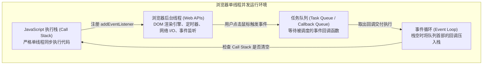
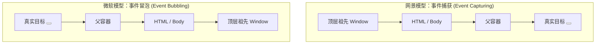

# Lec 14 事件（DOM Events & Event-Driven Architecture）

## TL;DR

- **宿主环境契约**：事件 API 并非 JavaScript 核心语言语法（ECMAScript）的固有组成部分，而是浏览器宿主环境依据 W3C DOM 标准暴露给开发者的核心 Web API，构成了现代 Web 界面与用户交互的事件驱动基石；
- **事件流三阶段传播**：事件在 DOM 树中经历“捕获阶段（从根向下渗透）$\to$ 目标阶段 $\to$ 冒泡阶段（从目标向上回弹）”，W3C 标准完美统合了网景与微软早期的历史分裂模型；
- **目标与当前上下文辨析**：`event.target` 指向触发物理事件的最底层深层叶子元素，而 `event.currentTarget`（在普通函数中等价于 `this`）严格指向当前正在执行监听回调的宿主容器；
- **事件委托与高级控制**：借助冒泡机制构建事件委托（Event Delegation），通过 `closest()` 优雅管理海量动态子节点，配合 `stopPropagation()`、`preventDefault()` 与 `AbortSignal` 打造高性能高韧性交互流。

---

## 1. 事件驱动编程模型：JavaScript 与浏览器的协作契约

许多初学者容易产生一个根本性误解，以为 `addEventListener`、点击、键盘按下是 JavaScript 语言自带的语法。

事实上，**事件 API 不是 JavaScript 语言本身的一部分（即不是 ECMAScript 语法语法糖），而是浏览器环境提供的一组用于与宿主环境、硬件外设及用户交互的底层 Web API**。



### 1.1 事件驱动范式（Event-Driven Paradigm）

传统的批处理程序是**流程控制主导的（Process-driven）**：从 `main()` 函数第一行开始，按照预设算法按部就班执行，直到最后一行终止退出。

而 Web 前端应用是纯粹的**事件驱动（Event-driven）**：
1. 页面加载完毕并执行初始化脚本后，主线程代码迅速执行完毕，进入静默空闲等待状态；
2. 系统将控制权交还给浏览器，等待用户做出动作（移动鼠标、敲击键盘、调整视口大小、网络包到达）；
3. 一旦物理事件发生，浏览器将事件打包为统一的 `Event` 实例对象，推入任务队列，等待主线程调用注册的回调函数（Callbacks）。

---

## 2. 事件监听机制的演进与现代 API

在 Web 发展史上，事件监听经历了三次重大范式更迭：

### 2.1 历史遗留反模式：HTML 内联与 DOM0

```html
<!-- 1. 远古反模式：HTML 内联事件（结构与行为严重耦合） -->
<button onclick="handleClick(event)">提交</button>

<!-- 2. DOM 0 级属性监听（单一覆盖缺陷） -->
<script>
  const btn = document.querySelector('button');
  btn.onclick = function() { console.log('Action A'); };
  
  // 后续代码或第三方脚本无意中覆写了该属性，Action A 被彻底抹除！
  btn.onclick = function() { console.log('Action B'); };
</script>
```

- **内联属性**使得展示结构（HTML）与业务逻辑（JS）强耦合，违反关注点分离，且存在潜在的 XSS 安全注入隐患；
- **DOM 0 级属性**（如 `element.onclick = fn`）只允许绑定唯一的单一函数，极易被项目内其他脚本静默覆盖破坏。

### 2.2 W3C DOM2 标准：`EventTarget.addEventListener`

现代 Web 统一采用事件目标接口规范：

::: definition `addEventListener` 完整语法契约
```javascript
target.addEventListener(type, listener, options);
```
- **`type`**：不区分大小写的事件类型字符串（如 `'click'`, `'input'`, `'keydown'`，注意绝无 `on` 前缀）；
- **`listener`**：事件触发时调用的回调函数（接收唯一的 `Event` 对象作为参数）；
- **`options`**：精细化控制事件行为的配置对象。
:::

#### 现代 `options` 配置参数深度剖析

```javascript
element.addEventListener('click', handler, {
  // 1. capture: 是否在捕获阶段执行（默认 false，即在冒泡阶段执行）
  capture: false,

  // 2. once: 执行一次后，浏览器自动将其从监听列表中安全注销（防止内存泄漏）
  once: true,

  // 3. passive: 声明该回调中绝对不会调用 event.preventDefault()
  // 关键性能优化：让移动端 touchmove / wheel 滚动直接在合成器线程渲染，杜绝卡顿！
  passive: true,

  // 4. signal: 允许通过 AbortSignal 实例一键批量取消事件监听
  signal: abortController.signal
});
```

::: insight 革命性的事件注销模式：AbortSignal
在过去，为了注销事件监听，你必须保留对原始函数的精确引用，并小心翼翼地调用 `removeEventListener('click', namedHandler)`。在处理匿名函数或组件销毁时极其容易遗漏导致**内存泄漏（Memory Leak）**。  
现代 Web 标准允许利用 `AbortController` 批量销毁：
```javascript
const controller = new AbortController();

window.addEventListener('resize', onResize, { signal: controller.signal });
window.addEventListener('scroll', onScroll, { signal: controller.signal });

// 当组件卸载或页面切换时，单行代码即可瞬间安全撤销所有关联监听：
controller.abort();
```
:::

---

## 3. DOM 事件流体系：捕获、目标与冒泡

在 1990 年代末的第一次浏览器大战中，Netscape 和 Microsoft 针锋相对地提出了两种完全截然相反的事件传播哲学：



- **Netscape 主张“从外到内”的捕获**：外层大容器首先感知到事件，随后向下逐层渗透递送至底层目标；
- **Microsoft 主张“从内到外”的冒泡**：物理碰撞发生在最底层的具体控件上，然后像气泡一样向水面上浮扩散。

### 3.1 W3C 标准事件流的三大完整阶段

W3C 标准委员会以极具智慧的折中方案统合了两者，确立了**现代全生命周期事件流模型**：

```mermaid
sequenceDiagram
    autonumber
    participant Win as Window
    participant Doc as Document
    participant Body as &lt;body&gt;
    participant Div as &lt;div id="container"&gt;
    participant Btn as &lt;button id="target"&gt;
    
    Note over Win,Btn: 【阶段一：捕获阶段 (Capture Phase)】
    Win->>Doc: 事件向下渗透传播
    Doc->>Body: 遍历祖先节点
    Body->>Div: 检查祖先上是否挂载 capture: true 监听器
    
    Note over Btn: 【阶段二：目标阶段 (Target Phase)】
    Div->>Btn: 事件精准到达目标节点本身
    
    Note over Btn,Win: 【阶段三：冒泡阶段 (Bubble Phase)】
    Btn->>Div: 事件向上传播回弹（默认监听执行阶段）
    Div->>Body: 向上冒泡通知祖先
    Body->>Doc: 冒泡到达文档
    Doc->>Win: 最终回弹至顶级对象
```

1. **捕获阶段（Capture Phase）**：事件从最顶层的 `Window` 出发，沿着 DOM 树深度优先向下穿透，直到到达目标元素的直接父级；
2. **目标阶段（Target Phase）**：事件抵达触发该动作的最底层具体 DOM 节点（如果该节点注册了监听，无论声明是捕获还是冒泡，均按注册顺序依次调用）；
3. **冒泡阶段（Bubble Phase）**：事件掉头原路向上回弹，逐层向上级祖先节点传播，直至重新到达 `Window`。绝大多数日常事件监听都工作在冒泡阶段。

> [!NOTE] 并非所有事件都会冒泡！
> 绝大多数用户交互事件（如 `click`, `input`, `keydown`）都会完整冒泡，但涉及元素个体状态切换的事件，如 `focus`、`blur`、`mouseenter`、`mouseleave` 以及媒体的 `load`、`unload` **默认不冒泡**。如果需要委托焦点，必须使用其对应会冒泡的等价事件：`focusin` 与 `focusout`。

---

## 4. 关键辨析：`event.target` vs. `event.currentTarget`

这是前端工程和人机交互中被混淆频率最高的一对核心概念。

::: definition `target` 与 `currentTarget` 的物理定义
- **`event.target`（事件源头 / 物理触发点）**：
  引发该事件的**最底层、最细粒度的 DOM 叶子节点**。用户鼠标究竟落在哪一个像素的元素上，`event.target` 就永远指向该元素；
- **`event.currentTarget`（当前处理者 / 逻辑容器）**：
  **当前正在执行该事件处理回调函数所属的那个 DOM 元素**。即是哪个元素调用了 `addEventListener`，在回调函数执行期间，`event.currentTarget` 就指向谁。
:::

### 场景推演与对比代码

```html
<ul id="todo-list">
  <li data-id="1">
    <span class="text">复习 MIT 6.4500 课程笔记</span>
    <button class="delete-btn">
      <svg class="icon"><path d="..."/></svg>
    </button>
  </li>
</ul>
```

假设我们将事件监听器绑定在顶级容器 `#todo-list` 上：

```javascript
document.getElementById('todo-list').addEventListener('click', function(event) {
  // 假设用户点击了垃圾桶图标内部的 <path> 路径：
  console.log(event.target);        // 输出: <path d="..."> (最底层的实际点击节点)
  console.log(event.currentTarget); // 输出: <ul id="todo-list"> (绑定监听器的父容器)
  console.log(this === event.currentTarget); // 输出: true (在非箭头函数中，this 恒等于 currentTarget)
});
```

---

## 5. 控制事件传播与默认行为

当事件沿着 DOM 树穿梭时，开发者拥有精确改变其物理轨迹的能力。

### 5.1 阻止事件向外扩散：`stopPropagation()`

```javascript
modalDialog.addEventListener('click', function(event) {
  // 阻止该点击事件向外部遮罩层 (Mask Backdrop) 冒泡
  // 防止点击对话框内部时误触发遮罩层的关闭行为
  event.stopPropagation();
});
```

::: pitfall `stopPropagation()` 与 `stopImmediatePropagation()` 的区别
- `event.stopPropagation()`：仅仅阻止事件继续向 DOM 树的上一级父元素（或下一级子元素）传播。**但如果当前同一个 DOM 元素上挂载了多个独立的 click 监听器，后续的兄弟监听器仍会被执行**；
- `event.stopImmediatePropagation()`：不仅阻止向其他 DOM 节点传播，还会**当场就地斩断当前节点后续尚未执行的其他监听器**，具有绝对的强制独占性。
:::

### 5.2 阻止浏览器默认行为：`preventDefault()`

许多 HTML 元素自身绑定了操作系统与浏览器赋予的默认行为：
- 点击 `<a>` 标签默认会触发页面跳转或锚点移动；
- 点击 `<button type="submit">` 会提交表单并刷新页面；
- 在页面上右键会弹出操作系统默认的上下文菜单；
- 敲击复选框 `<input type="checkbox">` 会切换勾选状态。

```javascript
// 拦截超链接的默认全页刷新跳转，改由前端路由 (SPA Router) 无缝加载
navLink.addEventListener('click', function(event) {
  event.preventDefault(); // 阻止浏览器向 href 地址发起物理网络 GET 请求
  history.pushState(null, '', this.href);
  renderPageContent(this.href);
});
```

> [!WARNING] `preventDefault()` 绝不会阻止事件的冒泡！
> `preventDefault()` 与 `stopPropagation()` 职责完全正交。调用 `preventDefault()` 只是告诉浏览器“不要执行你的原生动作”，事件该冒泡依然会浩浩荡荡向上层父容器冒泡传播！

---

## 6. 核心高级工程范式：事件委托（Event Delegation）

在工业级 Web 开发中，事件委托是性能优化与动态架构设计的核心基本功。

### 6.1 传统模式的性能灾难

假设你正在构建一个类似 Twitter 或微博的无限滚动信息流，页面上会源源不断加载 5,000 条帖子，每条帖子都有一个“点赞”按钮。

```javascript
// 极度业余的反模式：为 5000 个元素分别绑定独立的监听器
document.querySelectorAll('.like-btn').forEach(btn => {
  btn.addEventListener('click', handleLike);
});
```

- **内存消耗爆炸**：在 V8 引擎中，每个事件监听器、每个闭包上下文都会占用堆内存。5,000 个监听器会直接吃掉数兆内存；
- **动态更新瘫痪**：当通过 Ajax/Fetch 异步追加新加载的 20 条帖子时，新插入的 DOM 元素没有任何事件绑定，你必须再次手动调用绑定逻辑，代码极易出现漏网之鱼；
- **内存泄漏隐患**：当旧帖子被从 DOM 中移除时，若没有严格解绑监听器，极易引起游离 DOM 内存泄漏。

### 6.2 基于事件委托的高雅解法

利用**事件冒泡机制**，我们根本不需要在 5,000 个按钮上各自挂载监听器，只需在它们共同的父容器（例如 `<main class="feed">`）上**挂载唯一的单个监听器**！

```javascript
const feedContainer = document.querySelector('.feed');

feedContainer.addEventListener('click', function(event) {
  // 使用现代 DOM API Element.closest() 沿着 DOM 树自底向上匹配目标选择器
  const likeBtn = event.target.closest('.like-btn');

  // 如果点击发生在按钮外部，或者按钮不属于当前容器，则静默忽略
  if (!likeBtn || !feedContainer.contains(likeBtn)) {
    return;
  }

  // 成功捕获到点赞行为，读取帖子业务 ID 并更新状态
  const postId = likeBtn.dataset.postId;
  toggleLikeStatus(postId, likeBtn);
});
```

::: definition 现代事件委托的灵魂武器：`Element.closest()`
`target.closest(selector)` 从当前节点开始检查，如果匹配选择器则直接返回自身；否则逐级向上查询其父节点，返回第一个匹配指定 CSS 选择器的祖先元素；若一直查找到 `document` 仍未命中则返回 `null`。  
无论按钮内部嵌套了多少层复杂的 `<span>`、`<svg>` 或 `<path>`，`closest('.like-btn')` 都能穿透层层迷雾，百分之百精准定位到逻辑按钮本身！
:::

---

## 7. 组件解耦武器：自定义事件（Custom Events）

在复杂现代前端架构中，兄弟组件或不相干模块之间若直接调用彼此的内部方法，会导致严重的强耦合（Spaghetti Code）。

浏览器原生支持基于 **发布-订阅模型（Pub/Sub）** 的自定义事件分派机制：

```javascript
// 1. 购物车组件：触发业务维度的自定义事件，并将结构化数据塞入 detail 载荷
function dispatchCartUpdate(product, quantity) {
  const customEvent = new CustomEvent('shop:cart-add', {
    detail: {
      productId: product.id,
      productName: product.name,
      quantity: quantity,
      timestamp: Date.now()
    },
    bubbles: true,   // 允许该自定义事件沿着 DOM 树向上冒泡！
    composed: true   // 允许事件穿透 Web Components 的 Shadow DOM 边界！
  });

  document.dispatchEvent(customEvent);
}

// 2. 页面顶部的导航头徽标组件：独立监听业务事件并更新右上角数字徽章
document.addEventListener('shop:cart-add', function(event) {
  const { productName, quantity } = event.detail;
  updateBadgeCounter(quantity);
  showToastNotification(`已成功添加 ${quantity} 件 ${productName} 至购物车！`);
});
```

通过自定义事件，各独立模块只需面向事件协议契约编程，实现了彻底的架构级解耦。
