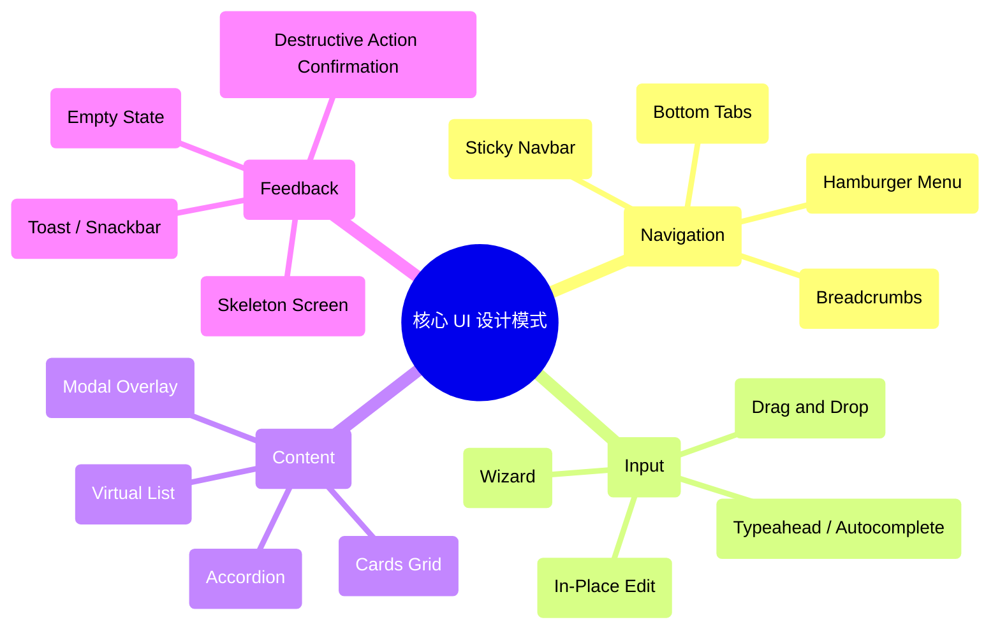
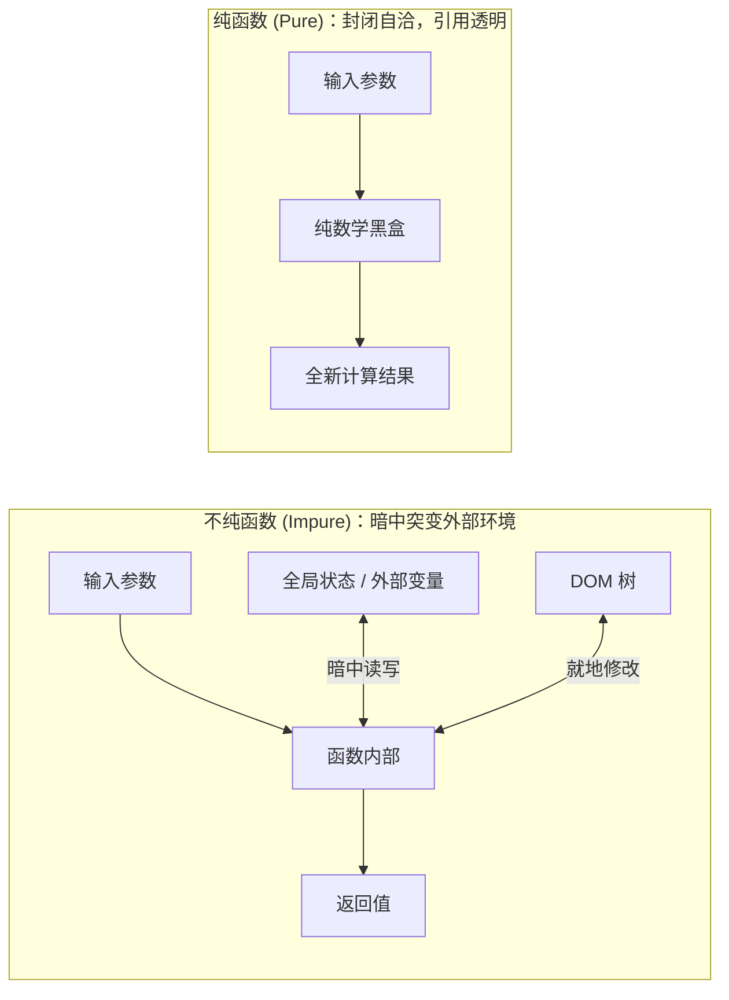

# Lec 15 设计模式与函数式 JavaScript（UI Patterns & Functional Programming）

## TL;DR

- **UI 模式沉淀成熟经验**：界面设计模式（UI Patterns）是针对常见交互场景反复验证的标准解决方案，复用成熟模式能够显著降低用户的学习成本，让团队将创新精力聚焦于核心业务差异化；
- **函数作为一等公民**：JavaScript 赋予函数一等公民（First-Class Citizens）地位，函数可作为变量赋值、作为形参传递并作为返回值交付，为高阶抽象提供了强大表达力；
- **纯函数与不可变性**：纯函数（Pure Functions）无副作用且具有引用透明性，配合不可变数据结构（Immutability），彻底杜绝由于多处引用就地突变（In-Place Mutation）引发的隐蔽状态 Bug；
- **声明式 UI 架构基石**：熟练运用 `map`、`filter` 与 `reduce` 构筑数据流水线，现代响应式框架（如 React 与 Vue）的核心公式 $UI = f(\text{State})$ 深刻印证了函数式范式在用户界面工程中的统治地位。

---

## 1. UI 设计模式的价值与雅各布定律

什么是设计模式（Design Patterns）？

设计本质上是在浩瀚的解空间中寻找合理的解决方案。缺乏经验的设计师经常在常见问题上反复折腾，花费大量的精力重复造轮子，甚至把历史上已经被证伪的低级错误原封不动地重新发明一遍。

### 1.1 为什么要使用设计模式？

1. **构思全新且无瑕疵的解决方案是极其困难的**：任何看似简单的交互控件（如模态框、轮播图、标签页、筛选器），在边缘状态、键盘导航、无障碍读屏和移动端触控上都隐藏着大量细微的陷阱；
2. **将创新保留在真正重要的地方（Don't Reinvent the Wheel）**：产品的核心竞争力在于独特的领域业务逻辑，而不是在“翻页按钮该长什么样”上特立独行；
3. **经过大规模真实用户测试的检验**：大多数主流设计模式来自科技行业巨头（Google Material Design、Apple HIG 等），它们投入了成百上千万美元进行眼动实验和 A/B 测试，其有效性具备充分的实证数据支撑。

### 1.2 雅各布定律（Jakob's Law）与可学习性

::: definition 雅各布定律（Jakob's Law of Internet User Experience）
用户将绝大多数时间花费在**其他网站**上。这意味着用户早已在成千上万个日常网站中建立起极其固化的心理预期和交互肌肉记忆。如果你的网站遵循相同的模式，用户无需学习即可直接上手（Instant Learnability）；反之，违背惯例的独特设计会迫使唤醒认知重担，招致挫败与流失。
:::

---

## 2. 常见核心 UI 界面模式谱系



### 2.1 经典交互模式案例

- **面包屑导航（Breadcrumbs）**：显化当前页面在全站信息架构（IA）中的层次纵深，为深度页面提供即时向上一级的跳跃锚点；
- **分步向导（Wizard）**：面对极为庞大繁复的录入任务（如贷款申请、税务申报），将其拆解为线性编号的微小步骤，每次只聚焦一个主题，大幅降低用户认知过载；
- **原地编辑（In-Place Edit）**：在仪表盘或待办列表中，点击文本即刻就地变为输入框，保存后自动恢复静态排版，消除从列表跳转到详情页再返回的低效往返。

---

## 3. UI 模式推荐学习资源

- [UI Patterns](https://ui-patterns.com/patterns)：按用户目标和交互问题分类的详尽设计模式库与案例剖析；
- [UX Library - Patterns & Inspiration](https://www.uxlibrary.org/explore/ui-design/ui-patterns-and-inspiration)：汇总全球顶尖产品设计规范与模式案例的综合导航；
- [Interaction Design Foundation - UI Design Patterns](http://www.interaction-design.org/)：深度学术与工程结合的交互设计模式理论文献。

---

## 4. 函数式 JavaScript：编写无副作用的高韧性代码

如果说 UI 设计模式解决了**“界面外观与交互行为的外部复用”**，那么函数式编程（Functional Programming, FP）则解决了**“处理界面数据与状态流转时的内部可控性”**。

在传统的**命令式编程（Imperative Programming）**中，代码充斥着显式循环、临时索引变量和就地突变。随着交互复杂度上升，散落在各个事件回调中的状态突变会导致“状态难以追踪、并发竞态频发、单测极度困难”。函数式编程通过声明式原则为 Web UI 开发带来了工程救赎。

### 4.1 函数是一等公民（First-Class Citizens）

在 JavaScript 中，函数与数字、字符串、普通对象具有完全相同的语法地位：
- 可以将函数存储在变量或对象属性中；
- 可以将函数作为参数传递给另一个函数；
- 可以从函数中返回一个新函数。

```javascript
// 1. 函数赋值给变量
const double = x => x * 2;

// 2. 函数作为参数传递（高阶函数）
function applyTransform(data, transformer) {
  return transformer(data);
}
console.log(applyTransform(21, double)); // 42

// 3. 函数作为返回值（函数工厂模式）
function createMultiplier(multiplier) {
  return function(value) {
    return value * multiplier;
  };
}
const triple = createMultiplier(3);
console.log(triple(10)); // 30
```

---

## 5. 纯函数（Pure Functions）与引用透明性

::: definition 纯函数（Pure Function）的两大数学契约
1. **相同输入必产生相同输出（Deterministic）**：函数执行的结果仅仅取决于其显式传入的形参，不依赖任何外部全局变量、当前时间戳（`Date.now()`）或随机数（`Math.random()`）；
2. **绝无任何副作用（No Side Effects）**：函数在执行过程中，**绝对不修改外部传入的参数**，不修改任何外部作用域变量，不向网络发包，不向控制台打印，也不向 DOM 发起物理写入。
:::



### 5.1 纯与不纯的现实代码对比

```javascript
// ❌ 不纯的反面教材：就地突变传入的对象，产生极其隐蔽的幽灵 Bug
let currentTaxRate = 0.08;

function calculateTotal(cartItem) {
  // 副作用 1：读取了可变的全局状态 currentTaxRate
  // 副作用 2：直接在传入的原始对象上修改属性！调用者原本的数据被悄悄破坏！
  cartItem.priceWithTax = cartItem.price * (1 + currentTaxRate);
  return cartItem.priceWithTax;
}

// ✅ 优雅的纯函数：输入什么计算什么，返回一个全新的派生结果
function calculateItemTotal(price, taxRate) {
  return Number((price * (1 + taxRate)).toFixed(2));
}
```

::: insight 纯函数的巨大工程红利
1. **单元测试极致简单**：纯函数测试无需 mock 任何 DOM、无需搭建复杂的全局环境，只需要 `expect(fn(input)).toBe(expected)`；
2. **可缓存性（Memoization）**：因为相同输入必产生相同输出，可以安全地将历史计算结果以哈希表缓存起来，大幅度提升前端密集计算性能；
3. **并发安全与无竞态**：纯函数不共享可变状态，永远免疫多线程或异步交错执行时的数据污染。
:::

---

## 6. 不可变性（Immutability）：杜绝就地突变

在 JavaScript 中，原始类型（Number, String, Boolean）天生不可变，而对象和数组是通过**堆内存引用（Reference）**传递的。

### 6.1 传统突变灾难与现代浅拷贝

```javascript
// 假设用户购物车列表
const cart = [
  { id: 1, name: '机械键盘', price: 599 },
  { id: 2, name: '人体工学椅', price: 1299 }
];

// ❌ 传统命令式突变：直接修改原数组
cart.push({ id: 3, name: '显示器挂灯', price: 199 }); // 原数组被篡改

// ✅ 现代函数式不可变性：使用展开操作符（Spread）创建全新快照
const updatedCart = [
  ...cart,
  { id: 3, name: '显示器挂灯', price: 199 }
];

// 过滤删除项目：使用 filter 返回新数组，原 cart 纹丝不动
const filteredCart = cart.filter(item => item.id !== 1);

// 修改项目属性：使用 map 映射生成全新引用
const discountedCart = cart.map(item => {
  if (item.id === 2) {
    return { ...item, price: item.price * 0.9 }; // 仅对目标对象展开并覆盖价格
  }
  return item;
});
```

现代 ECMAScript 2023+ 原生引入了不可变数组操作原语：
- `arr.toSorted()` 代替原位排序 `arr.sort()`；
- `arr.toReversed()` 代替原位翻转 `arr.reverse()`；
- `arr.toSpliced()` 代替原位切片替换 `arr.splice()`。

---

## 7. 声明式数据处理流水线：`map`、`filter` 与 `reduce`

函数式编程提倡用高阶函数组合取代传统的 `for` 循环，代码表达意图而非具体的迭代机械步骤。

```javascript
// 模拟一组从后端 Web API 获取的学生作业数据
const submissions = [
  { student: 'Alice', score: 92, submitted: true },
  { student: 'Bob', score: 58, submitted: true },
  { student: 'Charlie', score: 0, submitted: false },
  { student: 'Diana', score: 85, submitted: true },
  { student: 'Evan', score: 76, submitted: true }
];

// 业务需求：求所有已提交作业且及格（>=60）学生的平均分
const averageScore = submissions
  // 1. 过滤：只保留已提交且及格的记录
  .filter(sub => sub.submitted && sub.score >= 60)
  // 2. 映射：只提取分数数值
  .map(sub => sub.score)
  // 3. 规约：累加求和
  .reduce((sum, score, index, array) => {
    sum += score;
    // 当到达最后一个元素时，直接除以长度求出均值
    if (index === array.length - 1) {
      return sum / array.length;
    }
    return sum;
  }, 0);

console.log('及格学生平均分:', averageScore); // 84.33
```

---

## 8. 终极融合：函数式思想如何重塑现代 UI 架构

为什么现代主流 Web 前端框架（React, Vue 3, Svelte）集体倒向了函数式思维？

因为在图形界面演进几十年后，工程师们终于发现了一个数学级的优雅架构模型：

$$\text{UI} = f(\text{State})$$

- **状态（State）** 是唯一的真理来源（Single Source of Truth）；
- **用户界面（UI）** 是状态经过纯函数变换后映射出的确定性视觉呈现；
- 当用户触发点击事件时，程序不应去命令式地直接操纵 DOM 节点（“找到第 3 个 li，把它颜色改成红色”）；
- 程序唯一要做的，就是**以不可变的方式生成一个全新的 State**；
- 框架的响应式运行时（Reactive Runtime）接收到新 State 后，自动调用渲染纯函数，高效差量更新真实视图。

通过将 UI 设计模式的交互智慧，与函数式 JavaScript 的纯粹可控性融为一体，现代 Web 工程师得以在极高复杂度的工程中构建出既让用户感到流畅易用、又让代码保持坚固可测的大型数字产品。
