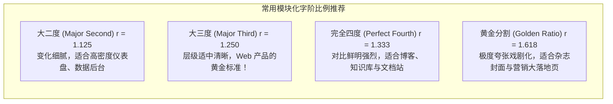
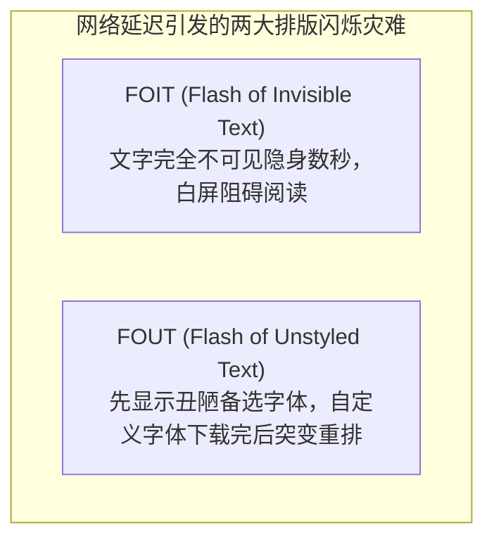

# Lec 17 字体与 Web 排版（Typography & Readability）

## TL;DR

- **字体心理学与语境匹配**：字体不仅是字符的视觉容器，更能传递鲜明的语气、情感与品牌信任感，字体的选用必须严格服务于内容情境与任务严肃度，杜绝轻浮的无序混搭；
- **模块化字阶与视觉层级**：通过数学比例（如大三度 1.25 或完全四度 1.333）构建系统的模块化字阶（Modular Type Scale），配合字重与灰度反差，建立一眼可辨的清晰信息骨架；
- **舒适阅读的几何铁律**：正文行距维持在 1.5–1.7 之间，遵循“字号越大行距比例越收紧”的倒数法则，将单行字符数严格限制在 45–75 个西文字符（或 25–40 个中文字符）的舒适扫描区间；
- **现代响应式排版工程**：运用 CSS `clamp()` 建立平滑缩放的流式字阶（Fluid Typography），配合 `@font-face` 与 `font-display: swap` 消除 FOIT 闪烁，兼顾视觉优雅与极速首屏性能。

---

## 1. Web 排版要素全景

Web 排版（Typography）不是纸质印刷在显示器上的简单像素映射，它是**信息传达的物理介质与阅读心流的基础设施**。

优秀的排版能够让成千上万字的复杂技术内容变得清晰、可扫读、呼吸顺畅；而糟糕的排版会瞬间耗尽读者的眼部肌肉与短期工作记忆。

系统化的 Web 排版包含以下核心要素：
- **字体族系（Typeface Family）、样式与字重（Font Weight）**
- **字号尺度（Type Scale）与数学比例系统**
- **字距（Letter-spacing）、行距（Line-height）与段间距**
- **视觉层级（Visual Hierarchy）与结构骨架**
- **行长（Measure / Line Length）与阅读舒适带**
- **色彩、灰度与对比度（WCAG 文本对比合规）**
- **流式响应式排版（Responsive & Fluid Typography）**

---

## 2. 字体种类与字体心理学（Typeface Psychology）

字体种类繁多，每一种字体都能在其笔画转折、衬线末端与几何比例中唤起独特的形容词和心理情感。


### 2.1 经典字体大类与适用语境

| 字体大类 | 视觉特征与代表字体 | 唤起的心理感知 | 最佳应用场景 |
| :--- | :--- | :--- | :--- |
| **衬线体（Serif）** | 笔画末端有装饰性衬线脚，粗细变化丰富。<br>如 *Times New Roman*, *Georgia*, *思源宋体* | 经典、严谨、权威、传统、文学沉淀 | 长篇学术论文、严肃新闻长文、文学小说阅读 |
| **无衬线体（Sans-Serif）** | 笔画粗细均一，无额外衬线修饰，现代干练。<br>如 *Inter*, *Helvetica*, *Roboto*, *思源黑体* | 现代、干净、中立、高效、易读 | Web UI 界面控件、移动端应用、仪表盘、代码注释 |
| **等宽体（Monospace）** | 每个字符（包括字母 `i` 与 `m`）水平宽度严格相等。<br>如 *Fira Code*, *JetBrains Mono*, *Courier* | 严谨、机械、精确、代码感、终端复古 | 代码展示、终端控制台输出、精密数据对齐表格 |
| **展示/手写体（Display / Script）** | 艺术风格极强，笔画夸张或高度模拟手写。<br>如 *Comic Sans*, *Lobster*, *Pacifico* | 活泼、童趣、个性、强烈情绪 | 极简海报标题、儿童软件（**严禁用于正文大段阅读**） |

### 2.2 反面教材：Comic Sans 的语境灾难

通常，只有看到字体使用不当的例子，才能更好地理解使用合适字体的重要性。

Comic Sans 可能是数字设计史上最被滥用的字体，而大规模的误用正是其主要原因之一。Comic Sans 的设计初衷是营造一种轻松随意的氛围（事实上，它最初是微软为 Microsoft Bob 软件中面向低龄用户的卡通助手对话框而专门定制的）。

然而在过去几十年中，人们荒谬地将其用于医院癌症确诊告知书、法庭判决书、政府官方通告乃至严肃学术答辩等极其庄重的场合。这种**字体气质与文本严肃度之间的巨大心理脱节**，会瞬间摧毁用户的信任感与专业认知。

---

## 3. 模块化字阶（Modular Type Scales）与层级构建

初学者在设置字体大小时，常常随心所欲地随意填写数字：比如标题写 `23px`，副标题写 `19px`，正文写 `14px`。这种毫无数学逻辑的孤立数值会导致界面视觉节奏混乱不堪。

专业排版系统必须基于 **模块化字阶（Modular Type Scale）** 构建。

::: definition 模块化字阶（Modular Type Scale）
从一个基准字号（Base Size，Web 上通常为浏览器的默认 $16\text{px}$）出发，**乘以一个固定的数学比例常数（Ratio: $r$）**，以几何级数连续向上递增生成各级标题，向下递减生成辅助微小文字。
:::

$$S_n = S_{\text{base}} \times r^n \quad (n \in \mathbb{Z})$$



### 3.1 基于大三度（1.25）的标准字阶实战

以基准字号 $16\text{px}$（`1rem`）为例：
- `Caption / Small` ($n = -1$)：$16 \div 1.25 = 12.8\text{px}$ $\to$ `0.8rem`
- **`Body / Base` ($n = 0$)：$16\text{px}$ $\to$ `1rem`（正文基准）**
- `H4` ($n = 1$)：$16 \times 1.25 = 20\text{px}$ $\to$ `1.25rem`
- `H3` ($n = 2$)：$20 \times 1.25 = 25\text{px}$ $\to$ `1.563rem`
- `H2` ($n = 3$)：$25 \times 1.25 = 31.25\text{px}$ $\to$ `1.953rem`
- `H1` ($n = 4$)：$31.25 \times 1.25 = 39.06\text{px}$ $\to$ `2.441rem`

遵循统一的几何倍率，能让全站的视觉大小变化呈现出浑然天成的音乐韵律感。

---

## 4. 舒适阅读的物理几何：行距、行长与垂直韵律

### 4.1 行距的倒数法则（The Inverse Rule of Line Height）

在 CSS 中，行高应当始终声明为**无单位数值（Unitless Number）**（如 `line-height: 1.5;`），它代表当前字号的纯倍数，能被子元素按自身字号优雅继承。

::: theorem 行高与字号的反比倒数法则
- **正文字体（14px - 18px）**：字号较小，为了防止读者的视线在换行扫描时“串行”，行间距必须宽松，推荐值为 **`1.5` 到 `1.7`**；
- **大标题（32px - 64px）**：由于文字物理尺寸巨大，笔画本身占据了很高的垂直空间。若仍套用 1.5 倍行高，标题行与行之间会产生巨大的空白沟壑，失去视觉凝聚力。因此标题行高必须大幅收紧，推荐值为 **`1.1` 到 `1.25`**。
:::

### 4.2 行长（Measure / Line Length）与阅读舒适带

::: definition 最优行长法则
- **西文字符**：单行文本长度应严格控制在 **45 到 75 个字符（Characters Per Line, CPL）**，66 个字符被视为黄金理想值；
- **中文字符**：单行汉字应控制在 **25 到 40 个字** 之间。
:::

```css
/* 工业级正文舒适行宽约束 */
.article-body {
  /* 使用 ch 字符宽度单位或 max-width 约束居中 */
  max-width: 68ch;
  margin-inline: auto;
  line-height: 1.65;
  font-size: 1.125rem;
}
```

- **行长过长（> 90 字符）**：读者读完漫长的一行后，视线从右端大幅度回跳到左端时，极易迷失落点，跳到上一行或下一行（视觉追踪疲劳）；
- **行长过短（< 35 字符）**：视线刚启动就不得不频繁换行，破坏完整的语法语义停顿与思维心流。

---

## 5. 字体配对与视觉层级黄金法则

在同一个 Web 应用中，**严禁使用超过 2 种字体家族**！

### 5.1 经典的配对范式
1. **单一全能字体家族（Single Superfamily）**：
   - 整个网站只加载一套具备丰富字重（300, 400, 500, 600, 700）与斜体的优质现代无衬线体（如 Inter, Roboto）；
   - **完全依靠字号大小、字重粗细（400 正文 vs 700 标题）以及色彩对比（标题纯黑 `#111` vs 正文深灰 `#374151` vs 辅助浅灰 `#6b7280`）拉开无与伦比的清晰层级**；
2. **经典的“衬线标题 + 无衬线正文”组合**：
   - 标题采用优雅有质感的衬线体（如 Playfair Display, Merriweather），营造人文氛围；
   - 正文与 UI 控件采用高可读性的无衬线体（如 Open Sans, Inter），确保长时间屏幕阅读不伤眼。

---

## 6. 现代响应式流式排版（Fluid Typography）

在过去，为了让标题在手机端变小、在宽屏桌面端变大，前端需要编写成堆的媒体查询断点（Media Queries）：

```css
/* 脆弱的断点阶梯跳变写法 */
h1 { font-size: 24px; }
@media (min-width: 768px) { h1 { font-size: 32px; } }
@media (min-width: 1200px) { h1 { font-size: 48px; } }
```

这种做法在断点临界处会导致字体突兀地“跳跃”，且难以适配平板或折叠屏等任意尺寸。

现代 CSS 提供了数学原语 **`clamp(MIN, VAL, MAX)`**，实现了字号随视口宽度（`vw`）平滑线性缩放的**流式排版（Fluid Typography）**：

```css
:root {
  /* 
   * 当视口极窄时，保持最小保底 1.75rem (28px)；
   * 当视口在 400px 到 1200px 之间时，跟随视口宽度动态线性伸缩；
   * 当视口极宽时，锁定最大上限 3.25rem (52px)，杜绝超宽屏文字过大爆炸！
   */
  --font-h1: clamp(1.75rem, 1rem + 2.5vw, 3.25rem);
  --font-body: clamp(1rem, 0.95rem + 0.25vw, 1.125rem);
}

h1 {
  font-size: var(--font-h1);
  line-height: 1.15;
}
p {
  font-size: var(--font-body);
  line-height: 1.6;
}
```

---

## 7. Web 字体加载性能优化（Web Font Performance）

自定义 Web 字体（Web Fonts, `.woff2`）通常体积达到几十至上百 KB，加载延迟极易引发致命的排版闪烁：



### 7.1 最优加载工程准则

```html
<!-- 1. 在 <head> 中对关键首屏字体执行预加载（Preload） -->
<link rel="preload" href="/fonts/inter-latin-var.woff2" as="font" type="font/woff2" crossorigin>
```

```css
/* 2. 声明 font-display: swap 策略 */
@font-face {
  font-family: 'Inter';
  src: url('/fonts/inter-latin-var.woff2') format('woff2');
  font-weight: 100 900;
  font-style: normal;
  /* 
   * swap 策略：在字体下载期间，立刻使用系统默认无衬线体渲染文本（保证可读！）；
   * 一旦自定义字体下载完毕，平滑替换，彻底终结长时间白屏隐身的 FOIT 灾难！
   */
  font-display: swap;
}
```
