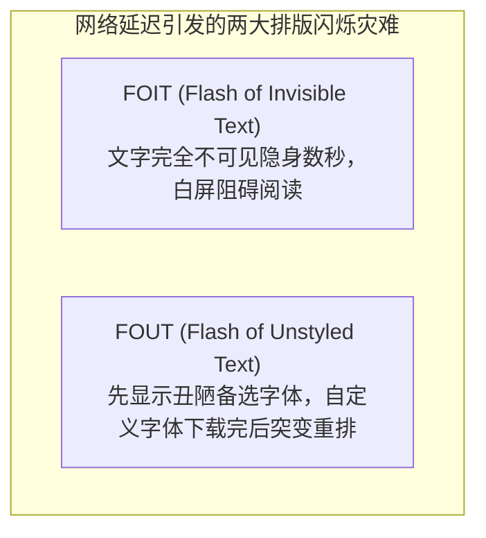

# Lec 17 排版（Typography）

排版（*Typography*）的任务就是将庞大的信息材料进行划分、组织和阐释，使得读者有很好的机会从中找到自己感兴趣的内容。

*Web Design is 95% Typography* -- ia.net

## TL;DR

- **字体心理学与语境匹配**：字体不仅是字符的视觉容器，更能传递鲜明的语气、情感与品牌信任感，字体的选用必须严格服务于内容情境与任务严肃度，杜绝轻浮的无序混搭；
- **推荐工具和网站**
  - **[v-fonts.com](https://v-fonts.com/)** 是设计师和前端开发者最常用的可变字体在线资源库与交互测试平台
- **舒适阅读的几何铁律**：用可变字体，空间占用小； line height 1. 5 ～ 2 之间；要视觉平衡，就把大号文字调细一点，把小号文字调粗一点；将单行字符数严格限制在 80 个西文字符（或 中文，则不应超过 40 个）
- **现代响应式排版工程**：运用 CSS `clamp()` 建立平滑缩放的流式字阶，配合 `@font-face` 与 `font-display: swap` 消除 FOIT 闪烁，兼顾视觉优雅与极速首屏性能。


## 课程组织

- 字体（*typeface*）与字型（*font*）， 样式（*style*）、字重（*weight*）
- 字号（*size*）
- 段落、行与字符间距
- 层级与结构
- 对齐（*alignment*）与布局
- 色彩与对比度（*contrast*）
- 响应式排版


## 一、字体

字体的设计本身具有意义，而不仅仅是装饰。每一种字体都有其独特的个性和用途。当其设计与所要传达的信息相契合时，它能增强沟通效果；而当使用不当时，它则会与信息背道而驰——往好了说是显得滑稽，往坏了说则令人感到不安。

字体有不同的类别，每一种都会唤起不同的形容词和情感。你可以阅读有关“字体心理学”的资料以了解更多这方面的内容。

### 1.1 字体大类与适用语境


> [!NOTE]
> 字体分类与心理感知
>
> 读者受字体影响的心理反应主要分为三层：**Feelings（感受）**、**Emotions（情绪）** 与 **Associations（联想）**。下表为五大主要类别、性格关键词与代表字体对照：
>
> | 字体大类 | 视觉特征与气质 | 性格关键词（心理感知） | 代表字体示例 |
> | :--- | :--- | :--- | :--- |
> | **SERIF（衬线体）** | 笔画末端有装饰性细节，经典、正式 | 传统（Tradition）<br>体面 / 值得尊敬（Respectable）<br>可靠（Reliable）<br>舒适（Comfort） | *Times New Roman*<br>*Trajan*<br>*Baskerville*<br>*Georgia Italic* |
> | **SANS SERIF（无衬线体）** | 没有多余装饰，简洁、现代、直接 | 稳重（Stability）<br>客观（Objective）<br>干净（Clean）<br>现代（Modern） | *Helvetica Bold*<br>*Franklin Gothic*<br>*Calibri*<br>*Myriad Italic* |
> | **SCRIPT（手写 / 书法体）** | 模仿手写笔迹，富有流畅感与艺术气息 | 优雅（Elegance）<br>深情 / 亲切（Affectionate）<br>创造力（Creativity） | *Bickham Script*<br>*Edwardian Script*<br>*Lavanderia* |
> | **MODERN（现代体）** | 几何与高对比风格，设计感强、前卫、具视觉冲击力 | 强有力（Strong）<br>前卫 / 进步（Progressive）<br>时尚（Stylish）<br>别致 / 潇洒（Chic） | *Futura*<br>*ITC Avant Garde Extra Light*<br>*Didot Italic*<br>*Century Gothic* |
> | **DISPLAY（展示 / 装饰体）** | 造型独特夸张，通常用于大标题，极富表现力 | 友好（Friendly）<br>独特（Unique）<br>富有表现力（Expressive）<br>有趣 / 俏皮（Amusing） | *Cooper*<br>*Spaceage Round*<br>*Valencia*<br>*Giddyup* |

### 1.2 反面教材

通常，人们在看到正确使用字体的原则被严重违背的案例时，才能更好地理解使用合适字体的重要性。


case 1: 官方机构（如警察局、医院、法院）在发布声明或指南时，通常需要借助中性、稳重、结构严谨的无衬线体（如 Helvetica、Arial、Frutiger）或衬线体（如 Times New Roman）来建立专业、可靠、值得信赖的形象。过于随意的圆润手写体消解了公文应有的庄重感，容易让受众在潜意识里质疑信息的正式程度与机构的专业水准。


Case 2: 2012 年 7 月 4 日，CERN 召开全球瞩目的新闻发布会，宣布发现了物理学界苦寻半个世纪的**希格斯玻色子（Higgs Boson）**。这是人类科学史上的里程碑时刻，耗资数十亿美元的大型强子对撞机（LHC）正是为此而建。使用了“臭名昭著”的 Comic Sans 字体。原本代表人类智慧巅峰、极其精密严谨的粒子物理学突破，在屏幕上一瞬间变得像**小学五年级的科学手抄报**。


### 1.3 衬线 vs. 无衬线


“serif（衬线）”字体是指带有衬线的字体，**历史更悠久，更具正式感**。

而“sans-serif（无衬线）”字体则是指没有衬线的字体（注：“sans”在法语中意为“无/没有”）， 兴起于 1920 年代及以后，更具**现代感**。


> 衬线字体更容易阅读吗？

不是！ 现有证据并未显示两者在易读性上有任何差异。

> 读者偏好呢？

早期研究发现读者更偏好衬线字体。 **近期研究表明，用户在线阅读正文时更偏好无衬线字体。** **在几乎所有研究中，读者的偏好或主观感知的易读性与实际阅读表现并不一致。**


华盛顿邮报新闻标题采用经典的**衬线体**（传递权威与传统新闻感），而下方的文章摘要和正文则采用简洁的**无衬线体**（提升屏幕阅读体验)。

相反，A List Apart 采用现代利落的**无衬线体**，而下方的正文段落则采用经典易读的**衬线体**，形成与上一页相反的经典搭配。


### 1.4 字重、字形


## 二、字体技术

```css
/*css加载自定义网络字体*/
font-family: Arvo;          /* 自定义字体名称为 Arvo */
  src: url(fonts/s.woff);     /* 字体文件的服务器路径 */
  font-weight: bold;          /* 指定该文件对应的字重为粗体 */
}

h1 {
  font-family: Arvo, sans-serif; /* 一级标题优先使用 Arvo，若加载失败则降级为无衬线体 */
  font-weight: bold;             /* 设置粗体 */
}
```


| **扩展名（Extension）**   | **说明**                                                     |
| ------------------------- | ------------------------------------------------------------ |
| **`\*.woff`, `\*.woff2`** | **Web 开放字体格式文件（Web Open Font Format file）**：专为网络设计的压缩字体文件。可用时应优先选用。WOFF 2 提供更好的压缩率。 |
| **`\*.otf`, `\*.ttf`**    | **字体文件（Font files）**：`*.otf` 是 OpenType 格式，`*.ttf` 是 TrueType 格式（OpenType 的一个子集）。 |
| **`\*.otc`, `\*.ttc`**    | **OpenType/TrueType 字体合集**：将多个字面（字重/样式）打包在同一个文件中。目前 `@font-face` 尚不支持，但已有相关支持计划。 |
| **`\*.eot`**              | **嵌入式 OpenType 文件（Embedded OpenType file）**：较老旧的格式，专为 IE 浏览器设计。具有历史意义，但在今天已无实际用途。 |


### 2.1 字符

字符（*Character*）是书面语言中具有语义价值的最小组成部分。字符本质上是编码点（codepoints）。
字形（*Glyph*）是是字符的具体形状、设计或视觉呈现形式。


### 2.2 连字

连字（ligature） (`/ˈlɪgəʧʊə/`)
n.（名词） 将多个字符连接组合为一个字形，以形成更具美感的形态。

(注：图中的音标 /ˈlɪɡətʃʊə/ 中的 tʃ 就正好展示了一个连字字形的例子！)

在阿拉伯语和乌尔都语等某些语言中，字母的形状必须根据相邻字符进行变化。
**OpenType**是用于改善排版的替代字形规则。
其特性有： 每个特性均由一个四字母名称标识（例如 liga、dlig、frac 等）(注：liga 代表标准连字，dlig 代表自由/装饰性连字，frac 代表分数格式)，字形替换规则通过代码进行描述，并直接编译进字体文件中。

```css
feature liga {
    sub f f i by f_f_i;   /* 将连续的 f f i 替换为连字字形 f_f_i */
    sub f i by f_i;       /* 将连续的 f i 替换为连字字形 f_i */
} liga;
```


### 2.3 标点符号

**使用规范的引号**：“”，而不是 ""（使用弯引号，而非直引号）

**使用规范的破折号与连字符**：

- **连字符（hyphens, `-`）**：用于复合词，例如 `"well-being"`（幸福/健康）
- **短破折号（en dashes, `–`）**：用于表示范围（如时间、数字区间）
- **长破折号（em dashes, `—`）**：用于在句子结构中制造强烈的语义停顿或转折


### 2.4 可变字体

*在数字字体刚起步时，每个字符都是由位图（bitmap）构成的，因此每一个字号都必须单独绘制。如果你强行放大某个字符，而不是使用专门为大字号绘制的版本，就会看到明显的像素颗粒。这迫使字体设计师不得不做海量的重复劳动；而如果你需要一个未被预先绘制的字号，那就只能自认倒霉了。*

*矢量字体（Vector fonts）是一场革命：设计师只需绘制一套图形轮廓，字符就能在任何字号下都保持极高的清晰度。*

*可变字体（Variable fonts）则是一场类似的革命——它将原本离散、需要分别绘制并独立存储的字重与字宽样式，整合进了一个单一、灵活的字体设计之中*


在传统静态字体时代，完整引入这样一个包含不同字宽和字重组合的字体家族，需要加载多达 37 个独立的字体文件。37 个文件，每个约 ~45KB（总计 1.5 MB），是离散的设计空间。

使用可变字体，只需要1 个文件，沿设计轴（design axes）进行插值计算，每条轴约 ~90KB（总计 180 KB），连续的设计空间。在可变字体中，“Deltas（增量）”指的是字形轮廓上各个锚点从默认状态向极值状态移动的坐标偏移量；当沿着“字重轴”调节粗细时，系统正是根据这些预设的锚点位移增量实时插值计算出新的轮廓形态。


已注册的可变轴：

| 轴标签（Axis tag） | 名称                                    | CSS 描述符/属性（Descriptor/Property） |
| ------------------ | --------------------------------------- | -------------------------------------- |
| **`ital`**         | **意大利斜体**（Italic）                | `font-style`                           |
| **`opsz`**         | **视觉字号 / 光学尺寸**（Optical size） | `font-optical-sizing`                  |
| **`slnt`**         | **倾斜度**（Slant）                     | `font-style`                           |
| **`wdth`**         | **字宽**（Width）                       | `font-stretch`                         |
| **`wght`**         | **字重**（Weight）                      | `font-weight`                          |

除了常见的字重 `wght` 外，Dunbar 可变字体最著名的特色是拥有自定义的可变轴——**x 高度（x-height）**，可以让小写字母的 x 高度在矮胖的文本体与高挑的展示体之间平滑过渡。


举个例子

```css
@font-face {
  font-family: "Dunbar";           /* 定义字体名称为 "Dunbar" */
  src: url("dunbar.otf");          /* 引入单一可变字体文件 */
  font-weight: 100 900;            /* 声明支持的字重范围：100 到 900 */
  font-stretch: 50% 200%;          /* 声明支持的字宽范围：50% 到 200% */
  font-style: -10deg 40deg;        /* 声明支持的倾斜角度范围：-10度 到 40度 */
}

h1 {
  font-weight: 234;                /* 设置精确的自定义字重数值：234 */
  font-stretch: 80%;               /* 设置字宽压缩至 80% */
  font-style: oblique 24deg;       /* 设置向右倾斜 24 度 */
}
```


🔥 **如果你想让不同字号的文字在视觉上\*感觉\*粗细一致，就把大号文字调细一点，把小号文字调粗一点。**


*通常情况下，专业字体都会为小型大写字母（small caps）、上标（superscripts）和下标（subscripts）专门绘制独立字形。这些字形并不仅仅是常规字形的简单缩小版（简单缩小只需调整字号即可），而是经过专门设计、拥有相对更粗笔画的字形，以便与正常大小的主体文字搭配时看起来协调统一。*

*如果字体没有提供这类专用字形，而我们仅仅通过调小字号（如这里把 `<abbr>` 设为 `80%`、把 `<sup>` 设为 `50%`）来生硬模拟小型大写字母和上标，排版效果就会显得非常草率——因为字号缩放会导致它们的笔画粗细变得极不均匀（例如 `[citation needed]` 显得过细发虚）。而可变字重字体（Variable weight fonts）同样可以帮助我们完美解决这一问题（只需单独提高缩略词和上标的 `font-weight` 即可）。*


```html
<p><abbr>MIT</abbr>, Cambridge, <abbr>MA</abbr>
<p><abbr>SQL</abbr> is awesome <sup>[citation needed]</sup></p>
```

```css
p {
  font: 300 300%/.9 Drive, sans-serif;
}

abbr {
  font-size: 80%;
  font-weight: 380; /* 缩小到 80% 后，把字重从 300 适当加粗到 ~380 */
}

sup {
  font-size: 50%;
  font-weight: 500; /* 缩小到 50% 后，需要更大幅度加粗（如 500 左右）来补偿变细的笔画 */
}
```


**[v-fonts.com](https://v-fonts.com/)** 是设计师和前端开发者最常用的**可变字体（Variable Fonts）在线资源库与交互测试平台**，


### 2.5 多色字体


## 三、字符与行间距

### 3.1 字符间距

我们可能以为自己平时阅读的文本中每个字符都是等距排列的，但实际上，字体设计师倾注了无数心血，通过手动调整每一对字符之间的间距，才让它们在人眼看来呈现出视觉上的等距效果。

- **字偶距（Kerning）**：成对字母之间的间距（对应 `kern` OpenType 特性）

- **字距调整（Tracking）**：整体字符间距的统一增减调整（+/-）

- **行距（Leading）**：文本行（基线）之间的垂直间距


[字偶距调整（Kerning）](https://en.wikipedia.org/wiki/Kerning)是指调整单个字符对之间间距的过程，以达到视觉上和谐美观的效果。


请注意，字偶距（kerning）与字距（letter-spacing，在传统印刷排印中称为 **tracking**）并不相同，后者会无差别地作用于所有字符之间。

- **[font-kerning](https://developer.mozilla.org/en-US/docs/Web/CSS/font-kerning:)**（控制字偶距）：可选值 `auto`（自动）、`normal`（强制开启）、`none`（关闭字偶距，你会看到 `AV`、`Ta`、`Wa` 之间立刻变得松散分开）。

- **[letter-spacing](https://developer.mozilla.org/en-US/docs/Web/CSS/letter-spacing:)**（控制整体字距）：当前为 `0em`（可调节正负值来统一增减所有字符之间的间距）。


### 3.2 字体度量指标


**图示术语（以单词 `Sphinx` 为例，从上到下）：**

- **ascender height（升部高度）**：小写字母向上延伸部分（如 `h` 的顶部）所能达到的最高线。
- **cap height（大写字母高度）**：大写字母（如 `S`）的顶部高度线。
- **median / mean line（中线）**：绝大多数无升部小写字母（如 `x`、`n`）的顶部高度线。
- **x-height（x 高度）**：基线（baseline）与中线（median）之间的垂直距离，即小写字母主体部分的高度。
- **baseline（基线）**：绝大多数字符坐落的基准参考线（图中红色横线）。
- **descender height（降部高度）**：小写字母向下延伸部分（如 `p` 的底部）所能达到的最低线。

### 3.3 行间距

足够的行间距对于在垂直维度上辨识词形是必不可少的，但过大的行间距又会让眼睛更难回溯定位到下一行的开头。行间距也被称为行距（leading，发音类似于“ledding”）。行距是指相邻两行基线之间的距离。字号和行距两者都非常重要。


```css
line-height: 1;
```

行高当前设置为 `1`（无单位倍数，即行高等于字号本身。在上方演示文本中可以看到，当设为 `1` 时，上一行的降部如 `g`、`p` 和下一行的升部如 `h`、`l` 几乎贴在一起，显得非常拥挤）。


患有某些认知障碍的人群在阅读行间距过近的文本时会非常吃力。**[Web 内容无障碍指南](https://www.w3.org/TR/UNDERSTANDING-WCAG20/visual-audio-contrast-visual-presentation.html)**建议行高（line height）至少为 1.5，甚至可以高达 2！


通过色块直观对比三种基于字体的相对单位：

- **$\updownarrow$ `1em`（洋红色横条）**：等于当前元素的**计算字号（`font-size`）**，即整个字框的垂直高度（涵盖升部与降部范围）。

- **$\updownarrow$ `1ex`（紫色横条）**：等于当前字体中小写字母 **`x` 的高度（x-height）**。

- **$\leftrightarrow$ `1ch`（蓝色竖条）**：等于当前字体中数字 **`0`（零）的字形前进宽度**（图中蓝色竖条的宽度正好精准包住了数字 `0` 的宽度，这也是前面提到的“单行 45–75 个字符”在 CSS 中常直接用 `max-width: 65ch` 来实现的原理）。


对于存在某些阅读障碍或视力障碍的人群而言，过长的文本行可能会成为一道巨大的障碍。他们很难在阅读时保持专注位置并跟上文本的流畅度，过短又会破坏完整的语法语义停顿与思维心流。

Web 内容无障碍指南建议**每行文本不应超过 80 个字符或字形（如果是中日韩 CJK 文字，则不应超过 40 个）**，这里的‘字形’是指该文本书写系统中的基本书写单位。

```css
max-width: 80em;
```


两端对齐（*Justified alignment*）能够显著提升版面效果，因为它有助于在左右两侧同时贯彻对齐的设计原则。然而，如果处理得草率且不够用心，它也会彻底破坏版面。在没有断字（*hyphenation*）处理的情况下，单词之间往往会出现极不均匀的空隙，产生令人不适的“受困留白”（trapped space / 视觉孤岛，排版中常称为“文字河流”）。行宽越窄，这个问题就越严重。如果在 HTML 中正确声明了语言属性，CSS 可以通过 `hyphens` 属性提供基础的自动断字功能。**但在极窄的行宽下应完全避免使用两端对齐——哪怕开启再多断字也救不了你**。


窄行宽、左对齐、自动断字效果


窄行款、中间对齐、不自动断字效果


## 四、 响应式流式排版

在过去，为了让标题在手机端变小、在宽屏桌面端变大，前端需要编写成堆的媒体查询断点（Media Queries）：

```css
/* 脆弱的断点阶梯跳变写法 */
h1 { font-size: 24px; }
@media (min-width: 768px) { h1 { font-size: 32px; } }
@media (min-width: 1200px) { h1 { font-size: 48px; } }
```

这种做法在断点临界处会导致字体突兀地“跳跃”，且难以适配平板或折叠屏等任意尺寸。

现代 CSS 提供了数学原语 **`clamp(MIN, VAL, MAX)`**，实现了字号随视口宽度（`vw`）平滑线性缩放的**流式排版（Fluid Typography）**：

```css
:root {
  /*
   * 当视口极窄时，保持最小保底 1.75rem (28px)；
   * 当视口在 400px 到 1200px 之间时，跟随视口宽度动态线性伸缩；
   * 当视口极宽时，锁定最大上限 3.25rem (52px)，杜绝超宽屏文字过大爆炸！
   */
  --font-h1: clamp(1.75rem, 1rem + 2.5vw, 3.25rem);
  --font-body: clamp(1rem, 0.95rem + 0.25vw, 1.125rem);
}

h1 {
  font-size: var(--font-h1);
  line-height: 1.15;
}
p {
  font-size: var(--font-body);
  line-height: 1.6;
}
```

---

## 五、Web 字体加载性能优化

背景：自定义 Web 字体（Web Fonts, `.woff2`）通常体积达到几十至上百 KB，加载延迟极易引发致命的排版闪烁：



最优实践： 最优加载工程准则

```html
<!-- 1. 在 <head> 中对关键首屏字体执行预加载（Preload） -->
<link rel="preload" href="/fonts/inter-latin-var.woff2" as="font" type="font/woff2" crossorigin>
```

```css
/* 2. 声明 font-display: swap 策略 */
@font-face {
  font-family: 'Inter';
  src: url('/fonts/inter-latin-var.woff2') format('woff2');
  font-weight: 100 900;
  font-style: normal;
  /*
   * swap 策略：在字体下载期间，立刻使用系统默认无衬线体渲染文本（保证可读！）；
   * 一旦自定义字体下载完毕，平滑替换，彻底终结长时间白屏隐身的 FOIT 灾难！
   */
  font-display: swap;
}
```
