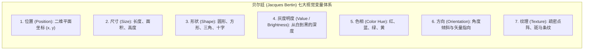
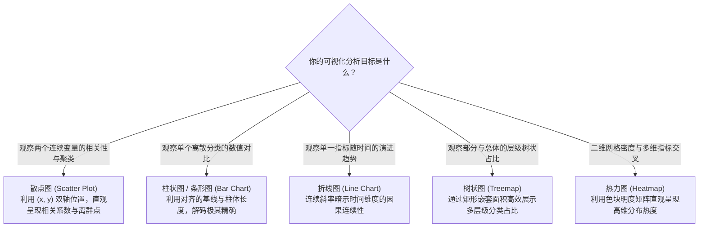
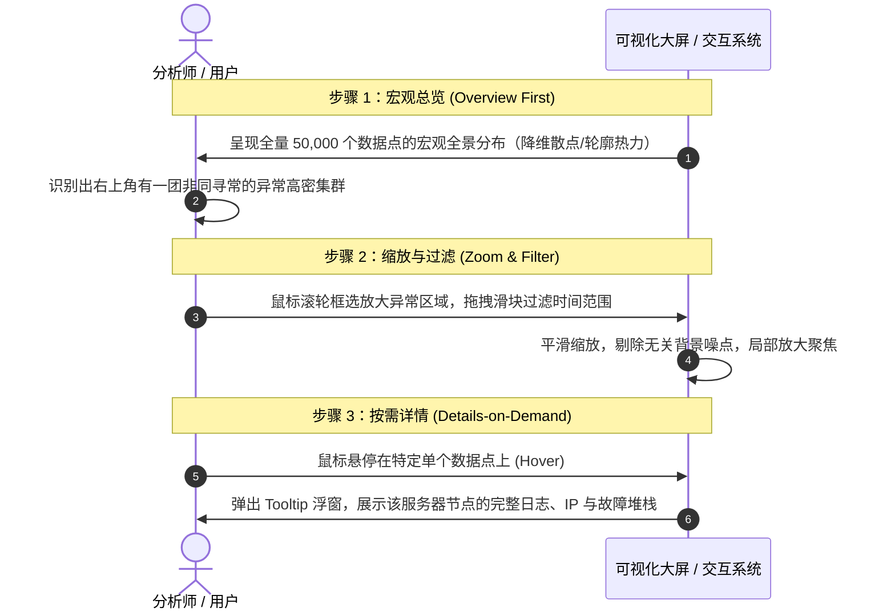

# Lec 21 信息可视化（Information Visualization & Visual Analytics）

## TL;DR

- **认知外化的放大器**：信息可视化（Infoviz）将抽象的高维符号数据映射为几何与视觉通道，借由人类视觉皮层的大规模并行处理能力突破工作记忆的算力瓶颈；
- **视觉变量与编码通道**：遵循雅克·贝尔廷（Jacques Bertin）与麦金利（Jock Mackinlay）的感知通道理论，二维平面空间位置在定量数据编码中享有无可比拟的最高知觉准确度；
- **前注意视觉属性**：利用色彩、长度、曲率与空间聚合的前注意处理（Preattentive Processing），使用户能够在 200 毫秒以内无意识地自动完成异常检测与聚类识别；
- **信息寻路交互箴言**：本·施耐德曼（Ben Shneiderman）确立了经典交互范式——“先宏观总览，再缩放与过滤，最后按需获取详情”，配合多图刷选联动（Brushing & Linking）赋予用户自由探索数据的推理能力。

---

## 1. 可视化连接计算与认知：从数据到洞见

> “获取数据、理解数据、处理数据、从数据中提取价值、对数据进行可视化以及传达数据含义的能力，将会在未来几十年里成为一项极其重要的技能……因为如今我们实际上已经拥有了几乎免费且无处不在的数据。因此，真正稀缺的补充性要素，就是理解这些数据并从中提取价值的能力。”  
> —— Hal Varian，Google 首席经济学家，发表于《The McKinsey Quarterly》，2009 年 1 月

在人机交互与 Web 界面工程中，信息可视化不是装饰性的“图表美化”，而是**人类大脑与计算机协同进行高阶科学推理的外部认知工具（External Cognition）**。

### 1.1 什么是信息可视化？

学术界对信息可视化的经典定义演进：

::: definition 信息可视化（Information Visualization）的三大经典界定
1. **“将符号形式的信息转换为几何形式。”**  
   —— Bruce H. McCormick 等人，1987 年（计算机图形学开创性定义）
2. **“寻找一种最能支持人类自然感知能力的人造外在记忆形式。”**  
   —— Jacques Bertin，1967 年（《Sémiologie Graphique》符号学定义）
3. **“利用计算机生成的、可交互的、可视化的数据表示方式来增强人类的认知能力（Amplify Cognition）。”**  
   —— Stuart K. Card、Jock Mackinlay 与 Ben Shneiderman，1999 年
:::

### 1.2 人机协同的分工智慧：为什么信息可视化如此高效？

- **计算机的强项**：能够以毫秒级的极速存储、索引、聚合数十亿条海量数据，但在开放性模式识别与价值判断上极度机械迟钝；
- **人类大脑的强项**：擅长在复杂的视觉场域中**发现非平凡的隐蔽模式（Patterns）**、**瞬间捕获异常离群值（Oddities/Outliers）**、**自发建立结构秩序**，并根据直觉洞察调整假说模型；
- **感官带宽与前注意处理（Preattentive Processing）**：人类视网膜与大脑枕叶视觉皮层构成了吞吐量高达数百兆的高速并行通道。我们在无需大脑逻辑中枢主动深思熟虑（Without Conscious Effort）的前提下，能在 200 毫秒以内自动感知到视野中的形状差异、色彩跳跃与空间聚类。

---

## 2. 贝尔廷视觉变量与麦金利知觉通道排行

数据可视化的核心工程，就是**将抽象的数据维度（Data Dimensions）映射到特定的视觉变量（Visual Channels）上**。

### 2.1 麦金利（Jock Mackinlay）感知通道准确度等级

并非所有的视觉变量在人类感知中都是平等的！Jock Mackinlay 通过心理物理学实验，严格测定了人类对不同视觉通道解码精度的绝对排行：

| 感知准确度排行 | 定量数据（Quantitative，如金额、温度） | 定序数据（Ordered，如排名、等级） | 定类数据（Categorical，如国家、类别） |
| :---: | :--- | :--- | :--- |
| **最精确 (Top 1)** | **二维空间位置（Position）** | **二维空间位置（Position）** | **二维空间位置（Position）** |
| **第 2 位** | 长度（Length） | 灰度明度（Value） | **色相（Color Hue）** |
| **第 3 位** | 角度 / 斜率（Angle / Slope） | 色彩饱和度（Saturation） | 形状（Shape） |
| **第 4 位** | 面积（Area） | 色相（Color Hue） | 纹理（Texture） |
| **第 5 位** | 体积 / 三维深度（Volume） | 纹理（Texture） | 灰度明度（Value） |
| **最不精确** | 色相（Color Hue，人类无法本能判断红比绿多多少） | 形状（Shape） | 长度 / 面积 |

::: tip 可视化编码黄金铁律
**将你业务数据中最核心、最重要的主度量指标，永远映射在具有最高知觉准确度的“二维空间位置（Position）”与“长度（Length）”上！**  
切忌使用肉眼极难量化判断的“三维立体体积（3D Volume）”或“饼图切割扇区角度（Angle）”来传达精确数值！
:::

---

## 3. 核心图表选型与认知模型

### 3.1 常用图表类型的工程选型决策

::: pitfall 为什么专家强烈排斥 3D 饼图？
1. **角度与面积的双重感知失真**：人类视觉系统对二维面积的估计存在非线性低估，对圆弧角度的估计远逊于平面对齐的直线长度；
2. **透视投影的严重欺骗**：斜放的 3D 饼图中，靠近观众视角的切片由于近大远小的透视几何，其像素面积会被虚假放大 30% 以上，严重扭曲客观事实；
3. **替代方案**：统一采用具有垂直基线对齐的**水平条形图（Bar Chart）**，从大到小排序，一秒扫出精准差异。
:::

---

## 4. 数据交互与信息寻路机制

静态图表只能展示预设切面的快照，现代 Web 可视化的灵魂在于**允许用户与数据进行平滑的双向交互与探索**。

### 4.1 施耐德曼的信息寻路大箴言（The Information-Seeking Mantra）

人机交互泰斗本·施耐德曼（Ben Shneiderman）提出了主宰整个可视化领域的四步法则：

> **“Overview first, zoom and filter, then details-on-demand.”**  
> （先宏观总览，再缩放与过滤，最后按需获取详情。）

### 4.2 刷选与联动（Brushing and Linking）

在复杂的数据分析工作台中，单一图表无法穷尽多维信息。系统通常并排呈现多个异构视图（例如左侧是地理地图，中间是散点图，右侧是时间轴）：

- **刷选（Brushing）**：用户在一个视图中使用鼠标框选出一组感兴趣的子集数据；
- **联动（Linking）**：**其他所有并排视图中对应的相同数据子集，瞬间以联动高亮形式同步高亮**，同时淡化其他非选中数据。

这种直接操纵（Direct Manipulation）机制使得用户能够把注意力完全投入到“数据本身的因果探索”之中，彻底消除了在各级表单筛选菜单之间机械切换的摩擦成本。

::: insight
图表不是数据的装饰性输出，而是推理工具。只有当视觉编码和交互动作与用户要比较、定位或解释的任务一致时，可视化才真正降低认知成本。
:::
