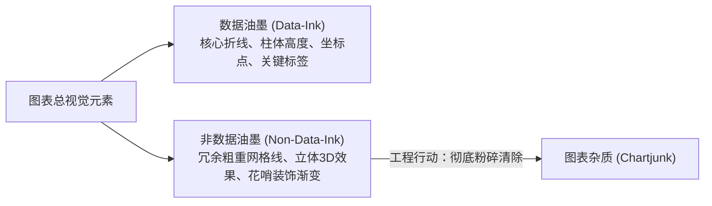

# Lec 4 图形设计（Graphic Design for User Interfaces）

## TL;DR

- **形式追随功能**：图形设计在 UI 中服务于信息理解与任务完成，绝非事后涂抹的表面装饰；美学可用性效应虽能增加用户对轻微摩擦的宽容度，但绝无法掩盖严重的可用性缺陷；
- **格式塔感知心理学**：完形、相似性、闭合性、接近性、连续性与对称性构成了人类大脑快速组织视觉信息、自发寻找秩序的原生本能；
- **四大核心排版原则**：运用对比（Contrast）建立视觉焦点，运用重复（Repetition）打造一致性，运用对齐（Alignment）连接离散元素，运用邻近（Proximity）明确信息亲密归属；
- **简单性与数据油墨比**：通过提高爱德华·塔夫特（Edward Tufte）的数据油墨比（Data-Ink Ratio），消除无意义的图表杂质（Chartjunk），战略性运用留白（Negative Space）降低认知负荷。

---

## 1. 图形设计不只是装饰：形式追随功能

大多数人都会误以为设计只是外观。人们觉得设计只是表面装饰——好像别人把一个盒子交给设计师，然后说：“把它做得好看一点！” 但我们并不认为设计是这样的。

> “设计不只是它看起来怎样、感觉怎样。设计真正的意义在于它如何运作。”  
> —— Steve Jobs

这不仅适用于工业硬件设计，更深刻地支配着 Web 界面与数字图形设计。图形设计并非仅仅是美化（尽管美学固然重要），它应该在需求分析阶段就深入融入系统骨架之中，而不是在工程功能完成后事后才做口红贴皮。

### 1.1 好的设计示例：形式追随功能（Form Follows Function）

位于温哥华 Robson Square 的坡道与楼梯结合设计。实际上，这个坡道在无障碍实践中因为过于陡峭而受到过部分行动不便者的批评，但这个理念本身很好地展示了如何将步行功能性、空间美感与建筑流线有机融合。

### 1.2 坏的设计示例：形式凌驾于功能之上（Form Over Function）

- 没有数字刻度、指针又黑得几乎看不见的时钟：虽然外观符合极端艺术画廊的冷淡风，但连最基础的“让人看清现在几点”的核心任务都无法完成；
- 现代部分智能手机 UI 为了追求所谓“一体化无缝玻璃”外观，激进地取消了所有实体物理按钮，甚至把返回与确认控件全部隐藏在极其晦涩、难以发现的边缘手势滑动之中。

::: definition 设计 vs. 艺术的根本界限
- **艺术（Art）**：聚焦于主观自我表达，旨在激发观者的思考、情感与审美震颤。艺术是感性的，不需要向任何具体任务妥协；
- **设计（Design）**：必须服务于明确的人类目标与功能诉求，必须解决具体问题。设计是理性的。一个优先考虑美观而忽视可用性的界面，可能是优秀的艺术展品，但作为人机界面是极其拙劣的失败品。
:::

### 1.3 美学可用性效应（Aesthetic-Usability Effect）

认知心理学研究确立了著名的“美学可用性效应”：**当用户对你的视觉设计产生积极愉悦的情感共鸣时，他们在心理上会对产品中一些较小的可用性问题和微小瑕疵更加宽容**。

一个视觉精致、排版优雅、留白呼吸感良好的界面，能显著降低用户的焦虑情绪，提升探索意愿。

> [!WARNING] 美学可用性效应有严格的工程极限！
> 一个漂亮的设计可以让用户更容易原谅轻微的排版偏斜或加载微顿，但它**绝对无法掩盖致命的架构漏洞**（如支付失败、关键数据丢失或无法找到核心入口）。“好看”永远救不了“不能用”。

---

## 2. 格式塔心理学原则（Gestalt Principles）

设计原则不是凭空捏造的审美教条，而是总结人类大脑如何感知物理图像的启发式经验法则。

格式塔心理学（Gestalt Psychology）揭示了人类视觉系统的原生自动化归纳机制：

1. **完形（Good Figure / Prägnanz）**：人类大脑天生倾向于将复杂的、不规则的刺激对象简化为最稳定、最简洁、最熟悉的整体图形；
2. **相似性（Similarity）**：在形状、大小、颜色或方向上相似的视觉对象，会被人类视线本能地自动归纳为同一组分类；
3. **闭合性（Closure）**：即使一组线条或图形之间物理上存在缝隙缺口，人类视觉也会在意识中自动补全连接，感知为完整的封闭轮廓；
4. **接近性（Proximity）**：在物理空间上距离较近的元素，会被视为彼此相关的有机整体；
5. **连续性（Continuity）**：当两条视觉路径发生交叉时，人类倾向于将每一个对象感知为沿着原方向平滑连续、不中断的完整实体；
6. **对称性（Symmetry）**：人们倾向于将复杂的视觉元素感知为围绕某个中心轴线构成的对称平衡形态。

参考论文详见：[Visual Design Principles: An Empirical Study of Design Lore](https://designftw.mit.edu/lectures/gd/principles-survey.pdf)。

---

## 3. 界面排版四大核心设计原则（CRAP）

在图形设计经典著作《The Non-Designer's Design Book》中，Robin Williams 提炼出了享誉业界的四大黄金法则（Contrast, Repetition, Alignment, Proximity），在 MIT 6.4500 课程中被深入引入到 Web 界面构建中。

### 3.1 对比（Contrast）

对比的核心作用在于：
- **建立清晰的视觉层级（Visual Hierarchy）**，让最重要的元素一秒跳入眼帘；
- **引导视线运动路径**，并在界面中创造出强烈而明确的视觉焦点（Focal Point）；
- 增强界面的节奏感与动感，避免白开水般的平庸。

**如何施加对比？**
考虑在字体字重（Bold vs Regular）、色彩明度（黑 vs 灰）、尺度大小（大标题 vs 正文）以及线条粗细上制造**具有显著差异的跳跃**。

- **左图（弱对比反例）**：字体大小和线条粗细之间存在微弱的差别。用户会困惑：“这根线比旁边粗了一点点，这是设计师故意设计的，还是一个渲染 bug？” 犹豫的弱对比是业余设计的典型标志；
- **右图（强对比正例）**：大幅度加粗标题并收紧内边距，线条粗细形成鲜明阶梯。强烈的反差消除了任何模糊性，界面显得坚定、专业且精致。

::: tip 对比法则的铁律
如果两个元素在性质上不同，就让他们**截然不同（Very Different）**！绝对不要让它们看起来“好像差不多又有一点点不一样”。
:::

### 3.2 重复（Repetition）

如果说对比通过制造差异来突出重点，那么**重复（Repetition）则通过一致性让分散在页面各处的设计元素融为一体**。

- 重复创造出强大的统一性（Unity）、一致性（Consistency）与品牌凝聚力；
- **重复的具体表现**：在整个系统内复用相同的圆角大小（如全站统一 `border-radius: 8px`）、复用相同色系的次级文本色彩、复用统一的图标笔画粗细与间距网格；
- 重复让用户在浏览新页面时感到安心，确信自己仍然处于同一个自洽的产品生态之中。

### 3.3 对齐（Alignment）

在视觉空间中，没有任何元素应当被随心所欲、漫不经心地孤立放置。**每一个界面元素都应当与页面上的另一个元素建立起明确的视觉对齐联系**。

当元素严格对齐时，即使它们在物理空间上相距甚远，读者的大脑中也会自动绘制一条看不见的隐形连线，将它们紧紧维系在一起。

- 左对齐的文本如果硬生生搭配一张完全居中的图片，左右两侧会产生尴尬不均的锯齿状空白；
- 元素如果几乎顶到容器的边缘，会营造出强烈的视觉紧张感和窒息感。

- **巧妙的对齐暗示**：在上述优秀案例中，椅子的支脚倾斜角度暗示了标志的宽度，倾斜交汇点构成了自然的视觉焦点，文字基线严格锚定在这一焦点水平线上，产生了极高的审美舒适度。

### 3.4 邻近（Proximity）

在空间上彼此靠近的对象，会被知觉心理学自动归纳为一个完整的逻辑单元。

- **空间亲密度表达概念亲密度**：如果一个表单项包含标签文本（Label）、输入框（Input）以及辅助校验说明（Hint），那么标签与输入框之间的纵向距离，必须**显著小于**该输入框与下一个输入框之间的距离；
- **消除歧义**：新手常犯的错误是让段落标题上下间距相等，导致读者根本无法分辨该标题是属于上面那段话的总结，还是下面那段话的引言。**标题距离其下属正文必须比距离上方段落更近**。

---

## 4. 简单性与数据油墨比（Simplicity & Data-Ink Ratio）

在前面四大原则之上，图形设计还存在一个至高法则：**简单性（Simplicity）**。

正如著名文学家与飞行员安托万·德·圣-埃克苏佩里所言：
> “达到完美并非由于再无可添加之物，而是由于再无可削减之物（Perfection is achieved, not when there is nothing more to add, but when there is nothing left to take away）。”

### 4.1 爱德华·塔夫特的数据油墨比（Data-Ink Ratio）

数据可视化与信息设计宗师爱德华·塔夫特（Edward Tufte）在其开山之作《The Visual Display of Quantitative Information》中提出了著名的理论度量：

$$\text{Data-Ink Ratio} = \frac{\text{用于传达实际核心数据的不可削减油墨量}}{\text{图表印刷使用的全部视觉元素总量}}$$

- **图表杂质（Chartjunk）**：包括伪 3D 柱状图、五颜六色的无意义背景填充、每隔 5 像素就出现一根的深色坐标网格、巨大的无用阴影；
- **优化法则**：在不丧失信息可读性的前提下，**无情地消除一切非数据油墨**。淡化网格线（从黑色实线改为浅灰虚线甚至完全移除），让真正承载数据趋势的曲线凸显出来。

### 4.2 留白（Negative Space / White Space）的战略价值

很多商业管理者一看到屏幕上有空白，就本能地产生恐慌感，试图用广告横幅、推销口号或更多卡片把每一寸像素填满。

这种做法是可用性灾难：
- **留白不是浪费的无用面积，留白本身就是核心设计元素！**
- 留白赋予了视线从容停留与呼吸的余地；
- 留白界定了群组之间的物理疆界；
- 在奢侈品与高端科技产品（如 Apple 官网）中，大面积克制、纯粹的留白传递出极高的专业威严与秩序感。
