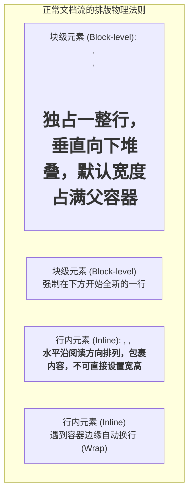
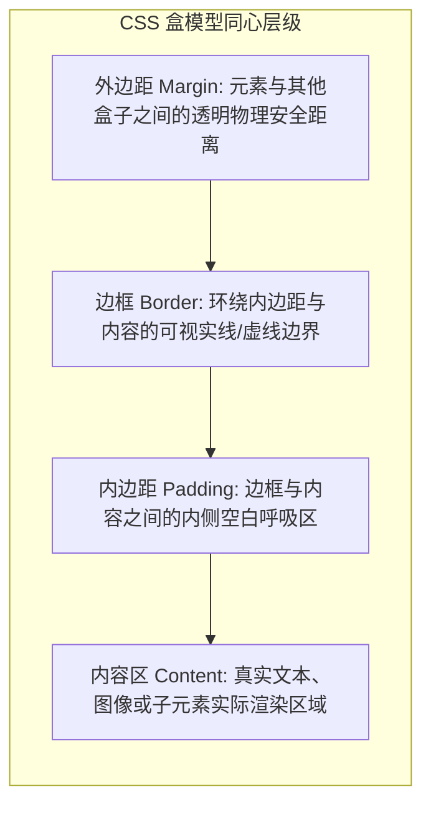
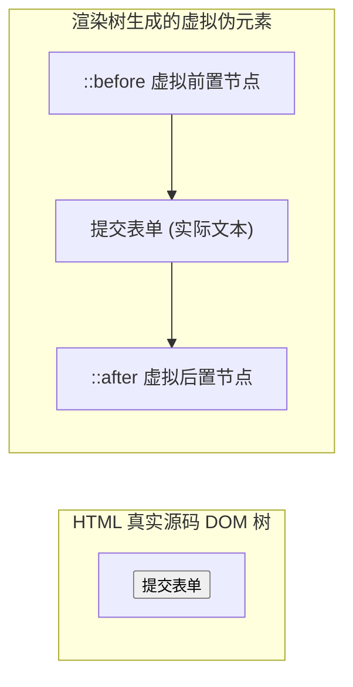

# Lec 6 CSS 的基本概念 I（Core CSS Foundations: Flow, Box Model & Selectors）

## TL;DR

- **万物皆为盒（Box）**：CSS 渲染引擎将每一个 DOM 节点抽象为矩形盒模型，在正常文档流（Normal Flow）中遵循块级沿列堆叠、行内沿行排列的基本物理规律；
- **标准盒 vs 边框盒**：默认的标准盒模型（`content-box`）会将内边距与边框向外累加撑大容器尺寸，现代前端工程普遍采用 `box-sizing: border-box` 将宽度锚定为视觉全宽；
- **相对单位与自适应**：利用 `rem` 响应系统字号偏好，利用 `em` 实现组件等比例整体缩放，配合 `ch`、视口单位（`vw/vh`）与 `calc()` 构筑弹性计算体系；
- **伪类与伪元素的边界**：伪类（`:`）依据动态用户状态或结构位置匹配真实 DOM 元素，而伪元素（`::`）向渲染树中虚拟注入并不存在于 HTML 源码中的抽象子构件。

---

## 1. CSS 核心设计理念与使用方式

在 CSS 中，**所有元素本质上都是一个盒子（Box）**。CSS 的全部使命，就是规定这些盒子如何呈现视觉样式，以及它们在屏幕空间中如何与相邻的其他盒子发生物理排斥与协作。

### 1.1 页面应用 CSS 的 3 种方式

```html
<!DOCTYPE html>
<html>
<head>
  <!-- 方式 1：通过外部 CSS 文件引入（工业界唯一强烈推荐的标准方式） -->
  <link rel="stylesheet" href="style.css">
  
  <!-- 方式 2：在 <style> 标签中编写内嵌样式（仅适合单页独立演示例程） -->
  <style>
    a { color: #4b5563; }
  </style>
</head>
<body>
  <!-- 方式 3：通过 style 属性内联样式（强烈反对使用：难以维护且违背关注点分离） -->
  <h1 style="color: #f06">Title</h1>
</body>
</html>
```

1. **外部样式表（`<link rel="stylesheet">`）**：这是生产环境的黄金标准。能够被浏览器在 HTTP 缓存中强缓存复用，实现样式与语义结构的彻底解耦；
2. **内嵌样式（`<style>`）**：仅用于关键首屏 CSS 注入（Critical CSS）或独立的原型技术演示；
3. **内联样式（`style="..."`）**：除了运行时 JavaScript 动态计算不可预测的坐标（如拖拽绝对位置）外，严禁在常规开发中滥用。

### 1.2 CSS 语法解剖

```css
h1 {
  font-size: 200%;
  color: white;
}
```

- **选择器（Selector）**：告诉渲染引擎这条规则作用于 DOM 树中的哪些节点（如 `h1` 标题）；
- **声明块（Declaration Block）**：由大括号包裹的一组“属性-值（Property-Value）”键值对；
- **分号间隔**：多个声明之间必须使用分号严格分隔；
- **通用关键字**：CSS 提供了全局通用的级联关键字，如 `currentColor` 可以让边框或图标自动复用当前文本色彩。

---

## 2. 正常文档流（Normal Document Flow）

在没有任何定位（Positioning）或弹性布局（Flex/Grid）干预的纯净状态下，浏览器按照 HTML 源码树的书写次序自顶向下渲染元素，这一规律称为**正常文档流（Normal Flow）**。



- **块级元素（Block）**：如 `<div>`, `<p>`, `<section>`，在水平方向上默认占满可用宽度，前后自带换行符，垂直方向依次堆叠；
- **行内元素（Inline）**：如 `<span>`, `<a>`, `<em>`，仅占据自身内容所需的物理尺寸，沿着文本行水平向前流动，不能设置 `width` 和 `height`，且垂直方向的 `margin` 不会推开相邻行；
- **脱离文档流**：当元素被赋予 `position: absolute / fixed` 或 `float` 时，它会彻底从正常文档流中“浮空升起”，原本被它占据的物理空间会被后续正常流元素瞬间填补。

---

## 3. CSS 盒模型（The Box Model）

盒模型是整个 Web 视觉布局的物理地基。每一个可见元素都由四个嵌套的同心矩形区域构成：



### 3.1 经典盒模型陷阱：`content-box` vs. `border-box`

浏览器在默认情况下采用的是 W3C 历史遗留的 **标准盒模型（`content-box`）**：

::: pitfall 标准盒模型的“膨胀灾难”
在 `content-box` 模式下，你在 CSS 中声明的 `width` **仅仅代表内部 Content 的宽度**！  
如果给一个 `width: 300px` 的卡片添加了 `padding: 20px` 和 `border: 2px solid black`：
$$\text{屏幕实际渲染总宽度} = 300 + (20 \times 2) + (2 \times 2) = 344\text{px}$$
这会导致原本计划并排放置的两个 50% 宽度的容器瞬间因为总和达到 $100\% + 88\text{px}$ 而被挤爆换行！
:::

```css
/* 现代 Web 前端全站通用的工业级盒模型重置标准 */
*,
*::before,
*::after {
  box-sizing: border-box;
}
```

在 **边框盒模型（`border-box`）** 下，声明的 `width: 300px` 就是整个盒子占据屏幕的**最终视觉全宽**。无论你后续如何调整 `padding` 或 `border`，渲染引擎会自动收缩内部 Content 区域，保证外部轮廓尺寸坚如磐石。

### 3.2 垂直外边距折叠（Margin Collapsing）

当两个块级元素在垂直方向上发生接触时，它们的上下 `margin` **并不会相加累加，而是会发生合并，最终距离等于两者中的最大值**：
- 如果上方段落有 `margin-bottom: 24px`，下方段落有 `margin-top: 16px`；
- 两者之间的实际物理间隙并不是 $24 + 16 = 40\text{px}$，而是 **`24px`**！

---

## 4. 值与单位系统（Values & Units）

CSS 提供了丰富多样的长度单位，划分为绝对单位与相对单位两大流派。

### 4.1 绝对单位 vs. 相对单位

- **绝对单位**：`px`（CSS 像素，在现代高清屏幕上为参考像素而非物理硬件发光点）、`cm`、`in`、`pt`。在任何地方表示固定的物理长度；
- **相对单位**：依据外部参考锚点动态求值，是响应式设计的命脉。
  - **`rem`（Root EM）**：严格相对于根节点 `<html>` 的字体大小（默认 `1rem = 16px`），是全站排版字阶与边距的最佳基准；
  - **`em`**：相对于**当前元素自身（或继承自父级）**的字体大小。最适合用于按钮等独立组件的内部等比例缩放；
  - **`ch`**：当前字体中数字 `0` 的水平宽度。在等宽字体或约束正文阅读舒适行宽（`max-width: 65ch`）时极其强大；
  - **`vw` / `vh`**：视口宽度与高度的 $1\%$（`100vw` 等同于浏览器当前可见视口总宽度）。

### 4.2 字体相关单位的缩放魔力


如果我们用 `em` 定义按钮的内边距和圆角：
```css
.btn {
  font-size: 1rem;
  padding: 0.5em 1em;    /* 上下 0.5 倍当前字号，左右 1 倍当前字号 */
  border-radius: 0.25em; /* 圆角随字号同步呼吸 */
}
.btn-large {
  font-size: 1.5rem;     /* 仅需改变字号，内部边距和圆角自动按比例放大！ */
}
```

### 4.3 动态数学表达式：`calc()`、`min()`、`max()` 与 `clamp()`

CSS 是一门真正的声明式计算系统，所有数学函数在视口或环境变化时会自动重新求值：

```css
/* 混合不同维度的单位计算 */
.sidebar-layout {
  width: calc(100% - 280px);
}

/* 带有上下安全护栏的响应式约束 */
.container {
  width: min(90%, 1200px); /* 手机端占 90%，桌面端最大不超过 1200px */
}
```

---

## 5. CSS 选择器全景与特异性基础

选择器是 CSS 规则与 DOM 节点建立关联的导向探针。

### 5.1 基础选择器分类

```html
<!-- 属性选择器常见实战模式 -->
<a href="https://example.com" target="_blank">外链</a>
<input type="email" required>
```

```css
/* 1. 基础选择器 */
* { margin: 0; }                  /* 通配选择器 */
p { line-height: 1.5; }           /* 标签元素选择器 */
.card { background: white; }      /* 类选择器 */
#navbar { position: fixed; }      /* ID 选择器 */

/* 2. 属性选择器 */
[required] { border-color: red; }           /* 包含特定属性 */
input[type="email"] { width: 100%; }        /* 属性值完全精确匹配 */
a[href^="https://"] { color: green; }       /* 属性值以前缀 startsWith 开头 */
a[href$=".pdf"] { content: " (PDF)"; }      /* 属性值以后缀 endsWith 结尾 */
a[href*="mit.edu"] { font-weight: bold; }   /* 属性值包含子字符串 */
```

---

## 6. 伪类（Pseudo-classes）与动态状态匹配

::: definition 伪类（Pseudo-class）
以**单冒号 `:`** 开头，用于向选择器添加某种**特殊的临时状态**或**DOM 结构逻辑位置**。伪类所选择的元素是真实存在于 DOM 树中的完整节点，只是当前处于某种特定的动态条件之下。
:::

### 6.1 用户交互状态伪类

```css
/* 鼠标悬停 */
button:hover {
  background-color: #2563eb;
}

/* 鼠标按下激活瞬间 */
button:active {
  transform: translateY(1px);
}

/* 元素获取到焦点 */
input:focus {
  border-color: #3b82f6;
  outline: 2px solid #93c5fd;
}

/* 现代可访问性黄金准则：仅当使用键盘 Tab 聚焦时显示焦点轮廓，鼠标点击不显示 */
button:focus-visible {
  outline: 3px solid #1d4ed8;
  outline-offset: 2px;
}
```

### 6.2 DOM 结构伪类与逻辑伪类

```css
/* 选中父容器中的第一个和最后一个子元素 */
li:first-child { border-top: none; }
li:last-child { border-bottom: none; }

/* 强大的公式选择：隔行换色（匹配奇数行） */
tr:nth-child(2n + 1) {
  background-color: #f9fafb;
}

/* 否定伪类：选择所有没有 .active 类的项目 */
.nav-item:not(.active) {
  opacity: 0.6;
}

/* 现代革命性父选择器 :has() —— 如果卡片内部包含图片，则改变卡片自身布局！ */
.card:has(img) {
  grid-template-columns: 200px 1fr;
}
```

---

## 7. 伪元素（Pseudo-elements）与虚拟内容生成

::: definition 伪元素（Pseudo-element）
在现代规范中以**双冒号 `::`** 开头（为了在语法上与伪类明确区分开），用于匹配或创建**并不独立存在于 HTML 源码树中的虚拟抽象子部件**。
:::



### 7.1 `::before` 与 `::after` 生成内容

通过结合必须的 `content` 属性，伪元素允许我们在不污染 HTML 语义源码的前提下，向页面无中生有注入装饰性图形：

```css
/* 为所有外部链接自动追加一个跳出箭头小图标 */
a[target="_blank"]::after {
  content: " ↗";
  font-size: 0.75em;
  vertical-align: super;
  color: #6b7280;
}

/* 绘制悬停动态下划线特效 */
.nav-link {
  position: relative;
}
.nav-link::after {
  content: "";
  position: absolute;
  bottom: 0;
  left: 0;
  width: 0;
  height: 2px;
  background-color: #3b82f6;
  transition: width 0.3s ease;
}
.nav-link:hover::after {
  width: 100%;
}
```

### 7.2 排版修饰类伪元素

```css
/* 经典西方报刊首字下沉排版（Drop Cap） */
p.intro::first-letter {
  font-size: 300%;
  float: left;
  line-height: 0.8;
  margin-right: 0.15em;
  font-family: Georgia, serif;
}

/* 自定义用户划词高亮时的背景色与文字颜色 */
::selection {
  background-color: #fde047;
  color: #000000;
}
```

在理解了盒模型、文档流、单位与伪类/伪元素之后，下一讲（**Lecture 8**）我们将深入探索 CSS 最宏大的统治中枢——**层叠机制（The Cascade）、继承（Inheritance）与特异性权重计算（Specificity）**！
