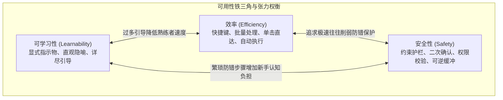
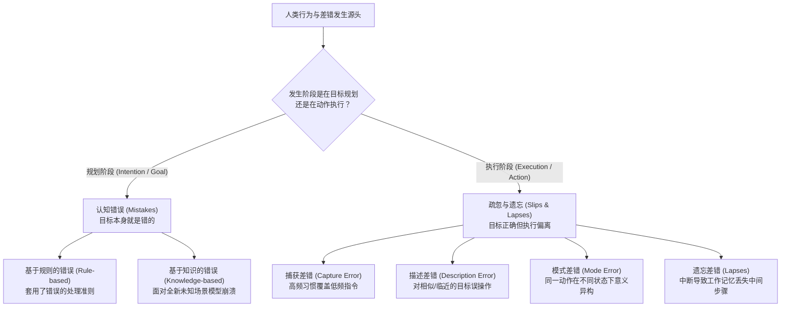
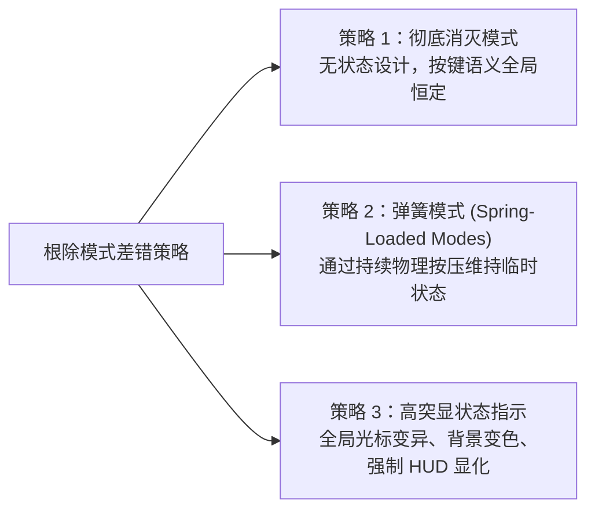
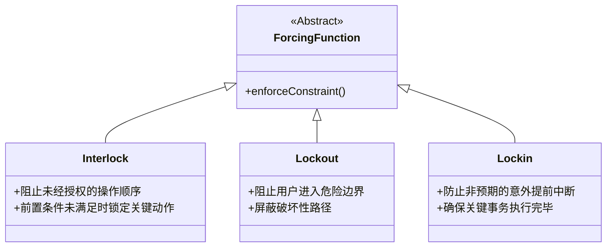
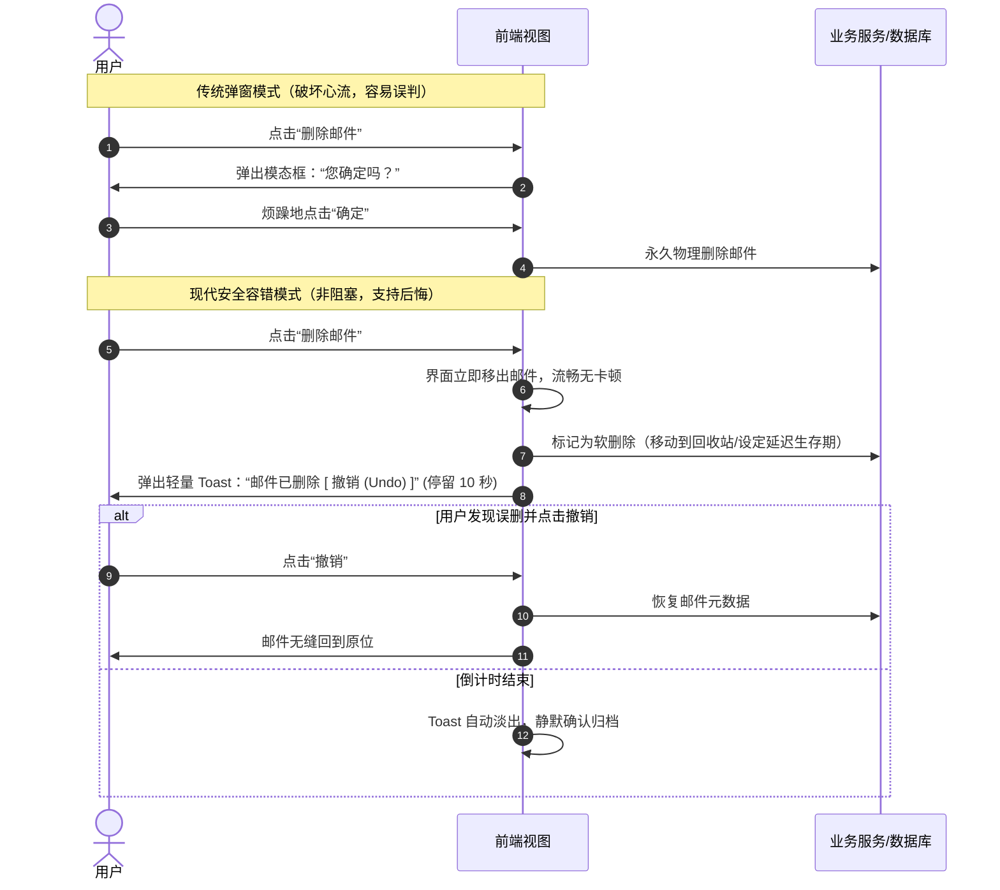

# Lec 7 安全性（Safety & Error-Tolerant UI Design）

## TL;DR

- **差错的心理学本质**：将用户失误严格划分为执行阶段的“疏忽与遗忘（Slips）”与目标规划阶段的“认知错误（Mistakes）”，所谓“用户操作失误”本质上是系统对人类认知局限性缺乏防御的设计缺陷；
- **典型疏忽模式防范**：通过前缀分化规避高频习惯吞噬的捕获差错（Capture Error），通过物理隔离防止相邻控件混淆的描述差错（Description Error），通过消除隐藏状态或采用弹簧模式根除模式差错（Mode Error）；
- **撤销优先于确认弹窗**：频繁的“您确定吗？”模态对话框会导致用户产生确认疲劳并演变为无意识点击，真正安全且高效的界面应将操作设计为可逆的，以非阻塞的“单步撤销（Undo）”保障系统容错弹性；
- **强制功能与主动防御**：借助互锁、闭锁与锁定等强制功能（Forcing Functions）消除关键步骤遗漏，通过宽容解析与状态持久化避免表单清空灾难。

---

## 1. 界面安全的定义与认知范式

在软件系统与图形界面的演进史中，“安全性（Safety）”常被狭隘地等同于密码学安全、网络防火墙或权限访问控制（Access Control）。然而在人机交互（HCI）与用户体验设计的语境下，**安全性代表着系统保护用户免受操作失误侵害、防止不可逆灾难性后果发生，以及让系统在面对异常输入时具备宽容容错与自愈能力的核心品质**。

### 1.1 从“操作员过失”到“设计过失”

当事故发生时，软件工程师和系统管理者往往习惯性地归咎于“用户粗心大意”或“操作员失误（Operator Error）”。但现代认知人机工程学（Cognitive Ergonomics）确立了一条根本法则：

::: definition 设计哲学：没有所谓“用户差错”，只有“设计缺陷”
人类大脑不是精准运行的硅基处理器。由于注意力带宽有限、工作记忆容量狭窄（Miller $7 \pm 2$ 法则）以及依赖直觉启发式思考，人在长期重复操作中犯错是不可避免的生理与心理必然。**一个优秀的软件系统必须在架构设计之初就假定用户会犯错，并在交互层面构筑层层防御护栏**。如果一个设计允许用户通过一次误触就清空数据库且无法挽回，那么这场灾难的制造者是界面设计者，而非最后点击按钮的用户。
:::

### 1.2 可用性铁三角的动态博弈

在前面几讲中，我们探讨了可用性的三大支柱：**可学习性（Learnability）**、**效率（Efficiency）** 与 **安全性（Safety）**。这三者之间往往存在着微妙的工程张力：



- **效率 vs. 安全性**：为了追求极致的高效，专业软件倾向于提供单键快捷操作、全局批量删除和快速覆盖；但这些提速通道一旦失去约束，极易引发大面积数据毁灭；
- **安全性 vs. 可学习性**：引入过多的校验步骤、警示弹窗和密码复验，会割裂新手用户的探索心流，增加对系统运作机制的理解成本；
- **优秀设计的折中准则**：安全防护机制应当**静默存在于后台**，仅在危险动作逼近临界点时提供恰到好处的物理约束，同时通过低成本的“恢复机制”抵消误操作代价，而不应依赖繁复的关卡惩罚日常高频操作。

### 1.3 现实反面教材：When2meet 的状态反向覆写陷阱

When2meet 是广受高校与团队欢迎的在线日程协调工具。其核心交互是让用户在网格上通过鼠标拖拽高亮自己的空闲时间段。然而该系统存在一个经典的可用性安全灾难：

::: pitfall 隐蔽状态引发的不可逆数据抹除
1. **模式模糊**：网格本身既用来“添加可用时间（绿色）”，又用来“擦除已有时间（白色）”。当前操作模式取决于鼠标落点单元格的初始状态——如果鼠标从一个已选中的绿色格子上按下并拖拽，系统会悄悄进入“擦除模式”；
2. **缺乏状态指示物**：光标形态在“填充”与“擦除”模式之间没有任何视觉变化；
3. **无撤销支持**：一旦用户为了调整某个边缘时间块而不小心从绿色格子起步并拖过整个日程区域，此前耗费数分钟比对日历标记的所有空闲时段会在瞬间被全部擦除，且页面刷新或浏览器后退均无法挽救历史状态。
:::

该案例深刻揭示了：即使功能逻辑完全正确的系统，若缺乏对模式切换、操作可逆性与视觉反馈的安全考量，依然会给用户带来灾难性的挫败感。

---

## 2. 人类差错的分类体系：疏忽与失误 vs. 认知错误

为了精准防御差错，我们必须借助认知心理学家唐纳德·诺曼（Don Norman）与詹姆斯·瑞森（James Reason）建立的人类差错分类模型（Human Error Taxonomy）。人类差错在发生机制上被严格划分为两大范畴：**疏忽与遗忘（Slips & Lapses）** 与 **规划认知错误（Mistakes）**。



### 2.1 行为层级与差错类型对照

| 维度 | 疏忽与遗忘（Slips & Lapses） | 认知错误（Mistakes） |
| :--- | :--- | :--- |
| **发生认知阶段** | **执行阶段（Execution / Storage）** | **规划与决策阶段（Planning / Formulation）** |
| **用户的目标正确性** | 用户内心拥有**完全正确的目标与知识**，但物理动作出现偏差或记忆中断 | 用户内心形成了**错误的意图或目标**，随后正确执行了该错误计划 |
| **心理运作状态** | **高度熟练的自动化行为（Autopilot）**，用户注意力处于发散或外部干扰状态 | **有意识的问题求解与规则推演**，用户注意力高度集中但掌握信息不全 |
| **发生频率** | **极高**（日常生活与熟练软件操作中占 80% 以上） | 较低，但在系统故障或非常规流程中具有高危险性 |
| **典型生活案例** | 打算从冰箱拿牛奶，却顺手把电视遥控器放进了冰箱 | 误以为柴油车可以加 95 号汽油，仔细按照规范加满了柴油车 |
| **经典软件案例** | 想要按 `Ctrl+S` 保存，手指却偏斜按下了旁边的 `Ctrl+W` 误关标签页 | 用户误以为“清空回收站”只是释放临时缓存，为了清理磁盘点击了清空 |

::: insight 为什么专业熟练用户更容易出现 Slips？
新手由于对界面极其陌生，每一步操作都依赖大脑慢速、深思熟虑的认知处理（System 2），因此新手常犯的是 **Mistakes**；相反，专业高手在长期训练后，90% 的操作已被下沉为小脑和基底核的自动化运动反射（System 1）。高手在操作时通常处于“自动巡航”状态，一边思考高层业务一边盲打操作，极易受到视觉干扰或习惯捕获而触发 **Slips**。因此，针对熟练高手的界面设计必须具备极高的 Slips 防护网。
:::

---

## 3. 典型疏忽（Slips）的深度剖析与界面防御

在 Web 与 UI 交互工程中，执行疏忽呈现出极其规律的模式。掌握这些模式是构建高韧性软件的前提。

### 3.1 捕获差错（Capture Error）

::: definition 捕获差错（Capture Error）
当一个罕见的、非惯用的操作序列，与一个高度熟练、日常高频的操作序列**拥有完全相同的前置触发动作（Prefix）**时，人类大脑的自动化执行机制会无意识地接管控制权，导致罕见操作被日常习惯强行“捕获”，最终执行了高频动作。
:::

#### 典型场景推演
- **代码编辑器**：Vim 用户原本意图输入 `:w`（仅保存当前缓冲区分支），但由于过去数万次操作都习惯性退出，手指在无意识中敲下了 `:wq`（保存并退出），意外关闭了正在监视构建日志的终端窗口；
- **日常办公**：员工准备去打印室取紧急文件，路线前 50 米与去洗手间完全一致，中途走神后发现自己居然莫名其妙站在了洗手间门前；
- **表单交互**：用户打算在电商后台点击“保存草稿（Save Draft）”，但由于平时习惯了点击右下角的“直接发布（Publish Now）”，鼠标顺势点击了发布。

#### 界面工程防御准则
1. **打断公共前缀**：严禁让高危/特殊操作与常规操作共享相同的前置步骤；
2. **位置与触觉分流**：将特殊关键路径的触发控件移出常规点击动线（例如将“发布”放在右上角固定栏，而将“存草稿”放在编辑器底部状态栏）；
3. **关键分支提供渐进确认屏障**。

---

### 3.2 描述差错（Description Error）

::: definition 描述差错（Description Error）
当两个或多个在物理空间上彼此临近的对象，其在用户的心理概念描述（Mental Description）中过于抽象、模糊或视觉呈现极其相似时，用户会将意图作用于 A 对象的操作，错误地施加到了 B 对象之上。
:::

#### 界面设计反模式与防御方案

```html
<!-- 反模式：高危险动作与低危险动作在视觉、位置与尺寸上完全同构 -->
<div class="action-bar-danger">
  <button class="btn btn-secondary">批量导出数据 (Export)</button>
  <button class="btn btn-secondary">批量清空数据 (Delete)</button>
</div>

<!-- 规范防御模式：通过色彩、空间距离、形状与图标建立多重描述辨识度 -->
<div class="action-bar-safe">
  <div class="primary-group">
    <button class="btn btn-primary">
      <svg class="icon">...</svg> 批量导出数据
    </button>
  </div>
  <div class="danger-zone" style="margin-left: auto;">
    <button class="btn btn-danger-outline" aria-label="危险操作：永久删除选中的所有记录">
      <svg class="icon-trash">...</svg> 永久删除所选
    </button>
  </div>
</div>
```


- **物理距离隔离（Spatial Separation）**：将破坏性按钮远离日常操作聚集区；
- **多通道差异化（Multi-channel Differentiation）**：不仅依赖文字描述，还要在色彩（警示红 vs 沉着蓝）、图标形状、按钮样式（实心 vs 边框）等多个通道同时拉开差距，确保即使在用户视线余光或屏幕严重反光下也不会看混。

---

### 3.3 模式差错（Mode Error）

::: definition 模式差错（Mode Error）
所谓“模式（Mode）”，是指系统处于的一种内部隐藏状态：在此状态下，**用户的同一个物理输入动作（如敲击键盘某键、点击鼠标左键），在系统内被赋予了完全不同的操作语义**。模式差错是指用户遗忘了当前系统所处的模式，带着对模式 A 的心理预期执行了操作，却触发了模式 B 的异构破坏性行为。
:::

#### 经典案例与隐患
- **大小写锁定（Caps Lock）**：用户在输入关键密码时，键盘处于 Caps Lock 激活模式。用户完全按正确按键敲击，但所有字符大小写颠倒，导致账户连续认证失败被锁定；
- **绘图软件**：在 Photoshop 或 Figma 中，用户以为当前是“选择光标工具”，想拖拽多选框选中几个图层，结果当前处于“铅笔工具”模式，直接在画布上划出了一条无法擦除的黑线。

#### 消除模式差错的三大工程策略



1. **策略 1：消除不必要的模式**：通过引入更丰富的物理输入通道（如独立的功能键、手势、外设）或直接将不同功能拆分为独立的屏幕组件，避免复用单一输入机制；
2. **策略 2：采用弹簧模式（Spring-Loaded / Quasimode）**：
   - 这是 Jef Raskin 在《The Humane Interface》中推崇的最安全的模式设计。用户必须**持续施加物理力量**（如按住 `Shift` 键、按住鼠标右键、按住空格键拖拽画布）才能维持临时模式；
   - 一旦用户松开手指，系统立即利用弹性物理反馈自动弹回默认基线模式。由于人类肌肉必须持续保持张力，大脑绝不会忘记自己正处于特殊状态中；
3. **策略 3：提供压倒性的视觉焦点变异**：
   - 如果长久生效的模式不可避免，必须在操作焦点处提供无法被忽视的反馈；
   - 例如改变光标样式（从箭头变成十字准星、橡皮擦或油漆桶），或者直接让工作区边框呈现高饱和度色彩，确保外围视觉（Peripheral Vision）能够捕捉到状态转移。

---

### 3.4 遗忘差错与强制功能（Forcing Functions）

当用户的注意力被外部事件（同事打招呼、手机推送、系统卡顿）意外打断时，原本储存在短期工作记忆（Working Memory）中的下一步行动计划会被瞬间冲刷，导致操作序列发生遗漏（Lapse）。

为了彻底阻止关键步骤的遗失，安全工程学引入了 **强制功能（Forcing Functions）**：

::: definition 强制功能（Forcing Functions）
一种物理或逻辑交互约束，它通过人为切断因果链条，**强迫用户必须首先完成前置安全动作，随后物理上才有可能开启下一个阶段的操作**。
:::

#### 强制功能的三大经典变体



1. **互锁（Interlock）**：强迫执行严格的时序次序。
   - *生活实例*：微波炉在炉门开启状态下，高压微波发生电路在物理机械上被断开，绝对无法通电启动；
   - *ATM 经典变革*：早期自动取款机先吐钞票再退银行卡，大量用户拿到现金后转身离开，导致银行卡遗失率极高。现代 ATM 采用互锁逻辑：**必须先拔出银行卡，出钞口才会物理开启交付现金**；
   - *Web 实例*：在多步骤结账向导中，只有在收货地址通过邮编数据库自动验证无误后，下一步的支付网关才会解锁激活。
2. **锁定（Lockout）**：阻止用户进入已知具有毁灭性后果的状态。
   - *实例*：在向生产数据库执行大规模批量迁移脚本时，系统通过环境变量锁屏蔽掉 `DROP TABLE` 命令的执行通道；
   - *Web 实例*：当用户账号处于非管理员状态时，彻底在 DOM 中移除“清空组织”按钮，而非显示一个可点击但报错的死按钮。
3. **闭锁（Lockin）**：保持正在进行的有益操作，防止由于用户无意识误操作导致进程中断。
   - *实例*：在用户通过网页向服务器上传 5GB 的大型视频文件期间，如果用户点击了关闭浏览器窗口，浏览器会触发 `beforeunload` 事件强制弹窗拦截：“文件正在上传中，离开本页面将丢失全部进度”。

---

## 4. 容错与恢复机制：撤销（Undo）vs. 确认（Confirmation）

当不可避免的误操作发生时，系统应当如何响应？这是交互设计史上最常被误解、也最常被滥用的领域。

### 4.1 确认弹窗的制度性破产：确认疲劳（Confirmation Fatigue）

几乎每一个软件工程师在编写破坏性操作（如删除、覆盖、重置）时，第一反应都是弹出一个模态警告框：

```text
┌───────────────────────────────────────────────┐
│  警告：您确定要删除选中的 300 篇文档吗？      │
│  [  取消 (Cancel)  ]       [  确定 (OK)  ]    │
└───────────────────────────────────────────────┘
```

这种设计在心理学与工程实践中已被证实是极其脆弱、甚至有害的：

::: pitfall 为什么确认对话框无法保障安全？
1. **确认疲劳与肌肉记忆脱敏**：如果系统中充斥着各种确认对话框（安装软件、保存配置、清理临时文件），用户的大脑会迅速将其归类为“无价值的阻碍杂音”。用户会训练出自动点击键盘回车（Enter）或连击鼠标右下角按钮的肌肉反射；
2. **狼来了效应（Cry Wolf Phenomenon）**：当真正致命的灾难降临时，那个生死攸关的确认对话框在外观上与日常那些烦人的弹窗毫无二致。用户在神经元反应过来之前就已经下意识按下了“确定”；
3. **心流阻断惩罚**：对于 99.9% 正常、深思熟虑执行删除操作的用户而言，弹窗是极度令人厌烦的效率惩罚，破坏了流畅的工作节奏。
:::

### 4.2 撤销优先原则（Reversibility over Confirmation）

人机工程学黄金准则确立：**绝大多数确认弹窗，都应当被“立即执行 + 非模态撤销（Undo）”机制所替代**。



#### Gmail 的撤销发送机制（Undo Send）
发送电子邮件在历史上一直被视为绝对不可逆的物理网络动作。早期客户端曾尝试弹出“确定要发送吗？”弹窗，饱受用户诟病。

Gmail 革命性地改变了这一范式：
- 当用户点击“发送”时，系统并不真正立即向 SMTP 目标服务器投递；
- 邮件进入本地或边缘服务器的缓冲延迟队列（例如持续 10 秒到 30 秒）；
- 界面底部浮出轻量级提示：“您的邮件已发送。[ 撤销 ] [ 查看邮件 ]”；
- 如果用户突然想起忘记添加附件或抄送人员写错，点击“撤销”，邮件瞬间重新还原为草稿状态，完全没有对外投递痕迹。

### 4.3 何时才必须使用高摩擦确认？

只有当且仅当一个操作**在物理或商业层面上具有真正的绝对不可逆性**（例如物理格式化硬盘、清空云平台生产环境 Kubernetes 集群、向第三方支付平台划扣不可追回的资金），确认机制才有其存在价值。

即便使用确认机制，也必须彻底摒弃简单的“点击确定”按钮，引入**认知摩擦机制（Cognitive Friction）**：

```html
<!-- 现代代码托管平台（如 GitHub / GitLab）的删除仓库安全协议 -->
<div class="danger-zone-modal">
  <h3>警告：此操作不可挽回！</h3>
  <p>这将会永久删除 <strong>mit-eecs/archipelago-core</strong> 仓库及其全部历史、Issue 与分支。</p>
  
  <label for="verify-input">
    请在下方输入完整的仓库名称以确认授权：
  </label>
  <input 
    type="text" 
    id="verify-input" 
    placeholder="mit-eecs/archipelago-core"
    pattern="mit-eecs/archipelago-core" 
    required
  />
  
  <!-- 只有输入文本与目标完全一致时，删除按钮才从 disabled 变为激活 -->
  <button class="btn btn-danger" disabled id="confirm-delete-btn">
    我了解后果，永久删除此仓库
  </button>
</div>
```

通过强迫用户将目光聚焦在关键对象文本上，并逐字符进行打字核对，成功将用户的认知从潜意识“自动巡航模式”强行拉回到高阶有意识审查状态。

---

## 5. 表单安全与前置防御工程

Web 应用程序的主要交互承载体是表单（Forms）。用户在表单填写中出现的错误往往占系统故障的大半。

### 5.1 宽容输入设计与 Postel 定律

::: theorem 健壮性原则（Postel's Law）
**“严于律己，宽于待人（Be conservative in what you send, be liberal in what you accept）。”**  
在处理用户输入时，系统不应机械地因格式微小瑕疵而抛出错误中断用户，而应自动识别、清理并宽容兼容各种合法的输入变体。
:::

#### 典型防御对比
- **电话号码输入**：
  - *反人类设计*：要求用户必须按照 `+86-138-0000-0000` 格式填写，少写破折号直接变红报错；
  - *安全宽容设计*：允许用户输入带括号、空格、连字符或纯数字的任何形式，前端通过正则清洗提取有效纯数字序列：`val.replace(/\D/g, '')`。
- **信用卡号输入**：
  - 自动识别输入卡号前缀并动态匹配 Visa / MasterCard 机构；
  - 自动每隔 4 位插入空格格式化显示，并动态计算 Luhn 校验和算法，在用户输完当场捕获差错。

### 5.2 状态持久化与防灾备忘（State Persistence）

在漫长的表单填写过程中，浏览器崩溃、意外断网、误按 `F5` 刷新或误触触控板手势后退是造成用户心智奔溃的高发地带。

::: example 健壮的表单自动持久化安全模式
```javascript
// 基于 LocalStorage 的表单安全自动暂存与灾难恢复
class SafeFormPersistence {
  constructor(formElement, storageKey) {
    this.form = formElement;
    this.storageKey = storageKey;
    this.init();
  }

  init() {
    // 1. 挂载时尝试从本地持久化存储恢复未提交的草稿
    this.restoreDraft();

    // 2. 监听表单输入事件，采用防抖（Debounce）自动将数据安全同步至本地
    this.form.addEventListener('input', this.debounce(() => {
      this.saveDraft();
    }, 500));

    // 3. 只有在表单成功向远端提交完成后，才安全清理本地草稿
    this.form.addEventListener('submit', () => {
      this.clearDraft();
    });
  }

  saveDraft() {
    const formData = new FormData(this.form);
    const serialized = Object.fromEntries(formData.entries());
    localStorage.setItem(this.storageKey, JSON.stringify(serialized));
  }

  restoreDraft() {
    const raw = localStorage.getItem(this.storageKey);
    if (!raw) return;

    try {
      const data = JSON.parse(raw);
      for (const [key, val] of Object.entries(data)) {
        const field = this.form.elements[key];
        if (field && !field.value) {
          field.value = val;
        }
      }
    } catch (e) {
      console.warn("草稿数据损坏，已忽略恢复", e);
    }
  }

  clearDraft() {
    localStorage.removeItem(this.storageKey);
  }

  debounce(fn, delay) {
    let timer = null;
    return (...args) => {
      clearTimeout(timer);
      timer = setTimeout(() => fn.apply(this, args), delay);
    };
  }
}
```
:::

---

## 6. 核心概念与设计检查清单

在评审 Web 用户界面的安全性与容错韧性时，可对照以下专业检查清单逐项审计：

- [ ] **执行可逆性**：所有高危破坏性动作是否都具备轻量且可见的 `Undo` 机制？
- [ ] **模式透明度**：系统中是否存在隐式模式？模式切换时光标、画布和界面色调是否有决定性视觉变化？
- [ ] **前缀分化**：具有毁灭性后果的操作序列，其起点是否与高频无害操作序列完全物理隔开？
- [ ] **视觉描述度**：危险按钮（如清空、删除）与常规按钮是否在位置、间距、颜色、图标上具备多维度区分度？
- [ ] **确认有效性**：是否存在由于弹窗过于频繁导致的确认疲劳？是否消灭了无意义的“您确定吗”对话框？
- [ ] **不可逆高危隔离**：针对真正不可挽回的大面积修改，是否采用了输入目标全名的高摩擦防御机制？
- [ ] **表单容错持久化**：用户耗费心血填写的复杂表单，在意外断电、网络中断或误关标签页时是否支持静默自动保存草稿？
- [ ] **宽容输入机制**：表单校验是否贯彻了 Postel 健壮性原则，能宽容处理空格、连字符等非实质性输入差异？
