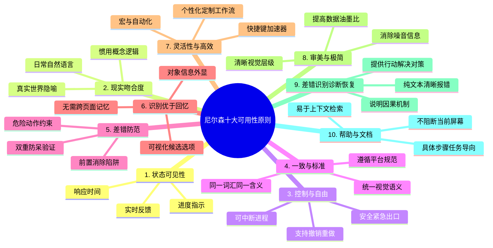
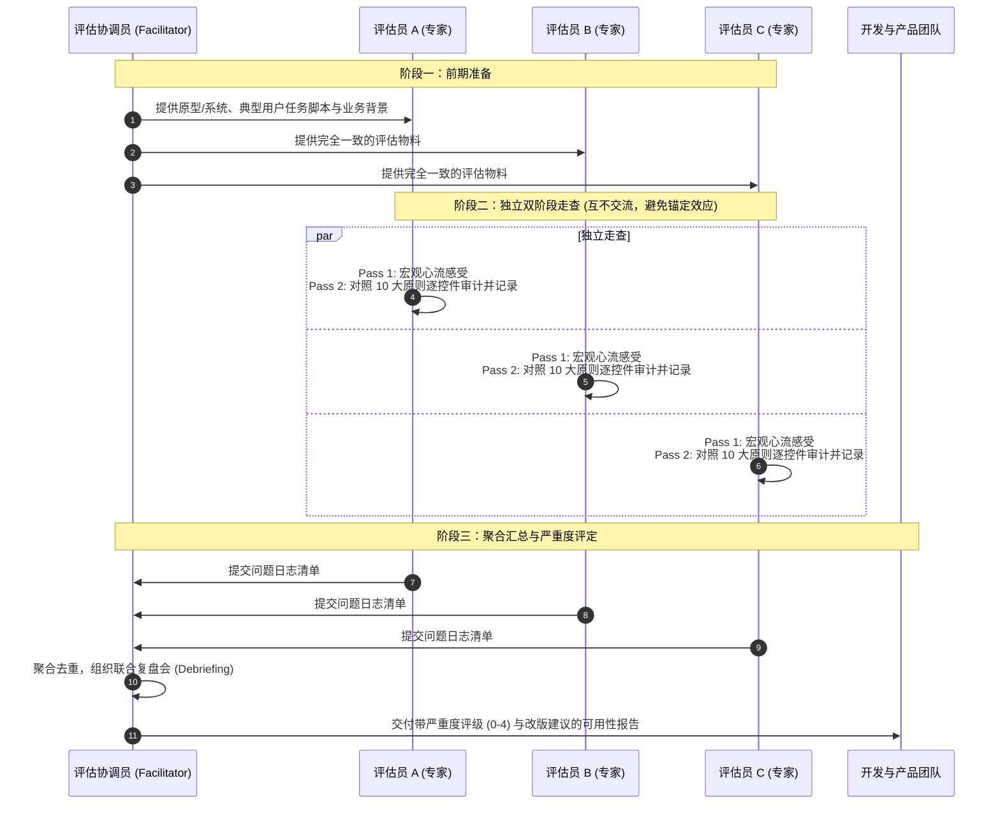
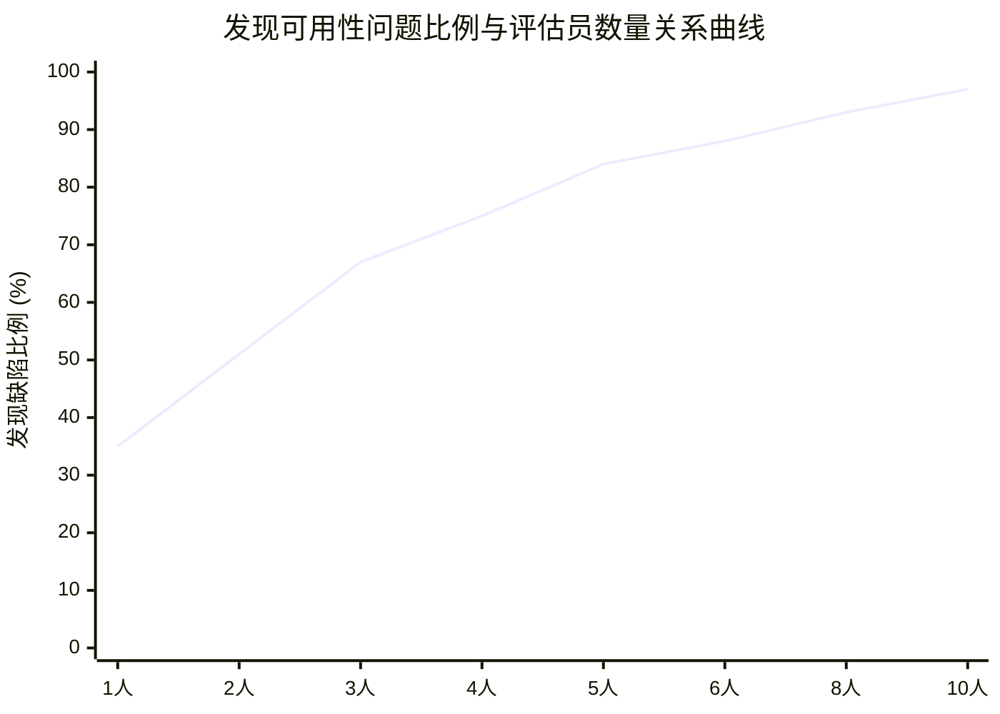

# Lec 9 启发式评估（Heuristic Evaluation & Usability Inspection）

## TL;DR

- **打折可用性工程核心**：启发式评估（Heuristic Evaluation）由雅各布·尼尔森（Jakob Nielsen）创立，属于“打折可用性工程（Discount Usability Engineering）”的关键支柱，通过评估人员对照经典人机交互原则走查界面，以极低的时间和金钱成本捕获常规可用性缺陷；
- **尼尔森十大原则全景**：以系统状态可见性、现实吻合、控制自由、一致性、防错、识别胜于回忆、灵活性与效率、极简审美、容错恢复及文档帮助等 10 项准则为评价标尺；
- **专家规模与边际收益**：单名评估员通常仅能捕获约 35% 的界面问题，而 3–5 名独立评估人员的交叉聚合能以最优的投入产出比发现 75%–85% 的可用性缺陷，超过 5 人后边际效益显著递减；
- **严重度分级与互补验证**：基于问题发生频率、冲击强度与持续性建立 0–4 级严重度量表；启发式评估擅长快速扫除浅层规则违背，必须与深入揭示用户真实心智模型断裂的用户测试（User Testing）双向互补。

---

## 1. 可用性审查与打折可用性工程

在软件工程实践中，用户体验团队经常面临现实的资源困境：正式的实验室用户测试（User Testing）需要招募代表性目标受众、设计受控实验脚本、搭建眼动仪与录屏环境，并消耗数天甚至数周的观察分析时间。在快速迭代的敏捷冲刺（Agile Sprints）中，团队无法在每个版本上线前都进行全套用户测试。

为了在成本、速度与评估深度之间取得工程平衡，可用性工程先驱雅各布·尼尔森提出了**打折可用性工程（Discount Usability Engineering）**理念，其核心武器便是**启发式评估（Heuristic Evaluation）**。

::: definition 启发式评估（Heuristic Evaluation）
一种可用性审查（Usability Inspection）方法：由少数评估人员（通常为 3 到 5 人）独立对照一组公认的、经过长期实证检验的**可用性启发式原则（Usability Heuristics）**，对用户界面的流程、交互控件与视觉反馈进行系统性走查，识别界面中不符合原则的缺陷，并按照严重度进行分级归档。
:::

### 1.1 什么是“启发式原则（Heuristics）”？

在计算机科学与认知心理学中，“启发式（Heuristic）”指的是**一种基于经验法则的、不保证理论绝对最优、但在绝大多数实际场景下高效可靠的实用准则**。

在界面设计领域，启发式原则不是死板的教条规范，而是提炼自成千上万个失败设计教训与成功产品模式的智慧结晶。它指导设计师在面对复杂的交互决策时，快速判断某个界面是否存在违背人类自然认知直觉的隐患。

---

## 2. 尼尔森十大可用性原则深度解构

1994 年，尼尔森基于对数百个可用性问题的因子分析，提炼出了工业界沿用至今的**十大可用性启发式原则（Nielsen's 10 Usability Heuristics）**。这套原则构成了启发式评估的核心审查清单。

### 2.1 原则详解与工程对照

#### 1. 系统状态的可见性（Visibility of System Status）
- **核心主张**：系统应当始终在合理的时间内，通过清晰、即时的反馈，让用户清楚地了解当前正在发生什么。
- **反面教材**：点击“提交订单”后，页面没有任何响应或转圈提示，用户怀疑自己没点准，于是连续快速点击了 5 次，导致同一笔交易重复支付。
- **规范设计**：长耗时操作展示百分比进度条（Progress Bar）或骨架屏（Skeleton Screen）；按钮在点击瞬间变为 `loading` 禁用态，阻断重复请求。

#### 2. 系统与现实世界的吻合（Match between System and the Real World）
- **核心主张**：系统应使用用户熟悉的语言、词汇和概念，而不是面向系统底层的专业术语（Jargon）；信息呈现顺序应当符合现实世界的生活经验。
- **反面教材**：给普通网购用户弹出报错提示：`Error 500: NullPointerException in PaymentGatewayWorker`。
- **规范设计**：使用通俗易懂的表述：“支付网关暂时无响应，您的银行卡尚未扣款，请在 2 分钟后重试”；界面控件复用物理世界成熟隐喻（如音量滑块、文件文件夹图标）。

#### 3. 用户的控制度与自由度（User Control and Freedom）
- **核心主张**：用户在探索界面时经常会误入非预期状态。系统必须提供清晰明显的“紧急出口（Emergency Exit）”，允许用户在不经历繁复步骤的情况下随时放弃离开，并提供健壮的“撤销（Undo）”与“重做（Redo）”。
- **规范设计**：向导流程（Wizard）每一步都提供明显的“上一步”和“取消”按钮；模态对话框支持点击遮罩层外部或按下 `Esc` 键即时退出。

#### 4. 一致性与标准化（Consistency and Standards）
- **核心主张**：遵循两大一致性原则：
  - **内部一致性（Internal Consistency）**：在同一个产品内部，相同的单词、图标、交互模式必须表达同一种含义（例如在 A 页面“保存”是蓝色按钮，在 B 页面绝不能变成绿色链接）；
  - **外部一致性（External Consistency）**：遵循 Web 平台与宿主操作系统的通用标准（如超链接下划线、`Ctrl/Cmd + C` 复制文本）。
- ::: pitfall 别让创新破坏外部一致性
  雅各布定律（Jakob's Law）指出：用户绝大部分时间是在其他网站度过的。如果整个互联网的购物车图标都放在右上角，你为了彰显所谓独特性将其放在屏幕左下角，只会给用户带来极大的寻路迷茫与学习成本。
  :::

#### 5. 差错防范机制（Error Prevention）
- **核心主张**：比提供优秀的报错信息更高明的境界，是从根源上精心设计界面，消除产生错误的土壤。
- **规范设计**：在密码输入框中提供“显示明文”切换开关，防止用户打错；在预订机票的日期选择器中，直接禁用（Disabled）早于起飞时间的到达日期候选，从物理交互上杜绝非法时间组合。

#### 6. 识别优于回忆（Recognition rather than Recall）
- **核心主张**：人类视觉的“再认（Recognition）”依赖外显线索，认知负荷极低；而“回忆（Recall）”依赖从大脑长期记忆中主动检索，极为消耗工作记忆。界面应将操作对象、选项与指导提示直接外显在屏幕上。
- **规范设计**：搜索框提供最近历史搜索与下拉自动联想（Auto-complete），而非让用户自行默写商品确切型号；命令式终端（CLI）与图形界面（GUI）的根本鸿沟即在于回忆与识别。

#### 7. 使用的灵活性与高效性（Flexibility and Efficiency of Use）
- **核心主张**：界面应当同时满足新手（Novices）与专业熟练用户（Experts）的双向诉求。为熟练者提供可加速交互的隐形跳板（Accelerators）。
- **规范设计**：提供丰富的键盘快捷键（Hotkeys）、鼠标双击直达、批量多选拖拽、模板复用，以及允许高级用户定制个人专属工作流工具栏。

#### 8. 审美与极简主义设计（Aesthetic and Minimalist Design）
- **核心主张**：界面的每一个多余像素都在争夺用户有限的注意力。对话框和页面不应包含无关或极少使用的信息，应当最大化“数据油墨比（Data-Ink Ratio）”。
- **规范设计**：弱化不必要的装饰线、高反差阴影与过量渐变；利用空白（Negative Space）拉开视觉层次，突出核心主任务路径。

#### 9. 帮助用户识别、诊断并从差错中恢复（Help Users with Errors）
- **核心主张**：错误消息必须使用自然语言精准表达，明确指出问题的物理根因，并建设性地给出具体可行的补救措施。
- **反面教材**：`输入非法`（用户完全不知道哪里非法、该怎么改正）。
- **规范设计**：`密码长度不足：当前密码仅 6 位，请补充至至少 8 位，并包含至少一个大写字母`。

#### 10. 帮助与文档支持（Help and Documentation）
- **核心主张**：最好的系统无需文档即可自解释。但当复杂专业场景需要帮助时，文档应当易于检索、紧密聚焦于用户的当前任务，并列出清晰可执行的具体操作步骤，而不是通篇堆砌晦涩的技术规格书。

---

## 3. 启发式评估的标准实施流水线

进行一次规范、具有工程效力的启发式评估，必须遵循严谨的三阶段流程：

### 3.1 独立双阶段走查（Two-Pass Inspection）

为了保证评估的深度与客观性，每位专家必须**严格独立作业**，绝不能一边走查一边讨论，否则强势评估员的观点会产生严重的“群体迷思（Groupthink）”与认知锚定。

走查通常分两遍进行：
1. **第一遍（Pass 1 - 宏观交互心流）**：
   - 评估员快速浏览整个界面的主要路径，建立对系统架构、任务流程和设计隐喻的整体直觉；
   - 记录初次接触系统时的全局困惑点；
2. **第二遍（Pass 2 - 微观原则核对）**：
   - 评估员深入各个子功能界面，对照 10 大启发式原则逐个界面元素细致推敲；
   - 记录每一个违背原则的实例。

### 3.2 规范的问题记录格式

记录问题时必须杜绝“这里体验不好”等主观抒情，必须包含**四要素结构**：

::: example 规范的启发式评估问题报告范式
- **问题位置（Where）**：用户结算流程第 2 步，优惠券输入模块（`Checkout-Step2.vue`）；
- **违背的启发式原则（Heuristic Violated）**：原则 9（帮助用户识别并从差错中恢复）+ 原则 5（差错防范）；
- **具体现象描述（What & Why）**：当用户输入的优惠券码已过期时，输入框下方仅闪烁一次红色文字“Coupon Invalid”，并未说明是“拼写错误”、“已过期”还是“未达满减金额”，且原本输入的优惠券字符串被系统自动清空，强迫用户必须重新打字；
- **严重度评级（Severity Rating）**：级别 2（轻度可用性问题，影响结账效率）。
:::

---

## 4. 评估专家规模与边际收益曲线

在工程资源有限的情况下，到底应当派遣多少名专家进行评估？尼尔森与莫利奇（Molich）通过海量实验测算得出了著名的**专家规模收益模型**：

数学模型表达为：
$$\text{Proportion of Problems Found} = 1 - (1 - p)^n$$

其中 $n$ 为评估人员数量，$p$ 为单名评估员发现缺陷的平均概率（实证统计平均值约为 $p \approx 0.35$）。

- **单人评估极不可靠**：单个专家只能发现约 35% 的可用性缺陷，存在巨大的个人认知盲区；
- **最佳投入产出比区间：3 到 5 人**：
  - 3 名评估员可发现约 67% 的问题；
  - 5 名评估员即可覆盖 **84% 左右** 的可用性问题；
  - 超过 5 人后，曲线急剧变平，后续加入的专家发现的大多是已被其他人记录过的重复问题，边际收益急剧递减。

::: insight 领域专家 vs. 可用性专家的“双重专家（Double Experts）”
实验研究表明，评估员分为三类：
1. **通用可用性专家**：懂 HCI 原则，但不熟悉具体行业业务，平均发现约 41% 的缺陷；
2. **领域业务新手**：对业务一知半解，发现率极低；
3. **双重专家（Double Experts）**：**既精通可用性人机工程学，又在所评估的领域（如医疗手术软件、高频量化交易终端、集成电路 CAD）具备深厚实战经验**。双重专家单人即可捕获超过 **60%–70%** 的致命缺陷！
:::

---

## 5. 严重度分级体系（Severity Ratings: 0–4）

发现成百上千个可用性问题后，开发团队不可能在一夜之间全部修复。必须依赖客观的量化权重进行排期裁决。

严重度等级主要由三大维度综合决断：
1. **发生频率（Frequency）**：该问题是高频出现还是仅在罕见极端边界出现？
2. **影响强度（Impact）**：用户遇到该问题后是能轻松克服，还是彻底卡死并造成工作成果损失？
3. **持续程度（Persistence）**：是一次性跨越即懂的问题，还是每次使用都会持续阻碍用户的慢性痛苦？

| 级别 | 定义标签 | 严重度表现特征 | 建议工程处置契约 |
| :---: | :--- | :--- | :--- |
| **0** | **不是问题** | 纯属个人审美偏好争议，不违反任何可用性原则 | 无需修复，关闭工单 |
| **1** | **微小瑕疵（Cosmetic）** | 表面视觉微瑕，不阻断任务心流（如间距略微偏斜 2 像素） | 仅在有空余带宽时顺手修复 |
| **2** | **轻度问题（Minor）** | 造成轻微困惑或延误，用户可自行探索克服 | 赋予低优先级修复排期 |
| **3** | **主要问题（Major）** | 显著阻碍核心任务完成，导致用户严重挫败甚至放弃 | **必须在高优先级迭代中修复** |
| **4** | **灾难性问题（Catastrophe）** | 核心主流程彻底阻断、造成严重资金或数据毁损、系统崩溃 | **立即停机或阻断发版（Blocker），当场攻关修复** |

---

## 6. 启发式评估 vs. 用户测试：双轮驱动的科学验证

在现代高质量软件工程中，启发式评估与用户测试从来不是二选一的对立关系，而是相互印证、交替推进的互补双翼。

| 比较维度 | 启发式评估（Heuristic Evaluation） | 用户测试（User Testing） |
| :--- | :--- | :--- |
| **核心执行主体** | **评估专家 / 经过培训的同伴** | **真实的目标终级用户（End-Users）** |
| **测试实施阶段** | 全流程，尤其适用于**设计极早期（草图、低保真线框）** | 适用于**中后期可交互原型或高保真可运行系统** |
| **实施成本与周期** | **极低、极快**（1–2 天即可输出完整报告） | **较高、较慢**（需招募受试者、录音录屏、转录分析） |
| **擅长捕获的问题** | 浅层违背、排版杂乱、快捷键遗漏、系统一致性断裂 | 深层心智模型割裂、真实认知障碍、意料之外的惊喜反馈 |
| **固有局限性** | 专家可能会产生“假阳性（报告了用户实际不在乎的问题）” | 容易漏掉那些在测试脚本任务路径之外的边缘死角问题 |

::: insight 工业级推荐组合打法
最经济高效的工程流水线是：
1. 在产品完成纸面原型或中保真原型时，**首先进行 1 轮 3–5 人的内部启发式评估**；
2. 迅速扑灭所有显而易见的、低级的违背（清理掉由于粗心造成的 0–2 级噪音）；
3. 随后将打磨后的干净系统**交给 5 名真实用户进行“出声思考（Think-Aloud）”用户测试**；
4. 此时用户的注意力不会被那些低级拼写或按钮位置所干扰，测试能够直击系统概念模型与核心业务价值的最深层本质。
:::
