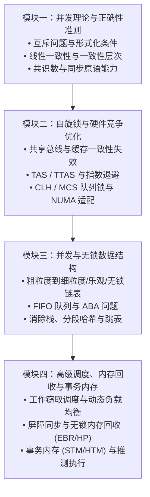

# 6.5080/6.836 多核编程（Multicore Programming）

## TL;DR

- 本课程系统探讨现代共享内存多核硬件的并发编程原理、可扩展同步算法与无锁数据结构设计。
- 以 Herlihy 与 Shavit 的经典教材为纲，涵盖互斥锁竞争、可扩展队列自旋锁、无锁队列/栈、并发哈希、工作窃取调度与软件事务内存。
- 核心学习路径实现从形式化数学正确性证明（如线性一致性与共识层次）到底层体系结构特性（缓存一致性、NUMA 拓扑、总线通信）的深度贯通。
- 前置依赖为算法导论（6.1210），推荐具备体系结构与系统编程基础；期末大作业完成高度并发的大型多核应用程序设计。

## 课程描述

### 先修课程

- **[6.1210 算法导论（Introduction to Algorithms）](../../tcs/61210_introduction_to_algorithms/index.md)**：掌握渐进复杂度分析、基础图算法与基本数据结构设计。
- **推荐先修或辅助知识**：建议掌握计算机体系结构（如 [6.1910 计算结构](../../arch/computation_structures/index.md)）或操作系统工程（如 [6.1800 计算机系统工程](../../computer_sys/os/index.md)），熟悉硬件缓存层级、虚拟内存与底层多线程并发编程。

### 官方课程描述与培养目标

**课程英文全称**：Multicore Programming（授课教授：Nir Shavit）

本课程系统介绍多核计算机系统编程的核心原理与关键技术。随着单核处理器主频受限于物理功耗墙，计算性能的提升全面转向芯片内多核并行。然而，多核并行绝非简单的多线程并发，跨核共享内存的同步与通信开销往往成为系统吞吐扩展的致命瓶颈。

课程重点涵盖：
1. **锁与可扩展性（Locking & Scalability）**：从经典互斥问题到基于硬件原语的高性能队列锁；
2. **并发数据结构（Concurrent Data Structures）**：细粒度锁、乐观同步、懒惰同步与非阻塞无锁结构（链表、跳表、队列、哈希表）；
3. **多处理器调度与负载均衡（Multiprocessor Scheduling & Load Balancing）**：工作分配、工作窃取（Work-Stealing）调度机制；
4. **前沿同步技术（Advanced Synchronization）**：软件事务内存（STM）、硬件事务内存（HTM）以及安全内存回收（Hazard Pointers、Epoch 回收）。

课程包含在一台大型多核服务器上开展的一系列渐进式编程作业，最终以设计并优化一个高度并发的实际应用程序作为结课项目。选修研究生版本（6.5080）的学生需完成额外的理论推导与前沿论文研读。

### 参考书籍与核心教材

- **Maurice Herlihy, Nir Shavit, Victor Luchangco, Michael Spear**. *The Art of Multiprocessor Programming* (2nd Edition). Morgan Kaufmann, 2020.（多处理器编程的艺术，国际经典权威教材，涵盖理论证明与工程实现）

## 课程内容全景

### 模块全景架构

多核编程的知识演进由理论模型向硬件物理现实逐步深入。在传统算法设计中，程序执行时间完全由总指令步数决定；而在现代多核计算环境下，处理器核心之间的通信延迟与总线拥塞成为了制约可扩展性的首要矛盾。

为了建立严密且能落地的并发系统设计能力，本课程体系从纯粹的形式化正确性推导出发，逐步下沉至物理微架构特性，并向上构建高性能数据结构与前沿事务抽象，整体划分为四大环环相扣的核心支柱：

1. **并发理论与正确性准则**：界定并发系统的数学语义边界，明确互斥性、死锁自由与饥饿自由的判定条件，并通过共识层次（Consensus Hierarchy）证明基础同步原语（如 CAS 与寄存器）在计算能力上的本质差距；
2. **硬件架构感知与自旋锁演进**：直面多处理器总线通信与缓存一致性机制，剖析 TAS 与 TTAS 锁引发的总线失效风暴，进而引入基于 FIFO 队列的点对点单播自旋锁（CLH 与 MCS），解决跨 NUMA 节点访问延迟；
3. **并发与无锁数据结构设计**：从粗粒度加锁逐步跃迁至细粒度、乐观锁、懒惰锁与基于 CAS 的无阻塞无锁结构，深入处理 FIFO 队列中的 ABA 内存回收难题、消除池并发栈与分段并发哈希表；
4. **高级调度、内存回收与事务内存**：通过工作窃取（Work-Stealing）算法实现动态不平衡任务的高效调度，并探索以软件事务内存（STM）与硬件事务内存（HTM）为代表的推测执行范式，彻底化解锁在可组合性上的软件工程灾难。

四大模块呈现出严格的递进依赖关系：没有模块一的形式化线性一致性基础，便无法验证无锁数据结构的正确性；没有模块二对总线与缓存一致性的物理直觉，便无法理解为什么简单的无锁循环可能比粗粒度锁更为缓慢；而模块四则在前三者的基础上，实现了从命令式锁向声明式乐观推测的终极范式跃迁。

### 讲义全景清单

| 讲次 | 讲义标题与核心主题 | 状态 | 对应教材章节 |
| :--- | :--- | :---: | :--- |
| **Lec 1** | [课程总览与多核并发挑战](./lec1.md)（阿姆达尔定律、摩尔定律转向与并发核心问题） | complete | Chapter 1 |
| **Lec 2** | [经典互斥算法与数学证明](./lec2.md)（LockOne/LockTwo、Peterson 锁、过滤锁、面包店算法与空间下界） | complete | Chapter 2 |
| **Lec 3** | [并发对象与正确性条件](./lec3.md)（顺序规范局限、顺序一致性、线性一致性、静止一致性与进展保证） | complete | Chapter 3 |
| **Lec 4** | 共享内存基础属性（原子寄存器模型、安全与正则寄存器） | draft | Chapter 4 |
| **Lec 5** | 同步原语的计算能力（共识数、Consensus Hierarchy、CAS/LL-SC 能力界限） | draft | Chapter 5 |
| **Lec 6** | 通用无等待同步构造（Universal Wait-Free Construction） | draft | Chapter 6 |
| **Lec 7** | [自旋锁与总线竞争优化](./lec7.md)（TAS/TTAS、指数退避、CLH/MCS 队列锁、NUMA 拓扑适配） | complete | Chapter 7 |
| **Lec 8** | 管程锁与条件等待（Monitors, Conditions, Lost Wakeup） | draft | Chapter 8 |
| **Lec 9** | 并发链表（细粒度锁、乐观同步、懒惰同步、无锁链表） | draft | Chapter 9 |
| **Lec 10** | [事务内存与锁的抽象困境](./lec10.md)（锁的组合性危机、事务宣言、OCC 原理、STM/HTM） | complete | Chapter 18 |
| **Lec 11** | 并发栈与消除池（Elimination Backoff Stack） | draft | Chapter 11 |
| **Lec 12** | 并发计数与排序网络（Counting Networks, Bitonic Sorting） | draft | Chapter 12 |
| **Lec 13** | 并发哈希表（Striped Hash Map, Recursive Split-Ordering） | draft | Chapter 13 |
| **Lec 14** | 跳表与并发搜索（Lock-based / Lock-free Skip Lists） | draft | Chapter 14 |
| **Lec 15** | 优先队列与松弛一致性（Priority Queues, Relaxed Consistency） | draft | Chapter 15 |
| **Lec 16** | 工作窃取与任务调度（Work Stealing, Cilk 调度模型） | draft | Chapter 16 |
| **Lec 17** | 数据并行与流处理（Data Parallelism, Fork-Join） | draft | Chapter 17 |
| **Lec 18** | [乐观并发与安全内存回收](./lec18.md)（C++ 乐观并发、野指针与 ABA 危害、SMR 风险指针与 EBR/RCU） | complete | Chapter 18, 19 |
| **Lec 19** | 无锁安全内存回收（Hazard Pointers, Epoch-Based Reclamation） | draft | Chapter 10, 19 |
| **Lec 20** | 事务性编程高级实践（TL2 算法、硬件事务内存受限与折中） | draft | Chapter 18 |

### 核心概念索引

- [Peterson 互斥锁](./concept/peterson-lock.md)：经典的双线程纯软件无饥饿互斥算法。
- [线性一致性](./concept/linearizability.md)：多核与分布式并发对象正确性的形式化黄金标准。
- [CLH 队列锁](./concept/clh-lock.md)：基于前驱节点状态自旋的 FIFO 隐式队列锁。
- [MCS 队列锁](./concept/mcs-lock.md)：基于本地节点自旋的显式队列锁，完美适配 NUMA 拓扑。

## 官方资源

- **MIT 官方选课页面**：[MIT 6.5080 Course Catalog](https://student.mit.edu/catalog/m6b.html#6.5080)
- **授课教师主页**：[Nir Shavit at MIT CSAIL](https://people.csail.mit.edu/shanir/)
- **教材配套网站**：[The Art of Multiprocessor Programming (Elsevier)](https://www.elsevier.com/books/the-art-of-multiprocessor-programming/herlihy/978-0-12-415950-1)
