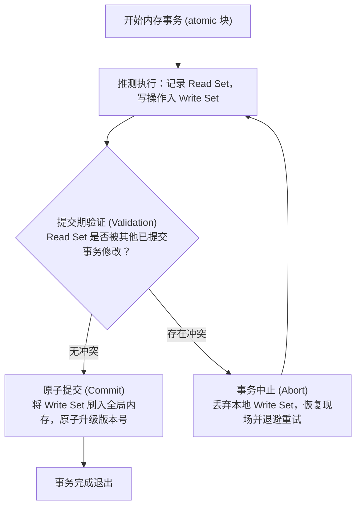

# Lec 10 事务内存与锁的抽象困境（Transactional Programming & STM）

## TL;DR

- 传统基于显式锁的并发控制在构建大型可伸缩软件时面临三大本质困境：粗细粒度锁的扩展性悖论、异常时的健壮性丧失以及核心的可组合性（Composability）破裂。
- 无论是跨对象的原子双向操作（如转账）还是条件同步（Monitor Wait/Signal），锁的粒度与协议都被迫泄露给上层调用者，彻底击穿模块封装边界。
- 事务性宣言（The Transactional Manifesto）倡导以声明式内存事务（`atomic { ... }`）取代指令式锁，将并发安全调度全权交由底层运行时负责。
- 事务内存主要基于乐观并发控制（OCC），借助读写集跟踪、版本校验与冲突中止回滚，兼顾无死锁保证、强组合性与高平均并行吞吐。

## 锁机制在多核时代的抽象破裂

显式锁（Locking）是多线程并发编程中最历史悠久的抽象。然而，随着计算架构迈入拥有数十乃至上千个物理核心的时代，基于锁的软件设计逐渐暴露出其深层的结构性缺陷。

### 粗粒度锁与细粒度锁的不可调和矛盾

软件工程师在使用锁保护共享状态时，始终被困在一对根本性的两难选择之中：

1. **粗粒度锁（Coarse-Grained Locking）**：
   - 用单把大锁保护整个数据结构或子系统（例如操作系统的全局大内核锁 BKL）。
   - **优势**：极易验证算法正确性，几乎不产生死锁。
   - **缺陷**：极度匮乏可扩展性。所有线程对不同数据的访问被迫串行化排队，硬件核心数越多，CPU 空转等待比例越高，阿姆达尔定律中的串行瓶颈被无限放大。
2. **细粒度锁（Fine-Grained Locking）**：
   - 为每个数据节点、每个哈希桶甚至每个变量配置独立的细粒度锁（如条带锁 Striped Locking、单链表锁耦合 Hand-over-hand Locking）。
   - **优势**：大幅提升不同数据项之间的并行访问吞吐。
   - **缺陷**：实现与调试成本呈指数级膨胀。锁的分配、获取顺序与释放条件极其繁琐，死锁、活锁、优先级反转与竞态漏洞屡禁不绝。

### 健壮性缺陷（Lack of Robustness）

锁是一种高度脆弱的“状态依赖”机制。持有锁的线程如果由于以下任何原因未能及时释放锁，整个系统将被迫走向不可逆的级联死锁：
- 线程在临界区内抛出未捕获的运行时异常；
- 线程遭遇内存缺页中断（Page Fault）或发起阻塞式 I/O 调用；
- 操作系统内核抢占（Preemption）将持有锁的线程强制切出 CPU；
- 线程遭遇逻辑死循环。

由于锁机制无法区分“线程正常运行中”与“线程已挂起失联”，其他排队等待该锁的核心只能无限期停滞，系统完全丧失容错自愈能力。

### 致命的可组合性危机（Composability Breakdown）

在现代软件工程中，**模块化与可组合性（Composability）**是构建大型可伸缩系统的核心基石：如果模块 A 是正确的，模块 B 是正确的，那么开发者理应能够将 A 与 B 组合起来，构建出更高层次且同样正确的复合操作。

然而，**基于锁的并发程序在本质上是不可组合的（Locks Do Not Compose）**。

#### 案例一：银行原子双向转账

假设存在一个设计优良的银行账户类 `Account`，其内部使用细粒度互斥锁确保单次操作的线程安全：

```java
public class Account {
    private final Lock lock = new ReentrantLock();
    private int balance;

    public void withdraw(int amount) {
        lock.lock();
        try {
            balance -= amount;
        } finally {
            lock.unlock();
        }
    }

    public void deposit(int amount) {
        lock.lock();
        try {
            balance += amount;
        } finally {
            lock.unlock();
        }
    }
}
```

现在，业务需要组合出一个原子的转账方法 `transfer(Account from, Account to, int amount)`。
- 如果简单调用 `from.withdraw(amount)` 随后调用 `to.deposit(amount)`，两个操作之间存在时间窗口，外界可以观测到“钱已被扣除但尚未存入”的不一致中间状态（破坏了原子性）；
- 如果试图在外层同时锁定两个账户，若线程 1 执行 `transfer(A, B, 100)`，同时线程 2 执行 `transfer(B, A, 50)`，两线程将分别持有 A 和 B 的锁并等待对方释放，**瞬间诱发致命死锁**！

为了避免死锁，客户端必须建立一套全局规则（例如根据账户 ID 排序依次加锁）。这意味着：**调用方必须深度了解两个账户内部的并发锁细节与全局协议**。

::: pitfall 锁协议暴露与抽象层击穿
为了保证并发安全，对象不能自行隐藏并发控制逻辑，而是被迫将锁定协议暴露给所有外部客户端代码。这彻底击穿了面向对象体系中的“封装性（Encapsulation）”与“信息隐藏（Information Hiding）”原则。原本清晰的抽象层彻底沦陷，并发控制逻辑散落渗透至系统的各个角落。
:::

#### 案例二：并发队列的原子转移

考虑两个各自线程安全的并发队列 `Queue1` 和 `Queue2`。开发者无法在不修改队列内部源码的情况下，将它们组合成一个原子性的复合操作：从 `Queue1` 弹出一个元素并将其压入 `Queue2`。任何尝试在外部加锁的方案都会陷入锁协议暴露或死锁的泥潭。

#### 案例三：管程条件等待的组合失败（Monitor Wait & Signal Do Not Compose）

在 Java 等语言中广泛采用的管程（Monitor）模型中，`wait()` 操作要求当前线程自动释放该管程的内置监视器锁。然而，在多层嵌套管程中：
- 线程在内层管程调用 `wait()` 时，**仅释放最内层的锁，外层管程锁依然被该线程死死持有**；
- 负责发送 `signal()` 唤醒信号的另一个线程若需要穿透外层管程，便会被外层未释放的锁永久阻断，酿成经典的**嵌套管程死锁（Nested Monitor Lockout）**。

## 事务性宣言与声明式并发

### 数据库领域的先验启示

在关系型数据库领域，成百上千个客户端连接同时对数以亿计的表记录执行复杂操作，却极少需要应用层程序员手动操控行锁、表锁或意向锁。数据库之所以能兼顾极高并发吞吐与清晰代码结构，核心原因在于其采纳了 **ACID 事务模型**。

开发者只需向系统声明事务边界：

```sql
BEGIN TRANSACTION;
UPDATE accounts SET balance = balance - 100 WHERE id = 'A';
UPDATE accounts SET balance = balance + 100 WHERE id = 'B';
COMMIT;
```

数据库引擎底层全权负责版本控制、锁升级、冲突检测与死锁打破，对应用开发者完全透明。

### 事务性宣言（The Transactional Manifesto）

多核计算领域的顶尖学者（包括 Maurice Herlihy 与 Nir Shavit 等）提出了**事务性宣言（The Transactional Manifesto）**：
- 许多源自单核时代的现代编程范式在多核世界中已难以为继；
- 必须推动系统软件的根本性范式跃迁：**用事务性内存 API（Transactional Memory）全面取代显式锁**；
- 赋予编程语言与运行时系统内建的事务支持，让并发控制从“指令式的命令操作”解放为“声明式的目标描述”。

```java
// 理想的声明式内存事务语法
atomic {
    accountA.withdraw(100);
    accountB.deposit(100);
}
```

在声明式事务范式下，程序员只负责指明操作的**原子性边界（Atomicity Boundary）**；如果底层发生并发冲突，运行时系统会自动重试，彻底消除了死锁风险并恢复了模块的可组合性。

## 事务内存核心机理：乐观并发控制（OCC）

### 悲观互斥 vs 乐观推测

- **传统锁（悲观机制）**：
  假定冲突频繁发生。线程在访问数据前必须先构筑防线（获取锁），哪怕其他线程此时根本没有访问意图，也要付出沉重的总线与原子指令开销。
- **事务内存（乐观机制）**：
  假定在大多数情况下，不同线程并发操作的数据集并不重叠。事务允许各线程并行展开**推测执行（Speculative Execution）**，直到提交前夕才进行冲突验证。

### 内存事务的生命周期三部曲



1. **读写集记录（Tracking Read & Write Sets）**：
   - **Read Set**：事务在推测执行过程中，所有读取过的内存地址及其版本时间戳被记录在事务专有的读集合中；
   - **Write Set**：事务所有的内存写操作并不会立即覆写全局共享内存，而是暂存在事务本地的写缓冲集合中。
2. **提交期验证（Validation Phase）**：
   - 当事务执行完毕准备提交时，系统迅速检查其 Read Set 中的所有内存地址。如果在此期间没有任何其他事务成功修改过这些地址，则验证通过。
3. **原子提交或中止（Commit or Abort）**：
   - **Commit**：事务原子性地将 Write Set 中的所有改动刷入主内存，并递增全局版本号；
   - **Abort**：如果验证失败（检测到数据冲突），事务立即中止。本地 Write Set 被直接丢弃，内存数据丝毫未损，事务自动进行退避并在稍后重新发起推测执行。

::: definition 事务内存（Transactional Memory, TM）
事务内存是一种基于共享内存的并发控制架构。它将一段内存读写指令序列封装为具有原子性（Atomicity）、一致性（Consistency）与隔离性（Isolation）的独立事务。事务在隔离环境中推测执行，并通过底层冲突检测机制保证要么全量成功生效，要么完整回滚且不留任何副作用。
:::

## 软件事务内存（STM）与硬件事务内存（HTM）的现实折中

为了让事务内存落地，学术界与工业界分别探索了两种截然不同的工程路径：

### 软件事务内存（Software Transactional Memory, STM）

- **实现机制**：纯软件库或编译器扩展（例如著名的 TL2 算法、TinySTM）。在每个对象头或内存条带中注入软件锁与版本戳，编译器自动在每次内存读写处插入屏障函数（Read/Write Barriers）。
- **优势**：
  - 不受硬件资源限制，支持任意大尺寸的事务和任意复杂的嵌套调用；
  - 具备跨架构的高可移植性。
- **代价**：
  - 软件维护读写集、计算哈希映射与验证版本号的开销极其沉重。在低冲突场景下，STM 的单线程吞吐可能比原生无锁代码慢数倍甚至数十倍。

### 硬件事务内存（Hardware Transactional Memory, HTM）

- **实现机制**：CPU 芯片硬件原生支持事务语义（例如 Intel 的 TSX 指令集扩展、IBM POWER 架构与 ARM TME）。
- **硬件妙手**：HTM 巧妙复用了物理核心的 **L1 数据缓存** 与底层的 **MESI 缓存一致性总线协议**：
  - 读集合通过监控 L1 缓存行的 Shared 状态实现：若其他核心试图修改该行向总线广播 Invalidate，硬件自动标记事务冲突；
  - 写集合通过缓冲在 L1 缓存行的 Modified 状态实现：提交时硬件直接完成批处理，无需任何软件屏障。
- **硬件瓶颈与局限**：
  - **容量中止（Capacity Abort）**：硬件事务的读写集不能超出 L1 缓存的物理容量（通常仅几十 KB）。一旦事务涉及的数据量溢出缓存，硬件无条件强制中止；
  - **非投机操作冲突**：硬件事务内部严禁执行系统调用（如文件 I/O、网络收发）或触发 CPU 中断，否则硬件会立即判定事务非法并终止执行。

### 混合事务内存（Hybrid Transactional Memory, HyTM）

为了兼顾硬件的极致低延迟与软件的无界容量，现代工业级实现通常采用混合事务内存方案：
- 事务优先使用原生的硬件 TSX 极速推测执行；
- 如果多次发生容量溢出或系统异常中止，系统透明平滑地降级回退到软件 STM 或全局备用锁（Fallback Lock）继续执行。

## 我的理解与体系启示

::: insight 悲观互斥到乐观推测的并发范式跃迁
从显式锁到事务内存的跃迁，是计算机系统设计中一次典型的从“面向指令的悲观控制”向“面向声明的乐观推测”的范式革命：
1. **控制权倒转**：显式锁要求程序员既要当“业务逻辑编写者”，又要当“微观硬件时序调度员”，在复杂系统中不可避免地因为加锁顺序微小偏差导致死锁崩溃；而事务内存将同步契约提升为声明式的 `atomic`，由底层机制兜底。
2. **失败语义的根本改变**：在锁的世界里，并发控制失败意味着死锁、数据损坏或崩溃（灾难性破坏）；而在事务内存中，并发冲突被降维为可控的推测失败与透明重试，彻底解放了软件的可组合性与健壮性。
3. **工程务实性反思**：尽管事务内存在理论上极其优美，但硬件缓存物理限制与软件簿记开销使纯事务内存尚未在通用编程中全面取代锁。然而，其乐观推测、读写集分离与版本校验的核心思想，已深刻融入了现代高性能无锁数据结构、数据库存储引擎及大规模分布式系统中。
:::
