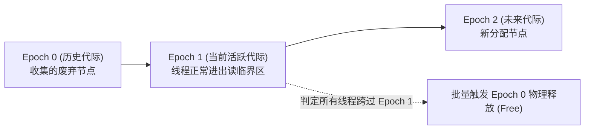

# Lec 18 乐观并发与安全内存回收（Optimistic Concurrency & Safe Memory Reclamation）

## TL;DR

- 乐观并发控制假定冲突罕见，允许操作在未锁定的共享数据上推测遍历，在提交前完成合法性校验。
- 在缺乏垃圾回收（GC）的手动内存管理语言（如 C++）中，乐观并发面临毁灭性的内存安全挑战：悬挂指针解引用、ABA 问题、内存被操作系统回收导致的段错误（Segfault）以及跨类型内存复用引发的类型安全破坏。
- 引用计数（如 `std::atomic_shared_ptr`）虽然能提供细粒度延迟释放，但频繁原子修改计数器会引发灾难性的缓存行总线颠簸（Cache Line Bouncing）。
- 工业级高性能无锁系统主要依靠安全内存回收机制（SMR）：风险指针（Hazard Pointers）通过线程局部公告板实现点对点保护；基于代际的回收（Epoch-Based Reclamation, EBR）与 RCU 通过全局静止期批处理，达成零开销读路径与极致扩展性。

## C++ 并发编程与显式内存管理困境

在基于共享内存的多核并发系统中，C++ 提供了完善的语言级并发原语：通过 `<thread>` 提供操作系统线程、通过 `<atomic>` 提供精确的硬件原子操作与内存一致性模型（Relaxed, Acquire/Release, Sequentially Consistent）。

然而，与 Java、C# 或 Go 等具备自动运行时垃圾回收（Garbage Collection, GC）的语言相比，C++ 存在一个深刻的体系鸿沟：**它缺乏自动内存生命周期管理机制，内存的物理分配与释放完全由程序员手动负责。**

在传统单线程或粗粒度加锁系统中，显式内存管理可以通过清晰的所有权模型（如 `std::unique_ptr`）顺利解决。然而，当我们转向高性能的**乐观并发（Optimistic Synchronization）**与**无锁数据结构（Lock-Free Data Structures）**时，手动内存管理演变为一个足以摧毁整个系统稳定性的工程噩梦。

::: definition 乐观并发（Optimistic Synchronization）
一种推测性并发设计哲学。算法假定绝大多数操作之间不存在数据冲突，因此允许线程在不获取排他锁、甚至不进行预先协调的情况下，直接并行遍历和读取共享数据；仅在操作最终准备生效（提交）的前夕，才执行冲突验证与一致性校验。
:::

## 乐观并发的隐式安全假设

在乐观并发算法中，有一个普遍成立的算法逻辑假设：
$$\text{若某个操作 } O_1 \text{ 的并发提交导致另一个挂起中的操作 } O_2 \text{ 失效，} O_2 \text{ 即使延迟感知并从头重试，也不会危害系统正确性。}$$

在具备自动 GC 的托管运行时中，上述假设是绝对成立且安全的：
- 只要线程持有一个局部对象引用（处于线程栈或 CPU 寄存器中），垃圾收集器就绝对不会物理回收该对象；
- 即便该节点早已被其他线程从链表或树结构中摘除（逻辑删除），该内存依然合法有效，重试线程读取该废弃节点的 `next` 指针绝不会引发硬件崩溃。

然而，在 C++ 等手动回收语言中，这一假设轰然倒塌：**持有一个指针，绝不保证该内存区域依然可以被安全解引用！**

## 并发物理释放引发的四大灾难性竞态

考虑一个典型的并发链表操作场景：
- 线程 T1 正在乐观遍历链表，刚刚读取到值为 7 的节点的 `next` 指针（指向节点 8）；
- 与此同时，并发线程 T2 成功将包含值 8 的节点从链表中物理移除，并立即调用 `delete` 或 `free()` 释放了该节点内存；
- 随后，线程 T1 尝试解引用刚刚获取到的指针，试图读取节点 8 的字段。

一旦物理内存被归还给内存分配器（Allocator），T1 的后续读取将触发以下四种毁灭性的未定义行为（Undefined Behavior, UB）：

1. **同类型内存覆写与脏读**：
   线程 T2 可能紧接着调用 `new Node()` 创建了一个新节点，内存分配器恰好将刚刚释放的节点 8 的原内存地址复用。当 T1 尝试访问时，T2 可能还在对该节点进行初始赋值，T1 读取到处于撕裂或非法中间态的野数据；
2. **经典的 ABA 逻辑穿透**：
   假设 T2 分配的新节点值被设为 25 并插入到其他位置。若 T1 正在链表中查找值 9，T1 会错误地认为节点 7 依然链接着值为 25 的节点，进而做出“值 9 不在列表中”的错误判定，甚至在 CAS 比较时因物理地址相同而发生灾难性的 ABA 误判；
3. **类型安全彻底崩溃**：
   另一个完全不相干的线程 T3 可能会调用 `new Task()` 创建一个完全不同结构的对象，分配器同样复用了这块内存。T1 将其当做链表节点强制解引用，破坏了内存布局与类型系统的物理边界；
4. **致命段错误与操作系统崩溃（Segmentation Fault）**：
   内存分配器可能将包含该地址的整个内存页通过 `munmap()` 或 `brk()` 归还给操作系统内核。当 T1 再次解引用该指针时，硬件 MMU 触发页面保护缺页中断，操作系统内核直接向进程发送 `SIGSEGV` 信号，程序立即崩溃暴毙。

::: pitfall 乐观并发与野指针陷阱
在非 GC 语言中，无锁并发数据结构的节点删除绝不能是简单的两步法：`从结构中摘除 -> 立即 free()`。必须严格保证：**任何可能正被并发线程持有的指针，其指向的物理内存绝不可被提前归还给系统分配器。**
:::

## 保护挂起操作的核心充分条件

为了防范上述由于并发释放引发的内存访问竞争，我们必须在理论上界定安全内存回收的充要边界：

::: definition 安全内存回收（Safe Memory Reclamation, SMR）充分条件
对于任意被逻辑删除的内存区域 $M$，**当且仅当系统能够严格证明当前没有任何挂起中的线程操作（Pending Operations）持有指向 $M$ 的潜在指针时，才允许对 $M$ 执行物理释放（Free / Delete）。**
:::

换言之，**物理释放必须被延迟执行（Deferred Reclamation）**，直至整个多核系统度过了一个所有并发观察者均已撤退的“安全期”。

## 引用计数方案及其总线缓存颠簸

针对延迟释放，最直观的工程解法是**引用计数（Reference Counting）**。在 C++ 中，可以通过 `std::atomic_shared_ptr<>` 为每个数据节点关联一个原子引用计数器。

### 引用计数的运行机理

- 节点每被一个外部指针引用（无论是链表内部的前驱指向，还是线程栈上的局部变量持有），计数器加 1；
- 线程使用完毕将局部指针重置时，计数器减 1；
- 当计数器归零时，说明系统中没有任何活体指针指向该节点，当前减计数的线程接管最后责任，调用 `delete` 释放物理内存。

### 架构级性能陷阱：缓存行颠簸（Cache Line Bouncing）

尽管引用计数在语义上极其完备，但在高性能多核数据结构中，它彻底扼杀了系统的可扩展性：

1. **内存足迹翻倍与遍历延迟增加**：
   每个指针必须包裹原子控制块，不仅增加了额外的堆内存开销，更导致指针解引用的缓存缺失（Cache Miss）概率倍增；
2. **只读操作被退化为全核写竞争**：
   在理想情况下，并发只读查找（如并发 `contains()` 或 `find()`）应当是纯粹的无干扰只读操作。然而，为了维护引用计数，**每一个遍历途经该节点的线程都必须对其计数器执行两次强制性的原子加减操作**。
3. **总线风暴再现**：
   不同核心频繁对同一个计数器发起原子写指令（`LOCK XADD`），导致缓存一致性协议在各个核心之间不断广播 Invalidate 消息，缓存行在各个 CPU 插槽之间剧烈震荡（Cache Line Bouncing），系统的并发吞吐发生断崖式下跌。

## 安全内存回收（SMR）的两大主流范式

为了在不消耗原子写总线带宽的前提下实现安全延迟释放，现代多核系统演化出两套最具代表性的 SMR 机制：

### 1. 风险指针（Hazard Pointers, HP）

由 Maged Michael 提出的风险指针是目前主流工业级库（如 Facebook Folly、Jemalloc）广泛采用的技术：

- **局部公布槽（Hazard Pointer Array）**：
  系统为每个工作线程分配少量（通常 1~2 个）全局可见但仅由该线程写入的原子指针槽；
- **读前公告**：
  线程在解引用某个节点之前，先将该节点物理地址写入自己的 Hazard Pointer 槽中，向全世界宣告“我正在访问此节点，任何人不得回收”；
- **延迟退役列表（Retire List）**：
  当某个线程将节点从数据结构中摘除后，它不执行 `delete`，而是将节点加入自己的本地退役列表中；
- **批量扫描回收**：
  当退役列表累积达到一定阈值时，回收线程统一读取所有线程的 Hazard Pointer 槽。只有不在任何现存 HP 公告栏中的孤立节点，才被安全物理销毁。

### 2. 基于代际的内存回收（Epoch-Based Reclamation, EBR / RCU）

基于代际的内存回收（EBR）是 Linux 内核 RCU（Read-Copy Update）在用户态无锁数据结构中的等价演化，具备极致的只读零开销：

- **全局代际时钟**：系统维护一个全局的代际计数器 `Global Epoch`（通常仅在 0, 1, 2 之间循环轮转）；
- **读临界区零同步**：
  线程进入读临界区时，只需在本地将自己的标志置为活跃，并将本地 Epoch 与全局 Epoch 同步。在遍历过程中，**读路径不产生任何针对共享计数器的原子写操作，完全在私有缓存内命中**；
- **静止状态判定（Quiescent State）**：
  当所有处于活跃状态的线程都已经推进到了新的代际后，系统判定已进入全局静止期；
- **批量安全释放**：两个代际之前的废弃节点已经绝不可能被任何现存操作访问，回收线程可以在后台批量执行物理内存回收，实现极高吞吐。

## 我的理解与体系启示

::: insight 内存回收是无锁算法不可分割的物理基石
许多初学并发编程的工程师常常以为“无锁数据结构”就是巧妙地用一堆 CAS 和原子指针编织出精妙的链表拓扑；然而，在工业界真正能稳定运行的高性能系统中，**无锁算法的真实代码量中，有 70% 以上都在严丝合缝地处理安全内存回收（SMR）**。

在带垃圾回收的托管语言（Java/Go）中，GC 运行时默默承担了这一不可承受之重，但也让开发者丧失了对对象生存期的微观控制权；而在底层的 C++ 与 Rust 体系中，野指针与段错误逼迫软件工程师必须直面硬件真实的生命周期时序。无论是风险指针的点对点精确防御，还是代际回收（EBR/RCU）的静止期批处理，其精髓都在于：**将高频高冲突的原子同步开销从每一次内存访问中剥离出来，转化为主线程零通信、后台批处理延迟回收的异步架构。**
:::
