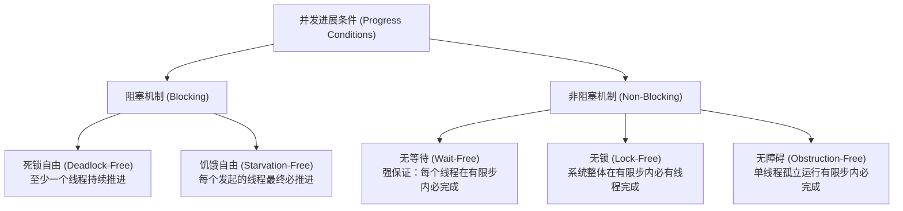

# Lec 3 并发对象与正确性条件（Concurrent Objects: Linearizability & Correctness）

## TL;DR

- 并发对象的行为由安全性（Safety / 正确性）与活性（Liveness / 进展条件）双重维度共同界定。
- 传统顺序规范不足以描述重叠调用的并发行为；顺序一致性要求全局操作按某种保持程序序的单线程序列生效，但缺乏局部性与可组合性。
- 线性一致性（Linearizability）要求每个操作在调用与返回之间的某一物理瞬时点（生效点 Linearization Point）原子生效，既保证了实时先后序，又具备模块化独立组合特性。
- 静止一致性（Quiescent Consistency）放宽了重叠操作的约束，仅在系统静止期恢复顺序语义，换取极高并发吞吐。
- 进展条件区分为阻塞保证（死锁自由、饥饿自由）与非阻塞保证（无等待 Wait-free、无锁 Lock-free、无障碍 Obstruction-free）。

## 从顺序对象到并发对象的认知跨越

在单线程顺序计算中，对象（如栈、队列、哈希表）的正确性定义非常直观：由其**顺序规范（Sequential Specification）**决定。在顺序执行下，方法调用是严格串行的，每次方法调用在下一个方法开始前就已经完全结束，对象的状态在任意时刻都处于明确、无歧义的合法状态中。

然而，在多处理器多核环境中，不同线程调用的方法在时间轴上产生物理重叠（Overlap）。此时出现了一个深层次的理论难题：**当多个线程同时向同一个队列调用 `enq()` 和 `deq()` 时，什么才算“正确”的行为？**

并发对象的行为通常从两个互补的正交维度进行描述：
1. **安全性（Safety）**：在系统运行中，“坏事永远不会发生”（即正确性条件 Correctness）；
2. **活性（Liveness）**：在系统运行中，“好事最终必定发生”（即进展条件 Progress）。

## 基于锁的并发队列案例与重叠调用

考察一个最朴素的并发先进先出（FIFO）队列实现。在该实现中：
- 内部采用环形缓冲区设计，`items` 为定长泛型数组，`head` 与 `tail` 为单调递增的整型计数器；
- 队列满载条件判定为 `tail - head == items.length`，空队列条件判定为 `tail == head`；
- 为了在多线程重叠调用下保护内部数据结构的指针与状态不变式，我们在类的实例中内置了一把可重入互斥锁 `ReentrantLock`。每一个进入 `enq()` 或 `deq()` 的方法都必须在方法首部加锁，并在 `finally` 块中确保释放。

```java
public class LockBasedQueue<T> {
    private int head = 0;
    private int tail = 0;
    private final T[] items;
    private final Lock lock = new ReentrantLock();

    @SuppressWarnings("unchecked")
    public LockBasedQueue(int capacity) {
        this.items = (T[]) new Object[capacity];
    }

    public void enq(T x) throws Exception {
        lock.lock();
        try {
            if (tail - head == items.length) {
                throw new Exception("Queue is Full");
            }
            items[tail % items.length] = x;
            tail++;
        } finally {
            lock.unlock();
        }
    }

    public T deq() throws Exception {
        lock.lock();
        try {
            if (tail == head) {
                throw new Exception("Queue is Empty");
            }
            T x = items[head % items.length];
            head++;
            return x;
        } finally {
            lock.unlock();
        }
    }
}
```

从直觉上看，软件工程师普遍认为该实现是“绝对正确”的：因为每一个线程在读取、判断和更新 `head`、`tail` 以及数组元素时，都独占性地持有同一把锁。由于同一时刻至多只有一个线程处于临界区内，所有并发的方法调用在微观物理层面上被粗暴地强制拉平为一段没有重叠的单线程串行执行流。


然而，从并发系统理论的视角审视，上述加锁实现掩盖了并发计算的本质真相：
1. **调用时间区间的客观存在**：如上图所示，从调用方视角看，任何方法调用都不是瞬时的单点，而是一个时间区间。它始于**调用事件（Invocation Event）**，并在返回计算结果时结束于**响应事件（Response Event）**。当线程 A 的 `enq()` 与线程 B 的 `deq()` 在时间轴上出现重叠时，系统的并发正确性不应该依赖于“粗粒度加锁把大家串行化”的拐杖；
2. **可扩展性窒息**：一旦我们为了性能追求无锁（Lock-Free）设计、允许多个线程在没有任何互斥锁保护的情况下并发穿透数组，我们就必须回答一个根本性问题：**在没有全局锁的前提下，如何从数学上定义一个交错重叠执行历史的正确性？**

## 三大并发正确性条件层级

计算机科学家们针对不同场景提出了三种渐进式的正确性条件：

### 1. 顺序一致性（Sequential Consistency）

1979 年，Leslie Lamport 提出了顺序一致性，用于界定多处理器硬件内存接口的合法行为。

::: definition 顺序一致性（Sequential Consistency, SC）
一个执行历史是顺序一致的，当且仅当存在一个所有操作的全序序列 $S$，使得：
1. $S$ 与对象的顺序规范（Sequential Specification）完全一致；
2. 对于任意单个线程，其自身操作在全序 $S$ 中的先后顺序，严格与其在程序中执行的代码顺序（Program Order）保持一致。
:::

- **特点**：顺序一致性允许操作在全局时间轴上被重新排队，只要单个线程内部看起来符合其程序序即可。
- **致命缺陷：缺乏可组合性（Not Composable）与非局部性（Non-Local）**。
  这是顺序一致性在面向对象软件工程中最致命的弱点：**如果对象 A 满足顺序一致性，对象 B 也满足顺序一致性，由 A 和 B 构成的组合系统却可能违背顺序一致性！** 这意味着系统架构师无法通过对独立模块分别验证来保证整站系统的正确性，模块化验证机制彻底失效。

### 2. 线性一致性（Linearizability）

为了解决顺序一致性不可组合的灾难，Maurice Herlihy 和 Jeannette Wing 于 1990 年提出了**线性一致性（Linearizability）**，这成为了现代并发数据结构与分布式系统的黄金标准。

::: definition 线性一致性（Linearizability）
一个并发执行历史满足线性一致性，当且仅当每个方法调用都可以在其调用事件（Invocation）与响应事件（Response）之间的某个瞬时物理时间点——**生效点（Linearization Point）**上原子瞬时生效，使得所有操作在按生效点排序后，完全满足对象的顺序规范。
:::

线性一致性不仅要求保留程序序，更施加了严格的**实时先后关系（Real-Time Order）**约束：
$$\text{若方法调用 } op_1 \text{ 在物理时间上先于 } op_2 \text{ 开始之前就已完全返回，则 } op_1 \text{ 必须在等价序列中排在 } op_2 \text{ 之前。}$$

::: theorem 线性一致性的局部性与可组合性定理（Herlihy & Wing 1990）
系统全局执行历史满足线性一致性，**当且仅当系统中的每一个独立对象都满足线性一致性**：
$$H \text{ is linearizable} \iff \forall x \in \text{Objects}, \quad H|x \text{ is linearizable}$$
:::

这一组合定理价值连城：它意味着软件工程师可以独立实现并验证一个队列、一个字典或一个无锁栈的线性一致性，然后毫无顾虑地将它们组合成庞大的复杂系统，全局正确性自动得到数学保证。

### 3. 静止一致性（Quiescent Consistency）

在很多追求极致吞吐的科学计算与计数网络中，维持严格的实时序开销过高。James Aspnes 等人提出了相对松弛的**静止一致性（Quiescent Consistency）**。

::: definition 静止一致性（Quiescent Consistency）
当一个并发对象当前没有任何未完成的方法调用（即所有线程均处于调用外部或挂起状态）时，称该对象处于**静止状态（Quiescent State）**。
静止一致性要求：被静止状态完全隔开的方法调用必须保持其实时先后顺序；而在同一段非静止执行期内并发重叠的操作，允许根据性能优化自由重排。
:::

静止一致性同样具备可组合性，但它给予了硬件和算法极大的重排自由度，常用于高通量共享计数器、分布式繁衍树与弱序内存池。

## 进展条件：阻塞与非阻塞的分类体系

在明确了安全性的前提下，并发对象必须给出其操作在何种条件下能够持续推进（Progress）：



### 1. 阻塞（Blocking）进展条件

在阻塞算法中，线程之间存在被动等待依赖。若持有资源的线程被操作系统调度挂起或崩溃，其他线程将被迫阻塞：
- **死锁自由（Deadlock-Free）**：系统整体持续推进，但允许个别线程发生饥饿；
- **饥饿自由（Starvation-Free）**：每个调用方法的线程最终都能成功返回，提供了最强的公平性保证。

### 2. 非阻塞（Non-Blocking）进展条件

现代无锁编程的核心追求是非阻塞性——**一个线程的暂停或延迟，绝不能导致其他健康线程无限期停滞**：

- **无等待（Wait-Free）**：
  最强非阻塞保证。**每一个调用方法的线程都保证在有限个自身计算步内完成操作并返回**，无论其他线程以何种速度交错运行甚至中途崩溃。通常需要复杂的协作机制（Helping Mechanism）来实现。
- **无锁（Lock-Free）**：
  工程中最广泛采用的非阻塞保证。保证**系统整体在有限步内必定有某个线程成功推进**。尽管个别竞争落败的线程可能需要在 CAS 循环中不断重试，但从全局来看系统永不停滞。
- **无障碍（Obstruction-Free）**：
  最弱的非阻塞保证。它仅承诺：当某个线程在一段足够长的时间窗口内孤立运行（即没有其他线程并发干扰）时，该线程保证在有限步内完成。它不防范活锁（Livelock），通常需要配合退避策略使用。

## 我的理解与体系启示

::: insight 线性一致性：并发系统设计的黄金分割线
在分布式系统与多核并发领域，存在着无数关于一致性的名词与模型（因果一致性、最终一致性、单调读、顺序一致性等）。然而，**线性一致性（Linearizability）之所以成为无可替代的学术基石与工程黄金分割线，核心就在于它实现了“真实物理时间”与“黑盒模块化组合”的完美共存**。

顺序一致性虽然符合单线程直觉，却无法进行局部组合验证，在大型模块化软件工程中近乎不可用；而弱一致性虽然吞吐极高，却把重排时序的认知负担全部转嫁给了应用层程序员。线性一致性通过确立离散的“原子生效点”，让每一个微观并发操作在物理时间轴上找到唯一的锚定瞬间，既为上层代码提供了与顺序代码完全等价的直观抽象，又为底层多核硬件留足了在调用与返回区间内部展开激进微架构优化的空间。
:::
