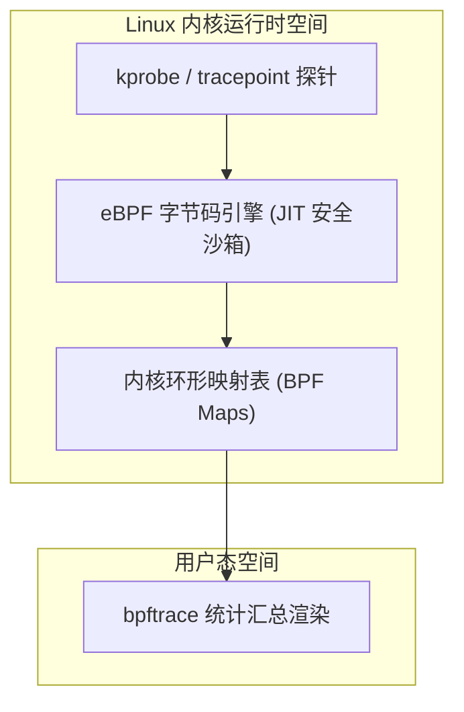

# Lec 4 程序调试、追踪与性能剖析（Debugging and Profiling）

> MIT 6.NULL · 现代软件工程工具链与开发者素养 · 官方讲义核心内容

## TL;DR

- **科学排错四步法**：摒弃随机试错，遵循“最小复现 $\to$ 提出可证伪假设 $\to$ 实验测量 $\to$ 迭代验证”的实证科学循环，系统性排除干扰变量。
- **状态观测与时空可逆**：交互式调试器利用硬件观察点捕获异常写入；可逆调试器（rr）通过捕获非确定性事件实现时间轴倒流（Reverse-step）。
- **内核透视与动态探针**：利用 `strace` 透视系统调用边界，依托 `eBPF / bpftrace` 在生产集群实现零重编译、纳秒级开销的动态可观测性。
- **剖析驱动的科学优化**：基于采样分析器（perf）与 Brendan Gregg 火焰图精准定位 CPU 热点平顶山，配合 `hyperfine` 实施严密的统计学基准测试。

---

## 1. 调试的工程科学方法论

在所有软件工程活动中，调试通常被视为最令人抓狂、耗费心智最多的环节。很多初级工程师在遇到 Bug 时的第一反应是“盲目碰运气”——胡乱改几行代码、随机换个参数，如果报错变了就觉得“有进展”。这种如同盲人摸象的调试方式不仅极其低效，往往还会引入更隐蔽的次生 Bug。

**调试必须遵循严格的科学方法论（The Scientific Method）**：
1. **稳定复现（Reproduce）**：找到一个能够以 100% 概率触发异常的最小化输入（Minimal Reproducible Example）；
2. **提出假设（Hypothesize）**：基于观察到的异常现象与代码架构，提出一个可被证伪的具体假设（例如：“第 42 行在处理空列表时引发了指针解引用”）；
3. **设计实验（Experiment）**：设计一个具体的观测手段（设置断点、拦截系统调用或打印变量）来验证或推翻该假设；
4. **验证并迭代（Repeat）**：如果假设被推翻，不要气馁，依据新获得的证据修正假设，直到彻底锁定根因（Root Cause）。

今天我们要介绍的全套工具，本质上就是在各个层面上为你提供**“观察程序真实运行物理状态的眼睛”**。

---

## 2. 从 Printf 到结构化日志与交互式调试器


大家最熟悉的调试手段无疑是 `print("here 1")`。打印调试直观、零门槛，但它存在三大致命缺陷：
1. **污染源码与 Git 历史**：你必须反复修改代码、重新编译运行，调试完还要小心翼翼地删掉所有 print；
2. **破坏时序（Heisenbug）**：`print` 本身是一次极其昂贵的 I/O 系统调用。在多线程并发排错中，一个 print 语句引入的毫秒级延迟，往往会彻底改变线程竞争时序，导致 Bug 当场“消失”；
3. **信息密度失控**：生产环境中成千上万行无结构的裸字符串，会让核心异常淹没在日志海洋中。

工程最佳实践是采用**结构化日志框架**，划分严格的日志级别（`TRACE`、`DEBUG`、`INFO`、`WARN`、`ERROR`），并通过环境变量（如 `RUST_LOG=debug` 或 `LOG_LEVEL=info`）在运行时无侵入地调整输出粒度。

### 交互式调试器

当程序发生段错误（Segmentation Fault）时，GDB、LLDB 或 Python 的 PDB 提供了就地挂起并审查虚拟内存的能力：

- **断点（Breakpoints，`b main.c:42`）**：在目标代码行暂停执行；
- **条件断点（Conditional Breakpoints，`b 42 if x == 0`）**：仅当特定变量满足异常条件时才触发暂停，避免在十万次循环中人工反复按 Continue；
- **硬件观察点（Hardware Watchpoints）**：利用 CPU 架构层级的调试寄存器（如 x86 的 DR0-DR3），在指定内存地址遭遇写入或修改的纳秒瞬间触发硬件中断，是定位“共享变量被未知线程意外篡改”的终极手段：
  ```shell
  (gdb) watch state->connection_count
  ```
- **核心转储事后分析（Core Dump Post-mortem）**：当生产进程崩溃退场时，操作系统可将其虚拟地址空间完整转储为 coredump 文件，后续通过调试器复盘崩溃第一现场的完整局部栈帧。

---

## 3. 时空可逆调试：`rr` 确定性重放

在传统调试器中，执行流是单向的。你一步步往下走，结果一不小心按了 `step` 跳过了关键函数，或者断点设晚了、崩溃已经发生了，你只能重新启动程序从头再来。更要命的是并发竞争 Bug，可能跑 100 次才崩溃一次。

为了终结这种痛苦，Mozilla 开源了革命性的工具——**`rr`（Record and Replay Debugging）**。

`rr` 的核心机理是：**记录一次极其轻量的非确定性执行日志，并在后续提供 100% 确定性的无限次重放**。

```shell
# 1. 录制一次偶发崩溃的执行（记录所有系统调用、时钟中断与并发调度输入）
$ rr record ./my_buggy_server

# 2. 随时随地唤起重放会话（基于 GDB 协议）
$ rr replay
```

进入 `rr replay` 后，你的时间轴被彻底解锁了！你不仅能像常规 GDB 一样向前走，更能**倒着走（Time Travel Debugging）**：
- **`reverse-continue`（`rc`）**：让程序沿着时间线反向倒退执行，直到撞上你设定的上一个断点！
- **`reverse-step`（`rs`）**：反向单步倒退一行代码！
- **`reverse-finish`**：反向跳出当前函数，退回到 caller 调用它的前一微秒！

当你在崩溃点停下发现变量 `x` 变成了非法值 `0x0` 时，你不再需要猜测它是哪里变坏的。你只需设置一个硬件观察点 `watch x`，然后轻敲一声 `rc`（反向继续），程序瞬间时光倒流，精准停在**上一次修改 `x` 的那一行动作上**！任何偶发的神秘内存损坏，在 `rr` 面前无所遁形。

---

## 4. 黑盒排错核武器：系统调用追踪 `strace` 与 Linux 内核探针 `eBPF`

很多时候我们排查的问题既没有源码，也无法挂载 GDB。例如：“为什么这个编译好的二进制程序一启动就报错 `File not found`，它到底在试图找哪个文件？”

在 Unix 体系中，**用户态程序要与物理世界发生的一切交互（读写文件、申请内存、建立网络连接），都必须向操作系统内核发起系统调用（System Calls）**。

### `strace`：系统调用的 X 光机

用户态应用程序与底层操作系统内核之间的一切交互（文件操作、内存映射、网络套接字传输）均必须经由系统调用（System Calls）完成。通过 `strace`，可清晰洞察进程向系统提出的每一次诉求：

```shell
# 追踪程序发起的全部系统调用
$ strace ./mystery_binary

# 仅过滤文件打开相关的系统调用
$ strace -e trace=openat,open ./mystery_binary

# 统计每个系统调用消耗的耗时与错误率汇总
$ strace -c ./mystery_binary
```
通过 `strace` 的输出，你能清晰看到程序尝试访问 `/etc/config.json` 返回了 `ENOENT (No such file or directory)`，瞬间破案！

### `eBPF / bpftrace`：零开销内核态动态追踪

`strace` 虽然强大，但它是基于古老的 `ptrace` 系统调用实现的，每次拦截系统调用都会引入两次昂贵的上下文切换，会将程序性能拖慢数十倍，**严禁在高并发生产环境中直接使用**。

现代 Linux 提供了无损的内核动态可观测技术——**eBPF（Extended Berkeley Packet Filter）** 与 **`bpftrace`**。

eBPF 允许你在内核中即时编译并挂载轻量级的安全字节码沙箱，以微秒级开销挂载在内核探针（kprobes）或用户态探针（uprobes）上：

在架构设计上，eBPF 依靠内核内置的静态验证器（Verifier）确保注入的字节码绝不包含无限循环、非法内存越界或悬空指针，从而杜绝引发内核崩溃（Kernel Panic）的一切风险。随后，内核 JIT 编译器将经过验证的字节码直接编译为宿主机原生机器指令，并挂载于预设的各类探针桩点之上：



eBPF 的探针覆盖范围极广，包括内核静态跟踪点（Tracepoints）、动态内核函数探针（kprobes / kretprobes）以及用户态动态探针（uprobes）。当目标探针被执行触发时，注入的 eBPF 程序直接在内核中断上下文中运行，将统计直方图或事件聚合结果就地沉淀在内核高效的 BPF Maps（哈希表或环形队列）中，只有最终的聚合数据才会被异步拷贝至用户态。这种机制避免了海量原始调用事件在内核态与用户态之间进行频繁无谓的上下文拷贝。

借助专为高级单行追踪设计的 DSL 工具 **`bpftrace`**，工程师能够以类似 awk 的直观语法，秒级捕获复杂的系统调用吞吐与长尾延迟特征：

```shell
# 统计全系统中按进程名聚合的读系统调用字节数直方图
$ sudo bpftrace -e 'tracepoint:syscalls:sys_enter_read { @[comm] = hist(args->count); }'
```

这种非侵入式白盒观测能力，彻底打破了传统生产环境中在“性能无损”与“可见性穿透”之间不可兼得的工程妥协。

---

## 5. 内存安全防御：编译器 Sanitizers vs 动态插桩

在 C/C++ 等非内存安全语言中，内存越界（Buffer Overflow）和释放后使用（Use-After-Free）是系统崩溃与安全漏洞的最大温床。

### 编译器内置 Sanitizers（ASan / TSan / UBSan）

现代编译工具链（LLVM/Clang 与 GCC）内置了先进的代码注入检查体系，通过在编译期对虚拟内存进行影子映射实现毫秒级检测：

::: definition [AddressSanitizer（ASan）影子内存机制]
ASan 将进程的虚拟内存空间以 8:1 的比例映射至一段连续的**影子内存（Shadow Memory）**，并在堆栈对象的边界周围强制注入特定中毒字节填充的**隔离红区（Redzones）**。每当代码发生指针解引用前，编译器插入的极速位运算指令会自动查询影子内存；一旦探测到指针踏入红区，立即中断进程并输出包含分配栈、释放栈与越界偏移的高精度诊断报告。
由于检查逻辑由编译器内联展开，运行时开销仅增加约 2 倍，足以在 CI/CD 测试流水线中全天候开启。
:::

- **AddressSanitizer（ASan）**：精确捕获堆栈溢出、释放后使用（Use-After-Free）与重复释放（Double Free）；
- **ThreadSanitizer（TSan）**：检测多线程间未受互斥锁保护的并发数据竞态（Data Races）；
- **UndefinedBehaviorSanitizer（UBSan）**：定位整数溢出、空指针解引用及非法移位运算。

### Valgrind 动态模拟器（Memcheck）
如果拿到的是没有源码、无法重新带 `-fsanitize=address` 编译的闭源二进制呢？
此时使用 **Valgrind**。Valgrind 是一个动态二进制插桩虚拟机（JIT），将目标指令在虚拟机中翻译运行并模拟全套寄存器与内存状态。缺点是会将程序执行速度拖慢 10 到 50 倍，但对黑盒第三方库的内存泄漏（Memory Leak）检测依然是强力兜底利器。

---

## 6. 性能剖析架构与火焰图解读

排查完正确性，最后是**性能（Performance）**。

软件工程中有句名言：“过早优化是万恶之源”。性能优化的首要法则是：**先做 Profiling 测量，永远不要凭空猜测瓶颈！**

### 执行时间维度分解

在终端利用 `time` 指令评估程序开销时，必须清晰区分输出的三个物理指标：

```text
real    0m2.415s  -> 墙上时钟时间 (Wall-clock time，人类感受到的总等待时序)
user    0m1.820s  -> 用户态 CPU 耗时 (纯计算逻辑执行时间)
sys     0m0.480s  -> 内核态 CPU 耗时 (内核代为执行系统调用与缺页异常时间)
```

若 `real` 显著大于 `user + sys`，表明程序瓶颈主要受制于外部磁盘 I/O 阻塞、网络等待或线程锁争用；若 `user` 极高并逼近 `real * CPU核心数`，则表明系统处于典型的算力计算受限状态。

### 采样剖析（Sampling）与 Brendan Gregg 火焰图

现代 Linux 性能分析的核心利器是内核级采样工具 **`perf`**：

```shell
# 以 99Hz 的质数频率对调用栈执行采样，避免与应用周期性定时器产生共振
$ perf record -F 99 -g -- ./benchmark_target
```

将采集的堆栈轨迹转换为交互式 SVG 火焰图（Flame Graph）：

```sh
# 将采样数据转换为直观的交互式 SVG 火焰图
$ perf script | stackcollapse-perf.pl | flamegraph.pl > flamegraph.svg
```


**如何阅读火焰图（Flame Graph）？**
- **纵轴（Y 轴）**：调用栈深度。最下方是 `main`，越往上是更深层的子函数调用；
- **横轴（X 轴）**：不代表时间先后！横轴按照函数名字母排序，**宽度直接正比于该函数在所有采样中所占的 CPU 时间百分比**。

寻找性能瓶颈的诀窍极其简单：**在火焰图的最顶层寻找“平顶山（Plateaus）”**！
如果某个顶层函数的长方形占据了整个屏幕宽度的 60%，那意味着整台机器超过一半的算力都在空转执行这个函数。集中精力重构这个“平顶”，就能获得最大的优化投资回报率（ROI）。

### 现代基准测试严谨度：`hyperfine`

进行优化前后的性能比对时，传统循环计时易受冷启动缺页、CPU 动态调频及磁盘缓存污染影响。现代工程推荐使用专用的 CLI 基准测试工具 **`hyperfine`**，它自动执行预热运行（Warmup）、执行多轮高斯分布采样，并直接给出具有统计学置信度的加速比与误差范围对比。

---
