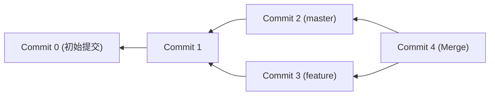
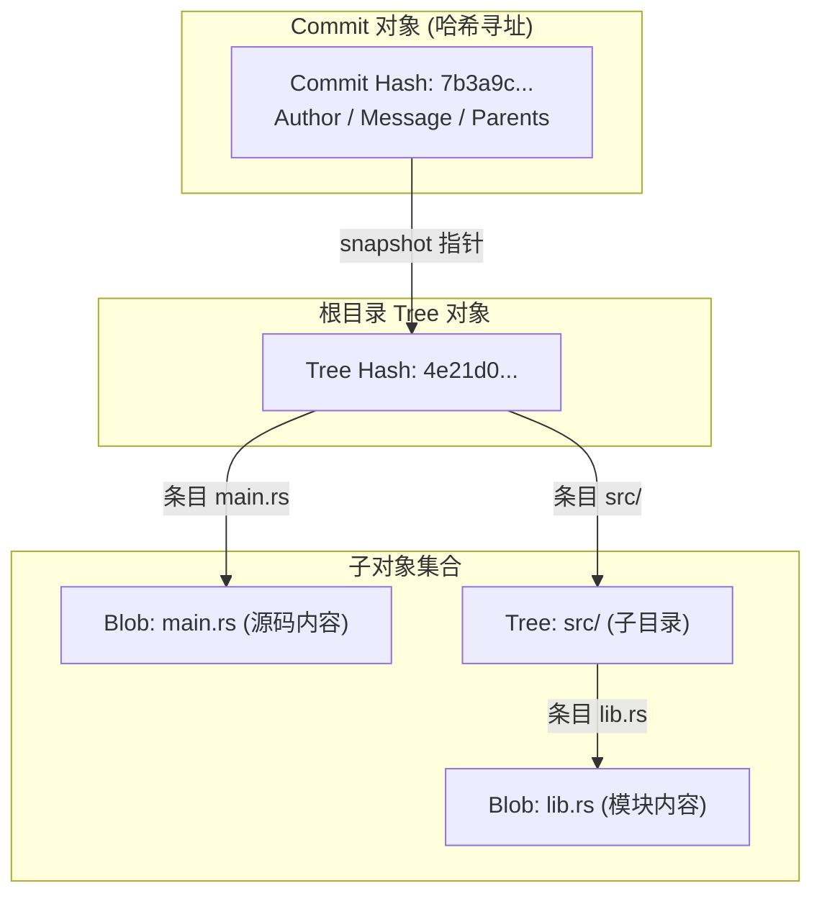

# Lec 5 版本控制与 Git 底层数据模型

> MIT 6.NULL · 现代软件工程工具链与开发者素养 · 官方讲义核心内容

## TL;DR

- **内容寻址与对象不可变性**：Git 底层是基于强密码学哈希（SHA-1/SHA-256）的内容寻址键值数据库，通过 Blob、Tree、Commit 与 Tag 四大核心对象实现全量快照与高效去重。
- **DAG 历史图谱模型**：提交历史表现为子节点单向溯源指向父节点的有向无环图，分支本质上仅为指向特定 Commit 节点的轻量可变指针。
- **暂存区解耦编辑与快照**：暂存区（Index）充当快照编译的缓冲区，允许开发者通过原子化切分实现职责单一的高内聚提交。
- **历史线性化与灾难恢复**：基于变基（Rebase）规范团队协同流，遵循公共分支不可变法则，依托 `git reflog` 与二分定位（`git bisect`）构建工程容灾底座。

---

## 1. 软件工程视角下的版本控制建模分水岭

今天我们将攻克几乎所有初入工程界的新人最畏惧、也最容易遭遇灾难性翻车的工具——**版本控制系统与 Git（Version Control and Git）**。
在没有版本控制的远古时代，人们管理项目历史通常依赖于在文件夹上打时间戳或后缀，比如 `project_final.zip`、`project_final_v2.zip`、`project_final_really_fixed_by_bob.zip`。这种方式不仅极易引发误覆盖，更完全无法支持多人协同、代码回滚与精细的变更溯源。

然而，很多同学在学习 Git 时感到极度痛苦。原因在于：**Git 的命令行用户界面（CLI）设计得相当晦涩，甚至充满了历史妥协与术语不一致**。比如 `git checkout` 这个命令，既能用来切换分支，又能用来丢弃工作区文件的修改，还能用来恢复历史某个特定版本的单个文件。如果你试图通过“死记硬背每个命令的几十个参数”来掌握 Git，只要遇到一次稍微复杂的冲突或变基失败，你就会彻底手足无措。

今天我们要采取一种完全不同的教学方式：**先学底层数据模型（Data Model），再看顶层命令行（Interface）**。

Git 的命令行可能很别扭，但 Git 底层的数据模型却极其优美、精炼且符合直觉。一旦你脑海中建立起了这个数据模型的全景图，Git 的所有命令对你而言不过是对这个数据结构执行的基础图遍历与指针移动操作。

---

## 2. Git 数据模型解密：快照与有向无环图

首先，Git 是如何建模代码历史的？

早期的版本控制系统（如 SVN 或 CVS）采用的是**基于文件差异的增量模型（Delta-based System）**。它们记录的是“文件 A 在第 2 版增加了两行，在第 3 版删除了第一行”。这种模型在计算某个分支的完整状态时，必须从第一天起把所有补丁依次重放一遍，性能极差。

Git 则彻底打破了这一思路：**Git 将项目历史建模为一连串顶层目录树的“快照（Snapshots）”**。

每次你执行 Commit，Git 记录的不是文件差异，而是**整个项目在这一时刻所有文件的完整快照**。为了节省空间，如果某个文件在这次提交中没有被修改，Git 绝不会傻傻地重复拷贝，而是直接保存一个指向既有文件内容的紧凑指针。


快照之间是如何关联的？Git 将提交历史组织为一个**有向无环图（Directed Acyclic Graph, DAG）**。

- 每一个**节点（Node）**代表一次提交（Commit）；
- 节点之间的**有向边（Edge）**指向它的**父提交（Parent Commit）**——注意，指针方向是**从子提交指向父提交**（因为子提交创建时知道父提交的身份，而父提交不可能预知未来的子提交）。
- 线性提交链中，每个提交有且仅有一个父节点；
- 分支合并时产生的 Merge Commit，则拥有两个或多个父节点。



## 3. 形式化伪代码：四大核心对象与内容寻址
如果用严谨的类型系统来描述 Git 的数据模型，可以用不到 30 行的伪代码定义其核心抽象：

```typescript
// 1. 数据块：存储纯文件内容（不包含文件名、权限或修改时间）
type blob = array<byte>

// 2. 目录树：将文件名映射为子树或数据块
type tree = map<string, tree | blob>

// 3. 提交 (Commit)：声明提交元数据、父节点引用列表与根目录树快照
type commit = struct {
    parents: array<commit>
    author: string
    committer: string
    message: string
    snapshot: tree
}

// 4. 通用对象联合体
type object = blob | tree | commit
// 5. 基于内容寻址的对象数据库
type objects = map<string, object>
```

大家请看 `objects = map<string, object>` 这个定义。**Git 在底层本质上就是一个以强哈希值为键的“内容寻址数据库（Content-Addressable Storage）”**！

在这套优雅的数据契约中，各个核心实体的职责边界极其清晰且高度正交：
- **数据块（Blob）**：Blob 仅纯粹封装文件的原始字节流数据。令人惊讶的是，Blob 对象自身甚至不包含文件名、目录路径、修改时间或 POSIX 执行权限（`chmod +x`）。这种极致的纯粹性保证了即使文件在项目中被随意重命名或跨目录移动，只要文件内容未变，其计算出的哈希键值恒定不变，无需重复分配存储。
- **目录树（Tree）**：Tree 对象等价于文件系统中的目录。它以结构化的数组列表记录了当前层级下的每一个条目：条目的 POSIX 访问模式（如 `100644` 常规文件、`100755` 可执行脚本、`040000` 子目录）、条目的字符名称，以及指向对应子 Tree 或 Blob 的 40 位哈希指针。通过递归嵌套的 Tree 结构，Git 能够以纯数据形式无损还原出任意复杂的深层目录拓扑。
- **提交对象（Commit）**：Commit 是快照图谱的顶层实体。它持有指向根目录 Tree 对象的哈希指针，声明了本次提交的作者身份（Author）、提交者身份（Committer）、提交说明以及至关重要的父提交哈希列表（Parents）。单亲节点代表常规线性演进，而多亲节点则直接构成了分支合并的拓扑交汇。




当你向 Git 存入任何对象时，Git 会将其序列化并计算加密哈希值（传统使用 SHA-1，现代逐步升级为 SHA-256）。这个 40 位的十六进制字符串不仅是对象的唯一全局身份证，更充当了该对象在磁盘 `.git/objects/` 目录下的物理检索主键。

由于哈希函数的抗碰撞性：
- 任何文件的微小改动都会引发哈希值的雪崩效应；
- 只要两个文件的内容完全一致，无论文件名是什么、存放于何处，在 Git 对象库中都只对应一份物理 Blob，实现天然的高效去重；
- 提交对象的哈希值递归包含了根目录 Tree 的哈希以及父提交的哈希，这形成了一条坚不可摧的密码学默克尔树（Merkle Tree），任何人都不可能在不改变后续所有哈希值的前提下篡改历史！

---

## 4. 引用系统：分支、标签与游离态（HEAD）

虽然哈希值极其安全，但人类不可能去记忆一串 40 位的类似 `7b3a9c...` 的乱码。
为了方便人类导航，Git 引入了**引用（References / Refs）**。引用本质上就是一个**存放在 `.git/refs/` 下的人类可读文本文件，其内部仅仅记录了一个 40 位的提交哈希值**：
- **分支（Branches）**：如 `master`、`main`、`dev`。分支是一个**动态移动的指针**！每当你在当前分支上创建新提交时，该分支指针会自动前移指向这个新提交；
- **标签（Tags）**：如 `v1.0.0`。标签是一个**不可变静态锚点**，永久固定在某个里程碑提交上，不再随新提交移动；
- **`HEAD` 引用**：Git 内部最特殊的单一全局指针。**`HEAD` 永远指示“你当前正在哪一个提交或哪一个分支上工作”**。

::: pitfall [游离分支状态的隐蔽丢失陷阱]
当开发者通过具体的 Commit 哈希执行检出时（`git checkout <commit-id>`），`HEAD` 将直接绑定至裸哈希值，脱离任何具体分支。此时若在此状态下继续执行提交，新提交虽然正常写入对象库，但没有任何分支指针维系它，这就进入了著名的 **“游离分支状态（Detached HEAD State）”**。一旦切换回其他主干分支，这些孤立的 Commit 节点将从 `git log` 中消失，并在未来遭遇垃圾回收（GC）清理。
:::

---

## 5. 暂存区（Staging Area / Index）的架构必要性

很多从其他 VCS 转过来的开发者常抱怨：为什么修改了文件不能直接 commit，非要先执行 `git add` 把文件放进暂存区？

这是因为：**暂存区（Staging Area）是让你有能力精心编排下一次快照的“草稿画布”**。

在日常开发中，你在工作区可能同时修改了 5 个文件，其中 3 个属于功能 A，另外 2 个顺手修了一个无关的拼写 Bug。如果不提供暂存区分割机制，你就只能将所有散乱的改动粗暴地打进同一个大泥球提交中。

借助 `git add`，你能够原子化、精细化地挑选哪些文件（甚至通过 `git add -p` 挑选单个文件中的具体某几行代码段）进入暂存区，从而确保每一次 Commit 都是内聚、独立且逻辑清晰的原子快照。

---

## 6. 分支汇合演进：三路合并 vs 线性变基

### 策略 1：三路合并（`git merge`）

`git merge feature` 会自动寻找当前分支与目标分支的**最近公共祖先节点（Common Ancestor）**，并对三方状态执行三路比对。合并完成后，会在当前分支上创建一个全新的 **合并提交（Merge Commit）**，该提交同时持有两个父节点指针。
- **优点**：百分之百忠实记录历史时序，永不篡改既有提交；
- **缺点**：在大型团队中，纷繁复杂的特性分支会导致 Git 历史图谱变成难以阅读的“毛线团”。

### 策略 2：变基（`git rebase`）

[00:54:10] **Anish Athalye**：
`git rebase main` 的本质是：**将你在特性分支上开发的一系列提交，从原有基点上“连根拔起”，依次作为补丁重新应用在目标分支的最前端**！

变基生成的是**全新的提交对象**（即便内容相同，由于父提交变了，计算出的哈希值完全不同）。
- **优点**：消除所有多余的 Merge Commit，获得极其干净纯粹的单链线性提交历史；
- **缺点**：改写了历史哈希值。


::: pitfall [变基的黄金法则（The Golden Rule of Rebasing）]
**绝不要对已经推送到远程公共共享仓库的提交执行变基！**
如果你对别人已经拉取并基于其继续开发的公共分支执行 Rebase，会导致远程与本地历史发生哈希级分裂，迫使团队所有人陷入冲突地狱。变基只应当用于整理自己本地未推送的私有分支。

---

## 6. 高级工程实战：交互式变基、二分排错与安全挽救

### 交互式变基（Interactive Rebase）精细化整理

在正式发起代码审查（PR / MR）前，专业工程师会通过 `git rebase -i` 对散乱的草稿提交执行精细化重构：
- `squash`（`s`）：将琐碎的修补提交折叠合并至上一逻辑单元；
- `reword`（`r`）：修正不符合规范的提交说明信息；
- `drop`（`d`）：安全剔除在实验过程中废弃的试错节点。

### 二分自动化溯源：`git bisect`

当系统中出现罕见的性能衰退或隐式回归缺陷时，面对跨越数百次提交的历史区间，`git bisect` 依托二分搜索算法在 $O(\log N)$ 时间复杂度内精准定位元凶：

```shell
# 1. 启动二分查找模式
$ git bisect start

# 2. 标记当前最新状态存在异常
$ git bisect bad

# 3. 标记两周前的已知健康基线版本
$ git bisect good v2.1.0

# 4. 自动化驱动：传入测试脚本自动执行全量判定
$ git bisect run npm test
```

Git 会自动检出中点版本并运行判定脚本，在数秒内输出首次引入缺陷的特定提交与作者信息。

### 终极安全网：`git reflog`

最后，请记住这句话：**在 Git 中，只要你曾经 commit 过的东西，几乎不可能真正丢失！**

即使你手滑执行了灾难性的 `git reset --hard HEAD~10`，导致原本辛苦写的分支瞬间在 `git log` 中蒸发，也不要慌张！

运行 **`git reflog`**。`reflog` 是你本地 Git 仓库对 `HEAD` 指针所有移动历史的“行车记录仪”。在 `reflog` 中找到误操作前的那一次提交哈希（例如 `HEAD@{1}`），执行：
```shell
$ git reset --hard HEAD@{1}
```
整个项目瞬间满血复活！
