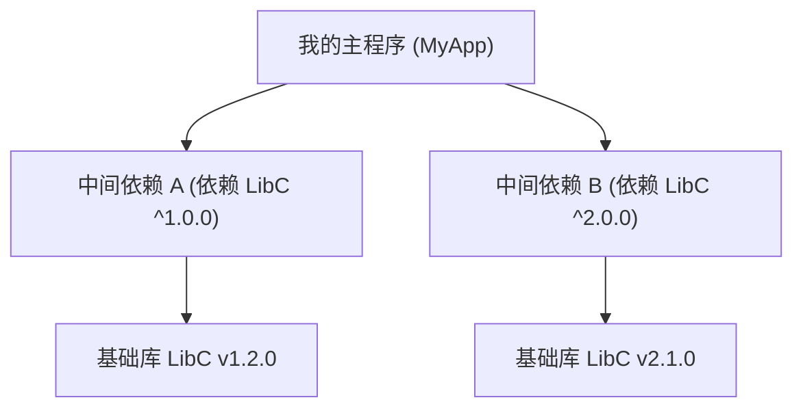

# Lec 6 代码打包、容器隔离与制品分发

> MIT 6.NULL · 现代软件工程工具链与开发者素养 · 官方讲义核心内容

## TL;DR

- **依赖抽象与锁定双轨制**：声明式依赖定义宽泛兼容范围（SemVer 2.0.0），锁定文件（Lockfile）固化全量依赖的精确版本与哈希指纹，捍卫可重现构建。
- **虚拟环境的路径本质**：语言级虚拟环境不具备虚拟化开销，其底层机理在于对进程 `$PATH` 变量的局部重写与标准包寻址目录重定向。
- **轻量进程隔离与容器三基石**：Linux 容器通过 Namespaces 隔离资源视图、通过 Cgroups 施加物理资源限额、结合 OverlayFS 分层写时复制实现镜像轻量化。
- **精细化制品交付工程**：多阶段构建（Multi-stage Builds）剔除构建期编译器冗余，依托 Docker Compose 声明式拓扑实现复杂微服务栈的一键拉起。

---

## 1. 软件交付全景：从“本地跑通”到“可重现制品”
软件工程中臭名昭著的经典名言：**“在我电脑上明明是好的（It works on my machine）！”**。
软件交付不仅包含源码本身，更必须包含它的**运行上下文与依赖契约**。今天这一讲，我们将系统梳理从底层系统库依赖、语言级虚拟环境、语义化版本控制、Lockfile 锁定文件，一直到 Linux 容器（Docker）与守护进程编排的完整工程工具链

---

## 2. 依赖管理与依赖地狱

依赖通常分为两大层级：
1. **语言级依赖（Language Dependencies）**：如 Python 的 `requests`、Node 的 `express`、Rust 的 `serde`。通常通过各自语言的包管理器（`pip`、`npm`、`cargo`）安装；
2. **系统级依赖（System Dependencies）**：如 C 标准库（`glibc` vs `musl`）、密码学库（`OpenSSL`）、图形渲染库（`libpng`）。这些由操作系统底层的包管理器（`apt`、`brew`）纳管。

### 菱形依赖危机
为什么项目依赖会演变成所谓的“依赖地狱”？最典型的场景就是**菱形依赖冲突**：



主程序同时引入了库 A 和库 B，而 A 依赖 `LibC v1`，B 依赖发生不兼容重大更新的 `LibC v2`。
在 Python 或 C 等共享单一命名空间或全局符号表的语言中，操作系统无法同时在内存中加载两个不同版本的 `LibC`，直接引发符号覆盖或运行时崩溃！

### 虚拟环境（Virtual Environments）如何工作？
很多人以为 `venv` 启动了某种虚拟机，**根本不是！它的原理极其朴素**：
当你执行 `source myenv/bin/activate` 时，该脚本内部仅仅做了一件事：**将 `myenv/bin` 绝对路径前置插入到你当前 Shell 会话的 `$PATH` 环境变量最前端**！

此时你在终端输入 `python` 或 `pip`，根据 Shell 的路径寻址规则，首先被找到并执行的是 `myenv/bin/python`。该 Python 解释器在启动时会检测自身所在目录，将第三方包安装路径（`site-packages`）重定向锁定至当前 `myenv/lib/pythonX.Y/site-packages`，从而在完全不修改系统底层文件的前提下实现轻量隔离。
---

## 3. 语义化版本（SemVer）与锁定文件（Lockfiles）

如何向包管理器精确表达依赖版本约束？工业界普遍采纳 **语义化版本 2.0.0（Semantic Versioning / SemVer）** 规范：

格式为：**`MAJOR.MINOR.PATCH`**（例如 `2.4.1`）
- **`MAJOR`（主版本号）**：包含**不兼容的破坏性 API 变更（Breaking Changes）**。必须做好代码重构准备才能升级；
- **`MINOR`（次版本号）**：以**向下兼容的方式引入全新功能**；
- **`PATCH`（修订号）**：以**向下兼容的方式修复 Bug**。

### 为什么只有声明式依赖是不够的？

[00:25:10] **Jose Javier Gonzalez Ortiz**：
在项目的 `package.json` 或 `pyproject.toml` 中，大家习惯写：
```json
"dependencies": {
  "express": "^4.18.0"
}
```
`^4.18.0`（Caret 约束）表示：允许安装 `>= 4.18.0` 且 `< 5.0.0` 的任何版本。

这就埋下了一颗雷：你今天执行 `npm install` 安装的是 `4.18.2`；三个月后另一位同事拉取代码执行 `npm install`，upstream 发布了 `4.19.0`，由于次版本向下兼容假设成立，npm 自动为他拉取了 `4.19.0`。如果 `4.19.0` 中潜藏了一个隐式变更，就会导致**同一份源码在不同人电脑上跑出不同结果**！

### 锁定文件（Lockfile）：实现可重现构建的唯一真理

现代包管理器引入了锁定文件（如 `package-lock.json`、`poetry.lock`、`Cargo.lock`）。
Lockfile 会将项目中**每一个直接依赖与间接传递依赖的确切版本号（Pinning）、下载 URL 及其文件的 SHA-256 密码学生成摘要**硬编码写入文件中。

**工程铁律**：**Lockfile 必须提交至 Git 版本库！**
在 CI/CD 流水线中，构建命令应使用 `npm ci` 而非 `npm install`。`npm ci` 会严格依据 lockfile 校验每一个字节的哈希值，确保构建过程具备 100% 确定性的**可重现性（Reproducibility）**。

---

## 4. 容器化技术（Docker）的底层内核秘密

虚拟环境只能隔离 Python 库，如果程序依赖特定版本的 Node、特定编译选项的 C++ `glibc`、以及 Redis 缓存服务，虚拟环境就无能为力了。
此时，我们需要操作系统层级的隔离。

### 虚拟机（VM） vs 容器（Containers）

为了实现彻底的环境隔离，历史上存在两条截然不同的工程路线：传统硬件虚拟化与现代操作系统级虚拟化。

传统虚拟机（如基于 VirtualBox、VMware 或 KVM 的架构）依赖虚拟机监视器（Hypervisor）。Hypervisor 在物理机硬件之上模拟出一整套虚拟 CPU、虚拟内存总线与虚拟磁盘控制器，并在其上引导安装一个包含完整内核的客体操作系统（Guest OS）。这种方式提供了极高的硬件强隔离安全级别，但其代价是极其沉重的计算与空间冗余：即便只运行一个 10MB 的极简微服务，也必须为 Guest OS 分配至少 1GB 以上的常驻内存，其冷启动耗时通常长达数分钟，且所有 I/O 操作均必须穿越复杂的虚拟驱动仿真层。

与此形成鲜明对比的是，Linux 容器（Container）彻底抛弃了硬件模拟的包袱。容器在本质上仅仅是宿主机操作系统内核通过特定隔离策略直接调度运行的一个受限进程组。所有容器共享宿主机同一套 Linux 内核，没有第二套内核在内存中空转：

### 支撑容器的三大内核支撑技术

容器三大 Linux 内核原语：
1. **命名空间（Namespaces / 视图隔离）**：为进程组构建独立的全局系统资源视图。
   - `PID Namespace`：隔离进程树，容器内部的主进程在视野内呈现为系统的 PID 1；
   - `Mount Namespace`：提供独立的文件系统挂载根目录（`chroot` 的现代化进阶）；
   - `Network Namespace`：赋予容器独立的虚拟网络设备（veth pair）、路由表与私有 IP；
   - `User Namespace`：实现容器内 root 权限与宿主普通无特权 UID 之间的安全映射。
2. **控制组（Cgroups / 资源限额）**：硬性限制进程组对物理硬件资源的消耗上限，支持为 CPU 周期（shares/quota）、物理内存容量、磁盘块设备 I/O 带宽设定配额，并在内存超限时触发确定性的 OOM Killer。
3. **联合文件系统（OverlayFS / 分层写时复制）**：通过将只读的下层镜像层（Lowerdir）与薄易失的可写层（Upperdir）进行联合挂载（Merged），实现镜像在多个容器实例间的高密度物理复用与秒级实例化。

Docker 镜像由只读的多层（Layers）堆叠而成：
```dockerfile
FROM python:3.12-slim       # 基础层：精简 Linux 根文件系统
COPY requirements.txt .    # 依赖层
RUN pip install -r requirements.txt
COPY src/ /app             # 业务源码层
```
当两台服务器运行 10 个不同的 Python 容器时，底层的 `python:3.12-slim` 在物理磁盘上只存储一份，共享只读。只有当容器启动写入数据时，OverlayFS 才会动态分配一个极薄的可写层（Writable Layer），实现秒级启动与极高的磁盘利用率。
---

## 5. 多阶段构建（Multi-stage Builds）与服务编排

在编写 Dockerfile 时，初学者最容易犯的错误是把编译器和调试工具全部留在最终生产镜像里，导致一个简单的 Go 或 Rust 服务镜像高达 1.5GB。
最佳实践是 **多阶段构建（Multi-stage Builds）**：

### 多阶段构建（Multi-stage Builds）的物理精简

在编写 Dockerfile 时，初学者最容易犯的错误是把编译器和调试工具全部留在最终生产镜像里，导致一个简单的 Go 或 Rust 服务镜像高达 1.5GB。而在联合文件系统（OverlayFS）的写时复制（CoW）机制下，即使在后续指令中执行 `RUN rm -rf /go`，前序层写入的数百兆文件依然被永久固化在底层的只读镜像层中，无法实现物理减重。

现代容器交付标准要求严格推行 **多阶段构建（Multi-stage Builds）**。通过在单一 Dockerfile 中声明多个离散的构建阶段，彻底物理切割“构建编译沙箱”与“线上生产运行态”。编译器的全部依赖（如 SDK、包管理器、中间编译缓存及头文件）仅留存在一次性的临时构建层中，最终镜像仅按需抽取剥离了符号表的独立静态可执行二进制：

```dockerfile
# 阶段一：编译构建环境（利用完整的工具链生成静态二进制）
FROM golang:1.22-alpine AS builder
WORKDIR /workspace
COPY go.mod go.sum ./
RUN go mod download
COPY . .
# 禁用 CGO 并剥离调试符号与DWARF信息，输出纯静态独立可执行文件
RUN CGO_ENABLED=0 GOOS=linux go build -ldflags="-w -s" -o app .

# 第二阶段：生产极简运行环境（丢弃所有源码与编译器）
FROM alpine:3.19
WORKDIR /app
# 仅从前置 builder 阶段按需抽取编译产物，不携带任何源码
COPY --from=builder /workspace/app .
EXPOSE 8080
# 彻底废除 root 权限，强制以无特权系统用户执行
USER 10001
ENTRYPOINT ["./app"]
```

::: pitfall [生产镜像膨胀与攻击面蔓延]
传统单阶段构建不仅浪费磁盘与拉取带宽，更致命的是扩大了安全攻击面。若黑客通过远程代码执行（RCE）渗透进生产容器，镜像内残留的完整编译器工具链（如 `gcc`、`python`、`curl`、`apt`）会成为攻击者原地编译提权漏洞利用、横向渗透内网的现成武器库。多阶段构建通过物理剥离一切构建态工具，实现了真正的最小运行特权与最小攻击面。
:::

通过 `COPY --from=builder`，最终生产镜像大小直接从 1.5GB 骤降至 15MB！不仅下载拉取飞快，更消除了几乎所有潜在的 CVE 安全漏洞面。

### 本地微服务拓扑编排：Docker Compose

对于依赖数据库、缓存队列等多组件协同的现代全栈系统，手动串联复杂的 `docker run --network` 命令并硬编码容器 IP 极其脆弱且不可维护。Docker Compose 提供了基于声明式配置编排多容器生命周期的标准规范。

通过在 `docker-compose.yml` 中声明服务拓扑，Compose 会自动在内核中为当前项目建立专用的用户自定义桥接网络（User-defined Bridge Network）。在该网络内部，Compose 激活了内置的嵌入式 DNS 服务发现机制，使得前端服务无需感知数据库的具体 IP 地址，仅需直接通过服务名称（如 `http://db:5432`）即可实现可靠的跨容器通信；同时，通过持久化卷（Volumes）将有状态的数据目录锚定在宿主磁盘，确保容器即使因故障崩溃重启，业务核心数据依然毫发无损：

```yaml
version: "3.8"
services:
  web:
    build: .
    ports:
      - "8080:8080"
    environment:
      - DB_HOST=db
    depends_on:
      - db
  db:
    image: postgres:16-alpine
    environment:
      POSTGRES_PASSWORD: secretpassword
    volumes:
      - pgdata:/var/lib/postgresql/data
volumes:
  pgdata:
```

---
