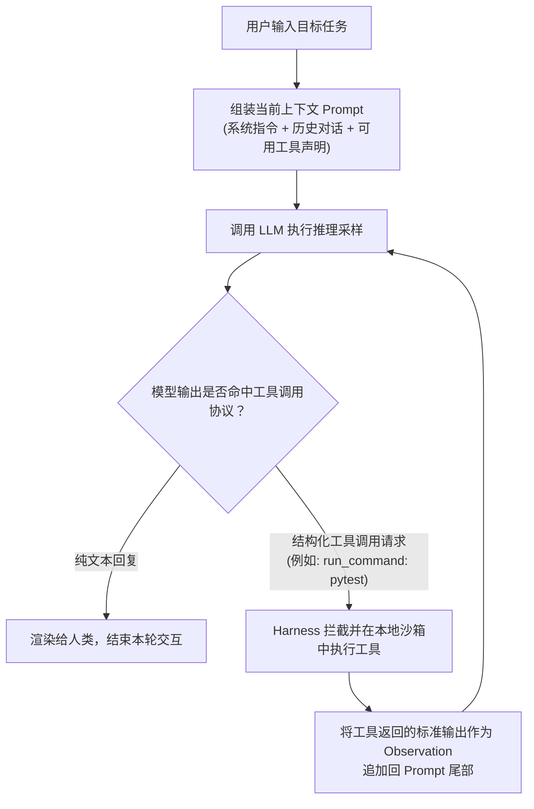
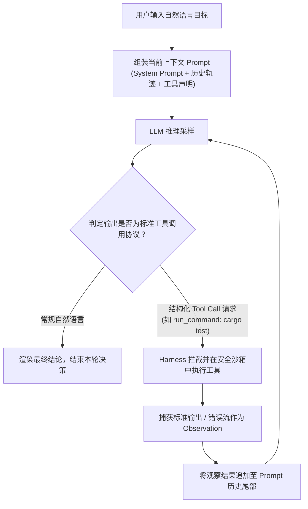

# Lec 7 智能体编程范式（Agentic Coding）

> MIT 6.NULL · 现代软件工程工具链与开发者素养 · 官方讲义核心内容

## TL;DR

- **自回归采样与工具增强循环**：编程智能体通过 200 行工具调度架构（Harness）将 LLM 的下一个 Token 概率生成与本地沙箱执行绑定，构建状态感知的自主闭环。
- **稀缺物理资产与上下文治理**：依托步骤回溯（Rewind）、动态摘要压缩（Compaction）、`llms.txt` 标准与按需技能（Skills），最大化利用有限注意力窗口。
- **解耦协作与多智能体拓扑**：基于模型上下文协议（MCP）打破外部工具接入壁垒，配合 Git Worktrees 与隔离子智能体（Subagents）实现高并发任务解耦。
- **批判性工程审查底线**：警惕调试螺旋陷阱与代码验证不对称性，始终坚持测试驱动（TDD）与第一性原理审查，守住系统的健壮性防线。

---

## 1. 软件工程的范式转移：从代码生成到自主智能体

什么是编程智能体（Coding Agent）？
它不再仅仅是一个被动等待你敲键盘并在光标后补全单词的“幽灵输入法”，也不是一个被困在浏览器对话框里只能泛泛而谈的聊天机器人。**智能体是一个被赋予了环境感知能力与工具调用权限的自主软件系统**。

它可以自主使用终端 Shell 执行编译与测试，可以穿梭于数十个源码文件之间搜索与读写，甚至可以通过 Web 工具查阅最新文档。它能够独立执行长达数十分钟的多步骤工程任务，根据测试报错自行纠偏、迭代。

今天这堂课，我们要彻底撕开 AI 智能体的神秘面纱：从它底层的概率计算与 200 行工具调度架构讲起，探讨如何管理极其昂贵的上下文预算，并清醒认识智能体在当前工程中的致命陷阱与安全防线。
---

## 2. 智能体物理基础：概率采样与 200 行调度器

为了不被铺天盖地的营销话术忽悠，每一个计算机系学生都必须建立对大语言模型（LLM）的底层数学认知：

**大语言模型的本质，是在给定前置提示词字符串 $x$ 的条件下，对下一个可能出现的补全字符串 $y$ 进行自回归条件概率建模**：
$$\hat{y} \sim \pi_\theta(\cdot \mid x)$$

模型没有任何人类意义上的“意识”或“真正的推理动机”，它所有的输出都来自于在这个庞大的高维概率分布中进行采样（Sampling）。

同时，模型拥有一个物理上不可逾越的硬边界——**上下文窗口（Context Window）**。不管是用户输入的提示词，还是模型自己生成的代码，都必须容纳在这一固定长度的 Token 数组内。

### 工具调用（Tool-calling）与 Agent Harness 原理

那么，一个只会预测下一个词的概率模型，究竟是如何操纵我们的电脑运行 Shell 命令并修改代码的？

实际上，**驱动智能体的底层运行时框架（Agent Harness），用不到 200 行 Python 代码就可以完整实现**！其核心循环如下：

在这个自闭环循环中：
1. Harness 在向模型发送请求时，会在提示词中附带一段标准 JSON 模式（Schema），声明“你拥有 `read_file`、`edit_file`、`run_command` 三个工具”；
2. 当模型判断当前需要运行测试时，它不会输出自然语言，而是输出一段特殊的标记字符串（如 `{"tool": "run_command", "args": {"cmd": "pytest"}}`）；
3. Harness 捕获到这一标记后，**暂停模型推理**，在宿主机或安全沙箱中实际执行 `pytest`；
4. 随后 Harness 将终端输出的真实测试报错信息（例如 `AssertionError: assert 42 == 0`）作为下一轮对话的系统输入塞回上下文；
5. 模型重新看到真实的报错物理现实，从而在下一轮推理中自主决定打开文件修复缺陷！

这就是所谓“自主性”的全部本质——**利用外部工具执行结果作为反馈信号驱动的自回归状态机**。

### 极简 Agent Harness 核心循环

驱动智能体执行复杂工程操作的运行时宿主（Agent Harness），其核心调度状态机极其简洁，在概念上仅需约 200 行代码即可形式化表达：

在这个自闭环循环中：
1. Harness 在向模型发送请求时，会在提示词中附带一段标准 JSON 模式（Schema），声明“你拥有 `read_file`、`edit_file`、`run_command` 三个工具”；
2. 当模型判断当前需要运行测试时，它不会输出自然语言，而是输出一段特殊的标记字符串（如 `{"tool": "run_command", "args": {"cmd": "pytest"}}`）；
3. Harness 捕获到这一标记后，**暂停模型推理**，在宿主机或安全沙箱中实际执行 `pytest`；
4. 随后 Harness 将终端输出的真实测试报错信息（例如 `AssertionError: assert 42 == 0`）作为下一轮对话的系统输入塞回上下文；
5. 模型重新看到真实的报错物理现实，从而在下一轮推理中自主决定打开文件修复缺陷！

这就是所谓“自主性”的全部本质——**利用外部工具执行结果作为反馈信号驱动的自回归状态机**。

---

## 3. 人机协同架构：工程经理与实习生心智模型

在工业级团队中，与智能体协同的最佳认知范式是将其视作一名 **“技术广博、手速极快、不知疲倦，但缺乏全局架构定力且极易过度工程化的初级实习生”**。
与智能体协作时，最健康的心理预期是把智能体当成一名**“技术全面、打字飞快、精力无限，但缺乏全局架构判断力且极度容易盲从的初级实习生（Intern）”**。

- 作为“工程经理”，你必须给出清晰、明确、可验证的验收规格（Specification）；
- 如果你的指令含糊其辞，比如“帮我优化这个项目”，实习生可能会按自己的脑补大拆大建，甚至删掉核心模块；
- 你必须对实习生提交的每一行代码执行严格的代码审查（Code Review），并在它陷入死胡同时通过人机交互打断（Interrupt）它，纠偏其前进方向。

### 验收驱动与测试前置（TDD）

指导智能体最有效、最安全的工程方法是 **测试驱动开发（TDD）**：
1. 由你（或者让智能体辅助你）先写出一组断言极其严密的单元测试（Failing Tests）；
2. 人工仔细审核这组测试用例，确保它们准确表达了你的业务契约与边界要求；
3. 将测试指令交给智能体：“*运行 `pytest tests/test_feature.py`，修改 `src/` 下的代码直至所有用例全绿通过，严禁修改测试文件本身。*”
通过确凿的测试红绿灯反馈，智能体可以在闭环中自我迭代数十次，从而交出百分之百符合预期的高质量交付物。

---

## 4. 上下文窗口的精细化物理治理

随着智能体与你对话数十轮、读取了上百个文件，**上下文窗口会迅速膨胀**。即使模型号称支持 100 万 Token，随着上下文的增长，模型的注意力会出现明显的稀释与退化（Needle-in-a-Haystack 衰减），推理延迟成倍暴增，单次 API 调用的费用更会呈指数级飙升。

如何高效治理上下文？现代智能体工程演进出了一整套高级工具范式：

### 1. 会话回溯与动态压缩（Rewind & Compaction）

- **步骤回溯（Rewind / Undo）**：当发现智能体在第 5 步开始误入歧途时，不要试图在第 6 步用自然语言劝说它“撤销刚才的改动”，因为错误的对话历史依然残留在上下文中继续干扰注意力。正确的做法是直接在 Harness 中将上下文历史“回滚”到第 4 步之前，彻底抹除错误记忆；
- **上下文压缩（Compaction / `/compact`）**：当会话长度逼近上限时，Harness 调用一次独立的上下文摘要模型，将前 80% 的冗长日志与历史 Diff 压缩为一段紧凑的 Markdown 状态纪要，替换原有历史，释放宝贵的心智带宽。

### 2. 标准文档接入协议：`llms.txt`

让智能体去爬取一个包含海量 JavaScript 脚本、导航栏和广告的 HTML 官网文档，是对 Token 的巨大浪费。

开源界正在普及 **`/llms.txt`** 规范（如 `cursor.com/llms.txt`、`pydantic.ai/llms.txt`）。软件作者会专门为 LLM 维护一份超高信息密度的 Markdown 格式 API 纯文本全景摘要。智能体只需检索并注入 `llms.txt`，就能在消耗极少 Token 的前提下掌握最新库的全部接口规范。

### 3. 项目规则注入（`AGENTS.md` / `CLAUDE.md`）与技能（Skills）

在仓库根目录维护一份面向智能体的“入职手册”——**`AGENTS.md`**：
声明代码规范、格式化检查命令、严禁触碰的文件以及类型检查规则。智能体在冷启动时会自动将该文档加载至系统提示词中。

为了避免静态 `AGENTS.md` 过于庞大导致上下文膨胀，现代 Harness 支持 **技能（Skills）** 机制：将特定领域的复杂工作流封装为按需加载的独立说明文件。智能体平时只看到一份极简的技能清单，唯独当识别到需要执行“对象存储迁移”或“数据库迁移”时，才动态将对应的 Skill 抓取进入上下文。

### 4. 子智能体（Subagents）与并行工作树（Git Worktrees）

在复杂的研发场景中，单智能体往往会分身乏术。顶层主智能体可以创建并派发独立的 **子智能体（Subagents）**：
- 例如指派一个“代码库调研子智能体”去深度遍历上千个文件，子智能体在自己的独立上下文沙箱中尽情翻阅，最后仅向主智能体汇报一段 300 字的提炼报告；主智能体的上下文丝毫不受冗余文件内容的污染。
- 为了防止多个并行作业的智能体互相修改同一份本地代码引发写冲突，工程上利用我们在第 5 讲学过的 **Git Worktrees**，为每个智能体分配一个完全隔离的物理工作副本，各自在独立分支上完成任务后，再由人类工程师汇总审查合并！

---

## 5. 风险防线：智能体时代的批判性工程审查
在课程的最后，我必须给大家泼一盆冷水。**在 2026 年，最危险的工程师是那些盲目信任 AI 输出、完全丧失了批判性思考的开发者**。

### 陷阱 1：调试螺旋（Debugging Spirals）与 AI 谄媚

当智能体遇到一个棘手的 Bug 时，它常常会在原地打转：尝试方案 A 报错，于是打了个补丁方案 B；方案 B 引发新报错，于是又打了方案 C……经过 20 轮修改，最初的代码已经被改得面目全非，引入了上百行无逻辑的冗余垃圾代码。甚至当你指出它的错误时，它会极具迷惑性地向你道歉并顺着你的话胡说八道（Gaslighting）。遇到这种情况，立即中止会话，用 `git checkout` 丢弃所有改动，回归人类的第一性原理思考！

### 陷阱 2：代码验证的不对称性（Verification Asymmetry）

在软件工程中，**看懂并验证一段别人（或 AI）写的复杂代码的正确性，往往比你自己从头写一遍还要困难得多！**
AI 写出的代码通常在语法上无懈可击、格式极其优美，但可能在并发锁安全、边界溢出或性能瓶颈上埋下了极度隐蔽的暗桩。如果你只看它“能跑起来”就草率合并，未来线上排错的代价将呈指数级放大。

**结语**：AI 智能体是放大生产力的终极杠杆，但杠杆的支点永远是你脑海中坚如磐石的计算机科学基石——算法、操作系统、网络协议与架构设计。只有当你本身具备极高水平的技术判断力时，你才能驾驭智能体成为一名百倍效率的卓越架构师！
