# 6.5060 / 6.827 算法工程（Algorithm Engineering）

## TL;DR

- **理论与实践的闭环弥合**：超越传统渐近复杂度分析与平坦 RAM 假设，构建涵盖“算法设计 → 理论分析 → 软硬协同实现 → 实验评测 → 理论反哺”的现代算法工程完整生命周期。
- **高维系统与硬件感知模型**：深入探究并行计算（Work-Span 模型与工作窃取调度）、层次存储（缓存无关模型、外存 I/O 复杂度、写高效 B-ε 树）与非易失内存等复杂物理约束。
- **大规模图计算与现代数据系统**：系统涵盖单机/分布式图处理框架（Ligra、GraphChi、PowerGraph）、空间局部性优化（GraphIt DSL）、轻量压缩（SIMD 向量化解压）及纯函数式流式图系统。

## 课程介绍

### 先修课程

- [6.1220 算法的设计与分析（Design and Analysis of Algorithms）](../../tcs/61220_design_and_analysis_of_algos/index.md)：熟练掌握渐近分析、动态规划、分治法、高级数据结构与理论复杂度下界。
- [6.1060 软件性能工程（Software Performance Engineering）](../software_performance_engineer/index.md)：熟悉现代处理器体系结构、缓存层次、C/C++ 底层内存布局、SIMD 向量化与基准评测。
- [6.1020 软件构造基础（Elements of Software Construction）](../element_of_software_construction/index.md)：具备中大型系统的规格设计、抽象屏障维护与防御性编程素养。

### 官方对课程描述的翻译

这是一个以顶级前沿研究为导向的算法工程高级研究生课程，全面涵盖算法与数据结构的深层理论与工业工程实践。学生将系统学习真实的计算模型、前沿算法设计与渐近分析，以及面向现代硬件底层的算法实现性能工程。

课程系统研究计算基础问题在顺序、多核并行、缓存高效（Cache-Efficient）、缓存无关（Cache-Oblivious）、外部存储（External-Memory）以及写高效（Write-Efficient）环境下的算法设计与系统实现。算法工程的核心方法论与优化原则将在大规模并行算法、高性能图分析系统与海量数据处理场景中得到深度展现。学生将研读顶级学术会议（STOC, FOCS, SODA, PPoPP, OSDI, VLDB, SIGMOD）经典论文，完成严密的算法设计推导与性能工程实测。

课程的四大核心支柱：
1. **多核并行与调度理论**：建立 Work-Span 抽象，掌握 Fork-Join 动态多线程模型与工作窃取（Work-Stealing）理论界限，构建 Work-Efficient 的并行算法。
2. **存储感知与缓存无关范式**：摆脱对特定硬件缓存大小 $M$ 和块大小 $B$ 的硬编码依赖，利用分治分块在任意复杂存储体系中自适应达成最优 I/O 传输。
3. **海量图计算引擎与领域专用架构**：从单机内存到外存、再到分布式集群，剖析 Direction-Optimizing、Propagation Blocking、拓扑重排序与领域专用语言（GraphIt DSL）的极致工程实现。
4. **轻量级压缩与数据系统加速**：利用现代 CPU 的 SIMD 向量化并行度，结合纯函数式持久化树（Aspen、PaC-trees），在极低延迟下支撑高并发写入与复杂实时分析。

### 参考书籍

**经典教材与学术专著**：
- Thomas H. Cormen, Charles E. Leiserson, Ronald L. Rivest, Clifford Stein. *Introduction to Algorithms* (CLRS, 4th Edition). MIT Press.（涵盖第 26 章多线程并行算法）
- Matthias Müller-Hannemann, Stefan Schirra (Eds.). *Algorithm Engineering: Bridging the Gap Between Algorithm Theory and Practice*. Springer, 2010.（算法工程方法论权威专著）
- David Easley, Jon Kleinberg. *Networks, Crowds, and Markets: Reasoning About a Highly Connected World*. Cambridge University Press, 2010.（网络分析与图结构基础）
- Guy E. Blelloch, Bruce M. Maggs. *Parallel Algorithms*. CMU Technical Report.
- Jeffrey Scott Vitter. *Algorithms and Data Structures for External Memory*. Foundations and Trends in Theoretical Computer Science, 2008.

## 课程知识体系

### 模块全景架构

本课程围绕现代硬件体系与大规模计算问题展开，突破经典算法“图灵机/单机平坦 RAM”的理论假定，建立起从计算模型、微架构适配到大规模系统落地的五大进阶模块：

- **模块一：算法工程方法论与并行基础（Lec 1 ~ Lec 5）**
  确立“设计—分析—实现—评测—反哺”的实验算法学研究闭环。建立 Work-Span（工作量与跨度）有向无环图模型；在 Cilk 运行时中理解基于双端队列的工作窃取调度；探讨理想缓存模型下的缓存无关（Cache-Oblivious）分治策略，并将其延伸至模板计算的时空梯形切分。
- **模块二：共享内存图处理与底层存储系统（Lec 6 ~ Lec 10）**
  深入多核多线程环境下的图计算母题。以 Ligra 框架为载体，推导 Direction-Optimizing BFS 的 Push/Pull 双向转换边界；直面闪存与 NVMe 时代的不对称读写开销，分析写高效 B-ε 树与 SplinterDB 键值引擎；运用 Cilksan 与 Cilkprof 工具链实现确定性竞态检测，并对 IPS4o 与并行基数排序开展深度评测。
- **模块三：分布式与单机图处理架构（Lec 11 ~ Lec 15）**
  跨越单机与集群的算力边界。对比 Pregel 顶点中心模型与 PowerGraph 的 GAS 抽象；反思分布式集群的虚荣指标（COST），展示单机外存系统 GraphChi 的滑动窗口机制；借助 Propagation Blocking 优化图遍历的空间局部性，利用 GraphMineSuite 集合代数加速子图匹配，并以 Log(graph) 和拓扑重排序最大化访存命中率。
- **模块四：轻量压缩、动态图与现代并发（Lec 16 ~ Lec 20）**
  面向极限吞吐与动态演进。借助 SIMD AVX2/AVX-512 向量化指令实现数十亿整数每秒的极速解压（StreamVByte、Roaring Bitmaps）；分析流式动态图上的并行并查集；探讨软件事务内存（STM）与硬件事务内存（HTM）；辨析 Hash 与 Sort 在现代大内存多核架构下的聚合与连接性能；运用纯函数式树（Aspen、PaC-trees）实现兼具只读快照与高并发更新的实时流系统。
- **模块五：图神经网络与计算前沿大趋势（Lec 21 ~ Lec 24）**
  立足现代智能化与后摩尔时代。针对图神经网络（GNN）设计基于分层采样与流水线的软硬协同加速架构；实现动态多线程环境下的高质量确定性并行随机数生成；复盘后摩尔时代硬件专业化（ASIC/GPU/TPU）演进对算法工程范式带来的颠覆性重构；以矩阵乘法为例，全景串联寄存器分块、缓存分块、SIMD 向量化与并行调度的性能工程极致实践。

各模块之间的演进与理论映射关系如下图所示：

```mermaid
flowchart TD
  subgraph M1["方法论与并行基础"]
    P1["算法工程闭环 (Methodology)"] --> P2["Work-Span 并行计算模型"]
    P2 --> P3["Cilk 运行时与工作窃取"]
    P2 --> P4["缓存无关模型 (Cache-Oblivious)"]
    P4 --> P5["模板计算时空梯形分块"]
  end

  subgraph M2["共享内存与现代存储"]
    S1["Ligra 共享内存图框架 (Push/Pull)"] --> S2["现代存储 (B-ε 树 & SplinterDB)"]
    S2 --> S3["Fork-Join 生产工具 (Cilksan / Cilkprof)"]
    S3 --> S4["高性能并行排序 (IPS4o / Radix)"]
    S4 --> S5["随机移位分解与启发式图着色"]
  end

  subgraph M3["单机与分布式图架构"]
    G1["分布式图系统 (Pregel / PowerGraph)"] --> G2["单机外存与 COST 反思 (GraphChi)"]
    G2 --> G3["传播阻塞与 GraphIt 领域专用语言"]
    G3 --> G4["子图匹配 (GraphMineSuite / ProbGraph)"]
    G4 --> G5["拓扑重排序与图压缩 Log(graph)"]
  end

  subgraph M4["向量化、动态图与纯函数树"]
    C1["SIMD 向量化压缩 (StreamVByte)"] --> C2["并行动态图算法 (并查集)"]
    C2 --> C3["事务内存 (STM / HTM 确定性前向)"]
    C3 --> C4["大内存聚合与连接 (Sort vs Hash)"]
    C4 --> C5["纯函数式流式图系统 (Aspen / PaC-trees)"]
  end

  subgraph M5["智能系统与前沿演进"]
    F1["图神经网络系统 (采样流水线)"] --> F2["确定性并行随机数生成"]
    F2 --> F3["算法演进大趋势 (后摩尔时代红利)"]
    F3 --> F4["矩阵乘法工程极致复盘 (SIMD/分块)"]
  end

  M1 ==> M2
  M2 ==> M3
  M3 ==> M4
  M4 ==> M5
```

上述模块体现了算法工程的核心世界观：理论复杂度是算法潜能的上界，而硬件物理特性是性能落地的刚性约束。只有将数学设计、体系结构适配与实验验证融为一体，才能锻造出真正具有工业竞争力的算法系统。

### 讲义全景清单

| 讲次 | 核心主题与算法 | 讲义链接 | 关键机制与核心理论收益 |
| :--- | :--- | :--- | :--- |
| **Lec 01** | 课程导论与算法工程方法论 | [lec1.md](./lec1.md) | 算法工程研究闭环、实验算法学准则、微架构基准测量陷阱与理论反哺 |
| **Lec 02** | 现代并行算法与计算模型 | [lec2.md](./lec2.md) | Work-Span DAG 模型、贪心调度定理、并行前缀和（Prefix Sums）与分治 |
| **Lec 03** | 缓存无关算法设计 | [lec3.md](./lec3.md) | 理想缓存模型、高瘦缓存假设、转置与矩阵乘法分治、I/O 复杂度证明 |
| **Lec 04** | Cilk 运行时与工作窃取调度 | [lec4.md](./lec4.md) | Cilk 语言原语、双端队列双向并发、工作窃取调度时空界限分析 |
| **Lec 05** | 模板计算与时空分块优化 | [lec5.md](./lec5.md) | 空间局部性与时间局部性融合、时空梯形切分、Pochoir 编译器技术 |
| **Lec 06** | 共享内存图处理与 Ligra 框架 | [lec6.md](./lec6.md) | 顶点子集与边映射原语、Direction-Optimizing BFS、Push/Pull 自适应切换 |
| **Lec 07** | 现代存储系统与写高效数据结构 | [lec7.md](./lec7.md) | NVMe 闪存非对称读写、B-ε 树缓冲机制、SplinterDB 键值存储引擎 |
| **Lec 08** | Fork-Join 生产力分析工具 | [lec8.md](./lec8.md) | 串行语义等价性、Cilksan SP-bags 确定性竞态检测、Cilkprof 性能剖析 |
| **Lec 09** | 高性能并行排序算法 | [lec9.md](./lec9.md) | Super Scalar Sample Sort、并行就地基数排序（Regions Sort）、IPS4o |
| **Lec 10** | 共享内存图算法：分解与着色 | [lec10.md](./lec10.md) | 随机移位图分解、并行启发式图着色、Work-Span 强保证排序启发式 |
| **Lec 11** | 分布式图计算框架 | [lec11.md](./lec11.md) | BSP 同步屏障、Pregel 顶点计算、PowerGraph GAS 模型与顶点切分优化 |
| **Lec 12** | 单机图系统与 COST 指标反思 | [lec12.md](./lec12.md) | McSherry COST 评价指标、GraphChi 滑动窗口、色数调度与外存流水线 |
| **Lec 13** | 图计算局部性优化与 GraphIt DSL | [lec13.md](./lec13.md) | 传播阻塞（Propagation Blocking）、算法逻辑与调度解耦、GraphIt 编译优化 |
| **Lec 14** | 子图匹配与图挖掘系统 | [lec14.md](./lec14.md) | 模式匹配与团查找、GraphMineSuite 集合代数抽象、ProbGraph 概率集合表示 |
| **Lec 15** | 图压缩与拓扑重排序 | [lec15.md](./lec15.md) | Log(graph) 紧凑图编码、Degree/BFS 拓扑重排、差分压缩 CSR 与访存局部性 |
| **Lec 16** | 轻量级数据压缩与 SIMD 向量化 | [lec16.md](./lec16.md) | SIMD-BP128 整数解压、StreamVByte 字节对齐、Roaring Bitmaps 倒排索引 |
| **Lec 17** | 并行动态图算法与并查集 | [lec17.md](./lec17.md) | 动态边流更新、Work-Efficient 并行并查集、随机连接与扁平化机制 |
| **Lec 18** | 事务性内存设计与实现 | [lec18.md](./lec18.md) | 软件事务内存（STM）、读写版本日志、确定性前向推进保证与 HTM 边界 |
| **Lec 19** | 高效数据聚合：排序 vs 哈希 | [lec19.md](./lec19.md) | 缓存敏感型聚合、并行 Semisort、现代大内存下 Sort 与 Hash Join 性能论战 |
| **Lec 20** | 纯函数式树与低延迟图流系统 | [lec20.md](./lec20.md) | 结构共享、Aspen 流式图架构、PaC-trees 并行压缩纯函数式树构建 |
| **Lec 21** | 图神经网络系统架构与加速 | [lec21.md](./lec21.md) | 图拓扑聚合与稠密张量混合负载、LightNE 嵌入、采样流水线与显存优化 |
| **Lec 22** | 确定性并行随机数与多维求和 | [lec22.md](./lec22.md) | 基于计数器的并行 RNG（Philox）、动态多线程可重现性、多维前缀和 |
| **Lec 23** | 算法演进大趋势与后摩尔红利 | [lec23.md](./lec23.md) | 经典硬件红利终结、软硬协同专业化、算法演进速率测算与开源公共资产 |
| **Lec 24** | 终极复盘：矩阵乘法的工程演进 | [lec24.md](./lec24.md) | Strassen 理论极限与常数瓶颈、多级分块、AVX-512 向量化与现代工程极致 |

## 官方资源

- [MIT 6.5060 Fall 2025 官方主页（Julian Shun）](https://jshun.csail.mit.edu/6506-f25/)
- [MIT 6.5060 Spring 2023 官方归档](https://people.csail.mit.edu/jshun/6506-s23/)
- [MIT CSAIL 算法工程与并行计算研究组](https://jshun.csail.mit.edu/)
- [Problem Based Benchmark Suite (PBBS 算法基准库)](https://www.cs.cmu.edu/~pbbs/)
