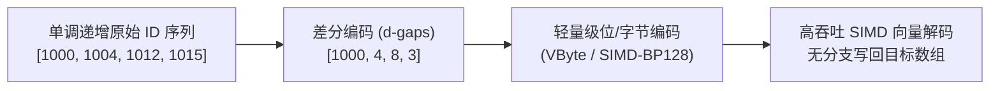
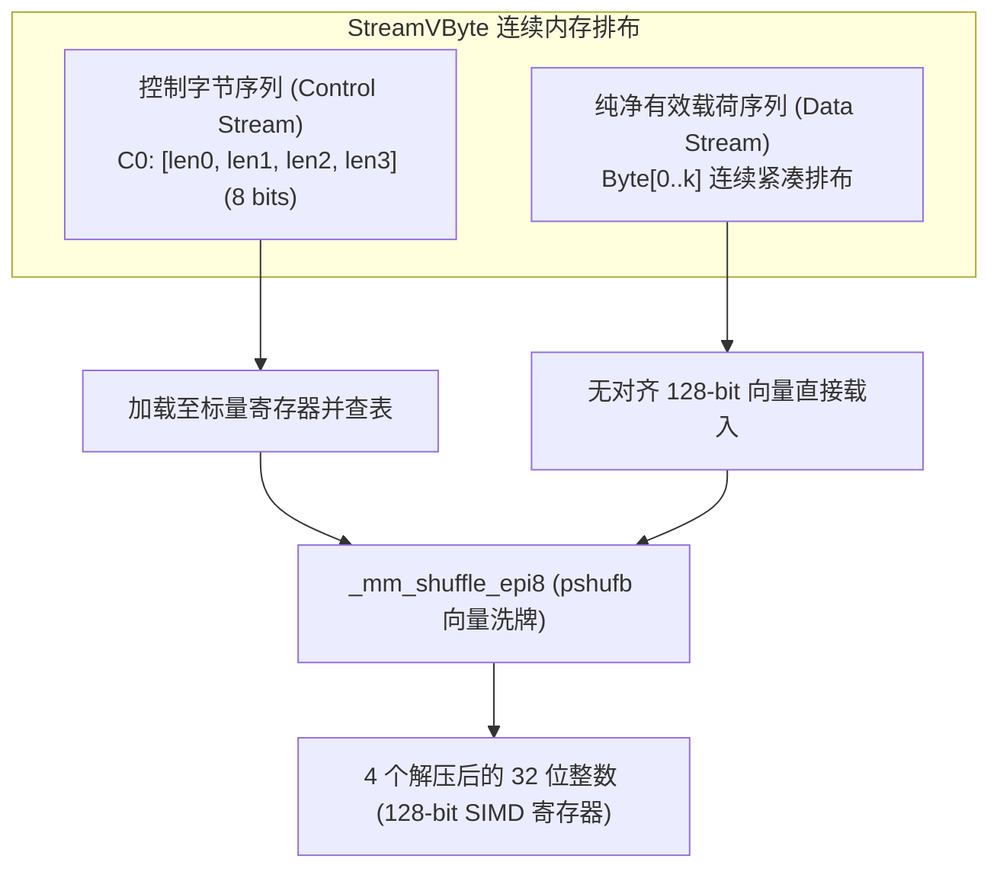
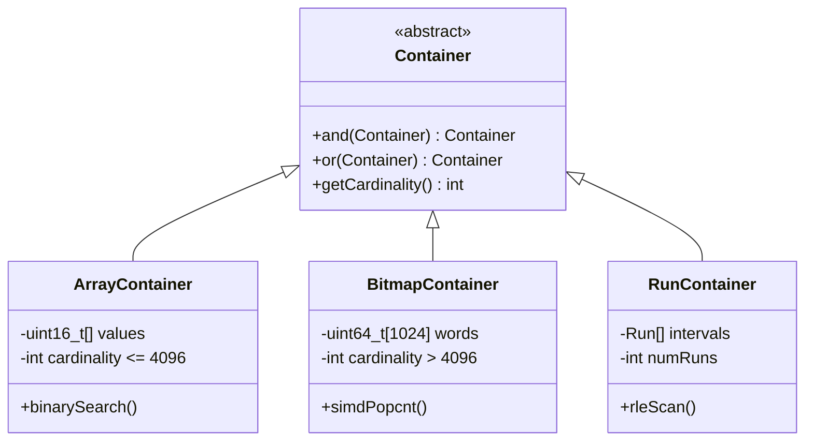

# Lec 16 轻量级数据压缩与 SIMD 向量化（Data Compression: SIMD Vectorization & Inverted Index）

## TL;DR

- 倒排索引与分析型数据库通过差分编码（d-gaps）将单调递增 ID 转化为小整数，使轻量级整数压缩成为打破主存带宽瓶颈（Memory Wall）的关键手段。
- 经典 VByte 将控制位与有效载荷紧耦合存储，导致标量解码循环面临严重的处理器分支预测失效率。
- StreamVByte 创新性地将控制字节流与变长数据载荷物理分离，利用 SIMD 洗牌指令（`pshufb`）实现无分支并行解压，吞吐量超越每秒数十亿整数。
- Roaring Bitmaps 采用双层分桶与三元混合容器架构，在稀疏与稠密之间自适应切换，大幅削减空间并加速集合求交。

## 倒排索引与整数序列压缩的物理动机

在现代全文检索、日志分析与列式存储数据库中，倒排索引（Inverted Index）是核心基础设施。倒排索引将每个词项映射到一个按升序排列的文档标识符列表（Posting List）：

$$
P = \langle docID_1, docID_2, docID_3, \dots, docID_n \rangle \quad (docID_i < docID_{i+1})
$$

直接存储 32 位或 64 位无符号整数会导致庞大的主存开销。在多核现代微架构下，单核的浮点与整数计算吞吐往往数十倍于单通道 DDR 总线带宽。若不经过压缩，CPU 的执行流水线在绝大部分时间处于等待内存控制器响应的空转状态（Memory-Bound）。

为了缩减数据体积，系统首先对 Posting List 进行差分编码（Delta Encoding / d-gaps）：

$$
\Delta = \langle docID_1, docID_2 - docID_1, docID_3 - docID_2, \dots, docID_n - docID_{n-1} \rangle
$$

由于文档词项在语料库中服从齐夫定律（Zipf's Law），绝大部分高频词在文档间紧密相邻，差分后的值通常集中在 1 到 255 的极小整数范围内。通过无损数据压缩，我们将 32 位定长表示压缩至平均 8 到 10 个比特，使单次缓存行载入能携带 4 倍以上的有效 ID，从而直接倍增系统吞吐。



## 经典字节对齐编码：VByte 与控制流开销

Variable Byte（简称 VByte）是信息检索领域应用最广泛的字节级变长编码方案。

::: definition [Variable Byte (VByte) 编码规则]
对于任意待编码的非负无符号整数 $x$：
1. 将 $x$ 的二进制表示切分为 7 个比特为一组的载荷片段。
2. 每个输出字节的最高位（MSB，第 7 位）作为**延续标志位（Continuation Bit）**。
3. 若 MSB 为 `1`，表示该整数的二进制序列尚未结束，下一个字节仍属于该整数；若 MSB 为 `0`，表示当前字节是该整数的末尾字节。
:::

例如，数值 $3$（二进制 `0000011`）被编码为单字节 `00000011`；而数值 $300$（二进制 `00000010 01011100`）被切分为两个 7 位块，分别编码为 `10000010` 和 `00101100`。

### 标量解码的微架构陷阱

VByte 的优势在于编码实现极其简洁，且以单字节为处理单元，避免了跨字节的繁重位移操作。然而，在现代超标量处理器上，标量 VByte 解压器的执行速度远低于理论预期，其瓶颈在于**数据与控制紧密混合**带来的分支预测失效：

```cpp
// 经典标量 VByte 解码核心循环
while (in_ptr < in_end) {
    uint32_t val = 0;
    uint32_t shift = 0;
    uint8_t byte;
    do {
        byte = *in_ptr++;
        val |= (uint32_t)(byte & 0x7F) << shift;
        shift += 7;
    } while (byte & 0x80); // 数据驱动的不可预测内层分支
    *out_ptr++ = val;
}
```

在真实索引数据中，差分整数的大小高度波动（从 1 字节到 4 字节交织出现）。内层 `do-while` 循环的分支跳转目标无法被 CPU 分支预测器（BPU）准确推断，导致高频的分支预测错误惩罚（每次预测失败流水线冲刷损耗 15 到 20 个时钟周期）。因此，传统 VByte 的解码速度通常被限制在 200MB/s 到 400MB/s 之间，甚至慢于解压缩前直接读取原始未压缩内存。

## SIMD 向量化加速：StreamVByte 与 SIMD-BP128

为了消除控制流依赖并释放现代 CPU 向量指令集的庞大带宽，算法工程界提出了控制与数据分离（StreamVByte）以及固定块位打包（SIMD-BP128）的解压架构。

### StreamVByte：控制与数据物理分离

Lemire、Boytsov 与 Kurz 提出了 **StreamVByte** 编码算法。StreamVByte 破除了在数据载荷中嵌入延续位的传统模式，将原本混合交织的数据流重组为两个独立的连续内存流：

1. **控制流（Control Stream）**：由专门的控制字节组成。每个控制字节包含 4 个 2-bit 标签，精准记录紧随其后的 4 个 32 位整数各自占用的有效字节数（1、2、3 或 4 字节）。
2. **数据流（Data Stream）**：纯粹存放变长连续的实际有效字节，各整数按顺序紧密拼接，中间没有任何元数据干扰。



由于控制字节仅有 256 种取值（$4^4 = 256$），系统可以在内存中静态预计算一张包含 256 个条目的常量洗牌掩码表（Shuffle Mask Table）。解码时，处理器每次只需读入 1 个控制字节作为查表索引，获取 16 字节的洗牌控制向量，随后通过单条 SSSE3 指令 `_mm_shuffle_epi8`（`pshufb`），直接将 128 位寄存器内紧凑打包的变长字节散射（Scatter）到 4 个对齐的 32 位整数槽位中。整个解压过程**彻底消除了数据依赖性条件分支**，单核解码吞吐跃升至每秒 40 亿整数以上。

### SIMD-BP128：分块固定位打包

与以字节为单位的 StreamVByte 不同，**SIMD-BP128**（Bit-Packing 128）是一种面向极致吞吐的位级压缩机制：

1. **分块原则**：数据以 128 个整数为不可分割的逻辑块进行编码。
2. **块内最大位宽提取**：扫描块内 128 个整数，计算其最大值所需的最小有效比特位宽 $b = \max_{i=0}^{127} \lceil \log_2(x_i + 1) \rceil$。
3. **向量位打包**：使用 128 位寄存器，将 128 个整数分别截取最低 $b$ 位进行密集打包。整个 128 整数块被均匀映射到 $b$ 个 128 位的向量寄存器中。

解压时，SIMD-BP128 完全避免了标量逐位解包循环，直接调用 AVX-2 / AVX-512 的向量逻辑右移（`_mm256_srli_epi32`）与按位与（`_mm256_and_si256`）指令，每个时钟周期解包多个 32 位整数，吞吐量可逼近内存总线的物理极限。

## 集合求交与空间索引的极致：Roaring Bitmaps

在倒排索引的求交（Boolean AND）和多维过滤场景中，压缩整数序列最终需要执行高频的集合运算。纯粹的变长整数列表在执行求交时必须使用双指针归并扫描，时间复杂度为 $O(|A| + |B|)$；而未压缩的位图（Bitset）支持单周期 64 位甚至 512 位按位与（`AND`），但会造成极端的高基数稀疏内存浪费。

**Roaring Bitmaps** 融合了有序列表与位图的优势，提出了自适应的三元容器架构。

### 双层分桶与容器体系

Roaring Bitmaps 将 32 位整数的高 16 位和低 16 位解耦处理：
- 高 16 位作为主键，通过第一级稀疏数组定位具体的**分桶分片（Chunk / Container）**，每个分片负责管理至多 $2^{16} = 65536$ 个整数。
- 低 16 位则存放在该分片所对应的二级容器内部。

根据分片内容纳的整数基数（Cardinality）与连续性，Roaring Bitmap 在运行时动态选择以下三种底层存储容器之一：



1. **数组容器（Array Container）**：
   - **适用区间**：当分片内整数基数 $N \le 4096$ 时使用。
   - **内存布局**：由一个紧凑的 `uint16_t` 动态数组存储已排序的低 16 位值。占用内存为 $2N$ 字节（至多 $2 \times 4096 = 8192$ 字节）。
2. **位图容器（Bitmap Container）**：
   - **适用区间**：当分片内整数基数 $N > 4096$ 时使用。
   - **内存布局**：固定分配 $65536 / 8 = 8192$ 字节（即 1024 个 64 位无符号整数构成的位图）。
   - **临界点证明**：当 $N = 4096$ 时，数组容器占用 $4096 \times 2 = 8192$ 字节，与位图容器体积完全相等；一旦 $N > 4096$，位图容器的空间效率与按位操作性能均严格占优。
3. **连续游程容器（Run Container / RLE）**：
   - **适用区间**：当存在大量连续区间（例如连续的主键自增生成段）时。
   - **内存布局**：存储 `[start, length]` 对。例如连续 10,000 个整数只需占用 4 个字节，压缩率极高。

### 向量化求交加速

Roaring Bitmaps 的核心威力在于其求交（Intersection）操作可根据左右两个容器的具体类型分派最优的硬件实现：
- **Bitmap $\cap$ Bitmap**：直接循环调用 AVX2 向量按位与（`_mm256_and_si256`），仅需 256 次向量运算即可完成对 65536 个元素的完全求交，并通过 `_mm_popcnt_u64` 极速统计基数。
- **Bitmap $\cap$ Array**：直接遍历数组容器中的每一个 16 位值，将其作为偏移量去位图容器中进行常量时间位探测（Bit Test），复杂度为严格的 $O(N_{\text{array}})$，完全避免了二分查找开销。

## 算法实现：StreamVByte SIMD 解码流水线

在传统的字节压缩算法中，解压代码通常深陷在逐字节条件判断与变长位移的泥潭中。StreamVByte 的核心突破在于将原本极其复杂的控制流决策完全转化为**静态常量查表与单指令向量数据重排**。

在微架构层面，SSSE3 引入的 `_mm_shuffle_epi8`（即汇编指令 `pshufb`）是一个功能极其强悍的字节置换原语。该指令接收一个 128 位的数据向量与一个 128 位的控制掩码向量。对于掩码中的每个字节：
- 若其最高位为 `0`，则以该字节的低 4 位为索引，从数据向量中选取对应位置的字节放置到结果槽位；
- 若其最高位为 `1`（如 `0xFF` 或 `0x80`），则直接在结果向量的相应位置填充常数零。

通过合理构造由 256 个条目组成的静态洗牌掩码表 `shuffle_mask_table`，任意给定的 8 位控制字节所指定的 4 个整数变长字节布局，均被编码为一个 16 字节的掩码。在实际执行时，算法一次性载入 16 字节的未压缩字节，随后利用单条 `pshufb` 指令同时完成 4 个 32 位整数的字节位置重排与高位补零，彻底消除了数据驱动的分支跳转。

下面给出了 StreamVByte 解码 4 个连续 32 位整数的核心实现与详细硬件契约：

```cpp
#include <immintrin.h>
#include <cstdint>
#include <cstring>

// 静态预计算的洗牌掩码表（每个条目 16 字节，对齐于 AVX 边界）
// index 对应于 8 位控制字节（4 个 2-bit 长度指示符，共 256 种组合）
extern const uint8_t shuffle_mask_table[256][16];
// 静态预计算的 4 整数总字节长度表
extern const uint8_t length_table[256];

/**
 * @brief 使用 SSSE3 / AVX2 向量化解码一组（4个）32位整数
 * @param control_byte 控制流中的单字节描述符
 * @param data_ptr 纯净有效载荷流指针
 * @param out_ptr 解码目标缓冲区指针（必须可安全容纳 4 个 32-bit 整数）
 * @return 载荷流向前消费的实际字节数
 */
inline size_t streamvbyte_decode_quad(
    uint8_t control_byte,
    const uint8_t* __restrict data_ptr,
    uint32_t* __restrict out_ptr
) {
    // 1. 无对齐载入 16 字节原始数据至 128 位向量寄存器
    // 注意：即使有效载荷小于 16 字节，只要末尾保留足够安全缓冲区，即可安全单指令载入
    __m128i in_data = _mm_loadu_si128(reinterpret_cast<const __m128i*>(data_ptr));

    // 2. 查表获取针对当前控制字节的洗牌掩码
    __m128i mask = _mm_load_si128(
        reinterpret_cast<const __m128i*>(shuffle_mask_table[control_byte])
    );

    // 3. 执行单周期硬件洗牌：根据掩码将零散字节重排并高位清零补齐至 4 个 32 位槽位
    __m128i result = _mm_shuffle_epi8(in_data, mask);

    // 4. 将解压完成的 4 个 32 位整数无对齐流式存入输出数组
    _mm_storeu_si128(reinterpret_cast<__m128i*>(out_ptr), result);

    // 返回当前组在数据流中所消耗的物理字节偏移
    return length_table[control_byte];
}
```

为了确保上述向量化流水线在生产环境中发挥极限吞吐，系统在工程实现上必须严格满足以下微架构优化准则：

1. **末端安全补齐（Safety Padding）**：由于 `_mm_loadu_si128` 每次无差别抓取 16 字节内存，在压缩缓冲区的末尾必须至少额外预留 16 字节的填充区域（Padding）。这避免了解码最后一组不足 16 字节的有效载荷时触发操作系统的页面越界访问（Page Fault / SIGSEGV）。
2. **掩码表的一级缓存驻留**：整个 `shuffle_mask_table` 的体积仅为 $256 \times 16 = 4096 \text{ 字节}$（4 KB），`length_table` 仅为 256 字节。这两张只读表能够完全常驻于处理器的 L1 数据缓存中，表项查找开销几乎等同于单周期寄存器访存。
3. **指令级并行度与循环展开**：在调用端，外层主循环通常按 4 组（即 16 个整数）为单位进行循环展开（Loop Unrolling）。现代超标量 CPU 具备多个乱序加载与执行端口，展开后能够交错发射多次无相关的载入与洗牌指令，隐藏内存访存延迟，达到每时钟周期解压 2 到 3 个 32 位整数的高吞吐。
4. **流式写回与缓存污染控制**：当解码目标数组非常庞大且不会立即被后续算子复用时，可以使用流式写入原语（如 `_mm_stream_si128`），绕过 CPU 缓存层级直接写回主存控制器（Non-Temporal Stores），防止解压产生的大量中间数据冲刷淘汰热点索引字典。

## 工程权衡：解压吞吐量 vs 压缩比的系统边界

在设计数据密集型系统时，算法工程师常陷入“压缩比越高越好”的理论误区，试图采用算术编码、霍夫曼编码或 Zstandard 等重型算法。

::: insight 内存墙时代的计算换带宽博弈
在微架构与主存构成的物理现实中，压缩的根本目的不是为了节省磁盘或固态硬盘的物理存储成本，而是为了**充当主存总线的高效带宽放大器（Bandwidth Multiplier）**。

假设服务器单核内存读取带宽为 $15\text{ GB/s}$：
- 若采用压缩比高达 4:1 的通用算法（如 Snappy 或 Deflate），但单核解压吞吐量仅有 $500\text{ MB/s}$，则计算核心将成为严重木桶短板，系统有效吞吐量被死死限制在 $500\text{ MB/s}$。
- 若采用 StreamVByte 或 SIMD-BP128，压缩比虽降低至 2.5:1，但单核解压吞吐达到惊人的 $4.5\text{ GB/s}$。结合数据压缩带来的总线带宽放大效应，单核实际上能够消化等效于 $4.5 \times 2.5 = 11.25\text{ GB/s}$ 的未压缩原始数据流。

因此，轻量级算法通过牺牲极少量的空间冗余，换取了**硬件友好的控制流与无分支执行路径**，在 CPU 密集计算与主存带宽受限之间找到了最优平衡点。
:::

| 算法方案 | 典型压缩率 (bits/int) | 单核解压吞吐 (GB/s) | 核心指令原语 | 关键应用场景 |
| :--- | :--- | :--- | :--- | :--- |
| **标准 VByte** | $10 \sim 14$ | $0.2 \sim 0.4$ | 标量位移、条件分支 | 传统搜索引擎、低频离线归档 |
| **StreamVByte** | $10 \sim 14$ | $3.5 \sim 5.0$ | `pshufb`、无分支查表 | 现代时序引擎、高频倒排索引 |
| **SIMD-BP128** | $8 \sim 12$ | $4.0 \sim 6.5$ | 向量位移、掩码逻辑与 | 内存列存数据库（OLAP 分析） |
| **Roaring Bitmaps** | 自适应混合 | 集合求交达 $10+$ | AVX2 按位与、`popcnt` | 复杂多维布尔过滤、图顶点索引 |
