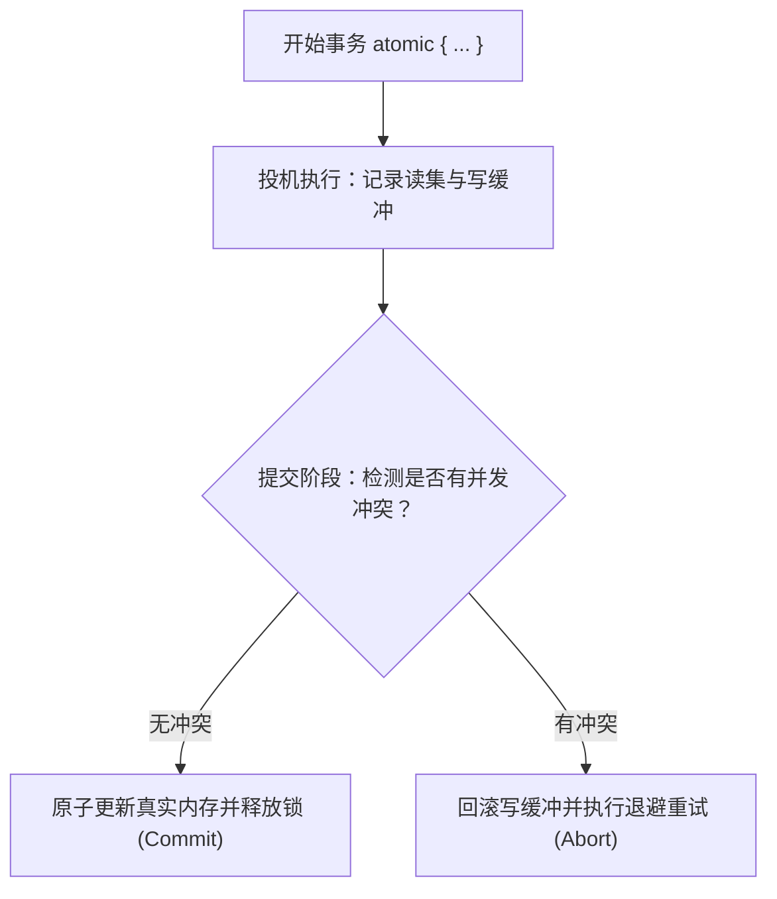
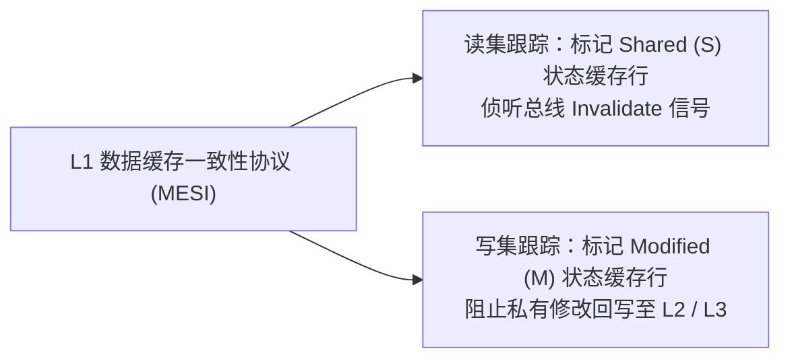

# Lec 18 事务性内存设计与实现（Transactional Memory: STM, HTM & Progress Guarantees）

## TL;DR

- 传统基于互斥锁的并发控制面临死锁、优先级反转以及代码不可组合（Non-Composability）的致命工程瓶颈。
- 软件事务内存（STM）通过读集（Read-Set）、写集（Write-Set）与版本时钟机制，将数据库 ACID 事务概念引入共享内存多线程编程。
- 硬件事务内存（HTM / 如 Intel TSX）复用 L1 缓存一致性状态跟踪投机访存，具备极低延迟，但受限于缓存容量溢出与异常中止。
- TL2 算法通过全局逻辑时钟与提交时验证，在纯软件层实现了高效的乐观并发，展现了算法工程在无锁与悲观锁之间的折中之道。

## 悲观锁的并发困境与事务性内存起源

在多核共享内存系统中，保证并发数据结构（如并发跳表、红黑树或哈希表）的原子性与线性一致性一直是性能工程的核心难题。

传统并发控制主要依赖悲观互斥锁（Mutex / Spinlock）。然而，悲观锁存在难以克服的体系结构与软件工程痛点：

1. **粗粒度锁与扩展性崩溃**：为保证全局一致性而使用全局锁（Coarse-Grained Locking），会导致所有并行线程在锁争用中严重串行化，阿姆达尔定律（Amdahl's Law）决定了多核加速比迅速见顶。
2. **细粒度锁的死锁与编程复杂性**：拆分为细粒度锁（Fine-Grained Locking）或手拉手锁（Hand-Over-Hand Locking）极易引发死锁（Deadlock）、活锁以及优先级反转（Priority Inversion），调试排查成本极高。
3. **不可组合性（Lack of Composability）**：悲观锁最致命的缺陷在于无法随意组合。例如分别拥有线程安全接口的操作 `transfer(A, B)` 想要原子地从账户 A 转账到账户 B，如果无法同时独占 A 与 B 的内部锁，就无法在不暴露中间破坏状态的前提下组合两个操作。

为了破除锁的枷锁，Maurice Herlihy 与 J. Eliot B. Moss 提出了**事务性内存（Transactional Memory, TM）**范式：将内存访问包装为具有原子性（Atomicity）、一致性（Consistency）和隔离性（Isolation）的逻辑事务块：

$$
\text{atomic} \{ \quad \text{balance}_A -= x; \quad \text{balance}_B += x; \quad \}
$$

程序员只需声明事务边界，底层的软硬件运行时负责监测数据冲突，在无冲突时并发提交，发生写冲突时自动中止（Abort）并回滚重试。



## 软件事务内存（STM）体系结构

软件事务内存完全在用户态软件库与编译器支持下实现，无需依赖特定的处理器微架构扩展。

### 事务执行的核心状态追踪

STM 运行时必须维护两类核心元数据：
- **读集（Read-Set）**：记录当前事务在投机执行期间读取过的所有内存地址及其读取时观察到的版本号。
- **写集（Write-Set / Write-Buffer）**：记录事务尝试写入的目标地址与待更新的新值。在事务正式提交前，所有写入操作仅在线程私有的写缓冲区中生效，严禁污染真实共享内存。

### TL2（Transactional Locking II）算法原理

由 Dice、Shalev 与 Shavit 提出的 **TL2 算法**是现代高效 STM 的代表性里程碑。它巧妙地结合了全局版本时钟（Global Version-Clock）与乐观并发控制。

::: definition [TL2 版本化锁（Versioned Lock）]
系统为内存中的数据对象（或内存条带 Stripe）分配一个 64 位版本锁字 $V$：
- 最高位（MSB）为 `Lock-Bit`：`1` 表示该锁当前正被某个提交中的事务独占，`0` 表示空闲。
- 其余 63 位表示该对象最近一次被成功更新并提交时的**时间戳（Timestamp）**。
:::

TL2 的协议遵循以下五个精妙阶段：
1. **采样起始时钟**：事务开始时，原子读取全局逻辑时钟值 $T_{\text{read}} = \text{GlobalClock}$。
2. **投机读取验证**：读取内存地址 $A$ 时，首先检查对应锁字 $V_A$。若已被加锁或其版本号大于 $T_{\text{read}}$，说明该数据在事务开始后已被修改，事务立即主动中止；否则读取值并将 $\langle A, V_A \rangle$ 记录进 Read-Set。
3. **投机写入缓冲**：写入内存地址 $B$ 时，不直接修改内存，仅在 Write-Set 中追加 $\langle B, val \rangle$。
4. **提交锁定时钟**：事务准备提交时，对 Write-Set 中的所有锁字按照内存地址全局递增排序后依次加锁，彻底规避加锁环路死锁。
5. **重验读集与时钟自增**：原子获取递增后的新全局时钟 $T_{\text{write}} = \text{FetchAndAdd}(\text{GlobalClock}, 1)$；随后重新验证 Read-Set 中的所有版本字是否依然保持不变。若验证通过，将 Write-Set 的内容刷入共享内存，并将对应锁的版本号刷新为 $T_{\text{write}}$，最后释放所有锁。

## 硬件事务内存（HTM / Intel TSX）与微架构限制

与纯软件维护哈希表和读写集的 STM 相比，**硬件事务内存（HTM）**直接在 CPU 物理核心与微架构层面实现事务跟踪，具有零软件抽象开销。

### Intel TSX 微架构原理

Intel TSX（Transactional Synchronization Extensions）引入了 `XBEGIN`、`XEND` 与 `XABORT` 机器指令：



HTM 的硬件实现极其精巧：它并没有增加庞大的专用存储器，而是**复用了现有的 L1 数据缓存与 MESI 缓存一致性总线协议**：
- **读集跟踪**：当事务读取某内存时，该缓存行在 L1 中被载入并打上事务标记。若其他核心向该行发出总线失效（Invalidate）请求，硬件直接触发事务中止。
- **写集跟踪**：当事务写入某内存时，修改仅停留在私有 L1 缓存中，缓存控制器阻止其向 L2 缓存或主存回写。事务成功提交时，原子撤销事务标志；若中止，硬件直接丢弃这些修改行，瞬间完成回滚。

### 硬件事务内存的物理天花板

尽管 HTM 单次提交开销近乎为零，但在实际工业系统中，其应用面临严峻的微架构物理制约：
1. **容量中止（Capacity Abort）**：L1 数据缓存通常仅有 32 KB 到 48 KB。一旦事务的读写集超出 L1 关联度或容量限制，或者由于缓存行冲突被驱逐出 L1，硬件将无条件中止事务。
2. **非受限指令（Disallowed Instructions）**：在事务执行期间，严禁调用系统调用（Syscall）、I/O 操作、除法溢出异常或执行 `CPUID` 等上下文切换指令，任何此类操作均会导致直接中止。
3. **硬件漏洞与安全弃用**：Intel TSX 硬件由于存在侧信道投机执行漏洞（如 ZombieLoad、RIDL 等微架构数据采样漏洞），在主流现代生产微码更新中被大量默认禁用或限制使用。

## 算法实现：TL2 软件事务内存提交协议

为了在软件层面提供确定的并发正确性，必须实现严格的提交锁协议。软件事务内存的核心目标是在不依赖专用硬件特性的前提下，通过精细编排内存屏障、版本时钟与细粒度锁字，达成多线程之间的无锁并发读取与安全可串行化提交。

在传统的互斥锁设计中，任何并发访问均需支付显式的上锁解锁代价。而 TL2 算法通过乐观并发控制范式，将大部分冲突检测工作推迟至事务提交的临界窗口期，从而最大限度释放了只读事务的并发吞吐能力。为了支撑这一机制，算法在工程实现上高度依赖条带化锁表、全局逻辑时钟原子推进以及强一致性内存验证序列。

### 提交协议的不变式与死锁预防

在提交阶段，最关键的细节在于加锁顺序与读集重验。为了防止两个并发事务因交叉锁定同一个锁字而产生死锁，所有写集条目必须在加锁前按照地址进行严格单调排序。加锁完成后，系统必须执行二次验证（Re-validation），确保在获取写锁的过程中，其他并发事务没有悄悄修改读集所覆盖的任何数据。

在多核架构下，这一过程还面临严格的微架构约束：
1. **全局时钟的原子争用**：所有写事务在提交时均需对全局逻辑时钟执行原子自增（`fetch_add`）。在高写负载场景下，承载全局时钟的单一缓存行将在各核之间频繁颠簸，成为全系统的吞吐瓶颈。因此生产级实现通常采用分段分布式时钟或时钟租约机制进行分流。
2. **锁字内存条带化（Striped Locks）**：为避免为每个 8 字节数据都分配独立的 64 位锁字，TL2 通常采用哈希条带锁技术，将庞大的地址空间通过掩码映射到固定容量（如 1048576 项）的全局锁表中，大幅削减元数据内存足迹。
3. **缓存行伪共享消除**：条带锁数组中的相邻锁字必须通过填充字节（Padding）隔离到不同的 64 字节缓存行中，防止并发事务对不同锁字的原子更新引发虚假的缓存一致性总线失效。
4. **回滚操作的无状态清理**：当任何一个锁的获取失败或读集二次验证发现版本号过期时，事务必须以严格逆序或全量遍历的方式释放所有已获取的锁字，同时彻底清空本地私有写集。这一过程不改变任何全局共享状态，保证了中止操作的确定性与轻量性。
5. **获取-释放内存序协同**：加锁阶段使用 `memory_order_acquire` 确保后续的读集重验不会被处理器投机提前执行；解锁阶段使用 `memory_order_release` 确保缓冲写入的有效载荷在版本号释放前已全局可见。
6. **无虚假写入与重入保证**：在整个投机执行阶段，所有对共享内存的写入都被拦截并暂存在线程私有的 Write-Set 中。即使事务最终因为读写冲突而发生中止（Abort），共享内存中的原始数据也不会经历任何污染或回滚清洗，这消除了经典基于 Undo-Log 的系统所特有的级联中止（Cascading Aborts）风险。
7. **地址全序加锁的不变式**：在多线程环境中，若两个事务以相反顺序尝试获取同一对锁，将必然触发哲学家就餐式的循环等待死锁。TL2 在加锁前强制使用内存地址对锁对象指针执行升序排序（`std::sort`），建立了严格的全局拓扑序，使得死锁在数学层面完全不可能发生。
8. **硬件流水线分支友好性**：验证循环内部只包含极为规整的版本号比较与指针跳转，高度利于现代超标量处理器的分支预测器（BPU）学习。

下面给出了 TL2 核心提交与验证逻辑的精简高性能 C++ 实现：

```cpp
#include <atomic>
#include <vector>
#include <algorithm>

struct LockEntry { std::atomic<uint64_t> ver{0}; };
struct ReadRecord { const LockEntry* lock; uint64_t ver; };
struct WriteRecord { LockEntry* lock; uint64_t* target; uint64_t val; };

class TL2Tx {
    static inline std::atomic<uint64_t> clock{1};
    uint64_t rv{0};
    std::vector<ReadRecord> rs;
    std::vector<WriteRecord> ws;

public:
    void begin() {
        rs.clear();
        ws.clear();
        rv = clock.load(std::memory_order_acquire);
    }

    bool try_commit() {
        if (ws.empty()) return true; // 只读事务无须加锁

        // 1. 规避死锁：按锁地址进行严格升序排序
        std::sort(ws.begin(), ws.end(), [](auto& a, auto& b) { return a.lock < b.lock; });

        // 2. 依次尝试锁定写集中的所有条目（最低位置 1）
        std::vector<LockEntry*> locked;
        for (auto& wr : ws) {
            uint64_t v = wr.lock->ver.load(std::memory_order_relaxed);
            if ((v & 1ULL) || !wr.lock->ver.compare_exchange_strong(
                    v, v | 1ULL, std::memory_order_acquire)) {
                for (auto* l : locked) l->ver.fetch_and(~1ULL, std::memory_order_release);
                return false;
            }
            locked.push_back(wr.lock);
        }

        // 3. 读集一致性二次验证：确认自开始以来无并发写污染
        for (auto& rr : rs) {
            if (rr.lock->ver.load(std::memory_order_acquire) != rr.ver) {
                for (auto* l : locked) l->ver.fetch_and(~1ULL, std::memory_order_release);
                return false;
            }
        }

        // 4. 原子递增全局时钟并更新写版本号
        uint64_t wv = clock.fetch_add(1, std::memory_order_acq_rel) + 1;
        for (auto& wr : ws) *wr.target = wr.val;
        for (auto* l : locked) l->ver.store(wv << 1, std::memory_order_release);
        return true;
    }
};
```

### 争用管理与退避调度（Contention Management）

当并发事务发生冲突而导致 `try_commit()` 返回 `false` 时，事务必须立即中止并回滚其获取的部分锁。然而，若所有冲突线程立即盲目重新执行事务，将在极短时间内引发二次冲突，甚至退化为持续互锁的活锁状态（Livelock）。

为了平抑这种高冲突震荡，系统需要引入争用管理器（Contention Manager）：
- **指数随机退避（Exponential Backoff）**：每次中止后，线程挂起自旋若干周期，其退避时钟周期按 $T_{\text{wait}} \sim \text{Uniform}(0, 2^k \cdot \text{base})$ 随机拉伸，打散多核的重试节奏。
- **贪心启发式调度（Greedy / Priority Manager）**：为较早开始或已完成大部分工作的长事务赋予更高的存活优先级。当短事务与长事务冲突时，强制短事务让步自杀，保障长事务顺利前向推进，从根本上防止事务饿死。

### 内存安全回收（SMR）与读写缓冲区生命周期

上述提交协议在逻辑上确保了事务的可串行化（Serializability）。在多核执行时，只读事务完全不需要争抢任何写锁，也不需要写入全局时钟，从而在只读密集的并发负载下展现出良好的伸缩性。

然而，在动态内存管理场景中，STM 还必须配合安全内存回收机制（如 Epoch-Based Reclamation, EBR 或 Hazard Pointers）。若事务 A 正在投机读取某个链表节点，而并发提交的事务 B 将该节点从链表中摘除并释放回操作系统，事务 A 将在读取被释放内存时触发非法访存崩溃（Segmentation Fault）。因此，事务性数据结构必须将物理内存的释放延迟到所有活跃的只读事务全部离开当前时期（Epoch）之后。

### 内存安全回收（SMR）与读写缓冲区生命周期

上述提交协议在逻辑上确保了事务的可串行化（Serializability）。在多核执行时，只读事务完全不需要争抢任何写锁，也不需要写入全局时钟，从而在只读密集的并发负载下展现出良好的伸缩性。

然而，在动态内存管理场景中，STM 还必须配合安全内存回收机制（如 Epoch-Based Reclamation, EBR 或 Hazard Pointers）。若事务 A 正在投机读取某个链表节点，而并发提交的事务 B 将该节点从链表中摘除并释放回操作系统，事务 A 将在读取被释放内存时触发非法访存崩溃（Segmentation Fault）。因此，事务性数据结构必须将物理内存的释放延迟到所有活跃的只读事务全部离开当前时期（Epoch）之后。

## 工程权衡：投机开销 vs 锁粗化的系统选择

在算法工程的长期演化中，事务性内存展现了理论与实践之间深刻的张力。

::: insight 事务性内存的理论优雅与硬件现实脱节
在 2000 年代初多核革命兴起时，学界曾普遍预言“事务性内存将彻底淘汰多线程加锁编程”。然而二十年后的工业界实践证明，事务性内存几乎未能成为主流并发数据结构的首选基础方案。

究其工程根因，在于**投机执行与冲突代价的非对称性**：
1. **STM 的内存放大与运行时惩罚**：纯软件 STM 每次内存读写都需要插入动态日志记录与哈希锁条带查找，单核运行时的指令膨胀率高达 $300\% \sim 500\%$。只有在核心争用极度激烈且事务极小的特殊边缘场景下，其吞吐才能追平精心手写的无锁数据结构。
2. **HTM 的确定性缺失与回退锁依赖**：由于硬件容量中止与微架构中断的不可预测性，任何 HTM 算法都必须保留一套完备的传统互斥锁作为失败回退路径（Fallback Lock）。一旦争用加剧触发回退，全局锁将强制所有并发事务中止并串行化，形成雪崩效应。

因此，现代算法工程演化出的务实共识是：**在底层通用数据结构中，优先采用基于原子原语（CAS、Fetch-and-Add）的特定无锁算法与分段无锁技术；在复杂的多步图计算与数据库内核中，采用确定性批处理（Batching）与任务依赖 DAG 调度**，以此彻底规避动态运行时的投机冲突开销。
:::

| 并发控制方案 | 编程心智模型 | 单核基准执行开销 | 高争用场景吞吐表现 | 容错与可组合性 |
| :--- | :--- | :--- | :--- | :--- |
| **粗粒度互斥锁** | 极简 | 极低（无争用时单条原子锁指令） | 灾难性串行化 | 差（无法随意组合） |
| **手写无锁结构 (CAS)** | 极难（需证明线性一致性） | 最优（无额外抽象层） | 优异（仅在局部竞争） | 极差（仅限单对象/特定算法） |
| **软件事务内存 (STM)** | 优秀（声明式原子块） | 极高（读写集日志与时钟验证开销） | 严重依赖冲突退避策略 | 极佳（天然支持任意嵌套组合） |
| **硬件事务内存 (HTM)** | 优秀（硬件指令封装） | 近乎零开销 | 频繁中止，需降级回退锁 | 较差（受限于物理缓存与中断） |
