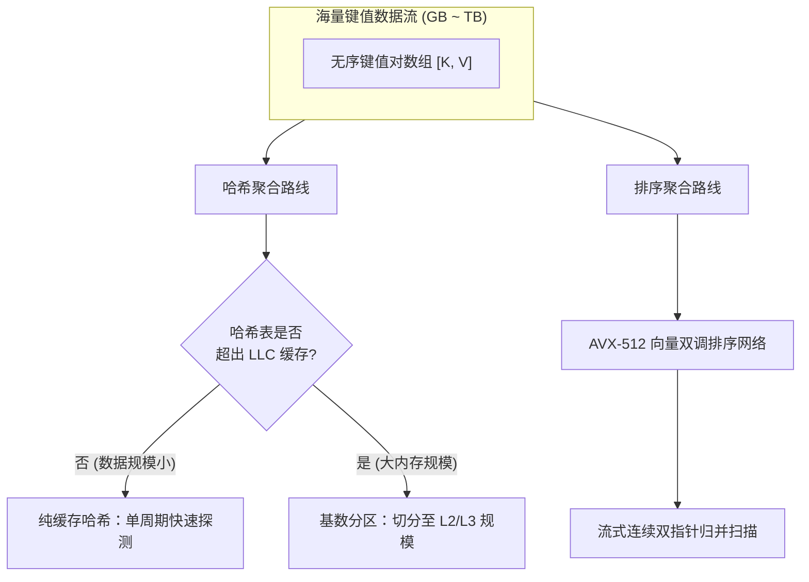
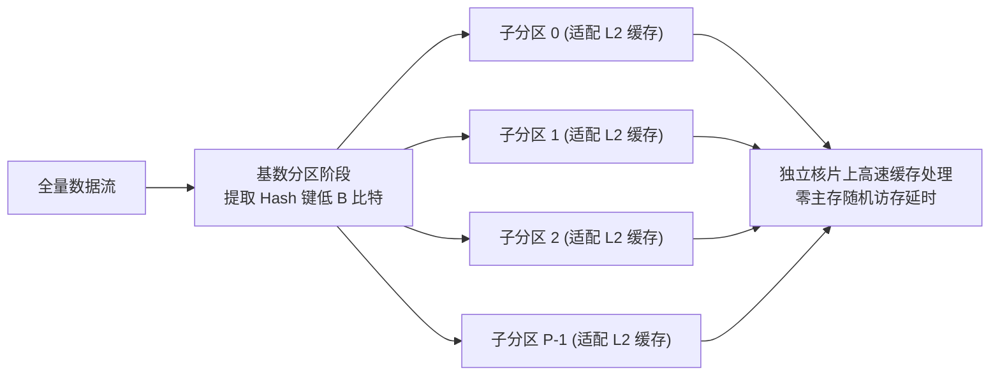

# Lec 19 高效数据聚合：排序 vs 哈希（High-Performance Aggregation: Sort vs Hash Joins）

## TL;DR

- 在现代大内存与多核架构下，关系型数据库与分析引擎中的核心聚合算子（`GROUP BY` 与 `JOIN`）形成了“排序 vs 哈希”的长期技术论战。
- 理论上哈希聚合具有渐进线性的 $O(N)$ 复杂度，但当哈希表超出最后一级缓存（LLC）时，随机 DRAM 寻址与 TLB 缺失会导致严重的流水线停顿。
- 基数分区（Radix Partitioning）将超大数据集切分为适配 L2/L3 缓存容量的微切片，将离散的随机访存转化为硬件友好的流式顺序读写。
- 并行 Semisort 通过放宽全序要求，仅聚合等价键值，在多核并行下以 $O(N)$ 工作量和极低常数开销实现了最优聚合吞吐。

## 大内存数据聚合与连接的核心问题

在数据分析引擎（如 DuckDB、ClickHouse、Spark）以及大规模图计算系统中，**数据聚合（Aggregation）**与**等值连接（Equi-Join）**是消耗 CPU 周期与主存带宽最多的核心算子：

$$
Q_{\text{agg}} = \text{SELECT key, SUM(val) FROM R GROUP BY key}
$$

$$
Q_{\text{join}} = R \bowtie_{R.key = S.key} S
$$

在经典算法理论中，解决这两类问题主要存在两条截然不同的技术路线：
1. **基于哈希的技术路线（Hash-Based）**：利用哈希函数构建哈希表，理论期望构建与探测时间为渐进线性的 $O(|R| + |S|)$。
2. **基于排序的技术路线（Sort-Merge-Based）**：首先对两表按键排序，随后通过双指针协同线性扫描完成归并，时间复杂度为 $O(|R|\log|R| + |S|\log|S|)$。

从纯理论时间复杂度来看，哈希算子显然优于排序算子。然而，在 2010 年代由 Kim 等人（Intel 实验室）与 Balkesen、Alonso 等学者掀起的关于“Sort vs Hash Join”的系列顶级论战中，实验结果却多次反转：在现代宽向量 SIMD 指令集与多级缓存体系下，高度优化的并行排序连接在相当多的大内存场景中全面压倒了哈希连接。

这种理论与工程实测的反差，揭示了现代高性能算法设计中**访存模式局部性与硬件微架构适配**的决定性力量。



## 缓存敏感型哈希聚合（Cache-Conscious Hashing）

当数据规模达到数亿条记录时，未经优化的朴素哈希表（如标准链地址法哈希表或开放寻址探测表）将面临致命的硬件性能塌陷：

1. **LLC 缓存缺失风暴（Cache Miss Storm）**：
   对于大小为数千兆字节的哈希表，每次哈希探测所访问的桶（Bucket）在主存物理地址上是完全随机离散的。由于 CPU 缓存行（64 字节）只能装载单次探测的目标节点，其余 60 字节被白白浪费；每次探测必须承担高达 $50 \sim 80 \text{ ns}$ 的 DRAM 延迟，CPU 核心计算端口陷入长期阻塞。
2. **TLB 换页缺失（Translation Lookaside Buffer Thrashing）**：
   对跨越数十 GB 虚拟内存的离散访问会导致处理器的页表缓存（TLB）频繁失效。即使配置了 2MB 大页（Huge Pages），数万次跨页跳转依然会导致硬件页表漫游（Page Table Walk）开销暴增。

### 基数分区（Radix Partitioning）机制

为了打破主存延迟瓶颈，**缓存敏感型哈希聚合**引入了多通道基数分区（Radix Partitioning）：

::: definition [基数分区分治原理]
设当前 CPU 的 L2 缓存容量为 $C_{\text{L2}}$，目标哈希表总规模为 $M$。
系统提取哈希值的低 $B$ 个比特位，将输入流按哈希值划分为 $P = 2^B$ 个独立的子分区（Partitions），使得每个子分区的体积严格满足：
$$
\text{Size}(Partition_i) \le \alpha \cdot C_{\text{L2}} \quad (\alpha \approx 0.7 \sim 0.8)
$$
:::

在分区分割完成后，后续的哈希聚合或 Join 探测操作完全被限制在每个独立的子分区内部。由于整个子分区及其对应的小哈希表能够完整驻留在高速 L2/L3 缓存中，所有的哈希查找均以 $1 \sim 4 \text{ ns}$ 的极速在片上缓存内完成，彻底规避了对外部主存的离散随机访问。



## 并行 Semisort：弱排序聚合的高性能突破

在诸如 `SELECT key, COUNT(*) GROUP BY key` 等聚合场景中，系统真正的需求仅仅是将具有相同键（Equivalent Keys）的数据项汇聚到同一个连续内存区间，**并不要求不同键之间保持严格的全局升序或降序（Total Order）**。

传统的快速排序或归并排序为了维护全局全序关系，付出了 $O(N \log N)$ 的计算代价。Blelloch 等人在 CMU PBBS（Problem Based Benchmark Suite）基准库中提出了**并行弱排序（Semisort）**算法。

### Semisort 算法原理与阶段划分

::: theorem [Semisort 工作量与跨度界限]
并行 Semisort 可以在理论工作量 $O(N)$ 与跨度 $O(\log N)$ 内完成对 $N$ 个键值对的弱排序重排，其计算复杂度与渐进哈希相当，但完全消除了复杂哈希表动态扩容与重哈希的开销。
:::

算法的核心执行流程分为三个高度并行的阶段：
1. **轻量局部采样与重度键识别（Heavy-Hitters Detection）**：
   在多核并发启动阶段，各线程对输入数据流进行局部低开销采样。若某些超高频热点键（Heavy Hitters）占据了大量比例，先将其提取到线程私有的小聚合槽中先行折叠，从根本上防止后续阶段产生数据倾斜。
2. **并行基数计数与直方图构建（Parallel Histogramming）**：
   将数据按块分派给多核，每个核心并行扫描数据块，使用基数映射统计当前块内各桶的元素频次；随后通过树形并行前缀和（Parallel Prefix Sums）计算出每个分区在全局输出数组中的绝对起始偏移量。
3. **无冲突并行分散写（Parallel Scatter）**：
   各核心再次遍历其数据块，利用原子自增或局部缓冲区将键值对直接存入输出数组的预留槽位中。同一键的所有元素在物理内存中被紧密聚合在一起，后续只需单次流式线性规约即可产生最终聚合结果。

## 现代大内存下的“排序 vs 哈希”大论战

排序与哈希在现代架构下的竞争本质，是**连续访存 + 向量化能力**与**随机访存 + 计算步数极小性**的博弈。

### 为什么排序路线能够反超哈希？

在现代微架构演进中，排序算子获得了多项底层硬件红利的强力加持：
1. **AVX-512 / AVX2 向量双调排序（Bitonic Merge Network）**：
   现代 CPU 能够在寄存器内部直接对 16 个 32 位整数以单指令多数据（SIMD）形式执行并行比较交换，消除了所有分支跳转指令。
2. **极速流式访存（Streaming Prefetching）**：
   排序后的归并扫描是严格单调线性的。硬件预取器（Hardware Prefetcher）能够 $100\%$ 准确预测下一次读取的缓存行，在数据被计算单元消费前已将其悄然拉入 L1 缓存，内存访存延迟被完全隐藏。
3. **TLB 友好性**：
   排序归并操作仅需极少量的活跃指针在内存中单向滑动，TLB 缓存行几乎永不失效。

相反，哈希路线若想获得同等性能，必须精心设计多级基数分区。而分区操作本身需要多次将数据读出并写入临时缓冲区，带来了额外的内存写放大（Memory Write Amplification）。如果分区次数过多，分区的物化（Materialization）开销甚至会超过全量排序本身。

## 算法实现：基数分区哈希聚合流水线

在实际设计基数分区（Radix Partitioning）内核时，算法工程师面临的最大挑战并非算法逻辑本身，而是现代处理器的**写合并缓冲区溢出（Write Combining Buffers Exhaustion）**现象。

### 写缓冲机制与非临时流式写入

现代 x86-64 处理器内部仅包含 10 到 12 个硬件写合并缓冲区（Line Fill Buffers / WCB）。当程序向内存写入数据时，微架构首先尝试在 WCB 中聚合字节，聚满一个 64 字节缓存行后整行提交总线：
1. **多目标离散写陷阱**：若单轮基数分区直接分出 256 个桶（$B=8$），则意味着当前执行核心需要同时向 256 个不同的主存地址并发写入。由于远超物理 WCB 数量限制，每次微小写入都会强制刷新 WCB，导致极其严重的缓存行总线读取分配（Read-For-Ownership, RFO）风暴与写放大。
2. **软件对齐缓冲（Software-Managed Buffers）**：为了彻底克服这一硬件缺陷，算法必须在用户态显式为每个分区开辟一个恰好等于 64 字节的私有临时槽位（对齐于 AVX 边界）。只有当该槽位被装满 64 字节数据后，才调用单条 AVX 向量流式指令 `_mm256_stream_si256`（Non-Temporal Store）直接刷写主存，完全绕过各级 CPU 缓存，杜绝读分配污染。
3. **严格的内存对齐约束**：流式存储指令 `_mm256_stream_si256` 在 x86-64 硬件层面要求目标内存地址必须严格按 32 字节（或 64 字节）对齐。若目标地址未对齐，CPU 将直接抛出一般保护性异常（General Protection Fault, `#GP`）。因此，每个分区在全局输出缓冲区中的起始偏移必须按缓存行向上取整补齐。
4. **内存屏障与总线清空（Store Fence）**：非临时流式写入属于弱序写入指令（Weakly-Ordered Stores），它不保证与后续标准加载指令之间的程序序一致性。在整批分区处理完成后，主线程必须显式插入单条 `_mm_sfence()` 屏障指令，强制将所有残留在 CPU 写合并缓冲区中的微数据排空刷入物理内存，随后下游算子方可安全读取分区数据。
5. **写分配（Write-Allocate）避免**：标准内存写入在缓存缺失时会执行写分配操作，先从 DRAM 读取完整的 64 字节缓存行到 L1 缓存再覆写部分字节；而非临时流式写入直接整行覆盖并旁路缓存，消除了一半的只读总线流量。
6. **循环发射吞吐优化**：通过在内存布局上保持 `PartitionBuffer` 结构的连续紧凑性，内层循环无需复杂的间接指针跳转即可维持高指令级并行度。

下面给出了经过微架构调优的基数分区聚合核心实现：

```cpp
#include <vector>
#include <cstdint>
#include <cstring>
#include <immintrin.h>

struct KeyValue { uint32_t key; uint32_t val; };

struct alignas(64) PartitionBuffer {
    KeyValue slots[8]; // 恰好装满一个 64 字节缓存行
    uint32_t count{0};
};

void radix_partition_stream(
    const std::vector<KeyValue>& input,
    std::vector<KeyValue>& output,
    const std::vector<uint32_t>& partition_offsets,
    uint32_t radix_bits
) {
    const uint32_t num_partitions = 1U << radix_bits;
    const uint32_t mask = num_partitions - 1;

    std::vector<PartitionBuffer> buffers(num_partitions);
    std::vector<uint32_t> cur_offsets = partition_offsets;

    for (const auto& item : input) {
        uint32_t pid = item.key & mask;
        auto& buf = buffers[pid];
        buf.slots[buf.count++] = item;

        if (buf.count == 8) { // 聚满 64 字节，流式写入主存
            uint32_t dest = cur_offsets[pid];
            _mm256_stream_si256(reinterpret_cast<__m256i*>(&output[dest]),
                _mm256_load_si256(reinterpret_cast<const __m256i*>(&buf.slots[0])));
            _mm256_stream_si256(reinterpret_cast<__m256i*>(&output[dest + 4]),
                _mm256_load_si256(reinterpret_cast<const __m256i*>(&buf.slots[4])));
            cur_offsets[pid] += 8;
            buf.count = 0;
        }
    }

    for (uint32_t pid = 0; pid < num_partitions; ++pid) {
        auto& buf = buffers[pid];
        if (buf.count > 0) {
            std::memcpy(&output[cur_offsets[pid]], &buf.slots[0], buf.count * sizeof(KeyValue));
            cur_offsets[pid] += buf.count;
            buf.count = 0;
        }
    }
}
```

### 多阶段分区与两趟切分（Multi-Pass Partitioning）

当输入数据量极大（如达到百亿条记录）时，单次切分所需的分区数可能高达 $2^{14} = 16384$ 个。若一次性开设如此多的分区，不仅软件维护的临时缓冲区体积将超出 L1 数据缓存容量，页表换页（TLB Miss）也将全面失控。

因此，工业级分析引擎严格执行两趟切分（Two-Pass Partitioning）策略：
- **第一趟基数切分**：提取高位比特（如高 6 位），将数据粗分为 64 个大块；
- **第二趟基数切分**：对每个大块提取次高位比特（如次高 6 位），将其细分为 64 个微切片。

通过将两趟切分级联，系统在每一阶段都将活跃工作集严格压制在片上缓存与 TLB 条目的物理安全线以内，在成倍提升吞吐量的同时，将内存访问带宽推至 DDR4/DDR5 总线的理论极限。

## 工程权衡：数据倾斜与缓存边界下的架构选型

在工业级数据系统的选型中，不存在通用于所有场景的绝对优胜算法。

::: insight 渐进复杂度与微架构特性的反直觉博弈
在算法工程实践中，“大 $O$ 阶数”绝非决定运行时间的唯一裁决者。

当基数较小或数据量能完全容纳在 L3 缓存内时：
- 哈希聚合仅需单次常量时间计算与极少的比较操作，完全压倒排序方案，吞吐量可达每秒数亿条记录；
- 此时引入排序会引入额外的无用比较与分支预测开销。

然而，当数据量跨入十亿级大内存领域且**键值分布存在严重偏斜（Skewed Distribution）**时：
- 朴素哈希表的高频冲突链与超限 DRAM 随机寻址将导致吞吐暴跌一个数量级；
- 而基于 SIMD 的全外核排序归并（Sort-Merge）或并行 Semisort 展现出极高鲁棒性。其执行时间对数据分布形态完全免疫，且由于能够吃满单核每秒近百 GB 的流式预取内存带宽，最终性能反超理论更优的哈希算法。
:::

| 算子实现方案 | 理论时间复杂度 | 访存模式 | SIMD 向量化潜力 | 缓存容量敏感度 | 适用工业场景 |
| :--- | :--- | :--- | :--- | :--- | :--- |
| **朴素开放寻址哈希** | $O(N)$（期望） | 离散随机访存 | 极低（控制流密集） | 极高（超 L3 性能断崖式下跌） | 中小型数据集、高基数唯一过滤 |
| **基数分区哈希** | $O(N)$ | 分区流式写 + 局部随机 | 中等（局部桶内探测） | 低（分区后天然适配片上缓存） | 经典大内存分析型 Join 内核 |
| **SIMD 向量排序归并** | $O(N \log N)$ | 纯流式单向顺序访存 | 极高（AVX-512 双调排序网络）| 极低（硬件预取器完美掩盖延迟） | 极端超大数据集、要求输出保序 |
| **并行 Semisort** | $O(N)$ | 直方图统计 + 并行分散写 | 优异（前缀和与块局部规约） | 适度（依赖全局分散写缓冲区） | 分布式中间结果聚簇、高并发多核 |
