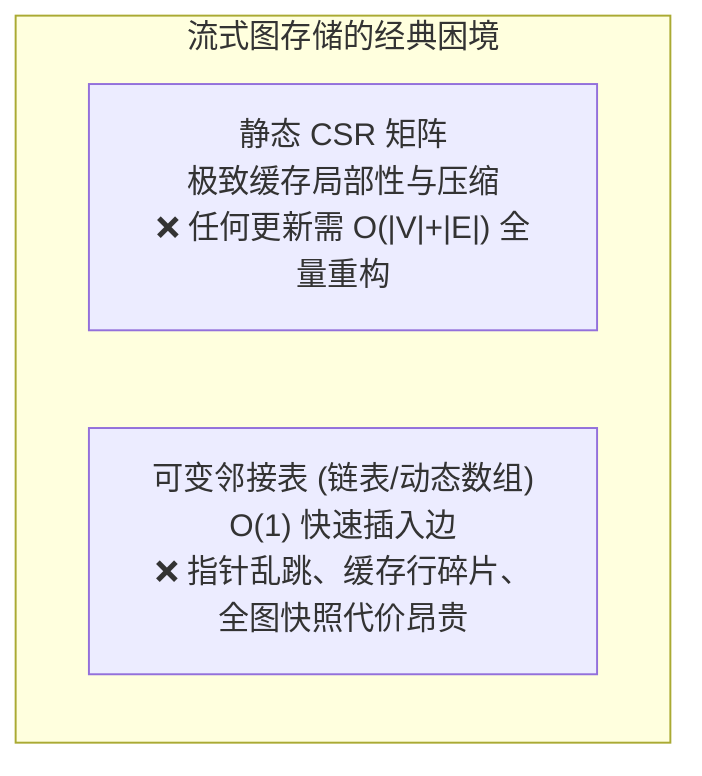
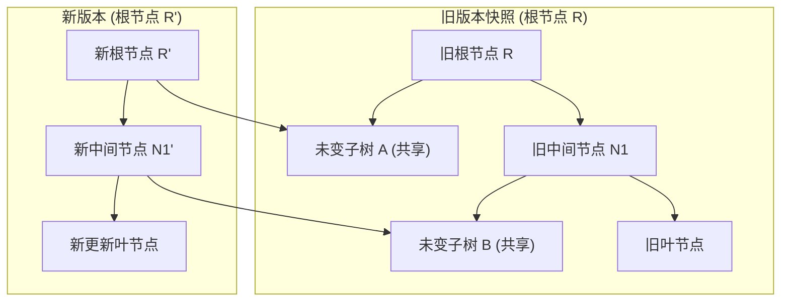
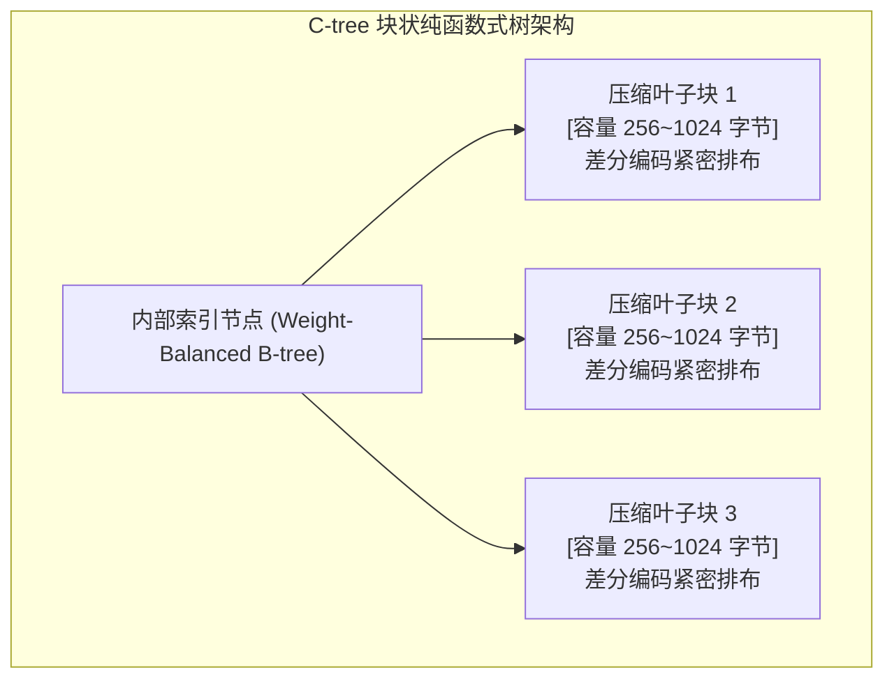
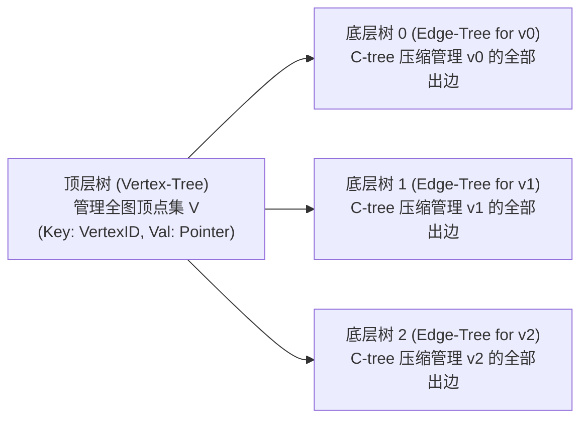

# Lec 20 纯函数式树与低延迟图流系统（Purely-Functional Trees & Streaming Graphs: Aspen & PaC-trees）

## TL;DR

- 流式图系统要求在每秒数十万高频边写入的同时，支持低延迟、无锁并发的复杂只读分析（如 BFS、PageRank）。
- 静态 CSR 矩阵无法高效支持可变更新，而传统指针邻接表在并发加锁下面临缓存局部性坍塌与快照开销巨大的困境。
- 纯函数式持久化树通过路径复制（Path Copying）实现结构共享（Structural Sharing），使只读分析线程仅需 $O(1)$ 指针拷贝即可获得零开销的一致性拓扑快照。
- Aspen 与 PaC-trees 提出块状压缩树（C-trees），将不可变平衡树与定长紧凑压缩块深度融合，兼顾了理论函数式安全性与微架构缓存行局部性。

## 流式图系统的并发快照困境

在现代网络安全监控、实时反洗钱风控和即时社交推荐等场景中，底层图系统面临着严苛的**流式读写混合（Streaming Read-Write Hybrid）**挑战：
1. **持续高速写入流**：系统每秒必须摄入数十万至数百万条边的新增、删除与权重更新（Streaming Ingestion）；
2. **长生命周期全局分析**：与此同时，系统必须能够随时启动运行耗时数秒甚至数分钟的复杂全局图算法（如三角计数、个性化 PageRank、弱连通分量）；
3. **严格一致性语义**：分析查询必须在一个完全一致、隔离的拓扑快照（Snapshot Isolation）上运行，严禁观察到处于半写入状态的孤立边或拓扑裂痕。

在传统的图系统设计中，这两大目标构成了尖锐的工程对立：



若采用全局加锁机制生成快照，高速写入流将被彻底阻塞，引发流摄入端数据积压；若采用写时复制（Copy-On-Write, COW），每次复制百 GB 级的全图内存将瞬间击穿系统的物理内存与总线带宽。

## 纯函数式数据结构与结构共享（Structural Sharing）

为了彻底破除快照阻塞与内存复制的矛盾，Blelloch、Shun 与 Dhulipala 等人在 SOSP'19 提出了 **Aspen 流式图框架**，其核心理论根基源于纯函数式数据结构（Purely-Functional Data Structures）。

### 路径复制（Path Copying）机制

在纯函数式模型中，所有数据结构节点都是严格**只读不可变（Immutable）**的。当系统需要向一棵树中插入或更新一个元素时，绝不原地覆写旧节点，而是分配一个新节点，并沿着从根节点到该叶子节点的访问路径进行**路径复制（Path Copying）**：

::: definition [纯函数式平衡树路径复制]
设树的高度为 $h = O(\log N)$。当修改叶子节点 $L$ 时：
1. 复制从根节点 $R$ 到 $L$ 路径上的 $h$ 个祖先节点；
2. 新创建的祖先节点直接复用未发生变更的子树指针（结构共享）；
3. 生成一个全新的根节点指针 $R'$ 指向最新的树形拓扑。
:::



### 零拷贝瞬时快照优势

结构共享带来了图计算中梦寐以求的优异特性：
- **$O(1)$ 时间复杂度快照**：只读分析算法启动时，只需原子读取当前最新根节点指针 $R$ 并递增其引用计数（或进入当前 Epoch），便瞬间拥有了全图历史状态的私有快照。
- **完全无锁并发读写**：写入线程生成新根节点 $R'$ 并通过单次原子 CAS 切换全局头指针。在此过程中，只读分析线程安全地遍历属于旧根 $R$ 的子树结构，读写双方在微秒级时间内互不阻塞。
- **空间开销极低**：单次边更新仅额外分配 $O(\log N)$ 个新节点，旧快照释放后，无用节点由垃圾回收器（GC）或基于代期的内存安全回收机制（EBR）静默销毁。

## C-trees 与 PaC-trees：并行压缩纯函数式树

尽管基础的纯函数式二叉树在语义上极其优雅，但如果直接将图的邻接表表示为传统的二叉平衡树（如 AVL 树或红黑树），系统将遭遇灾难性的硬件性能衰退：
1. **指针追逐（Pointer Chasing）**：每个树节点仅容纳一个顶点 ID，遍历邻接表需要持续顺着指针在不连续的堆内存中跳步，CPU 缓存命中率趋近于零；
2. **极高的元数据内存开销**：每个 4 字节的顶点 ID 都需要附带左右子节点指针（各 8 字节）、平衡因子与引用计数，内存膨胀率高达 $500\% \sim 800\%$，彻底丧失了大内存装载能力。

为了兼顾函数式结构共享与现代 CPU 缓存行的紧凑性，Aspen 创新性地发明了**块状压缩树（C-trees / Chunked Trees）**与**并行压缩树（PaC-trees）**。

### C-trees 的微架构解剖

C-trees 是一种结合了 B+ 树思想与函数式不变性的混合多路平衡树结构：



C-trees 的内部设计遵循以下核心法则：
- **粗粒度叶子块（Chunks）**：叶子节点不再存储单条边，而是维护一个固定大小（如 256 字节到 1024 字节，恰好占满数个连续的 64 字节缓存行）的扁平数据块。
- **块内紧凑差分编码**：块内的邻居顶点 ID 按照升序排列，并利用我们在 Lec 16 中学习的轻量级整数压缩技术（如 Byte-Packing 或差分 VByte）进行位压缩。一个 512 字节的叶子块足以容纳上百个邻居顶点。
- **权重平衡（Weight-Balanced）上层索引**：上层索引树采用基于权重的平衡机制（$BB[\alpha]$ 树），确保树的高度严格收敛于 $O(\log(N / B))$。

### 批更新并行化（Parallel Chunked Updates）

当摄入包含 $K$ 条边的微批次更新时，PaC-trees 支持高度并行的分治合并：
1. 将 $K$ 条新边按目标块进行并行排序与直方图划分；
2. 利用 Fork-Join 并行调度器并发执行多路子树合并（`Tree-Union` / `Tree-Intersect`）；
3. 批更新的总工作量收敛至 $O(K \log(1 + N / K))$，理论跨度仅为 $O(\log K \cdot \log N)$。

## Aspen 系统架构：双层树与纳秒级图流计算

基于 C-trees，Aspen 构建了一套优雅的**双层纯函数式树（Two-Level Tree Architecture）**：



1. **顶层顶点树（Vertex Tree）**：一棵以顶点 ID 为键的持久化平衡树。每个顶点节点内部存储该顶点的元数据及其对应的出边树根指针。
2. **底层出边树（Edge Tree）**：为每个顶点单独维护一棵由 C-tree 构成的出边集合。

当对某顶点 $u$ 插入一条指向 $v$ 的出边时：
- 系统首先定位并更新 $u$ 的出边树，通过路径复制生成一个新出边树根节点；
- 随后更新顶层顶点树中指向该出边树的指针，生成新的顶层根节点。
整个操作完全局部化，未涉及修改的数千万顶点及其出边树被完整共享复用。

## 算法实现：纯函数式持久化二叉树路径复制与快照

在工程落地纯函数式数据结构时，核心任务是保证不可变性契约与多核原子发布的无锁协同。

### 路径复制的不变式与快照可见性

在传统的面向对象设计中，对象的修改直接发生在原内存地址上。而纯函数式树的核心原则是：**任何已发布到共享内存中的节点均为全局只读，生命周期内其字段永不改变**。

这一特性为并发访问带来了极其深远的性能优势：
1. **彻底消除读端加锁**：并发分析线程在访问树形结构时，完全不需要获取任何互斥锁、读写锁或原子自旋标志，甚至无需执行任何原子自增操作。读操作就是纯粹的原生内存读取，能够以单核全速穿透缓存层级。
2. **写操作的纯净隔离**：写线程在执行路径复制时，新分配的节点仅在当前线程的私有调用栈中可见。在最终完成根指针的原子 CAS 替换之前，写操作对外部系统完全隐形，天然杜绝了读脏数据（Dirty Read）的可能。
3. **原子版本切换（Root Pointer Swinging）**：当新版本的路径全部构建完毕后，写线程通过单次原子指针写操作（Release 内存序）将全局根指针指向新节点。这一瞬间，新版本拓扑正式对全系统生效，具有完美的线性一致性（Linearizability）。
4. **递归不变式与空间复杂度界限**：单次插入操作在递归构建新路径时，仅复制访问路径上的关键祖先节点，其额外分配的新节点数量严格受限于树的深度 $O(\log N)$。对于整棵拥有数千万节点的庞大树结构，单次变更所触及的物理内存通常仅为数百字节，极大地保护了 CPU 缓存不受颠簸污染。
5. **CAS 失败自适应重试**：当多个写线程并发尝试发布新版本时，CAS 操作将裁定其中一个写线程成功，其余写线程则获取到最新的根指针并重新在最新快照上执行路径复制，确保整个系统具备非阻塞的前向推进保障。
6. **线程局部内存池（Thread-Local Arena）规避全局堆锁**：由于路径复制会在每次更新时产生 $O(\log N)$ 个临时新节点，若直接使用系统的全局堆分配器（如标准 `malloc`），将在多核环境下引发激烈的中央堆锁或全局页表争用。高性能系统通常为每个工作线程绑定私有的线性连续内存池，新节点均以指针自增方式瞬间完成分配，彻底消除锁竞争。
7. **不可变指针引用的长久稳定性**：只读分析算法在捕获根节点引用后，整个树形结构在该分析线程眼里是完全冻结的。所有内部指针在分析生命周期内永远有效，编译器可以大胆地对循环中的节点访问进行向量化与寄存器提升优化，而无需担心并发写导致的内存破坏。

下面给出了一个满足纯函数式结构共享语义的持久化二叉查找树原型实现：

```cpp
#include <memory>
#include <cstdint>
#include <atomic>

template <typename K, typename V>
class PersistentBST {
public:
    struct Node {
        K key; V val;
        std::shared_ptr<const Node> left, right;
        Node(K k, V v, std::shared_ptr<const Node> l, std::shared_ptr<const Node> r)
            : key(std::move(k)), val(std::move(v)), left(std::move(l)), right(std::move(r)) {}
    };

private:
    std::atomic<std::shared_ptr<const Node>> root{nullptr};

public:
    // O(1) 获取当前全图的只读一致性快照
    std::shared_ptr<const Node> get_snapshot() const {
        return root.load(std::memory_order_acquire);
    }

    // 纯函数式单点插入：路径复制，复用未变更子树
    static std::shared_ptr<const Node> insert_copy(
        const std::shared_ptr<const Node>& cur, K k, V v) {
        if (!cur) return std::make_shared<const Node>(k, v, nullptr, nullptr);
        if (k < cur->key) {
            return std::make_shared<const Node>(cur->key, cur->val, insert_copy(cur->left, k, v), cur->right);
        } else if (k > cur->key) {
            return std::make_shared<const Node>(cur->key, cur->val, cur->left, insert_copy(cur->right, k, v));
        }
        return std::make_shared<const Node>(k, v, cur->left, cur->right);
    }

    // 利用 CAS 原子发布最新版本根指针
    void update_root(K k, V v) {
        auto old_r = root.load(std::memory_order_relaxed);
        while (!root.compare_exchange_weak(
            old_r, insert_copy(old_r, k, v), std::memory_order_release, std::memory_order_relaxed));
    }
};
```

### 生产级内存安全回收（EBR）替代方案

虽然上述示例使用了 C++ 标准库中的 `std::shared_ptr` 来简化内存管理，但在真实的工业级高性能系统（如 Aspen 与 PaC-trees）中，`std::shared_ptr` 是被严格禁用的：
- **原子引用计数的总线风暴**：每次只读线程复制一个 `std::shared_ptr` 时，底层微架构都会对引用计数所在的缓存行执行一次原子自增（`LOCK XADD`）。这在 64 核并发只读场景下会导致极端的缓存行失效与总线拥塞，彻底抵消函数式结构共享的性能收益。
- **基于代期的内存回收（EBR）解法**：生产系统为每个线程分配无锁裸指针，并使用全局代期时钟（Epoch Counter）跟踪活跃读者。当某版本快照被新根指针覆盖后，旧节点不会被立刻销毁，而是被加入待退役链表（Retire List）。仅当全局所有读线程均离开旧代期后，由后台线程批量释放物理内存，实现真正的零原子争用内存回收。

在工程落地中，为了完全消除 `std::shared_ptr` 内部原子引用计数所带来的总线缓存一致性争用，生产级系统（如 Aspen）通常摒弃智能指针，改用基于代期（Epoch-Based Memory Reclamation）的自定义内存池分配器，所有节点均以无锁单向指针连接，在进一步削减写开销的同时实现毫秒级的内存安全回收。

## 工程权衡：结构共享带来的内存与局部性妥协

纯函数式持久化流式图系统在计算机系统结构中确立了独特的性能坐标。

::: insight 函数式纯洁性在系统内核中的硬件妥协
在传统的软件工程教条中，函数式编程与不可变性常被批评为“脱离硬件物理实际的象牙塔玩具”，因其在纯单核微架构下会制造大量的堆内存碎片与恶劣的指针间接寻址。

然而，Aspen 的算法工程实践为我们提供了一记极佳的技术反思：
1. **多核并发下的快照溢价**：当系统核心数扩展至 64 核甚至 128 核时，维护可变共享状态的锁竞争开销与快照复制成本，其膨胀速度远超单核局部性损耗；
2. **宏观函数式，微观硬件友好**：C-trees 的精妙之处在于**将函数式结构共享推迟在块（Chunk）的粒度之上**。在块级别以上，保持绝对纯粹的无锁函数式路径复制，享受 $O(1)$ 零拷贝快照与无锁并发的全部数学红利；在块级别以内，遵循极其严苛的微架构硬件规范，采用连续字节对齐、SIMD 差分压缩与流式连续扫描。

这种“上层不可变解耦并发，下层硬编码贴合缓存”的分层混合架构，是现代算法工程化解理论模型与硬件物理矛盾的典范设计。
:::

| 图存储架构 | 边插入吞吐量 | 快照获取时间 | 缓存行局部性 | 拓扑内存压缩率 | 适用生产负载 |
| :--- | :--- | :--- | :--- | :--- | :--- |
| **静态 CSR** | 极差（全图重算） | $O(1)$（静态天然只读） | 极致（全连续行） | 极优（全图高度压缩） | 离线大规模静态挖掘 |
| **可变指针邻接表** | 优异（常数级追加） | 灾难性（需加全局写锁） | 极差（离散指针节点）| 极差（大量指针填充） | 低并发纯写入图数据库 |
| **写时复制 B 树** | 中等（每次写触发分裂）| 中等（深度复制页） | 良好（页级连续） | 中等（页内存在空隙） | 通用嵌入式图存储引擎 |
| **Aspen C-trees** | **极高（并发微批次更新）**| **$O(1)$（原子指针拷贝）**| **优异（512B 压缩块）**| **极优（差分位级压缩）**| **高并发流式实时图分析** |
