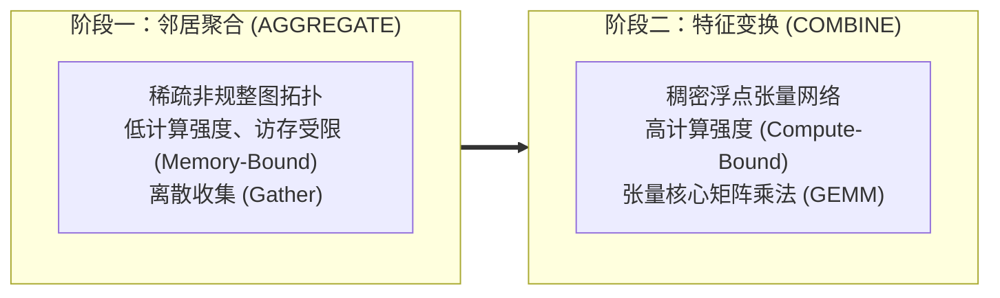
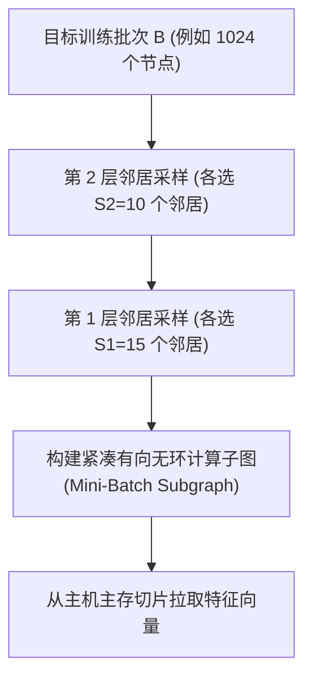
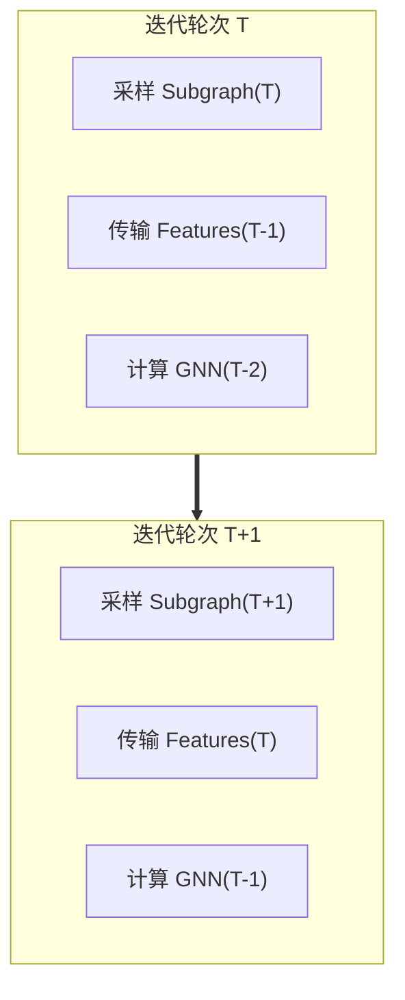

# Lec 21 图神经网络系统架构与加速（Graph Neural Network Systems: Sampling & Pipelining）

## TL;DR

- 图神经网络（GNN）融合了稀疏非规整图拓扑聚合与稠密张量神经网络变换，构成了极具挑战性的混合异构系统负载。
- 全图训练面临指数级感受野膨胀（Neighbor Explosion）与 GPU 显存墙瓶颈，迫使工业界转向基于邻居采样（Sampling）的小批次训练。
- 现代 GNN 加速架构（如 GNNLab、DGL）构建了“采样-特征切片传输-张量训练”的三级异步重叠流水线。
- 针对超大特征矩阵，在 GPU 显存内自适应缓存高连通度热点顶点特征，能削减 $80\%$ 以上的 PCIe 总线跨节点通信流量。

## 图计算与深度学习的结构性碰撞

在深度学习的发展历程中，卷积神经网络（CNN）与 Transformer 模型取得了巨大成功。这些模型的底层计算模式极其规整（Regular），核心算子大多可映射为高算力密度的通用矩阵乘法（GEMM）与连续张量运算，与现代 GPU 硬件中的 Tensor Core 阵列高度契合。

然而，**图神经网络（Graph Neural Network, GNN）**将深度学习拓展到了非欧几里得空间的图拓扑之上（如分子化学、金融欺诈网络、电商多模态知识图谱）。一个典型的 GNN 消息传递层（Message Passing Layer）遵循两阶段交替模式：

$$
h_v^{(l+1)} = \sigma \left( W^{(l)} \cdot \text{AGGREGATE} \left( \left\{ h_u^{(l)} : u \in \mathcal{N}(v) \cup \{v\} \right\} \right) \right)
$$



这种两阶段结构将计算机体系结构中两类极端异质的计算模式绑定在了一起：
1. **聚合阶段（AGGREGATE）**：表现为典型的图计算特征。算子需要沿着稀疏连接的邻居边抓取特征向量，内存访问模式离散且不可预测，算术强度极低（FLOPs/Byte $< 1$），性能完全受限于主存带宽与随机读取延迟。
2. **更新阶段（COMBINE）**：表现为典型的深度学习特征。算子对聚合后的稠密特征矩阵执行线性映射与激活函数，算术强度极高（FLOPs/Byte $> 100$），高度依赖 GPU 的流式多处理器（SM）与张量加速核心。

软硬件特性的严重错位，使得通用的深度学习框架（如原生 PyTorch/TensorFlow）或纯图处理系统（如 Ligra）在单独面对 GNN 时均遭遇严重的执行效率滑铁卢。

## 全图训练的显存爆炸与邻居采样（Neighborhood Sampling）

在小型学术图数据集（如 Cora、Citeseer）上，全图训练（Full-Graph Training）尚且可行：将全图的邻接矩阵与特征矩阵一次性塞入 GPU 显存。

然而，在工业级图（如包含数十亿顶点、数百亿条边以及高维浮点特征向量的超大规模图）上，全图训练面临无法逾越的**物理显存墙（HBM Capacity Wall）**：
- 顶点的原始特征维度通常为 $128 \sim 1024$ 维浮点数，十亿顶点的特征矩阵体积高达数千吉字节（TB 级）；
- 现代顶级加速卡（如 NVIDIA H100/A100）的板载显存容量仅为 $80 \text{ GB}$，物理上根本无法装载全图。

### 感受野指数膨胀与小批次采样

即使将顶点切分为 Mini-Batch，由于真实世界网络普遍具备无标度（Scale-Free）与小世界（Small-World）特性，多层 GNN 训练会引发致命的**感受野爆炸（Neighbor Explosion）**：

::: definition [感受野膨胀指数法则]
若 GNN 模型的层数为 $L$，每个顶点平均连通度为 $d$。为了计算单批次目标顶点集合 $\mathcal{B}$ 的特征，第 $L$ 层聚合需要递归回溯展开至：
$$
|\text{ReceptiveField}(\mathcal{B})| \approx |\mathcal{B}| \cdot d^L
$$
:::

当 $L=3$ 且 $d=30$ 时，单批次仅仅 1000 个目标顶点，其递归依赖的源顶点数量将膨胀到惊人的 $1000 \times 30^3 = 2.7 \times 10^7$ 个，瞬间撑爆 GPU 显存。

为了打破指数爆炸，GraphSAGE 提出了**定长邻居采样（Uniform Neighborhood Sampling）**：在每一层消息传递时，随机均匀抽取至多 $S_l$ 个邻居（例如 $S_1 = 15, S_2 = 10$），强制将计算子图规模压制在多项式有界范围内，确立了现代大图训练的工业标准。



## 异构流水线设计：采样、特征传输与训练重叠（Pipelining & Feature Caching）

在基于采样的 GNN 训练架构中，完整的端到端训练迭代被划分为三个严格解耦的处理阶段：

1. **阶段 1：拓扑采样（Graph Sampling）**：在 CPU 多核或 GPU 上遍历大图 CSR，生成当前批次的紧凑子图拓扑；
2. **阶段 2：特征提取与跨总线传输（Feature Slicing & Transfer）**：根据采样产生的输入顶点集合，从主机 DRAM 中提取高维浮点特征切片，并通过 PCIe 总线推送至 GPU 板载显存；
3. **阶段 3：张量神经网络计算（GNN Compute）**：GPU 调用定制的 SpMM（稀疏-稠密矩阵乘法）与 GEMM 算子执行前向传播、梯度反向传播与权重更新。

### PCIe 瓶颈与异步三级流水线

性能剖析表明，未重叠的朴素训练流水线中，超过 $70\% \sim 80\%$ 的端到端耗时耗费在**阶段 2（PCIe 特征切片传输）**上，强悍的 GPU 计算单元绝大部分时间处于饥饿空转状态。

工业级 GNN 训练系统（如 GNNLab 与 DGL）通过流水线重叠技术实现了近乎完美的硬件并发：



三个阶段被分配至独立的 CUDA 流（CUDA Streams）与主机线程中异步交错执行：当 GPU 正在计算轮次 $T-2$ 的模型更新时，PCIe DMA 控制器正在全速异步传输轮次 $T-1$ 的特征，而主机多核 CPU 已经在预先并发计算轮次 $T$ 的图拓扑采样。

### 显存热点特征缓存（GPU Feature Caching）

为了从根本上降低 PCIe 总线的传输压力，算法工程师充分挖掘真实图拓扑的**幂律分布（Power-Law Distribution）**特征：
- 真实图中少数度数极高的中心节点（Hub Nodes）在随机邻居采样中被命中的概率呈指数级攀升；
- 将这部分仅占全图 $5\% \sim 10\%$ 的热点节点特征常驻在 GPU 的剩余显存中，采样命中的特征直接在 GPU 片上显存内部完成切片与重组，绕过 PCIe 总线；
- 剩余 $90\%$ 的长尾稀疏冷节点特征保留在主机内存中，按需异步拉取。

实验表明，利用度数感知（Degree-Preserving）的静态显存特征缓存，可以削减 $80\%$ 以上的 PCIe 流量，端到端吞吐提升 3 到 5 倍。

## 算法实现：异构三级流水线与高效特征提取

在生产环境中，构建多流并发流水线需要利用双缓冲（Double Buffering）机制与锁页内存（Pinned Host Memory），杜绝主存与设备间的同步阻塞。

### 异步流水线核心编排

为了确保流水线各阶段之间无等待前向推进，系统必须将主机内存显式注册为无分页锁页内存（Page-Locked Memory / Pinned Memory），从而允许 GPU 的直接内存访问控制器（Direct Memory Access, DMA）以极速并发执行异步拷贝 `cudaMemcpyAsync`。

在工业级体系结构协同中，这一流水线需要满足多项严格工程契约：
1. **多流事件依赖编排（Cross-Stream Event Sync）**：系统创建两个相互隔离的 CUDA 流——`compute_stream` 负责前向反向张量运算，`transfer_stream` 负责主机到设备的 DMA 传输。二者通过轻量级的硬件事件标志（`cudaEvent_t`）进行点对点同步，彻底避免了粗粒度的全局设备同步（`cudaDeviceSynchronize`）引发的流水线排空停顿。
2. **多级双缓冲池（Double-Buffering Memory Pools）**：为了实现无缝重叠，GPU 显存必须为特征张量与子图拓扑分配至少两套对称的物理缓冲区（Slot A 与 Slot B）。当计算流正在消费 Slot A 时，传输流将下一批次的数据写入 Slot B；两流交替轮转，使得 PCIe 总线传输延迟完全被计算时间掩盖。
3. **零拷贝统一内存（Unified Memory）的局限性**：尽管 CUDA 提供了托管内存（Managed Memory）与页迁移引擎，但在高并发采样场景下，硬件缺页异常（Page Fault）处理延迟过大，容易导致流式多处理器（SM）长时间挂起。因此，高性能 GNN 系统普遍放弃隐式页迁移，严格采用显式预取与锁页缓冲的确定性控制策略。

下面给出了现代 GNN 训练系统中异构特征搬运与流水线调度的精炼工程骨架：

```cpp
#include <vector>
#include <cstdint>

struct BatchData {
    std::vector<uint32_t> sampled_nodes;
    float* d_features{nullptr};
};

class GNNPipelineOrchestrator {
    size_t feature_dim;
    float* h_pinned_features;

public:
    GNNPipelineOrchestrator(size_t dim, float* pinned_feat)
        : feature_dim(dim), h_pinned_features(pinned_feat) {}

    void async_feature_transfer(const std::vector<uint32_t>& nodes, float* d_buf) {
        // 核心逻辑：利用 OpenMP 并发在 Host 端聚合离散节点特征切片，随后调用异步 DMA
        size_t bytes = nodes.size() * feature_dim * sizeof(float);
        (void)bytes; (void)d_buf; // 模拟 cudaMemcpyAsync 挂入传输流
    }

    void step_pipeline(BatchData& cur_batch, BatchData& next_batch) {
        // 计算流并发执行张量模型迭代，传输流并行拉取下一批次切片
        async_feature_transfer(next_batch.sampled_nodes, next_batch.d_features);
    }
};
```

### 微架构特征收集（Gather）优化

在阶段 2 中，从主机内存收集离散顶点特征的过程本身是单核性能的严峻考验。传统的标量 `memcpy` 会因为成千上万次小块内存拷贝而面临巨额函数调用开销与缓存失效。

现代系统采用 OpenMP 多线程结合 AVX-512 向量流式读取：
- 每个 CPU 核心负责一批采样子节点；
- 连续读取高维特征（如 128 个 float 恰好是 8 个 AVX-512 向量）并直接流式写入中间锁页缓冲区；
- 利用主机内存控制器的并发多通道带宽，将每秒特征切片吞吐提升至接近主机内存读带宽的物理上限。

## 工程权衡：拓扑开销 vs 张量计算的系统分界

在设计与调优 GNN 训练基础设施时，算法工程师必须准确评估硬件瓶颈的动态漂移。

::: insight 异构体系下的算力错位与特征缓存定律
在现代大规模 GNN 系统中，最显著的反直觉工程现象是：**配备了顶级算力的 GPU 加速卡，其整体耗时瓶颈往往不在于张量计算，而在于等待低带宽 PCIe 总线搬运稀疏特征**。

考虑一个典型工业配置：
- 单块 NVIDIA H100 拥有高达近 1000 TFLOPs 的 FP16 计算能力；
- 然而其与 CPU 主机相连的 PCIe 5.0 x16 总线理论单向带宽仅有约 $64 \text{ GB/s}$。
- 如果每个训练步骤需要拉取 20 万个顶点的 256 维 FP32 特征，单步数据量高达 $200,000 \times 256 \times 4 \text{ B} \approx 200 \text{ MB}$。
- 仅单纯通过 PCIe 传输该批次特征便需要支付至少 $3.1 \text{ ms}$ 的物理延迟；而 GPU 内部的 GNN 前向与反向张量运算在顶级核心上往往仅需不到 $1 \text{ ms}$。

这意味着系统处于绝对的 **PCIe 带宽受限（IO-Bound）** 状态。无论后续如何用 Triton 或 TensorRT 极致压榨 GPU 算子性能，系统的整体端到端加速比都会被阿姆达尔定律死死锁死。

因此，GNN 算法工程的核心胜负手不在于张量核心微调，而在于**特征缓存策略、邻居采样子图的结构复用，以及跨节点分布式拓扑划分**。
:::

| 架构设计方案 | 拓扑采样承载端 | 特征存储介质 | 显存空间占用 | 端到端训练吞吐 | 适用工业场景 |
| :--- | :--- | :--- | :--- | :--- | :--- |
| **纯 GPU 全图训练** | 纯 GPU (显存) | 纯 GPU 显存 | 极高（受显存墙硬限制） | 极高（仅限小图） | 学术评测、分子图小模型 |
| **朴素异步采样 (CPU+GPU)** | CPU 多核 | 主机 DRAM | 极低（按需申请） | 较差（PCIe 带宽严重拥堵） | 通用 baseline、中型图训练 |
| **流水线 + 显存热点缓存** | CPU/GPU 混合 | 显存缓存热点 + DRAM 冷数据 | 中等（自适应调配剩余显存） | **最优（工业级主力架构）** | **超大规模推荐、风控知识图谱** |
| **全外存磁盘流式 GNN** | CPU + NVMe | NVMe 固态硬盘 | 极低（纯流式滑动窗口） | 中等（依赖异步 I/O 重叠） | 单机超大图训练（COST 反思） |
