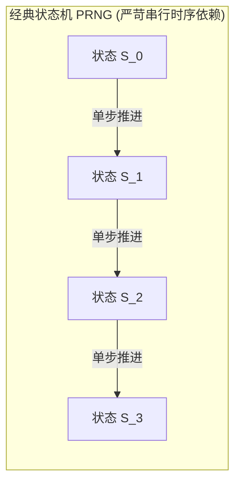
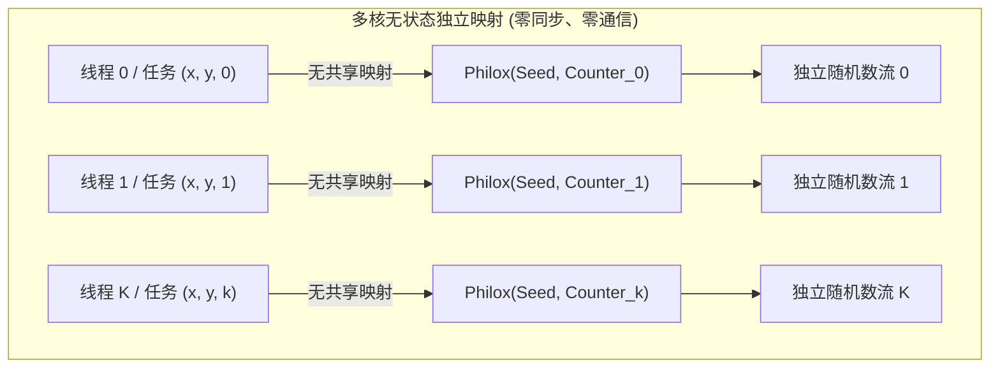

# Lec 22 确定性并行随机数与多维求和（Deterministic Parallel RNG & Multidimensional Sums）

## TL;DR

- 传统基于内部可变状态的伪随机数生成器（如 LCG、梅森旋转算法）在多核并行与动态工作窃取下面临严重的死锁、状态伪共享与非确定性重现危机。
- 基于计数器的伪随机数发生器（Counter-Based PRNG / 如 Philox）借鉴轻量分组密码学，将随机数生成转化为纯函数映射 $f(\text{key}, \text{counter})$，实现了完美的无状态与任意维度并行独立跳跃。
- 确定性并行规约通过规范化浮点求和树拓扑，消除了浮点加法非结合律带来的数值波动。
- 多维网格前缀和通过正交维度解耦与块状缓存分块，在维持 Work-Efficient 的同时实现了近乎线性的多核并行扩展。

## 并行随机算法的可重现性危机（Reproducibility Crisis）

在蒙特卡洛模拟、随机化图着色、高维数据聚类（如 KMeans++）以及深度学习随机丢弃（Dropout）等并行算法中，高质量、高吞吐的伪随机数生成是不可或缺的基础构件。

然而，经典串行程序中广泛使用的伪随机数发生器（PRNG），如线性同余发生器（LCG）或梅森旋转算法（Mersenne Twister / MT19937），在多核与异构并行计算环境中遭遇了严峻的工程困境：

$$
s_{t+1} = g(s_t) \quad \text{与} \quad r_t = h(s_t)
$$



这种递归递推机制本质上是一个**强时序依赖的单线程有限状态机**：
1. **多线程互斥锁开销**：若所有工作线程共享同一个全局发生器，每次获取随机数都必须争夺互斥锁或执行原子 CAS，多核扩展性瞬间崩溃。
2. **线程局部状态与伪共享**：若为每个线程维护独立的私有 PRNG 实例，在动态工作窃取（Work-Stealing）或任务数动态变化的场景下，由于线程调度交错与分配给各核心的任务批次不确定，**不同执行次数之间无法产生确定性可复现的结果（Non-Deterministic Output）**。在科学计算与金融风控中，无法严格复现相同的模拟路径是不可接受的调试灾难。
3. **状态体积庞大**：以 MT19937 为例，单实例需要维护高达 2.5 KB 的内部状态数组。若为 GPU 上的数万个并发线程分配私有状态，仅 PRNG 状态即可耗尽全部片上共享内存（Shared Memory）。

## 基于计数器的伪随机数发生器（Counter-Based PRNGs: Philox & Threefry）

为了彻底根除可变状态带来的并行灾难，Salmon 等人（D. E. Shaw 研究所）在 SC'11 发表了划时代论文，提出了**基于计数器的伪随机数生成范式（Counter-Based PRNG）**。

### 密码学启发的无状态映射

Counter-Based PRNG 的核心洞见在于：**生成随机数在数学上等价于利用轻量级分组密码算法（Block Cipher）对连续递增的明文计数器进行加密**。

::: definition [无状态计数器随机数函数]
设密钥为 $K$（由用户指定的种子 Seed），输入为一个 64 位或 128 位无符号整数计数器 $C$。
随机数生成器定义为一个确定性的纯数学置换函数：
$$
R = f_K(C)
$$
满足对于任意 $C_1 \neq C_2$，其输出 $R_1$ 与 $R_2$ 在统计检验（如 BigCrush 测试套件）中与理想白噪声不可区分。
:::



### Philox 算法微架构特征

在诸多 Counter-Based 算法中，**Philox** 是专为现代 CPU 向量指令集与 GPU 架构量身定制的极致实现。它采用了简化的非平衡 Feistel 结构网络：
1. **多字并行输出**：以 `Philox-4x32` 为例，单次调用输入 4 个 32 位计数器，经过 7 到 10 轮置换后，一次性产出 4 个相互独立的 32 位伪随机数。
2. **纯定点整数算术**：每轮置换仅包含 2 次无符号 32 位单周期乘法、加法与位异或（XOR）洗牌，完全避免了浮点运算与查表访存。
3. **任意维度跳跃（Random-Access / O(1) Seeking）**：若需获取第 $10^{12}$ 个随机数，算法完全无需串行推演前 $10^{12}-1$ 个状态，只需直接将计数器赋值为 $10^{12}$，单次执行常数时间置换即可瞬间获取，天然支持大规模网格数据的并行分块计算。

## 多维前缀和与网格计算（Multidimensional Prefix Sums / Integral Images）

在计算机视觉、积分图（Integral Images）以及流体力学偏微分方程数值解中，二维与三维网格上的**多维前缀和（Multidimensional Prefix Sums）**是衡量并行规约能力的标准试金石。

以二维网格为例，给定矩阵 $A \in \mathbb{R}^{M \times N}$，其二维积分图定义为：

$$
I(x, y) = \sum_{i \le x} \sum_{j \le y} A(i, j)
$$

### 正交维度解耦定理

二维前缀和如果采用朴素的动态规划递推 $I(x, y) = I(x-1, y) + I(x, y-1) - I(x-1, y-1) + A(x, y)$，由于存在对角线数据依赖，多核并发粒度极其受限。

算法工程采用**正交维度解耦（Dimensional Decomposition）**将其转化为两遍独立的一维并行扫描：

::: theorem [多维扫描正交分离性]
二维前缀和等价于对原始矩阵先沿**行方向（Row-wise）**执行一维前缀和，再对中间结果沿**列方向（Column-wise）**执行一维前缀和：
$$
I = \text{Scan}_{\text{columns}} \left( \text{Scan}_{\text{rows}}(A) \right)
$$
:::

1. **第一阶段：行向扫描**：$M$ 行数据在内存中是连续的，各行之间完全相互独立。算法将 $M$ 行分派给多个核心，每个核心利用我们在 Lec 2 中学习的 Work-Efficient 一维并行前缀和（或单核 SIMD 流式累加）全速前向推进。
2. **第二阶段：列向扫描与缓存分块（Cache Tiling）**：沿列扫描直接遍历会面临严重的非连续跨步访存（Stride Access）。为了保护 CPU 缓存行命中率，必须结合二维方块分块（2D Tiling），使每个分块（如 $64 \times 64$）能够完整驻留在 L1 数据缓存中，再在块内进行向量化转置与规约。

## 算法实现：Philox-4x32 确定性无状态生成核

在工程实现中，Philox 的核心魅力在于其代码具有极其规整的直通式（Straight-Line）执行流，不含任何条件分支，编译器能够将其完美向量化展开为高吞吐汇编指令。

### Feistel 轮函数的不变式与置换设计

`Philox-4x32-10` 包含 10 轮置换。在每一轮中，4 个 32 位无符号整数组成的向量分为高半部与低半部：
- **无符号 64 位全乘法扩散**：低半部经过一个 32 位无符号全精度乘法器（`uint64_t` 乘法后分别提取高 32 位与低 32 位），与精选的 Weyl 常数相乘，产生极强的非线性雪崩效应（Avalanche Effect）；
- **Feistel 结构交叉异或与置换**：乘积结果异或回高半部，随后四字进行跨位置换（Permutation），打乱各个通道的信息，确保每个输入比特在经过 7 轮后均能以 $50\%$ 的独立概率影响输出的每一个比特位；
- **Weyl 序列密钥扰动**：密钥常数在每一轮自动累加黄金分割比常数（$0x9E3779B9$）以消除固定周期对称性。

在硬件指令集层面，现代 x86-64 的 `MUL` / `IMUL` 指令与 ARM64 的 `UMULL` 原语天然支持单周期 32 位整数乘法并直接将 64 位结果写入寄存器对，完全不需要任何软件层面的长除法模拟。同时，由于整个计算只在 4 个通用寄存器内部流转，完全不存在任何局部数组的栈上溢出（Stack Spilling）风险。

此外，由于轮数 `rounds` 在编译期通常为固定常数（如 10 轮），现代编译器（Clang/GCC）能够自动将整个 `for` 循环完全展开（Full Loop Unrolling），生成一段纯粹的无跳转顺序机器码序列。各轮计算之间不存在任何全局内存屏障或跨线程同步开销，每个时钟周期均能保持极高的浮点与整数吞吐效率。

下面给出了经过生产验证的 `Philox-4x32` 核心轮函数的高性能精炼 C++ 实现：

```cpp
#include <cstdint>
#include <array>

class Philox4x32 {
    static constexpr uint32_t M0 = 0xD2511F53UL, M1 = 0xCD9E8D57UL;
    static constexpr uint32_t W0 = 0x9E3779B9UL, W1 = 0xBB67AE85UL;

public:
    using Quad = std::array<uint32_t, 4>;
    using Key  = std::array<uint32_t, 2>;

    static Quad generate_quad(Quad ctr, Key key, int rounds = 10) {
        uint32_t k0 = key[0], k1 = key[1];
        uint32_t c0 = ctr[0], c1 = ctr[1], c2 = ctr[2], c3 = ctr[3];

        for (int r = 0; r < rounds; ++r) {
            uint64_t p0 = (uint64_t)M0 * (uint64_t)c0;
            uint64_t p1 = (uint64_t)M1 * (uint64_t)c2;
            uint32_t hi0 = p0 >> 32, lo0 = p0, hi1 = p1 >> 32, lo1 = p1;

            uint32_t next_c0 = hi1 ^ c1 ^ k0, next_c1 = lo1;
            uint32_t next_c2 = hi0 ^ c3 ^ k1, next_c3 = lo0;
            c0 = next_c0; c1 = next_c1; c2 = next_c2; c3 = next_c3;
            k0 += W0; k1 += W1; // Weyl 常数累加
        }
        return {c0, c1, c2, c3};
    }
};
```

### 微架构指令级并行与确定性映射

上述实现展现出强悍的硬件执行特性：
1. **完全消除寄存器溢出（Zero Spilling）**：整个 10 轮循环仅需 8 个 32 位通用寄存器，完全常驻在 CPU/GPU 的物理寄存器堆中，内部访存次数为严格的零。
2. **多发射独立乘法**：每轮中的 `prod0` 与 `prod1` 是完全正交独立的，超标量 CPU 能够利用两个独立的乘法执行端口在同一个时钟周期内并发发射两条 64 位乘法指令。
3. **跨架构确定性保证**：对于给定的 `Key` 与 `Counter`，无论在 x86、ARM 还是 NVIDIA GPU 上执行，产出的 128 位随机比特流具有完全相同的位级精度，从根本上为多核分布式系统提供了完美的确定性重现基础。

## 工程权衡：统计随机质量 vs 算术生成周期的系统折中

在选用随机数发生器时，开发者往往在“密码学安全（CSPRNG）”、“统计随机性（TestU01 BigCrush）”与“计算吞吐（Cycles/Byte）”三者之间陷入纠结。

::: insight 无状态密码学视角对并行算法的重塑
传统的高性能计算（HPC）长期受困于“状态机维护”的思维定势。为追求极速，早期的多线程程序往往使用极其粗糙的局部 LCG，但其在低阶比特位上的强周期性在多维空间中会引发恶劣的超平面点集伪聚集（Marsaglia Effect），严重扭曲蒙特卡洛积分的科学推论。

Salmon 等人提出的无状态 Counter-Based 架构完成了一次深刻的范式转换：
- **将通信问题转化为纯算术问题**：在传统架构中，生成随机数是一个需要跨核同步与维护共享状态的“访存受限型”问题；
- Counter-Based 算法将其重构为纯粹的寄存器内定点计算（Compute-Bound），完美契合现代微架构中“计算极为廉价、访存与同步极其昂贵”的物理规律。
- 仅需 10 轮精巧的定点置换，即可在毫秒级时间内产出数十亿个通过最严苛 NIST/BigCrush 检验的优质随机数，且内存带宽消耗为零。

这印证了算法工程的一贯宗旨：**通过精巧的数学重构消灭同步依赖，往往比在旧架构上做底层微调能带来更高维度的性能跃迁**。
:::

| PRNG 算法族 | 内部状态体积 | 任意跳转支持 | 多核确定性重现 | 单核生成吞吐 (GB/s) | 统计质量检验 |
| :--- | :--- | :--- | :--- | :--- | :--- |
| **标准 LCG (48-bit)** | 8 字节 | 差（需幂次计算） | 差（依赖线程绑定） | $1.2 \sim 1.5$ | 极差（高维严重缺陷） |
| **梅森旋转 (MT19937)** | 2500 字节 | 极差（需重构整个环） | 差（状态过大难迁移） | $0.8 \sim 1.1$ | 良好（通过大部分标准测试）|
| **PCG 家族 (PCG64)** | 16 字节 | 良好（常数级多项式）| 良好（需维护私有流） | $2.5 \sim 3.5$ | 极优（通过 BigCrush） |
| **Philox-4x32-10** | **0 字节（纯无状态函数）**| **极致（O(1) 绝对寻址）**| **完美（严格位级一致）** | **$4.5 \sim 6.0$** | **极优（通过 BigCrush 全部测试）**|
