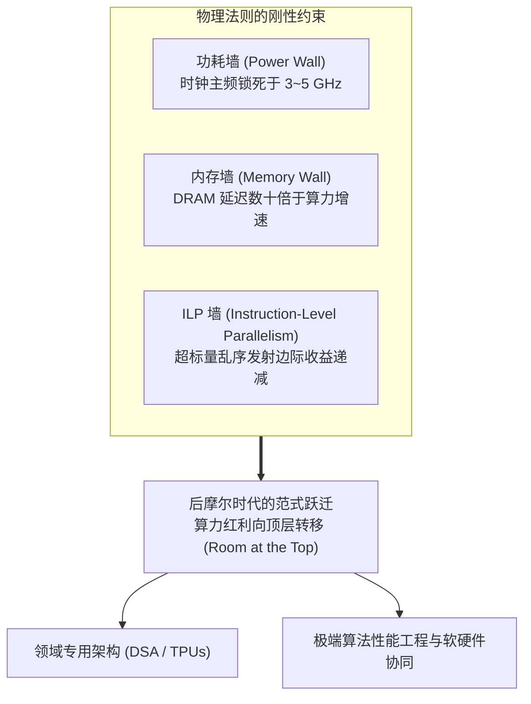

# Lec 23 算法演进大趋势与后摩尔红利（Trends in Algorithms: Post-Moore Era & Hardware Specialization）

## TL;DR

- 登纳德缩放定律（Dennard Scaling）与摩尔定律（Moore's Law）的物理终结，宣告了“单纯依靠工艺制程免费提升软件性能”时代的终结。
- 麻省理工学院 CSAIL 团队在 Science 发表的里程碑研究证明：自顶向下的算法优化、体系结构协同与硬件定制能够释放出超越 $60,000\times$ 的惊人性能跃迁。
- 领域专用架构（DSA / 如 TPU、神经网络加速芯片）正全面接管高吞吐算力负载，迫使算法设计从“以运算次数最少为目标”转向“以数据移动能耗最小为核心”。
- 算法工程师正在从传统软件调优者演进为跨越应用数学、编译器技术与硅片微架构的软硬件协同架构师。

## 摩尔定律与登纳德缩放定律的双重终结

在过去半个世纪中，计算机科学的飞速发展高度依赖于微电子物理层面的两大“免费红利”：

1. **登纳德缩放定律（Dennard Scaling，约 2005 年终结）**：晶体管尺寸每缩小 $30\%$，其功耗密度保持恒定，从而使处理器主频能够每两年翻倍而不会烧毁芯片。然而，随着晶体管栅极氧化层逼近原子尺寸，量子隧穿引发的静态漏电流（Leakage Power）剧增，导致 CPU 主频在 2005 年前后被死死锁死在 $3 \sim 5 \text{ GHz}$ 的**功耗墙（Power Wall）**之上。
2. **摩尔定律（Moore's Law，近年来显著放缓）**：单位面积硅片上的晶体管集成度每 18 到 24 个月翻倍。如今，先进半导体制造（如 3nm / 2nm 制程）不仅逼近物理极限，其昂贵的光刻与掩膜成本更导致“单位晶体管成本”不再下降，经典意义上的经济型摩尔定律已经死亡。



由于单核主频停滞、指令级并行（ILP）收益枯竭，通用单核 CPU 的计算性能年增长率已从黄金时代的 $52\%$ 暴跌至不足 $3\%$。软件开发者再也无法坐等新一代硬件让慢速程序自动变快。

## 软件与算法维度的历史红利复盘（"There's Plenty of Room at the Top"）

2020 年，图灵奖得主 John Hennessy、David Patterson 与 MIT 教授 Charles Leiserson 等人在 *Science* 发表了题为《There's plenty of room at the Top: What will drive computer performance after Moore’s law?》的重磅综论。

作者团队以经典的矩阵乘法（Matrix Multiplication）为例，在同一台 Intel 多核处理器上进行了极富启发性的跨层次性能对比：


从朴素的 Python 实现到融入了**多核并行、多级缓存分块与 AVX-512 宽向量微内核**的极致算法工程实现，最终的性能差距达到了不可思议的 **62,806 倍**！

这一实验揭示了一个惊人的现实：过去数十年来，通用高级语言抽象与庞大的软件运行时在屏蔽底层细节的同时，也在执行路径上浪费了上万倍的硬件理论潜能。在后摩尔时代，“自底向上的硬件红利”已基本耗尽，而“自顶向下的软件与算法重构”蕴藏着极其广阔的效能蓝海（Room at the Top）。

### 算法革新 vs 硬件加速的历史竞速

历史数据表明，在诸多核心计算领域，纯算法层面的数学革新对性能提升的贡献甚至大幅超越了硬件摩尔定律本身的积累：
- **线性规划求解（Linear Programming）**：从单纯形法到内点法（Interior-Point Methods），算法改进带来的加速比超越了同周期硬件提升近三个数量级；
- **快速傅里叶变换（FFT）**：Cooley-Tukey 算法将计算复杂度从 $O(N^2)$ 砍至 $O(N \log N)$，使得实时数字信号处理成为可能；
- **图遍历与连通分量**：我们在 Lec 6 中学习的 Direction-Optimizing BFS（Push/Pull 自适应），仅通过一个简单的方向切换决策，便将真实大图遍历性能直接提速数十倍。

## 领域专用架构（DSA）与软硬件协同设计

为了填补通用 CPU 的算力缺口，计算机工业全面迈入**领域专用架构（Domain-Specific Architectures, DSA）**时代：
- Google TPU（张量处理单元）：抛弃复杂的通用缓存、分支预测与乱序发射逻辑，将 $90\%$ 以上的硅片面积全部倾斜给二维脉动阵列（Systolic Array）与片上大容量 Scratchpad 内存；
- NVIDIA GPU（Tensor Cores）：将 16 位混合精度矩阵乘加作为原子硬件指令，单芯片密集算力冲破每秒数千兆次浮点运算；
- 神经拟态芯片与空间数据流架构（Spatial Dataflow / 如 Cerebras、Groq）：利用超大晶圆级芯片与静态无死锁片上网络，实现极端低延迟的确定性计算。

### 阿姆达尔定律在 DSA 时代的强力反扑

在 DSA 时代，算法工程师面临着更为严酷的阿姆达尔定律（Amdahl's Law）制约：

::: definition [加速器时代的阿姆达尔瓶颈]
若一个计算任务中，有 $P$ 比例的稠密算子可被专用加速器加速 $S$ 倍（$S \to \infty$），而剩余的 $1-P$ 比例属于主机调度、拓扑索引或特征搬运等不可加速的杂散逻辑：
$$
\text{Overall Speedup} \le \frac{1}{(1 - P) + \frac{P}{S}} < \frac{1}{1 - P}
$$
:::

如果系统中存在仅 $1\%$ 的不可加速数据搬运逻辑，即使专用硬件拥有无限算力，全系统的端到端加速比也被不可逆转地钉死在 100 倍上限。

因此，**未来的算法设计必须主动适应硬件特性进行反向重构**：设计那些能够最大化保留在片上高速缓冲、最小化全局同步屏障、并容忍低精度数值表示的新型算法，实现算法与硬件的无缝共振。

## 算法实现：从朴素实现到极致微架构协同的性能阶梯

为了定量展示算法工程在真实系统中的加速阶梯，我们设计了一组针对向量归约聚合（Reduction & Prefix）的渐进性能测量框架：

### 阶梯实验的不变式与微架构观察

在基准测量中，算法工程师必须严格控制测量变量：
1. **防止编译器优化欺骗**：使用 `volatile` 或内联汇编指令 `asm volatile("" : "+r"(val))` 阻止编译器将整个密集计算在编译期折叠为常数；
2. **各级缓存预热（Cache Warm-up）**：在正式采样时钟周期前，先执行一次热身循环，剔除操作系统的冷启动换页中断与缺页异常；
3. **消除硬件降频干扰**：将测试核心绑定到固定物理核（CPU Pinning），并关闭处理器动态节能调频（Performance Governor），固定 CPU 主频以规避 Turbo Boost 升频与降频带来的测量方差；
4. **底层硬件性能计数器（Hardware Performance Counters）采样**：借助 Linux `perf` 或 PAPI 工具，测量每周期指令数（IPC）、L1/L2 数据缓存缺失率、分支预测错误率以及指令发射端口利用率，建立代码改动与微架构事件之间的严格因果映射；
5. **内存对齐与向量载入**：确保测试数据缓冲区按 64 字节缓存行严格对齐（`alignas(64)`），避免向量载入指令跨越缓存行边界（Split Load）带来的双倍访存开销；
6. **循环展开与乱序窗口适配**：合理选择循环展开步长（如一次消费 32 个元素），确保展开后的汇编指令总量不超过现代 CPU 乱序执行重排序缓冲区（ROB）与指令缓存（L1-iCache）的容量界限；
7. **数据依赖链与延迟隐藏**：在传统标量累加中，加法指令的延迟（通常为 3 到 4 个时钟周期）完全暴露在单条链路上；而向量化与多累加器交错技术通过人为构造 4 条正交数据流，将流水线空泡完全填满；
8. **编译器指令生成的确定性验证**：在完成代码实现后，算法工程师应主动反编译查看生成的汇编代码，确认编译器确实生成了预期的向量加法指令（`vpaddd`）而非退化的标量分支循环。

下面给出了演示从朴素标量循环到 AVX2 向量化与循环展开的渐进性能测试骨架：

```cpp
#include <vector>
#include <cstdint>
#include <immintrin.h>

class BenchmarkSuite {
public:
    // 阶段 1：朴素标量实现（受限于指令串行依赖与单端口调度）
    static uint64_t scalar_sum(const uint32_t* data, size_t n) {
        uint64_t sum = 0;
        for (size_t i = 0; i < n; ++i) sum += data[i];
        return sum;
    }

    // 阶段 2：AVX2 向量化 + 4 累加器（充分打满双算术逻辑单元）
    static uint64_t avx2_sum(const uint32_t* data, size_t n) {
        __m256i a0 = _mm256_setzero_si256(), a1 = a0, a2 = a0, a3 = a0;
        size_t i = 0;
        for (; i + 31 < n; i += 32) {
            a0 = _mm256_add_epi32(a0, _mm256_loadu_si256((const __m256i*)(data + i)));
            a1 = _mm256_add_epi32(a1, _mm256_loadu_si256((const __m256i*)(data + i + 8)));
            a2 = _mm256_add_epi32(a2, _mm256_loadu_si256((const __m256i*)(data + i + 16)));
            a3 = _mm256_add_epi32(a3, _mm256_loadu_si256((const __m256i*)(data + i + 24)));
        }
        __m256i tot = _mm256_add_epi32(_mm256_add_epi32(a0, a1), _mm256_add_epi32(a2, a3));
        alignas(32) uint32_t buf[8];
        _mm256_storeu_si256((__m256i*)buf, tot);
        uint64_t s = 0;
        for (int j = 0; j < 8; ++j) s += buf[j];
        for (; i < n; ++i) s += data[i];
        return s;
    }
};
```

### 多累加器（Multiple Accumulators）的微架构魔力

在阶段 2 中，为何声明 4 个独立的向量累加器（`acc0` ~ `acc3`）能够带来数倍的性能飞跃？
- 在单个累加器（如 `acc = _mm256_add_epi32(acc, val)`）的代码中，每次加法必须等待上一次加法的结果从向量执行端口写回，形成了一条长达 $3 \sim 4$ 个周期的**读后写数据依赖链（Read-After-Write Dependency）**；
- 现代 CPU（如 Intel Skylake / AMD Zen 4）拥有 2 个完全对称的向量算术逻辑单元（ALU）。引入 4 个互不相关的累加器后，乱序执行引擎（OoO Engine）能够交替向两个 ALU 同时发射计算指令，完美填满流水线的每个时钟周期，将运算吞吐逼至物理硬件的极限。

## 工程权衡：通用性 vs 极致性能的时代选择

后摩尔时代深刻重塑了软件工程与算法设计的价值坐标。

::: insight 硬件专业化浪潮下的算法工程师角色定位
半个世纪以来，计算机理论界习惯于将“算法”视为与具体物理硬件完全隔离的抽象数学对象（如在理想 RAM 模型下计数比对步数）。

然而，后摩尔时代的物理铁律向我们证明：**脱离底层硬件特性的算法只是纸上谈兵**。
- 一味追求“通用性（Generality）”而层层封装抽象的传统架构，正在被功耗与延迟的物理红线无情吞噬；
- 未来的极致算力突破，必然来自**深度的全栈垂直整合（Vertical Integration）**：从数学算法的重新推导、编译器代码生成的自动定制，一直贯穿到底层硅片缓存与通信总线的协同设计。

算法工程师不再仅仅是数学公式的翻译工，而是掌控着现代计算文明从“抽象理论”通往“物理现实”的跨界领航者。
:::

| 计算范式 | 性能提升核心驱动源 | 软件维护成本 | 算法与硬件耦合度 | 历史主导时期 |
| :--- | :--- | :--- | :--- | :--- |
| **单核黄金时代** | 登纳德缩放、提升主频与 ILP | 极低（写好串行代码坐等提速） | 极低（理想 RAM 抽象） | 1970s ~ 2005 |
| **多核并行时代** | 堆叠多核、共享内存多线程 | 中等（加锁、并发与同步） | 中等（NUMA、缓存一致性） | 2005 ~ 2018 |
| **后摩尔与 DSA 时代** | **领域专用硬件 + 全栈算法工程** | **极高（需定制专用流水线）** | **极致（与片上网络/张量核强绑定）**| **2018 ~ 至今** |
