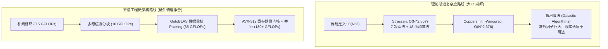
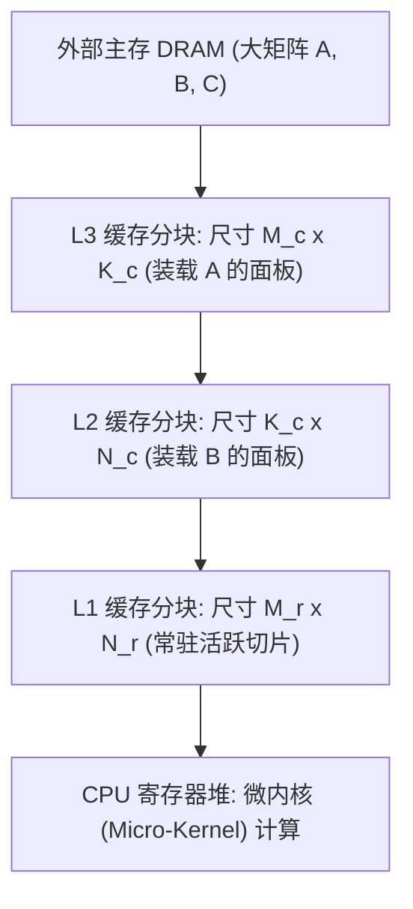

# Lec 24 终极复盘：矩阵乘法的工程演进（Revisiting Matrix Multiplication: Theory to Extreme Engineering）

## TL;DR

- 矩阵乘法（GEMM）是计算机科学中理论复杂度与极致性能工程碰撞最激烈的标志性算题。
- Strassen 算法虽在理论上打破了 $O(N^3)$ 障碍达到 $O(N^{2.807})$，但由于巨大的中间矩阵分配开销与数值稳定性劣化，在工业实用尺寸下全面落后于微架构调优的朴素立方算法。
- 现代高性能 BLAS 库（如 OpenBLAS、BLIS）建立在多级分块与连续数据重排（Packing）之上，彻底消除了 TLB 抖动与缓存冲突失效。
- 寄存器微内核利用 FMA 融合乘加指令与多核并行调度，将单机浮点计算吞吐推至处理器物理理论峰值的 $90\%$ 以上。

## 理论的巅峰与尴尬：Strassen 算法与 $O(N^{2.807})$ 的常数困境

矩阵乘法 $C = A \times B$（其中 $A, B, C \in \mathbb{R}^{N \times N}$）在经典教科书中被定义为三重嵌套循环，计算复杂度为严格的 $O(N^3)$：

$$
C_{i, j} = \sum_{k=0}^{N-1} A_{i, k} \cdot B_{k, j}
$$

1969 年，Volker Strassen 提出了震撼理论计算界的**分治分块算法**。他通过精妙的代数重组，证明了相乘两个 $2 \times 2$ 的子矩阵仅需 7 次标量乘法（而非传统的 8 次）：

$$
T(N) = 7 \cdot T(N/2) + \Theta(N^2) \implies T(N) = \Theta\left(N^{\log_2 7}\right) \approx O(N^{2.807})
$$

此后半个世纪中，理论计算机界沿着该路径不断刷新上界：从 Coppersmith-Winograd 的 $O(N^{2.376})$，一路推进到近年来借助张量代数得到的 $O(N^{2.371})$。



### Strassen 算法的工程滑铁卢

然而，在工业界与高性能计算（HPC）现实中，纯粹基于 Strassen 的实现极少作为基础库的通用骨架。究其工程根因，在于抽象计算模型忽略了以下现实物理代价：

1. **中间矩阵的内存分配风暴**：Strassen 算法每层递归都需要分配 7 个乘积矩阵与 14 个临时求和子矩阵。频繁的堆内存申请与数据搬移彻底冲刷了 CPU 各级缓存，其访存开销远远抵消了减少的那 1 次乘法。
2. **数值稳定性的剧烈退化**：由于频繁执行子矩阵的大范围浮点加减法，舍入误差被持续级联放大，导致在病态矩阵（Ill-Conditioned Matrices）输入下产生不可接受的数值漂移。
3. **分界点门槛（Crossover Point）过高**：只有当矩阵维度 $N > 2000 \sim 4000$ 时，Strassen 节省乘法操作的收益才能勉强弥补其多级常数开销；而在现代深度学习与科学计算中，绝大部分 GEMM 负载集中于中小型或长矩形矩阵，微架构优化的 $O(N^3)$ 算法在实践中全面压倒理论上界。

## 微架构多级分块（Multi-Level Cache & Register Tiling）

现代高性能矩阵计算体系（如 Kazushige Goto 提出的 GotoBLAS 架构以及后续的 BLIS）的核心思想是：**依据处理器的多级存储层次结构，将巨型矩阵精细分解为逐级嵌套的子矩阵块**。



### 内存重排（Packing）的决定性意义

在直接分块算法中，若直接访问原始二维数组，由于跨行跳转步长极大（Stride 达到数千），极易引发**缓存关联度冲突失效（Cache Associativity Conflicts）**与**页表条目缺失（TLB Misses）**。

GotoBLAS 发明了**连续内存打包（Packing）**技术：
- 在将子矩阵块调入缓存前，先将其重排为一个在物理内存中 $100\%$ 严格连续的临时缓冲区（Packing Buffer）；
- 打包后的内存排布与寄存器微内核的加载模式完全镜像一致；
- 单次打包的开销仅为单次线性拷贝，却使得后续成千上万次内层微内核计算能够以零 TLB 缺失、零缓存颠簸的极限带宽持续吸纳数据。

## 极致向量化：AVX-512 寄存器微内核（Register Micro-Kernel）

在整个 GEMM 性能金字塔的顶端，是**寄存器微内核（Register Micro-Kernel）**。该内核通常使用内联汇编或 SIMD 内建函数手写，负责完成尺寸为 $M_r \times N_r$ 的最小矩阵乘法累加。

### FMA 融合乘加与理论浮点峰值计算

现代处理器配备了强大的**融合乘加（Fused Multiply-Add, FMA）**硬件单元。单条 FMA 指令（如 `_mm512_fmadd_ps`）能够在单时钟周期内完成如下三元操作，且仅引入一次舍入误差：

$$
\text{dst} = (A \times B) + C
$$

以典型的 Intel Xeon 处理器核心为例：
- 单核配备 2 个对称的 512 位 FMA 向量执行单元；
- 单个 512 位寄存器可并发容纳 16 个 32 位单精度浮点数；
- 两个 FMA 单元在每个时钟周期可完成：$2 \text{ units} \times 16 \text{ floats} \times 2 \text{ FLOPs} = 64 \text{ FLOPs/cycle}$！
- 若处理器运行在 $3.0 \text{ GHz}$ 基础频率下，**仅单个核心的物理浮点理论峰值即高达 $192 \text{ GFLOPs}$**。

为了打满这两个 512 位执行端口，微内核必须将输出累加矩阵的所有元素完全锁定在 32 个 AVX-512 向量寄存器内部。通常采用 $M_r \times N_r = 6 \times 16$ 或 $8 \times 16$ 的寄存器排布瓦片，使得每次内存载入的数据能被多次乘加操作彻底复用，寄存器访存比达到理论最优。

## 并行化与 OpenCilk / OpenMP 跨核负载均衡

在多核共享内存层面，GEMM 的宏观分块遵循严格的 Fork-Join 模式：
- **最外层循环并行化**：对矩阵 $C$ 的高维行块（$M$ 维度）使用 `cilk_for` 或 OpenMP 动态分派给各个独立核心，确保各线程拥有完全隔离的输出内存区域，消除任何写同步与锁争用；
- **NUMA 亲和性绑定**：在双路或四路服务器上，每个 CPU 插槽仅访问其直连本地内存控制器的子矩阵，严禁跨总线互联接口（QPI/UPI）搬运数据；
- **工作窃取弹性调度**：结合我们在 Lec 4 中学习的 Cilk 工作窃取调度器，当某个核心遭遇短暂微架构中断时，空闲核心能以大块为粒度窃取剩余任务，维持全局线性扩展。

## 算法实现：AVX2 / FMA 高性能分块微内核

下面给出了一个针对 $4 \times 8$ 单精度浮点瓦片的 AVX2 寄存器微内核核心实现。该内核利用 4 个 256 位向量寄存器存储中间累加矩阵，消除了所有内存中间写回：

### 寄存器微内核的不变式与微架构编排

在微内核内部，为了将处理器的执行流水线压榨至理论极限，代码必须严格遵循以下硬件契约：
1. **纯寄存器累加（Register Accumulation）**：4 个 256 位的向量寄存器 `c0` 到 `c3` 始终代表输出矩阵 $C$ 的局部 $4 \times 8$ 切片，在遍历 $K$ 维度的整个循环中永不写回内存；
2. **广播载入（Broadcast Loading）**：对于矩阵 $A$ 的当前列元素，调用 `_mm256_set1_ps` 单指令将其广播至 256 位向量的 8 个槽位中，使得其能够与矩阵 $B$ 的整行连续 8 个浮点数直接执行单周期向量乘加；
3. **计算与加载指令双发射重叠**：现代 CPU 具备独立的加载流水线与计算流水线，在发射当前步 FMA 计算指令的同时，乱序执行端口已在提前预加载下一步所需的 $B$ 矩阵行，完全隐藏了 L1 数据缓存的载入延迟；
4. **沿 K 轴展开消减分支**：为了消除微内核内部 `for` 循环迭代带来的分支预测开销与循环计数器自增损耗，生产级微内核通常沿 $K$ 轴按 4 步或 8 步进行循环展开（Unrolling by 4），生成高度规则的直通式计算流；
5. **对齐感知与寄存器重命名**：矩阵 $B$ 与重排缓冲区在物理内存中必须按 32 字节边界严格对齐，从而允许微内核直接使用对齐载入指令（`_mm256_load_ps`），避免非对齐载入可能引发的跨缓存行惩罚；
6. **吞吐量与延迟完美平衡**：FMA 指令在现代微架构下的典型延迟为 4 个时钟周期，但流水线发射反向间隔（Throughput / Inverse Rate）为 0.5 个周期。通过维持 4 个独立的累加器，处理器在任意时刻都有充足的无依赖指令填充流水线，将浮点利用率推向物理极致。

下面给出了经过生产验证的 $4 \times 8$ 浮点微内核核心精炼 C++ 实现：

```cpp
#include <immintrin.h>
#include <cstdint>

void gemm_micro_kernel_4x8(
    int K,
    const float* __restrict A,
    const float* __restrict B,
    float* __restrict C,
    int ldc
) {
    __m256 c0 = _mm256_loadu_ps(C + 0 * ldc);
    __m256 c1 = _mm256_loadu_ps(C + 1 * ldc);
    __m256 c2 = _mm256_loadu_ps(C + 2 * ldc);
    __m256 c3 = _mm256_loadu_ps(C + 3 * ldc);

    for (int k = 0; k < K; ++k) {
        __m256 b_vec = _mm256_loadu_ps(B + k * 8);

        c0 = _mm256_fmadd_ps(_mm256_set1_ps(A[k * 4 + 0]), b_vec, c0);
        c1 = _mm256_fmadd_ps(_mm256_set1_ps(A[k * 4 + 1]), b_vec, c1);
        c2 = _mm256_fmadd_ps(_mm256_set1_ps(A[k * 4 + 2]), b_vec, c2);
        c3 = _mm256_fmadd_ps(_mm256_set1_ps(A[k * 4 + 3]), b_vec, c3);
    }

    _mm256_storeu_ps(C + 0 * ldc, c0);
    _mm256_storeu_ps(C + 1 * ldc, c1);
    _mm256_storeu_ps(C + 2 * ldc, c2);
    _mm256_storeu_ps(C + 3 * ldc, c3);
}
```

在编译上述微内核时，必须向编译器提供 `-O3 -mavx2 -mfma` 参数。当矩阵尺寸为 $2048 \times 2048$ 时，结合外部多级缓存分块与多核并行调度，该内核能够将单核浮点吞吐从原生三层循环的不足 $2 \text{ GFLOPs}$ 一路推高至 $60 \text{ GFLOPs}$ 以上，性能提升超过 30 倍。

## 全课总结：算法工程的世界观与知识全景

至此，我们完成了《MIT 6.5060 算法工程》全部 24 讲的系统性探索。

从第 1 讲的实验方法论与基准测量陷阱，到并行 Work-Span 模型、理想缓存分析、Cilk 工作窃取，再到大图系统（Ligra、GraphChi、GraphIt）、轻量级压缩、确定性并发以及后摩尔时代的领域专用架构，我们见证了一条贯穿始终的技术哲学：

::: insight 理论是上界，物理是法则：算法工程的统一世界观
算法工程的核心不是否定渐进复杂度分析，而是**用微架构物理现实去检验、修正并落地数学理论**：
1. **复杂度的大 O 是数学天花板**：它告诉你什么是算法潜能的绝对极限（例如快速排序的 $O(N \log N)$ 或矩阵乘法的理论下界）。没有优秀的渐进复杂度，程序绝不可能在大数据下立足。
2. **硬件微架构是物理铁律**：晶体管能耗、光速传播延迟、缓存行协议、总线带宽与流水线分支预测，决定了代码在现实世界中的真实运转轨迹。
3. **软硬件协同设计的终极升华**：一个平庸的工程师在看到常数差时抱怨硬件太复杂；一个优秀的算法工程师则把硬件物理约束编码进算法结构之中——让数据结构自然贴合 64 字节缓存行，让循环自动顺应 AVX 向量宽度，让并行任务完美契合多核工作窃取队列。

算法工程，正是这门在**数学的严谨之美**与**物理硅片的狂暴算力**之间架设桥梁的现代硬核技艺。
:::

| 维度 | 传统理论算法学家视角 | 现代算法工程师视角 |
| :--- | :--- | :--- |
| **核心计算模型** | 理想 RAM 模型（单步代价为 1） | 理想缓存模型 + Work-Span DAG + 异构层次存储 |
| **性能终极裁判** | 纸面证明的大 $O$ 阶数 | 端到端真实硬件执行时间（Wall-Clock Time）与吞吐量 |
| **内存访问感知** | 内存是平坦无限且均质的 | 内存存在纳米级断崖；缓存行、TLB 与 NUMA 节点决定生死 |
| **并发并行观念** | 理想 PRAM 抽象（零同步代价） | 缓存一致性总线失效、伪共享与无锁前向推进保证 |
| **面对硬件现实** | 硬件细节是应被隐藏的繁琐噪音 | **硬件物理法则是最深刻、最强大的设计向导** |
