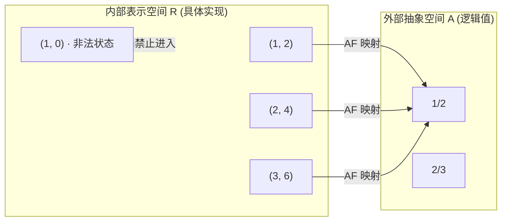

# 抽象数据类型的表示不变式与表示暴露防范

## TL;DR

- 表示不变式（Representation Invariant, RI）是 ADT 内部状态值必须在所有时刻无条件满足的布尔谓词，是模块自证正确性的基石。
- 抽象函数（Abstraction Function, AF）定义了合法内部表示空间（R）到外部客户理解的抽象空间（A）的满射关系。
- 表示暴露（Representation Exposure）是导致不变式被隐蔽破坏的最危险漏洞，必须通过私有字段和深度防御性拷贝（Defensive Copying）彻底隔绝。
- 创建者与生成者必须建立不变式，变异者与观察者必须保持不变式；在每个公开方法的出入口调用 `checkRep()` 能在第一时间定位破坏源头。

## 核心主动唤醒问题

1. **什么是表示不变式（Rep Invariant, RI）？它与方法的前置条件（Precondition）有何区别？**
   - 前置条件是调用方向被调用方法做出的承诺；而表示不变式是 ADT 内部的私有契约，由 ADT 自身全权保证，调用方无需感知也绝不应该有能力破坏它。
2. **为什么单靠 `private` 关键字无法彻底杜绝表示暴露（Rep Exposure）？**
   - 如果构造函数直接保存了外部传入的可变对象引用，或者 getter 方法直接返回了内部可变对象的引用，外部代码即可绕过类的方法直接篡改内部数据，使 `private` 沦为摆设。
3. **在生产代码与调试期中，`checkRep()` 的调用策略应当如何权衡性能与正确性？**
   - 调试与测试期无条件在方法出入口执行全量 `checkRep()`；在生产环境中，对 $O(1)$ 廉价断言予以保留，对需要遍历复杂集合的 $O(n)$ 昂贵检查可通过环境变量或编译开关按需关闭。

## 为什么 ADT 必须维护自己的不变式？

在面向对象与模块化设计中，最严重的软件退化通常源于“状态漂移”：某个变量在运行数小时后变成了一个不可理喻的值（例如时间戳为负数、分数的分母为零、哈希桶中的键被原地修改）。

::: definition 表示不变式（Representation Invariant, RI）
表示不变式是定义在数据类型内部所有表示字段上的条件约束。对于合法的对象实例，在经过构造或任意公开方法调用前后，**RI 必须恒为真（Always True）**。
:::

如果一个模块无法独立守住自己的不变式，它就必须依赖成百上千个外部调用者自觉遵守潜规则。只要有一个调用者疏忽，整个系统就会崩溃，且定位 bug 时需要排查所有可能访问该对象的代码路径。

## 抽象空间 (A) 与表示空间 (R) 的映射

理解 ADT 的核心在于区分两个空间：
1. **抽象空间（Abstract Space, A）**：客户端所看到的逻辑值（例如数学上的“不可变有理数 $p/q$”）；
2. **表示空间（Representation Space, R）**：计算机底层存储的具体数据结构（例如两个 `int` 字段 `numerator` 和 `denominator`）。



* **表示不变式（RI）**：定义了 R 中哪些状态是合法的。在有理数示例中，$RI = \{ (n, d) \mid d \neq 0 \text{ 且 } \gcd(|n|, |d|) = 1 \}$。它将非法状态（如分母为 0）拒之门外。
* **抽象函数（AF）**：定义了如何将每个合法表示映射为客户端理解的逻辑值。$AF(n, d) = n / d$。多个不同的表示（如未约分的数值）可以映射到同一个抽象值，但每个合法表示必须恰好对应一个抽象值。

## 四类操作对不变量的契约责任

根据 Barbara Liskov 的经典分类，ADT 操作分为四类，它们在不变式维护中承担不可推卸的责任：

| 操作类别 | 典型方法命名 | 对表示不变式（RI）的责任 |
| :--- | :--- | :--- |
| **创建者 (Creators)** | `new`, 工厂方法 | **从无到有建立 RI**：必须保证返回的新实例完全符合 RI |
| **生成者 (Producers)** | `concat()`, `add()` | **建立新实例的 RI**：接收旧实例，产生的新对象必须满足 RI |
| **变异者 (Mutators)** | `set()`, `push()` | **维持 RI**：修改内部字段后，必须在返回前恢复 RI |
| **观察者 (Observers)** | `size()`, `get()` | **只读且绝不破坏 RI**：严禁产生任何导致表示漂移的副作用 |

## 表示暴露的致命陷阱与防御性拷贝

很多开发者以为将字段标为 `private` 就万事大吉，这是极其危险的错觉。访问修饰符 `private` 只能防止外部代码直接通过 `obj.field` 进行赋值，却无法阻止通过引用传递获取底层可变数据结构的控制权。

在软件工程中，**表示暴露（Representation Exposure）** 最常通过别名（Aliasing）潜入系统。别名意味着同一个内存对象同时被多个指针持有；当外部代码通过其中一个别名修改对象时，类内部赖以生存的不变量就会在毫无预警的情况下轰然崩塌。

如下代码展示了一个经典的表示泄露陷阱：

```typescript
// 典型反模式：表示暴露
class Period {
  private start: Date;
  private end: Date;

  constructor(start: Date, end: Date) {
    if (start.getTime() > end.getTime()) {
      throw new Error("start cannot be after end");
    }
    // 危险：直接保存外部传入的可变引用！
    this.start = start;
    this.end = end;
  }

  public getStart(): Date {
    // 危险：直接把内部可变对象返回给外部！
    return this.start;
  }
}
```

在这段代码中，存在两个极其致命的安全漏洞：
首先是在构造函数内部，直接将调用者传递的 `start` 引用赋值给私有变量，导致调用方仍然持有对内部日期的直接操控权；
其次是在读取方法中，直接把内部私有引用返回给了外部世界。
外部调用者只需执行 `period.getStart().setYear(2099)`，即可在类完全不知情的情况下摧毁 `start <= end` 的表示不变式！这种 Bug 在大型工程中极其隐蔽，因为出问题的往往不是数据修改点，而是在数万次调用之后由于无效状态引发的下游雪崩。

要彻底根除表示暴露，必须在所有跨越抽象边界的数据传输点执行**深度防御性拷贝（Defensive Copying）**：

::: example 正确的防御性拷贝模式 (Defensive Copying)
```typescript
class Period {
  private readonly start: Date;
  private readonly end: Date;

  constructor(start: Date, end: Date) {
    // 1. 入口拷贝：隔断与构造入参的别名关系
    this.start = new Date(start.getTime());
    this.end = new Date(end.getTime());

    // 2. 在拷贝之后再验证 RI
    if (this.start.getTime() > this.end.getTime()) {
      throw new Error("start cannot be after end");
    }
  }

  public getStart(): Date {
    // 3. 出口拷贝：禁止外部调用者持有内部对象指针
    return new Date(this.start.getTime());
  }
}
```
通过在入参处克隆新实例，类内部的数据获得了与外部调用者生命周期完全隔离的绝对独立性；而在返回值处克隆新实例，则杜绝了任何外部别名原地变异内部属性的可能性。
:::

::: insight 优先使用不可变值（Immutability）
防止表示暴露的终极解法不是写满复杂的防御性拷贝，而是**在设计阶段优先使用不可变类型**（例如使用不可变时间戳 `number` 或 JavaScript 原生的 `Temporal.Instant`，而非遗留的 `Date` 对象；使用只读切片而非可变数组）。如果内部字段全部是天然不可变值，表示暴露的风险在编译期便不复存在。
:::

## 运行时自检：`checkRep()` 的最佳实践

无论类型系统多么强大、代码审查多么严格，人类工程师在编写复杂状态变异逻辑时依然容易出现逻辑漏洞。因此，在实现 ADT 时，必须显式编写一个私有辅助方法 `checkRep()`，用来将形式化的 RI 翻译为具体的运行时断言。

`checkRep()` 的存在具有多重工程价值：
1. **即时定位故障**：它遵循“尽早失败（Fail Fast）”原则，一旦有操作破坏了不变式，程序会在第一时间崩溃并抛出清晰的断言错误，防止错误状态污染下游数据库；
2. **可执行的契约文档**：与其在注释中写模糊的文字说明，不如用可执行的布尔表达式清晰记录“何为合法状态”，后续维护者无需猜测字段的取值边界；
3. **回归测试的安全网**：在未来的重构或性能调优过程中，`checkRep()` 会成为全自动的监视哨兵，确保任何算法改动都不会破坏既有的结构约束。

```typescript
class Tweet {
  private readonly author: string;
  private readonly text: string;
  private readonly timestamp: number;

  private checkRep(): void {
    assert(this.author.length > 0, "author cannot be empty");
    assert(this.text.length <= 280, "text exceeds max length");
    assert(this.timestamp > 0, "invalid timestamp");
  }

  constructor(author: string, text: string, timestamp: number) {
    this.author = author;
    this.text = text;
    this.timestamp = timestamp;
    this.checkRep(); // 构造结束立即检查
  }

  public retweet(): Tweet {
    this.checkRep(); // 方法开始检查不变式
    const result = new Tweet(this.author, `RT: ${this.text}`, Date.now());
    this.checkRep(); // 方法结束再次检查
    return result;
  }
}
```

在工程落地中，务必在构造函数末尾以及每个变异操作的最后显式调用 `this.checkRep()`。只要操作在离开前保证状态健康，下一个方法进入时就可以放心地假设不变式成立。

## 常见误区与失败模式

::: pitfall 陷阱一：在防御性拷贝之前做有效性检查
如果先检查入参条件 `if (start > end)`，再执行 `this.start = new Date(start)`，在多线程或异步环境下，传入的对象可能在检查通过后被另一个线程篡改（TOCTOU 漏洞）。**必须先拷贝，后检查！**
:::

::: pitfall 陷阱二：修改对象后导致哈希表表示不变式崩溃
将可变对象作为 `Map` 或 `Set` 的键，并在放入集合后修改对象的内部属性，会导致该对象的哈希值发生改变。这会直接破坏哈希表“每个键都能在其对应哈希桶中找到”的核心表示不变式，导致元素“神秘失踪”。
:::
