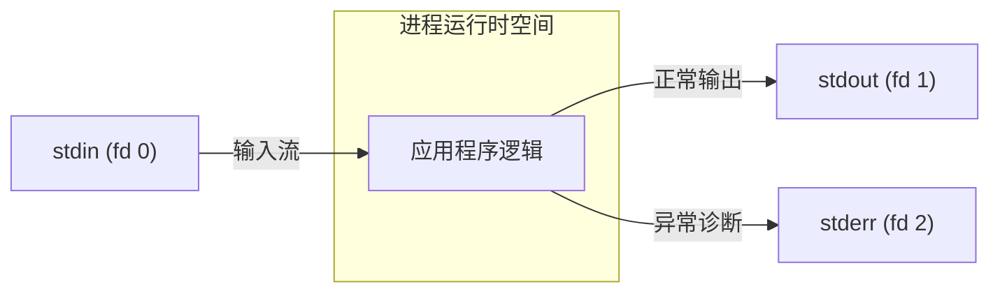
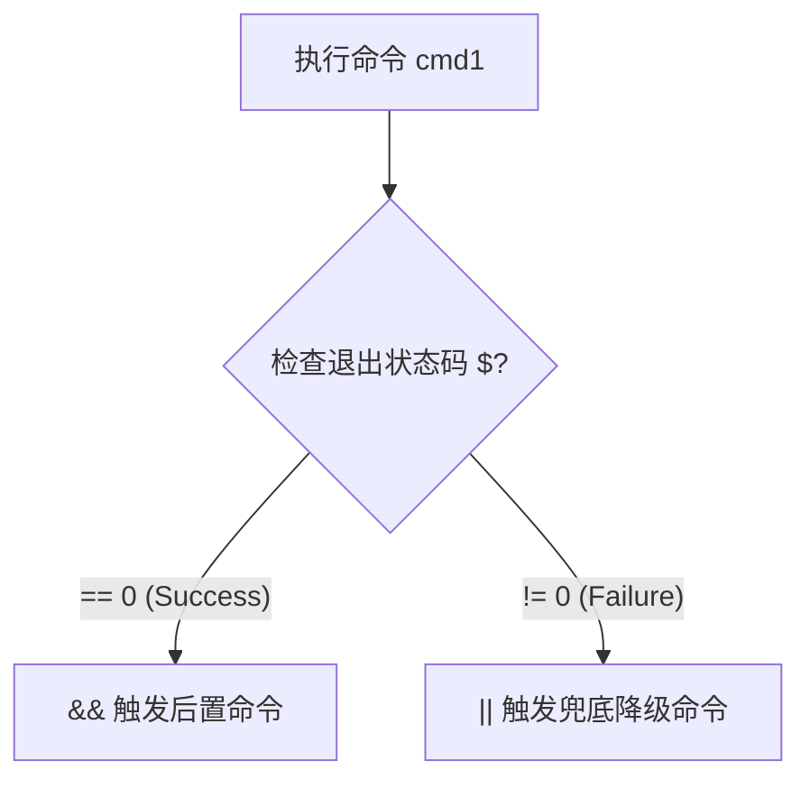
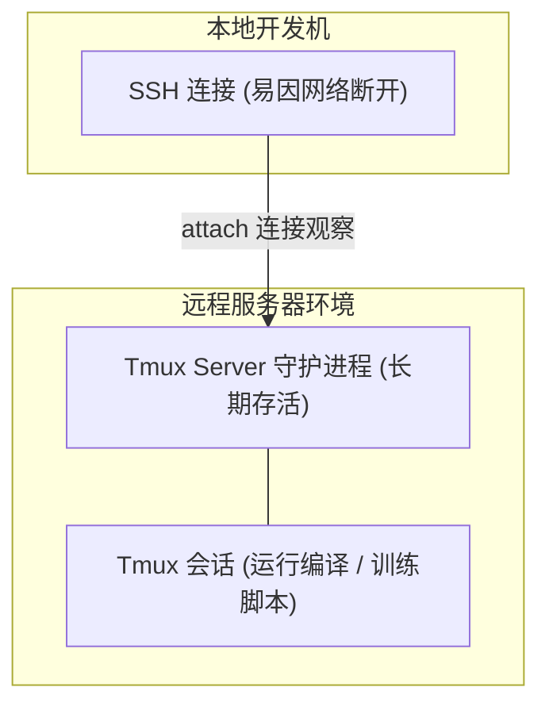

# 02 命令行环境与自动化编排（Command-line Environment）

> MIT 6.NULL · 现代软件工程工具链与开发者素养 · 官方讲义核心内容

## TL;DR

- **约定优于配置的 CLI 模型**：命令行程序通过标准参数数组、短/长选项标志与通配符展开（Globbing）解耦交互细节，实现正交组合。
- **流隔离与真并行管道**：标准输入输出与错误流保持结构隔离；管道符串联的命令由操作系统并发调度，通过内核缓冲区建立流式背压机制。
- **状态感知与进程生命周期**：退出状态码驱动条件控制流；POSIX 软中断信号控制进程暂停与终止，配合 Trap 机制实现严密的异常资源回收。
- **远程会话与工作环境永续**：基于 Ed25519 的 SSH 密钥认证保障通道安全，依托 Tmux 终端多路复用器隔绝网络挂断信号（SIGHUP）实现生产级会话持久化。

---

## 1. 命令行接口模型与参数解析

在绝大多数现代高级编程语言中，数据流经由形式参数与返回值完成传递。与此不同，Unix/Linux 命令行程序的交互遵循一整套自 1970 年代演进并高度标准化的工业契约。

### 参数（Arguments）与标志（Flags）契约

当用户在 Shell 中键入一条指令时，Shell 首先根据空白字符将命令字符串切分成独立的数据单元，并作为参数列表提交给操作系统的进程创建原语（如 `execve` 系统调用）。

::: definition [CLI 标志约定]
- **短选项（Short Flags）**：以单横线 `-` 开头后接单字符，如 `-a`、`-l`、`-h`。短选项允许合并压缩（例如 `ls -lah` 与 `ls -l -a -h` 语义等价）。
- **长选项（Long Flags）**：以双横线 `--` 开头后接完整单词，如 `--all`、`--human-readable`。长选项自解释性强，是编写生产级自动化脚本与 CI/CD 配置的首选。
- **双横线终止符（`--`）**：指示选项解析结束。其后出现的所有字符串均被强制视为常规文件名或目标参数，用于安全操作包含短横线前缀的特殊文件（例如删除名为 `-rf` 的文件时使用 `rm -- -rf`）。
:::

标志解析不是 Shell 自身的语法要求，而是运行在子进程中的目标程序遵循的接口标准。在实际软件工程中，开发者通常依赖语言生态中的解析库（如 Python 的 `argparse`、Rust 的 `clap`、Go 的 `cobra`）来实现该契约。

### 通配扩展（Globbing）的工作时序

与正则表达式由应用程序自身在运行时编译匹配不同，通配扩展是由 **当前交互 Shell 在派生子进程前直接完成展开的**。

| 通配模式 | 语法含义 | 展开时机与行为 |
| :--- | :--- | :--- |
| `*` | 匹配任意长度的字符序列（不跨目录层级） | Shell 在启动程序前将模式匹配到的所有路径按空格展开为独立参数 |
| `?` | 匹配单个字符 | 精确匹配单字符占位，常用于版本号或序列命名归类 |
| `{a,b}` | 笛卡尔积集合展开（Brace Expansion） | 无论文件是否存在均进行纯字符串笛卡尔积排列组合 |
| `**` | 递归子目录通配（需 Shell 开启 `globstar`） | 深度遍历目录树匹配所有层级下的目标扩展名文件 |

::: example [通配展开的时序验证]
考虑如下目录清理命令：
```console
$ rm *.log
```
其底层执行流程并非将字符串 `"*.log"` 传递给 `rm` 程序并由 `rm` 遍历磁盘，而是 Shell 首先扫描当前目录，将所有匹配的文件名组装为参数列表：
```console
$ rm server.log debug.log audit.log
```
若没有任何文件匹配且 Shell 未开启 `nullglob`，在 Bash 默认行为下将把原始字符串 `"*.log"` 直接传给 `rm`，从而导致 `rm: cannot remove '*.log': No such file or directory` 的典型报错。
:::

---

## 2. 标准流、并行管道与重定向

Unix 系统将 I/O 设备统一抽象为文件描述符（File Descriptors）。进程默认持有三个核心文件流：



### 管道（Pipeline）的并发调度与背压

使用管道操作符（`|`）将多个命令串联时，操作系统并非依次按顺序执行程序，而是 **并发启动所有子进程**，并通过内核环形缓冲区（Kernel Ring Buffer）建立流式传输通道。

::: definition [管道背压机制（Pipe Backpressure）]
当上游写入速度远大于下游读取处理速度时，内核管道缓冲区（在 Linux 下通常为 64KB）将被填满。此时操作系统内核会自动将上游写入进程置于睡眠挂起状态，暂停其 CPU 调度；当下游读取消费数据后，上游被重新唤醒。这一机制确保了即使处理百 GB 级的流式日志，整个流水线的内存占用也始终恒定在极小的缓冲区上限内。
:::

### 标准流的隔离与重定向重组

在默认交互状态下，操作系统的进程管理器会将标准输出（文件描述符 1）与标准错误（文件描述符 2）均绑定到终端显示器的控制台上。这种设计保证了无论是正常的计算结果还是突发的报警提示，都能即时呈现在用户眼前。然而在自动化脚本与服务化编排中，若不加区分地混淆这两条流，将导致灾难性的逻辑污染。

为了实现精确的流控制，Shell 提供了丰富的文件描述符重定向语法。其底层本质是调用操作系统内核的 `dup2()` 系统调用，将特定文件描述符的指向原子重写为目标文件或目标管道的句柄：

```console
# 覆盖写入标准输出至文件（内部以 O_WRONLY|O_CREAT|O_TRUNC 打开目标）
$ command > output.log

# 追加写入标准输出（内部以 O_WRONLY|O_CREAT|O_APPEND 打开目标）
$ command >> output.log

# 仅将标准错误重定向至文件，标准输出继续打印至屏幕控制台
$ command 2> error.log

# 将标准输出与标准错误合流重定向至同一文件
$ command &> combined.log
$ command > combined.log 2>&1

# 吞噬所有输出（常用于静默脚本执行，黑洞设备文件）
$ command > /dev/null 2>&1
```

理解重定向顺序是掌握 Shell 流控制的关键技术门槛。例如经典写法 `> combined.log 2>&1`，解析时序自左向右：首先将 `1`（`stdout`）定向到目标文件，紧接着 `2>&1` 将 `2`（`stderr`）复制为当前 `1` 所指向的目标句柄，从而实现两者合并输出到文件。若颠倒顺序写为 `2>&1 > combined.log`，则 `2` 将首先绑定到当时的终端设备，随后仅 `1` 被定向到文件，导致错误日志仍然泄漏到屏幕上。

::: pitfall [标准输入裸单横线 `-` 约定]
许多遵循 POSIX 标准的命令行程序（如 `grep`、`tar`、`curl`）约定使用单个破折号 `-` 代指标准输入。例如：
```console
$ curl -s https://example.com/data.tar.gz | tar -xzvf -
```
若忽略末尾的 `-`，部分工具可能会误将后续参数作为归档文件名处理，导致管道数据阻塞挂起。
:::

---

## 3. 环境变量与进程作用域继承

环境变量是操作系统维护在每个进程地址空间中的键值对字符串表，构成了进程获取运行环境上下文（如语言区域、用户主目录、依赖寻址路径）的标准手段。

### 局部变量 vs 导出环境变量

在 Shell 中给变量赋值时，等号两端不得留有空格：

```bash
# 正确赋值
var=123

# 错误：Shell 会将 var 视作命令名，将 "=" 和 "123" 视为参数
var = 123
```

::: definition [进程环境继承边界]
在当前 Shell 中直接声明的变量为当前会话私有，其派生的任何子进程均无权访问该变量。通过 `export` 关键字声明后，操作系统在通过 `fork()` 创建子进程时，会将当前进程的环境变量表完整克隆复制到子进程的独立地址空间中。
:::

```console
$ DEBUG=true
$ bash -c 'echo "Debug mode: $DEBUG"'
Debug mode: 

$ export DEBUG=true
$ bash -c 'echo "Debug mode: $DEBUG"'
Debug mode: true
```

### 瞬时环境变量注入

若只需为单次命令执行注入特定环境，无需污染全局 Shell 会话，可使用命令前置赋值语法：

```console
# 仅对本次启动的 Node 进程注入生产环境标识
$ NODE_ENV=production node server.js

# 仅针对单次 date 命令调整时区
$ TZ=America/New_York date
```

---

## 4. 退出状态码与条件控制流

所有符合 POSIX 规范的可执行程序在通过 `exit()` 系统调用终止时，必须向操作系统父进程返回一个 0 至 255 的整型状态码（Exit Code）。

- **`0`**：表示程序执行成功、目标达成；
- **非零（`1 ~ 255`）**：表示发生不同类型的运行故障或未满足过滤条件。

当前最新一条命令的退出状态保存在内置特殊变量 `$?` 中。

### 状态码驱动的逻辑控制流

Shell 与传统高级语言最大的认知差异在于：**Shell 的条件分支与循环完全由状态码驱动，而非布尔类型**。



```bash
# 条件执行链条
grep -q "CRITICAL" /var/log/syslog && notify-admin || echo "System normal"
```

---

## 5. 进程控制与 POSIX 信号系统

当开发者在终端中按下键盘快捷键时，终端模拟器并不会直接杀死进程，而是向内核发起请求，由操作系统向目标前台进程组广播派发对应的 **POSIX 信号（Signals）**。

### 核心信号全景

| 信号名称 | 信号编号 | 默认行为 | 触发快捷键 / 场景 | 可否被捕获 / 忽略 |
| :--- | :--- | :--- | :--- | :--- |
| **`SIGINT`** | 2 | 终止进程 | `Ctrl + C` | **可捕获**（常用于安全保存数据） |
| **`SIGQUIT`** | 3 | 终止并产生 Core Dump | `Ctrl + \` | **可捕获**（用于定位死锁） |
| **`SIGTERM`** | 15 | 优雅请求终止 | `kill <pid>` | **可捕获**（容器与服务关闭标准信号） |
| **`SIGKILL`** | 9 | 强制硬终止 | `kill -9 <pid>` | **内核强制回收，不可捕获与忽略** |
| **`SIGTSTP`** | 20 | 挂起当前进程 | `Ctrl + Z` | **可捕获**（让出终端控制权） |
| **`SIGHUP`** | 1 | 终止终端派生进程 | 终端窗口关闭 / SSH 断开 | **可捕获**（常用于通知服务重载配置） |

### 优雅退出：Bash 中的 `trap` 异常清理

在生产级软件工程中，任何脚本程序在执行过程中都有可能由于人为按键（`Ctrl + C`）、系统资源耗尽（`SIGTERM`）或网络断连（`SIGHUP`）而被迫中止。若脚本在生命周期初期创建了临时文件、独占锁（Lockfile）或挂载了虚拟设备，而未在异常退出时进行回收，这些资源将永久驻留在文件系统或内核状态表中，最终诱发磁盘爆满或死锁。

为了构建抵御非预期中断的鲁棒性体系，POSIX Shell 提供了 `trap` 内建指令。它允许开发者在用户态预先向 Shell 注册指定信号的异步处理回调函数。当操作系统内核向该脚本进程派发匹配的信号中断时，Shell 解释器会暂停当前的主干执行流，转而优先调度执行回调逻辑，清理现场后再恢复或终结进程：

```bash
#!/usr/bin/env bash
set -euo pipefail

# 创建安全临时工作目录（利用 mktemp 生成唯一且具有权限隔离的临时路径）
WORK_DIR=$(mktemp -d "/tmp/build_job.XXXXXX")

# 注册异常中断清理钩子
cleanup() {
    local exit_code=$?
    echo "清理临时资源：$WORK_DIR (退出码: $exit_code)"
    rm -rf "$WORK_DIR"
    exit "$exit_code"
}

# 绑定所有关键异常信号与脚本退出时刻（EXIT 伪信号确保无论正常退出还是异常退出均被触发）
trap cleanup EXIT SIGINT SIGTERM SIGHUP

# 执行核心编译或数据处理逻辑
echo "开始在 $WORK_DIR 中处理数据..."
sleep 60
```

上述设计融合了多重工程防御策略：通过 `set -euo pipefail` 确保未定义变量、命令失败及管道中途崩溃能够即时被检测并中止；通过向 `trap` 注册 `EXIT` 伪信号，使得无论脚本是顺利执行完毕还是因信号强制退出，清理函数都能以确定性（Deterministic）机制得到调度。这种资源生命周期管理哲学，与现代系统级语言（如 C++ 的 RAII、Rust 的 Drop 特征以及 Python 的上下文管理器）的异常安全边界思想一脉相承。

---

## 6. 远程作业与 SSH 密钥认证体系

SSH（Secure Shell）通过端到端非对称加密建立安全的控制通道。

### 基于 Ed25519 的免密公私钥认证

现代工程实践强烈推荐使用椭圆曲线密码学（Ed25519）替代陈旧的 RSA 算法，具备更短的密钥长度与更高的抗攻击强度：

```console
# 1. 本地生成 Ed25519 密钥对
$ ssh-keygen -t ed25519 -C "developer@archipelago.internal"

# 2. 将公钥一键注入远端服务器授权白名单
$ ssh-copy-id -i ~/.ssh/id_ed25519.pub user@remote-host
```

::: pitfall [私钥密码短语（Passphrase）的安全边界]
生成私钥时若直接回车置空密码短语，私钥将以未加密明文持久化在磁盘 `~/.ssh/id_ed25519` 中。一旦开发机遭遇物理失窃或恶意软件扫描，攻击者即可无阻碍横向渗透所有远端集群。最佳实践是设置强口令，并交由操作系统的 `ssh-agent` 在内存中单次解密托管。
:::

### SSH 跨机器管道透传

SSH 客户端自身即为标准 I/O 适配器。利用该特性可实现极简的跨网络数据流转移：

```console
# 在本地压缩打包目录，直接流式传送到远程服务器解压，不落地中间压缩包
$ tar -czf - ./project | ssh user@remote-host "tar -xzf - -C /opt/deploy/"
```

---

## 7. 终端多路复用器（Tmux）与会话持久化

在远程主机执行耗时任务时，一旦网络抖动导致 SSH 连接断开，远端登录 Shell 会收到 `SIGHUP` 信号并递归终止所有子进程。

Tmux 采用客户端/服务端架构，彻底解耦了进程生命周期与网络物理连接。



### Tmux 核心操作流

- **会话持久化**：
  - 新建命名会话：`tmux new -s training`
  - 临时脱离会话（保持后台运行）：按下前缀键 `Ctrl + B`，随后单按 `d`（Detach）
  - 重新接入会话：`tmux attach -t training`
- **分屏与窗口（Panes & Windows）**：
  - 水平左右分屏：`Ctrl + B` 然后按 `%`
  - 垂直上下分屏：`Ctrl + B` 然后按 `"`
  - 新建标签页窗口：`Ctrl + B` 然后按 `c`
  - 切换窗口：`Ctrl + B` 后按对应数字序号（`0..9`）

---

## 8. 定制 Shell 环境：Dotfiles 与现代 CLI 工具链

### 现代替代工具链

传统 Unix 基础工具形成于上世纪 70 年代，受限于当时的硬件约束。现代开源生态涌现出一批高并发、默认行为更合理的替代方案：

- **`ripgrep`（`rg`）**：原生集成 `.gitignore` 解析，基于并行多线程与 SIMD 加速的文本检索工具；
- **`fd`**：具有友好语法着色与合理默认过滤的目录树查找器；
- **`fzf`**：极速命令行通用交互式模糊匹配器，用于重构命令历史检索与路径补全；
- **`zoxide`（`z`）**：基于频次与新鲜度加权（Frecency）的智能路径跳转工具。

### Dotfiles 版本化工程实践

将终端配置文件（`.bashrc`、`.zshrc`、`.tmux.conf`、`.gitconfig`）统一收拢在版本控制仓库中，通过符号链接建立映射：

```console
$ git clone https://github.com/username/dotfiles.git ~/.dotfiles
$ ln -sf ~/.dotfiles/zsh/zshrc ~/.zshrc
$ ln -sf ~/.dotfiles/tmux/tmux.conf ~/.tmux.conf
```

---

## 我的理解

::: insight [流、信号与约定：Unix 架构的长青之美]
现代软件开发往往沉浸在微服务、容器化与分布式架构中，但这些复杂系统在单个节点上的本质，依然没有超越 Unix 的基础构件：以字节流为唯一媒介的 I/O 通信、以非阻塞背压为保障的管道传输、以整型状态码为契约的控制跳转，以及以软中断为纽带的信号生命周期管理。

理解命令行环境的价值，不仅在于提升日常敲击键盘的敲击效率，更在于建立对操作系统进程间协作的直觉。无论是 Docker 容器的优雅停机序列（发送 `SIGTERM` 等待超时后再发送 `SIGKILL`），还是 Kubernetes 探针检测机制（依据退出码判定存活状态），其底层哲学均直接脱胎于本讲所建立的命令行环境规则体系。
:::
