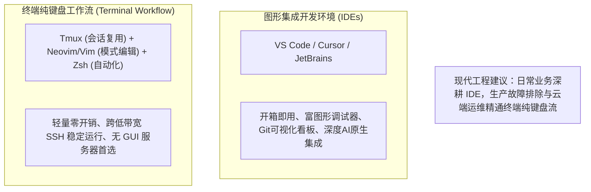
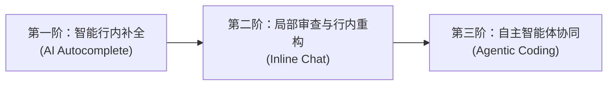

# 03 现代开发环境、Vim 与代码智能（Development Environment & Tools）

> MIT 6.NULL · 现代软件工程工具链与开发者素养 · 官方讲义核心内容

## TL;DR

- **模式编辑的思维抽象**：Vim 将文本编辑解构为图灵完备的领域特定语言，通过“动词 + 修饰符 + 名词”的严密正交组合，使文本操纵速度与工程师心智思维同频。
- **解耦架构与语言服务协议**：LSP 通过标准 JSON-RPC 协议消解了 $M \times N$ 的编辑器与语言后端耦合陷阱，使轻量终端与现代 IDE 共享工业级 AST 语义索引。
- **AI 协同编码的三阶形态**：大语言模型从被动行内补全进阶为局部精准审查（Inline Chat），并依托类型系统、文档注释与上下文提示工程实现高置信度代码生成。
- **环境隔离与可重现开发**：依托 Dev Containers 规范将运行时库与工具链定义为代码，彻底终结跨平台依赖冲突与环境漂移。

---

## 1. 软件工程视角下的开发环境选型

在现代软件工程生命周期中，开发者用于阅读、理解、检索与审查代码的时间，远超敲击键盘输入新字符的时间。传统的无状态文本输入模式假定用户始终处于字符追加状态，导致频繁依赖鼠标与方向键在代码树间进行低效漫游。

在真实的研发体系中，开发环境不仅是一个文字编辑窗口，更是连接代码语法分析、类型推导、编译构建、断点调试与远程基础设施的综合控制台。现代工程实践主要形成了两大互补的工作流流派，二者在开发范式与使用场景上各有鲜明的侧重：



图形 IDE（如 VS Code）通过高度集成的插件生态降低了工程上手门槛，并提供了直观的变量监视窗口、交互式 Git 冲突合并看板以及深度的 AI 审查体验；而基于终端的极简流派则消除了图形子系统的一切开销，使得开发者即使面对上千公里外高延迟、断网频发的云端计算节点，依然能够依靠纯文本流展开毫秒级响应的高难度调试。现代卓越工程师的成熟素养，并非盲目站队某一种工具，而是深谙两者的技术边界，使二者在不同的研发阶段发挥各自不可替代的优势。

两者的终极目标高度一致：消除从“脑中所构想的代码修改逻辑”到“磁盘文件物理状态演进”之间的认知摩擦与动作延迟。

---

## 2. Vim 模式编辑的语法哲学

Vim 的核心设计精髓在于 **模式编辑（Modal Editing）**。它将键盘按键的语义根据当前所处的状态进行上下文隔离，彻底摆脱了对辅助功能键（如 Ctrl、Alt）与鼠标点击的重度依赖。

### 核心操作模式

::: definition [Vim 五大核心运行模式]
- **普通模式（Normal Mode）**：默认启动模式。所有字符键均映射为移动或操作指令，工程师绝大部分时间应当停留在该模式下纵览与巡检代码。
- **插入模式（Insert Mode）**：字符按键即时转化为文件缓冲区的文本追加，由普通模式按 `i`、`a`、`o` 触发，按 `<Esc>` 立即返回。
- **可视模式（Visual Mode）**：以字符（`v`）、行（`V`）或矩阵列块（`Ctrl + v`）为单位建立选区，执行批量缩进或删除。
- **替换模式（Replace Mode）**：按 `R` 进入，按键将覆盖当前光标下的既有字符而非向前挤压。
- **命令行模式（Command-line Mode）**：按 `:` 进入，用于执行写盘（`:w`）、退出（`:q`）、全局正则替换（`:%s/old/new/g`）等解释器指令。
:::

### 界面即编程语言：动词、名词与修饰符的组合语法

Vim 最具革命性的思想是将操作序列设计为一门具有严密正交语法结构的微型领域特定语言（DSL）：

```text
[动词 Verb] + [计数 Count] + [修饰符 Modifier] + [名词/动作 Noun/Motion]
```

```mermaid
flowchart LR
    V["动词 (Action)<br/>d (删除) / c (修改) / y (复制)"] --> M["修饰符 (Scope)<br/>i (内部 inner) / a (环绕 around)"]
    M --> N["名词 (Target)<br/>w (单词) / ( (括号) / \" (双引号)"]
    N --> R["组合原子指令<br/>ci( : 修改圆括号内的参数<br/>da\" : 连同双引号删除字符串"]
```

#### 1. 名词（Nouns / Motions）：光标位移与定位

- **字符与单词级**：`h/j/k/l`（左/下/上/右基础巡航）、`w`（跳至下一词首）、`b`（跳回前一词首）、`e`（跳至词尾）。
- **行内精准跳转**：`0`（绝对行首）、`^`（行首首个非空字符）、`$`（行尾）、`f{char}`（行内向后快速寻字符）、`t{char}`（跳至目标字符前一位）。
- **全文范围跳转**：`gg`（文件起始行）、`G`（文件末尾行）、`:{N}`（精确跳转至第 N 行）、`%`（在对应匹配的成对括号间跳跃）。

#### 2. 动词（Verbs）：对文本执行的物理作用

- `d`：删除（Delete，语义上等价于剪切至匿名寄存器）；
- `c`：变更（Change，删除目标范围内容并 **自动无缝切入插入模式**，专为修改设计）；
- `y`：抽离复制（Yank，提取至剪贴板缓冲）；
- `p`：置入粘贴（Paste）；
- `u`：历史状态撤销（Undo）；
- `Ctrl + r`：前进重做（Redo）。

#### 3. 语义修饰符（Text Objects）：感知代码 AST 边界

修饰符赋予了动词理解程序语法结构的能力：
- `ci"`：**Change Inside Quotes** —— 清空双引号中的字符串字面量，并在引号内就绪打字；
- `da(`：**Delete Around Parentheses** —— 连同外层圆括号及其包裹的所有实参整体移除；
- `ci{`：清空代码块内部的所有函数体逻辑。

::: example [纯键盘重构缺陷代码实录]
考虑一段存在索引边界错误的循环代码：
```python
for index in range(len(items)):
    process(items[index])
```
在普通模式下，光标停留在第一行任意位置：
1. 键入 `f(` 跳至 `range` 的左括号；
2. 键入 `ci(` 清空括号内冗余的索引访问，直接输入 `items` 并按 `<Esc>`；
3. 键入 `j` 移至下一行，执行 `ci(` 清空原有调用，键入 `item`。
整个过程完全免除了反复按退格键和微调方向键的手部颤动，体现出极高的动作经济性。
:::

---

## 3. 代码智能与语言服务协议（LSP）

在早期软件工程中，为编辑器提供语义高亮、符号跳转与类型检查需要由编辑器开发者针对每门语言单独实现语法解析器，导致了灾难性的 $M \times N$ 生态孤岛。

### LSP 的客户端/服务端分层模型

微软在推动 VS Code 生态时联合开源界确立了 **语言服务协议（Language Server Protocol, LSP）**，将重型语义分析逻辑与轻量文本渲染层彻底剥离：

- **LSP 服务端（Language Server）**：针对特定编程语言独立运行的常驻守护进程（如 Python 的 `pyright`/`pylance`、Rust 的 `rust-analyzer`、Go 的 `gopls`）。语言服务端负责在内存中编译抽象语法树（AST）、解析项目模块拓扑与符号依赖图。
- **LSP 客户端（Editor Client）**：编辑器（VS Code、Neovim、Emacs）通过标准输入输出（stdio）或本地套接字，基于 JSON-RPC 格式与语言服务端进行异步通信。

```json
// 客户端向服务端发起定义跳转请求
{
  "jsonrpc": "2.0",
  "id": 1,
  "method": "textDocument/definition",
  "params": {
    "textDocument": { "uri": "file:///workspace/src/main.rs" },
    "position": { "line": 42, "character": 15 }
  }
}
```

通过这一标准解耦层，社区只需为每门语言开发一套高保真的官方 Language Server，便能一举赋能全宇宙的所有文本编辑器，使终端与图形 IDE 获得完全对等的语义洞察力。

---

## 4. AI 协同编程新范式与提示工程

自大规模语言模型（LLM）与代码生成专用架构（如 OpenAI Codex）落地以来，AI 辅助已成为现代集成开发环境的核心一等公民。其在 IDE 中的工程落地主要划分为三个渐进形态：



### 提示词引导的行内补全机制

代码补全本质上是在给定当前文件上文、光标位置及项目上下文切片下的自回归概率预测。高质量的语义输出高度依赖开发者给出的输入先验。当大模型面对一个函数声明时，它无法凭空猜测工程师未说出口的业务逻辑细节；相反，模型在数十亿行公开开源代码上预训练所沉淀的统计概率模型，极其渴望捕获具有强区分度的语义锚点。

若开发者书写命名随意且缺乏类型约束的签名，输入空间的熵值极高，模型被迫从海量潜在实现中随机游走：

::: pitfall [模糊意图导致的幻觉补全]
当开发者书写命名随意且缺乏类型约束的签名时：
```python
def parse(data):
```
模型将陷入广袤的潜在分布中，极易生成与当前架构不符的脆弱逻辑或过时的外部依赖调用。
:::

**工程最佳实践**：充分利用现代类型系统（Type Annotations）与规范文档注释（Docstrings）向补全引擎注入确定性边界。在现代软件工程实践中，为函数赋予具有精准领域隐喻的动宾短语命名（如 `parse_audit_stream` 而非 `handle_data`），配合数据载荷的强契约结构体定义，能够使模型的预测概率分布急剧收敛于唯一最优的工程实现路径：

```python
from typing import List
from dataclasses import dataclass

@dataclass
class AuditRecord:
    timestamp: int
    actor_id: str
    action_type: str

def parse_audit_stream(raw_payload: bytes) -> List[AuditRecord]:
    """
    将二进制协议缓冲区流反序列化为审计记录列表。
    若载荷校验和失败，抛出 CorruptedPayloadException。
    """
    # 光标置于此处，模型将依据签名类型与异常契约生成极为精准的健壮解析代码
```

这种通过代码结构本身实施的隐式引导，远比在聊天框中书写长篇累牍的自然语言 Prompt 更加高效可靠，使得代码补全从被动的“瞎猜补齐”演化为具有严密语义共鸣的确定性协同。

### 局部审查与 Diff 对比（Inline Chat）

行内审查交互允许开发者选取受限的代码块，以自然语言发出局部架构重构或依赖替换指令（例如：“消除此处的递归改用显式堆栈以避免栈溢出”）。现代 IDE 会以标准 Unified Diff 形式展现变更建议，保留开发者的最终审查裁决权，实现人机协同的闭环控制。

---

## 5. 环境配置代码化与开发容器（Dev Containers）

在团队协作与分布式部署场景中，开发环境漂移是阻碍效能的经典顽疾。

### 从手写配置到 Dev Containers 规范

- **第一阶段（手动排错）**：依赖冗长的 README 文档手工执行 `apt install` 或下载二进制，由于操作系统内核与动态链接库差异，极易出现不兼容。
- **第二阶段（宿主脚本与版本管理工具）**：使用 `pyenv`、`nvm`、`asdf` 限制运行时版本，但仍无法隔离全局系统级 C 依赖与网络端口。
- **第三阶段（开发容器化 Dev Containers）**：基于开源的 `devcontainer.json` 开放规范，将整个开发环境（OS 镜像、工具链、编译器版本、LSP 插件扩展、调试器）作为基础设施代码（IaC）纳入 Git 版本管理。

```json
{
  "name": "Rust Embedded Development",
  "image": "mcr.microsoft.com/devcontainers/rust:latest",
  "features": {
    "ghcr.io/devcontainers/features/docker-in-docker:2": {}
  },
  "customizations": {
    "vscode": {
      "extensions": [
        "rust-lang.rust-analyzer",
        "tamasfe.even-better-toml",
        "vscodevim.vim"
      ]
    }
  }
}
```

任何团队成员克隆代码后，IDE 将通过本地 Docker 引擎自动拉起完全受限的隔离容器，并挂载当前源码目录，实现“一键签出、全量就绪”的可复现工程标准。

---

## 我的理解

::: insight [工具抽象的收敛与编程范式的演进]
回顾文本编辑器的演进史，从早期的行编辑器 `ed`、屏幕编辑器 `vi` 到今日的 Neovim 与 VS Code，表层的界面呈现形态经历了翻天覆地的跃迁，但底层的抽象逻辑却展现出惊人的收敛性：Vim 提出的“模式编辑语法”成为了跨越数十种软硬件平台的事实交互协议；LSP 将语言理解的复杂度从 $O(M \times N)$ 降维至 $O(M + N)$；而开发容器则将纷繁复杂的操作系统运行态彻底封装为声明式的代码。

这印证了一个深刻的软件工程规律：**真正卓越的工具并非试图包揽一切业务逻辑，而是通过定义清晰、正交且解耦的契约协议，将复杂的现实世界划分为独立演进的自治域**。掌握这些协议级工具体系，能让工程师将宝贵的心智带宽从环境搭建的杂务中彻底解放出来，专注于最具创造性的系统架构与问题抽象。
:::
