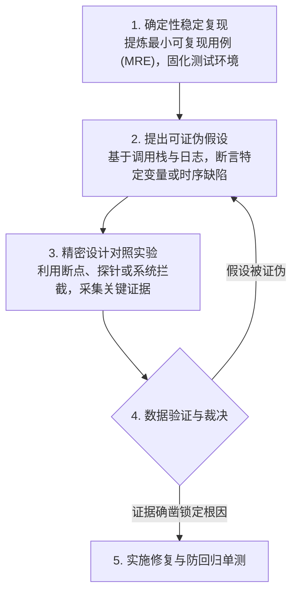
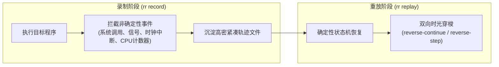
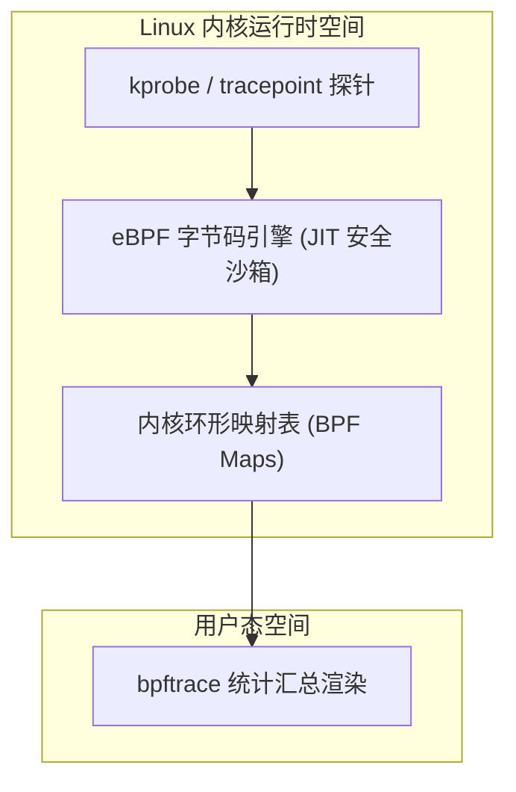
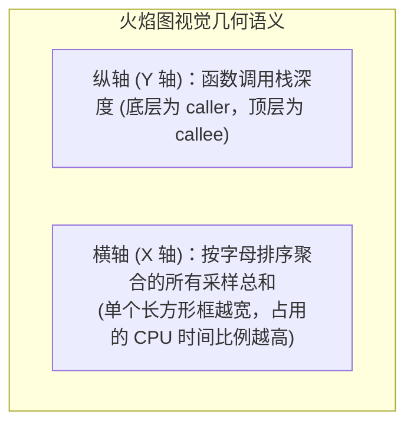

# 04 程序调试、追踪与性能剖析（Debugging and Profiling）

> MIT 6.NULL · 现代软件工程工具链与开发者素养 · 官方讲义核心内容

## TL;DR

- **科学排错四步法**：摒弃随机试错，遵循“最小复现 $\to$ 提出可证伪假设 $\to$ 实验测量 $\to$ 迭代验证”的实证科学循环，系统性排除干扰变量。
- **状态观测与时空可逆**：交互式调试器利用硬件观察点捕获异常写入；可逆调试器（rr）通过捕获非确定性事件实现时间轴倒流（Reverse-step）。
- **内核透视与动态探针**：利用 `strace` 透视系统调用边界，依托 `eBPF / bpftrace` 在生产集群实现零重编译、纳秒级开销的动态可观测性。
- **剖析驱动的科学优化**：基于采样分析器（perf）与 Brendan Gregg 火焰图精准定位 CPU 热点平顶山，配合 `hyperfine` 实施严密的统计学基准测试。

---

## 1. 调试的工程科学方法论

在真实的工业级复杂系统工程中，定位隐蔽缺陷所消耗的心智带宽通常数倍于书写新代码。业余开发者往往倾向于根据直觉随机修改代码（“散弹式编程”），这种试错不仅难以捕获竞态条件（Race Conditions）等非确定性缺陷，更破坏了实验环境的基线一致性。

工程级调试必须严格践行实证科学的研究方法：



调试工具的本质并非解决问题本身，而是作为工程观测仪器的延伸，为上述科学假设提供确凿的物理证据支撑。

---

## 2. 日志治理与交互式调试器进阶

### 结构化日志分级与时序扰动防范

虽然向控制台输出调试信息直观轻便，但传统的裸打印在并发与高性能服务中存在不可忽视的系统副作用：

::: pitfall [海森堡缺陷（Heisenbug）与日志 I/O 陷阱]
系统调用 `write()` 在向标准输出写盘或屏幕刷新时涉及耗时的内核上下文切换与锁竞争。在并发竞争排错中，插入一行打印语句所引入的数毫秒时延足以彻底重组线程调度顺序，使得原本高频发生的死锁或竞态条件瞬间隐匿，形成典型的海森堡缺陷。
:::

现代工程要求引入结构化日志系统，通过严谨定义严重等级（`TRACE`、`DEBUG`、`INFO`、`WARN`、`ERROR`），在生产环境中仅输出关键聚合指标，而在受控预发环境中通过无侵入环境变量（如 `RUST_LOG=debug` 或 `DEBUG=*`）动态调节采集粒度。

### 交互式调试器核心原语

当程序发生段错误（Segmentation Fault）时，GDB、LLDB 或 Python 的 PDB 提供了就地挂起并审查虚拟内存的能力：

- **条件断点（Conditional Breakpoints）**：仅在命中特定异常上下文时中断：
  ```console
  (gdb) break worker_loop if task_queue.size > 1000
  ```
- **硬件观察点（Hardware Watchpoints）**：利用 CPU 架构层级的调试寄存器（如 x86 的 DR0-DR3），在指定内存地址遭遇写入或修改的纳秒瞬间触发硬件中断，是定位“共享变量被未知线程意外篡改”的终极手段：
  ```console
  (gdb) watch state->connection_count
  ```
- **核心转储事后分析（Core Dump Post-mortem）**：当生产进程崩溃退场时，操作系统可将其虚拟地址空间完整转储为 coredump 文件，后续通过调试器复盘崩溃第一现场的完整局部栈帧。

---

## 3. 时空可逆调试：`rr` 确定性重放

传统调试器最大的痛点在于**时间的单向性**。一旦在单步执行时不慎越过故障发生点，或者由于随机调度导致偶发死锁无法复现，开发者只能重新拉起程序碰运气。

Mozilla 开发的 `rr`（Record and Replay Debugging）彻底颠覆了单向执行模型：



::: definition [确定性重放原理（Deterministic Replay）]
现代 CPU 架构的大多数用户态指令执行是完全确定性的；系统运行的不确定性几乎全部源自外部 I/O 输入、异步信号派发、系统调用返回值以及硬件多线程调度的交织。`rr` 通过利用 CPU 性能计数器（Performance Counters）记录退休指令数，并在内核拦截所有非确定性事件。在重放期间，`rr` 模拟这些外部输入的精确到达时机，从而实现对原始执行流百分之百保真的位级复现。
:::

在重放会话中，开发者可以肆意执行逆向调试指令：
- `reverse-continue`（`rc`）：逆向执行，直至命中上一个断点；
- `reverse-step`（`rs`）：代码行级别的时间倒流；
- `reverse-finish`：时光倒流回当前函数被调用的入口点前夕。

---

## 4. 黑盒透视：系统调用追踪与 eBPF 内核动态探测

当排查闭源二进制、三方依赖库或生产服务悬挂等黑盒场景时，无需源码亦可实施深度探测。

### `strace`：系统调用边界探测

用户态应用程序与底层操作系统内核之间的一切交互（文件操作、内存映射、网络套接字传输）均必须经由系统调用（System Calls）完成。通过 `strace`，可清晰洞察进程向系统提出的每一次诉求：

```console
# 追踪所有文件打开系统调用，排查权限与相对路径丢失
$ strace -e trace=openat,open -f ./service_binary

# 统计进程运行期间各类系统调用的调用频次、错误数与耗时占比
$ strace -c ./service_binary
```

虽然 `strace` 功能强大，但其依赖的 `ptrace` 机制每次拦截均涉及多次高开销的上下文切换，导致程序性能剧降数倍，因此绝不可轻易挂载于重载生产集群。

### `eBPF / bpftrace`：零开销内核态动态追踪

为了克服传统用户态追踪工具引入的巨大性能损耗，现代 Linux 内核演进出了 **eBPF（Extended Berkeley Packet Filter）** 这一革命性的可观测性基础设施。它将原本静态的操作系统内核转变为一个完全可编程的高性能运行时平台，允许工程师在无需修改内核源码、无需加载第三方内核模块、更无需重启服务器的前提下，以纳秒级开销向正在运行的生产系统注入观测逻辑。

在架构设计上，eBPF 依靠内核内置的静态验证器（Verifier）确保注入的字节码绝不包含无限循环、非法内存越界或悬空指针，从而杜绝引发内核崩溃（Kernel Panic）的一切风险。随后，内核 JIT 编译器将经过验证的字节码直接编译为宿主机原生机器指令，并挂载于预设的各类探针桩点之上：



eBPF 的探针覆盖范围极广，包括内核静态跟踪点（Tracepoints）、动态内核函数探针（kprobes / kretprobes）以及用户态动态探针（uprobes）。当目标探针被执行触发时，注入的 eBPF 程序直接在内核中断上下文中运行，将统计直方图或事件聚合结果就地沉淀在内核高效的 BPF Maps（哈希表或环形队列）中，只有最终的聚合数据才会被异步拷贝至用户态。这种机制避免了海量原始调用事件在内核态与用户态之间进行频繁无谓的上下文拷贝。

借助专为高级单行追踪设计的 DSL 工具 **`bpftrace`**，工程师能够以类似 awk 的直观语法，秒级捕获复杂的系统调用吞吐与长尾延迟特征：

```console
# 统计全系统中按进程名聚合的读系统调用字节数直方图
$ sudo bpftrace -e 'tracepoint:syscalls:sys_enter_read { @[comm] = hist(args->count); }'
```

这种非侵入式白盒观测能力，彻底打破了传统生产环境中在“性能无损”与“可见性穿透”之间不可兼得的工程妥协。

---

## 5. 内存安全防御：编译器 Sanitizers vs 动态插桩

在系统级语言（C/C++）开发中，非法的内存越界读写是引发安全穿透与非确定性崩溃的首要根源。

### 编译器内置 Sanitizers（ASan / TSan / UBSan）

现代编译工具链（LLVM/Clang 与 GCC）内置了先进的代码注入检查体系，通过在编译期对虚拟内存进行影子映射实现毫秒级检测：

::: definition [AddressSanitizer（ASan）影子内存机制]
ASan 将进程的虚拟内存空间以 8:1 的比例映射至一段连续的**影子内存（Shadow Memory）**，并在堆栈对象的边界周围强制注入特定中毒字节填充的**隔离红区（Redzones）**。每当代码发生指针解引用前，编译器插入的极速位运算指令会自动查询影子内存；一旦探测到指针踏入红区，立即中断进程并输出包含分配栈、释放栈与越界偏移的高精度诊断报告。
:::

- **AddressSanitizer（ASan）**：精确捕获堆栈溢出、释放后使用（Use-After-Free）与重复释放（Double Free）；
- **ThreadSanitizer（TSan）**：检测多线程间未受互斥锁保护的并发数据竞态（Data Races）；
- **UndefinedBehaviorSanitizer（UBSan）**：定位整数溢出、空指针解引用及非法移位运算。

### Valgrind 动态模拟器（Memcheck）

对于无法获取源码或无法重新编译的现成二进制程序，可使用 Valgrind。它通过即时编译（JIT）在用户态构建了一个合成 CPU 模拟环境，追踪每一位寄存器与内存状态的合法性。虽然其会将运行速度拖慢 10 至 50 倍，但对黑盒动态库的内存泄漏定位具有不可替代的兜底价值。

---

## 6. 性能剖析架构与火焰图解读

性能优化必须坚持以严谨的测量数据为准绳。盲目基于直觉的“微优化”往往不仅毫无成效，反而严重破坏代码可维护性。

### 执行时间维度分解

在终端利用 `time` 指令评估程序开销时，必须清晰区分输出的三个物理指标：

```text
real    0m2.415s  -> 墙上时钟时间 (Wall-clock time，人类感受到的总等待时序)
user    0m1.820s  -> 用户态 CPU 耗时 (纯计算逻辑执行时间)
sys     0m0.480s  -> 内核态 CPU 耗时 (内核代为执行系统调用与缺页异常时间)
```

若 `real` 显著大于 `user + sys`，表明程序瓶颈主要受制于外部磁盘 I/O 阻塞、网络等待或线程锁争用；若 `user` 极高并逼近 `real * CPU核心数`，则表明系统处于典型的算力计算受限状态。

### 采样剖析（Sampling）与 Brendan Gregg 火焰图

现代 Linux 性能分析的核心利器是内核级采样工具 **`perf`**：

```console
# 以 99Hz 的质数频率对调用栈执行采样，避免与应用周期性定时器产生共振
$ perf record -F 99 -g -- ./benchmark_target
```

将采集的堆栈轨迹转换为交互式 SVG 火焰图（Flame Graph）：



::: insight [寻找火焰图中的“平顶山”（Plateaus）]
解读火焰图的最高法则是：**忽略狭窄尖耸的高塔，专注于观察最顶层呈现出宽阔水平切面的“平顶山”**。若某一顶层叶子函数的水平跨度占据全图宽度的 50%，意味着半数以上的系统 CPU 资源都在被该函数所独占消耗。将其重构或优化掉，是提升系统吞吐量最具杠杆效应的切入点。
:::

### 现代基准测试严谨度：`hyperfine`

进行优化前后的性能比对时，传统循环计时易受冷启动缺页、CPU 动态调频及磁盘缓存污染影响。现代工程推荐使用专用的 CLI 基准测试工具 **`hyperfine`**，它自动执行预热运行（Warmup）、执行多轮高斯分布采样，并直接给出具有统计学置信度的加速比与误差范围对比。

---

## 我的理解

::: insight [可观测性层级：从黑盒猜测到白盒穿透]
软件工程的发展史，很大程度上是一部“系统内部运行透明化”的演进史。初学者的调试止步于在应用层通过 Printf 盲猜内部状态；而优秀的系统工程师则掌握了一整套由浅入深的跨层观测体系：从用户态指令级断点，下潜至进程与内核边界的系统调用（strace），再深入至内核运行时的安全探针（eBPF），乃至硬件层级的性能计数器与调试寄存器（Watchpoint & perf）。

拥有这套全景观测视野后，原本幽暗诡谲的系统故障（如并发竞态、内存踩踏与偶发毛刺）全部退化为了可被严密观测与度量的物理现象。工程师不再是一个焦虑的修补者，而是手持精密科学仪器的探寻者，通过提出假设与实验检验，确凿地锁定系统的终极真理。
:::
