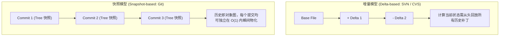
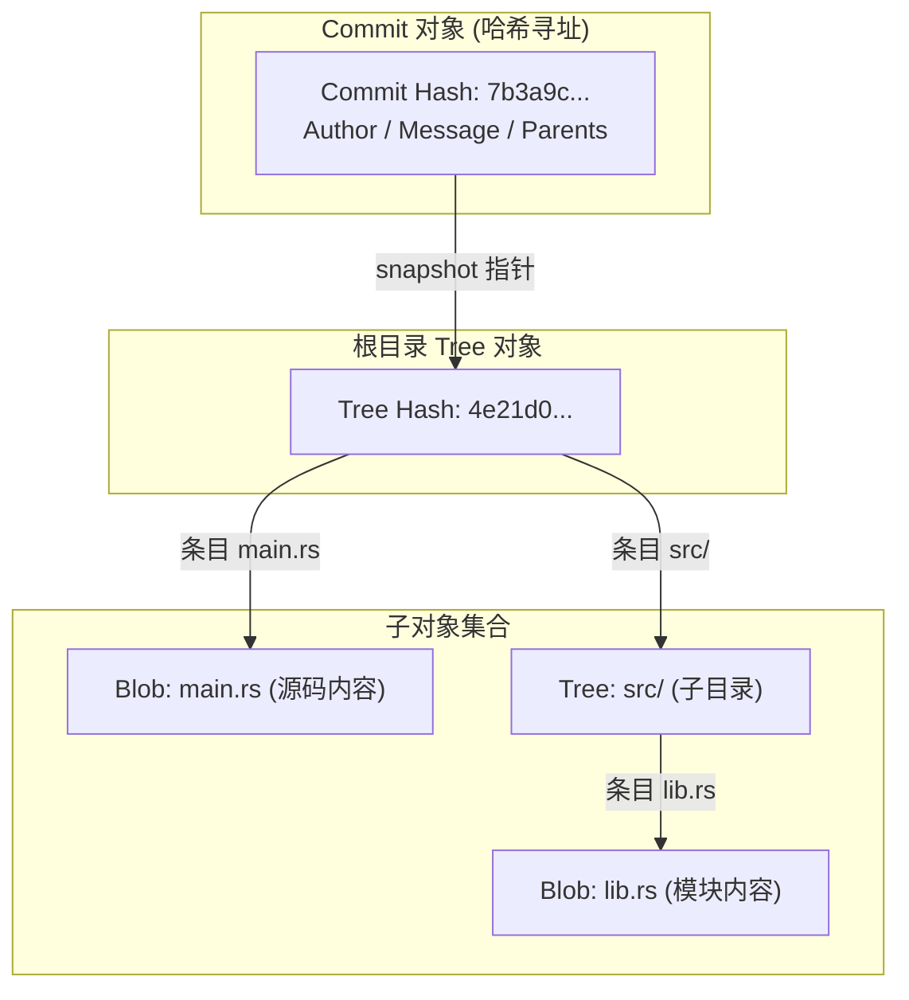
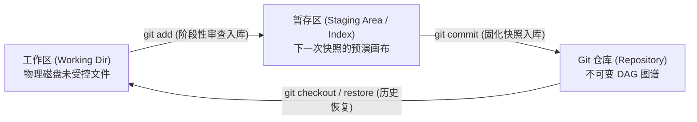
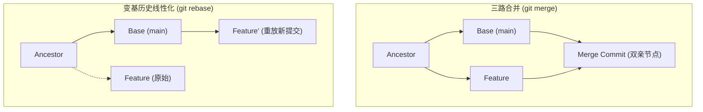

# 05 版本控制：Git 数据模型与高级流（Version Control & Git）

> MIT 6.NULL · 现代软件工程工具链与开发者素养 · 官方讲义核心内容

## TL;DR

- **内容寻址与对象不可变性**：Git 底层是基于强密码学哈希（SHA-1/SHA-256）的内容寻址键值数据库，通过 Blob、Tree、Commit 与 Tag 四大核心对象实现全量快照与高效去重。
- **DAG 历史图谱模型**：提交历史表现为子节点单向溯源指向父节点的有向无环图，分支本质上仅为指向特定 Commit 节点的轻量可变指针。
- **暂存区解耦编辑与快照**：暂存区（Index）充当快照编译的缓冲区，允许开发者通过原子化切分实现职责单一的高内聚提交。
- **历史线性化与灾难恢复**：基于变基（Rebase）规范团队协同流，遵循公共分支不可变法则，依托 `git reflog` 与二分定位（`git bisect`）构建工程容灾底座。

---

## 1. 软件工程视角下的版本控制建模分水岭

在分布式协作的大规模软件工程中，版本控制系统（VCS）是团队协调并发修改、追踪技术债务与保障基线质量的底层操作中枢。早期的集中式系统（如 CVS、Subversion）将版本演进抽象为针对单文件的“差异补丁集（Delta-based Set）”。在这种增量模型下，版本库记录的是基础文件以及随时间推移施加的逐行 diff 补丁。当系统需要检出某个分支在特定时间点的完整代码状态时，必须自初始状态起沿着链条依次重放成千上万个差异补丁，计算开销极其沉重；且分支创建往往意味着在服务器端执行昂贵的文件树深拷贝，导致团队对特性分支的使用心存顾虑。

为了彻底解除这一计算瓶颈，Linus Torvalds 在设计 Git 时摒弃了基于文件差异打补丁的传统思维，引入了基于系统全局状态的快照哲学：



在 Git 的快照架构中，每一次提交都代表了当前工程在某一物理时刻的顶层目录树全量快照。对于未发生变动的文件，Git 仅仅保存指向既有数据实体的紧凑指针，从而在保证逻辑全量快照的同时，实现了极致的物理存储压缩。这种快照体系彻底解耦了文件修改历史与物理存储结构，使得分支切换、历史比对与冲突合并在底层退化为极致轻量的图节点寻址运算，分支的创建与销毁仅耗时数毫秒，彻底重塑了敏捷软件开发的协作范式。

---

## 2. 形式化数据模型与四大核心对象

如果将 Git 视作一个形式化的状态机，其底层结构可以通过一组正交的类型系统完整表达。这套类型系统仅由四个基本对象构建而成，却优雅地支撑起了整套复杂的版本控制逻辑：

```typescript
// 1. 数据块 (Blob)：存储纯文件二进制载荷（解耦文件名与元数据）
type blob = array<byte>

// 2. 目录树 (Tree)：维护目录层级，将文件条目映射为子树或具体 Blob
type tree = map<string, tree | blob>

// 3. 提交 (Commit)：声明提交元数据、父节点引用列表与根目录树快照
type commit = struct {
    parents: array<commit>
    author: string
    committer: string
    message: string
    snapshot: tree
}

// 4. 存储层：以哈希值为唯一主键的内容寻址对象数据库
type object = blob | tree | commit
type object_database = map<hash, object>
```

在这套优雅的数据契约中，各个核心实体的职责边界极其清晰且高度正交：
- **数据块（Blob）**：Blob 仅纯粹封装文件的原始字节流数据。令人惊讶的是，Blob 对象自身甚至不包含文件名、目录路径、修改时间或 POSIX 执行权限（`chmod +x`）。这种极致的纯粹性保证了即使文件在项目中被随意重命名或跨目录移动，只要文件内容未变，其计算出的哈希键值恒定不变，无需重复分配存储。
- **目录树（Tree）**：Tree 对象等价于文件系统中的目录。它以结构化的数组列表记录了当前层级下的每一个条目：条目的 POSIX 访问模式（如 `100644` 常规文件、`100755` 可执行脚本、`040000` 子目录）、条目的字符名称，以及指向对应子 Tree 或 Blob 的 40 位哈希指针。通过递归嵌套的 Tree 结构，Git 能够以纯数据形式无损还原出任意复杂的深层目录拓扑。
- **提交对象（Commit）**：Commit 是快照图谱的顶层实体。它持有指向根目录 Tree 对象的哈希指针，声明了本次提交的作者身份（Author）、提交者身份（Committer）、提交说明以及至关重要的父提交哈希列表（Parents）。单亲节点代表常规线性演进，而多亲节点则直接构成了分支合并的拓扑交汇。



这套数据结构构成了自底向上的密码学生成树：文件的二进制数据被散列为底层的叶子节点（Blobs），中间层目录结构被散列为中间路由节点（Trees），而顶层的提交记录（Commit）则充当带有时序与作者元数据的根节点。在任何一次变更中，未修改的文件及其父子 Tree 对象完全共享相同的物理存储与哈希键值，唯独发生改动的文件及其所有上级祖先目录会沿着路径向上被重新计算并物化出全新的哈希节点。这种结构即为计算机科学中著名的持久化数据结构（Persistent Data Structure），它保证了每次提交不仅在概念上是一次全量快照，而且在存储时间与空间复杂度上与实际改动的差异大小严格成正比。

::: definition [内容寻址（Content-Addressable Storage）与默克尔树]
Git 中的任何对象均由其序列化载荷的哈希值（如 SHA-1 生成的 40 位十六进制摘要）作为唯一定位标识。这种架构带来了三大数学保证：
1. **天然幂等去重**：若多个文件内容完全一致，无论其路径分布于工程何处，在物理数据库中仅存储唯一一份 Blob 实体；
2. **密码学完整性**：Commit 对象的哈希递归囊括了根 Tree 以及全量祖先节点的哈希签名，构成了一条抗篡改的默克尔树（Merkle Tree），任何历史位翻转都会导致顶层哈希雪崩；
3. **只读不可变性**：对象一旦写入 `.git/objects/`，其二进制内容便永久不可更改。
:::

---

## 3. 引用系统：分支、标签与游离态（HEAD）

哈希值是机器友好的索引，而人类开发者需要可读的语义符号来追踪开发前沿。**引用（References / Refs）** 充当了连接语义空间与哈希空间的桥梁。

### 分支与标签的物理本质

在物理文件系统上，所有引用均紧凑持久化在 `.git/refs/` 目录下，其内部仅仅保存了一行 40 位的目标提交哈希值：

- **分支（Branches）**：属于 **动态移动的游标**。当开发者在某一分支上提交代码时，Git 会自动将该分支文件的哈希值更新为最新的 Commit，其计算开销仅相当于一次指针改写。
- **标签（Tags）**：属于 **不可变的锚点**。标签固定指向某一特定的历史里程碑提交，不随后续演进而产生偏移。

### `HEAD` 与游离分支状态（Detached HEAD）

`HEAD` 是当前工作环境所处位置的唯一事实依据。通常情况下，`HEAD` 是一个符号引用（Symbolic Reference），指向当前活跃的分支文件（例如 `ref: refs/heads/main`）。

::: pitfall [游离分支状态的隐蔽丢失陷阱]
当开发者通过具体的 Commit 哈希执行检出时（`git checkout <commit-id>`），`HEAD` 将直接绑定至裸哈希值，脱离任何具体分支。此时若在此状态下继续执行提交，新提交虽然正常写入对象库，但没有任何分支指针维系它。一旦切换回其他主干分支，这些孤立的 Commit 节点将从 `git log` 中消失，并在未来遭遇垃圾回收（GC）清理。
:::

---

## 4. 暂存区（Index）的工程中枢价值

很多从简易工具入门的开发者难以理解暂存区（Staging Area）的存在意义。暂存区是位于工作区（Working Directory）与 Git 历史存储库（Repository）之间的一道受控安全阀。



暂存区的核心工程价值在于 **解耦“开发过程中的连续修改”与“提交历史中的原子封装”**：
- 允许开发者在同一个工作区内同时演进多个特性，通过 `git add -p`（交互式补丁暂存）仅将特定函数或行号的修改送入暂存区；
- 确保推送到版本库的每一个 Commit 都是职责单一、能独立通过自动化测试的高内聚原子快照，为日后的故障回滚与代码审查奠定基石。

---

## 5. 分支汇合演进：三路合并 vs 线性变基

当特性开发完成需要融入主干时，团队必须在“忠实时序记录”与“可维护线性图谱”之间做出架构选型：



### 三路合并（Three-way Merge）

`git merge` 通过计算两个分支端点及其最近公共祖先（LCA）的状态差异实施三路合并：
- **优点**：真实保留分支并行开发的历史拓扑图，提交哈希保持原始不可变性；
- **缺点**：频繁引入无实质语义的 Merge 节点，导致历史图谱在大型工程中严重退化为蛛网状。

### 变基操作（Rebase）

`git rebase` 将当前分支上相对于主干的增量提交序列提取为独立临时补丁，并依次作为新提交无缝移植在目标主干的最顶端：
- **优点**：消除分支岔路，输出绝对平直的线性提交流，大幅降低代码追溯与排错成本；
- **缺点**：重放过程中所有提交被重新计算哈希值，本质上重写了历史。

::: pitfall [变基的绝对红线：公共分支不可变法则]
**严禁对已经推送到公共共享远程仓库（如 `origin/main`）的提交执行 Rebase！**
若对公共提交执行变基，将导致远程哈希与本地重写哈希发生分裂。当团队其他成员尝试拉取代码时，Git 会被迫尝试合并同一逻辑但在物理上哈希相异的两套历史，引发灾难性的大面积冲突。变基仅限于整理自己本地未推向公共视线的私有特性分支。
:::

---

## 6. 高级排错与容灾恢复体系

### 交互式变基（Interactive Rebase）精细化整理

在正式发起代码审查（PR / MR）前，专业工程师会通过 `git rebase -i` 对散乱的草稿提交执行精细化重构：
- `squash`（`s`）：将琐碎的修补提交折叠合并至上一逻辑单元；
- `reword`（`r`）：修正不符合规范的提交说明信息；
- `drop`（`d`）：安全剔除在实验过程中废弃的试错节点。

### 二分自动化溯源：`git bisect`

当系统中出现罕见的性能衰退或隐式回归缺陷时，面对跨越数百次提交的历史区间，`git bisect` 依托二分搜索算法在 $O(\log N)$ 时间复杂度内精准定位元凶：

```console
# 1. 启动二分查找模式
$ git bisect start

# 2. 标记当前最新状态存在异常
$ git bisect bad

# 3. 标记两周前的已知健康基线版本
$ git bisect good v2.1.0

# 4. 自动化驱动：传入测试脚本自动执行全量判定
$ git bisect run npm test
```

Git 会自动检出中点版本并运行判定脚本，在数秒内输出首次引入缺陷的特定提交与作者信息。

### 终极安全网：`git reflog`

Git 拥有严密的引用变迁日志体系。即便是因为手误执行了高危的 `git reset --hard` 丢弃了代码，只要该状态曾被写入过 Commit 树，其哈希值便始终被本地的引用行车记录仪所捕获：

```console
# 查看 HEAD 指针的所有历史位移轨迹
$ git reflog

# 一键穿梭回误操作发生前的历史瞬间
$ git reset --hard HEAD@{1}
```

---

## 我的理解

::: insight [数学模型对抗复杂性的工程典范]
Git 之所以能统治现代软件工程的版本控制长达二十年，根本原因不在于其顶层的命令行语法，而在于其底层数学模型的纯粹与完备。Linus Torvalds 将复杂的团队协同抽象为了一个不可变的内容寻址哈希树，将纷繁的历史分支抽象为了一个拓扑有向无环图。

在这一底层契约之上，无论顶层的开发流程是 Git-Flow、Trunk-Based 还是单体大仓（Monorepo），底层的图运算与哈希寻址均能保持确定性（Deterministic）的数学优美。理解了 DAG 与对象数据库，工程师就拥有了看透表象的“透视眼”——那些曾令人战战兢兢的冲突合并与变基失败，瞬间具象化为清晰的指针图谱重塑，赋予了开发者在代码时空中从容穿梭的绝对自信。
:::
