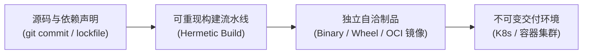
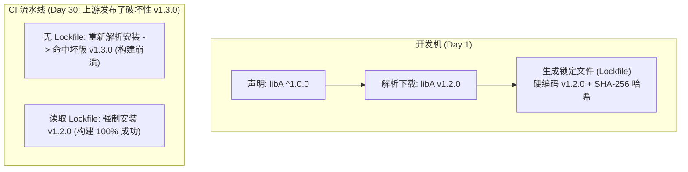
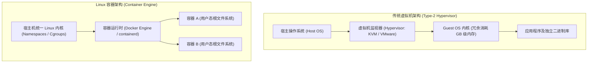

# 06 代码打包、容器隔离与制品分发（Packaging and Shipping Code）

> MIT 6.NULL · 现代软件工程工具链与开发者素养 · 官方讲义核心内容

## TL;DR

- **依赖抽象与锁定双轨制**：声明式依赖定义宽泛兼容范围（SemVer 2.0.0），锁定文件（Lockfile）固化全量依赖的精确版本与哈希指纹，捍卫可重现构建。
- **虚拟环境的路径本质**：语言级虚拟环境不具备虚拟化开销，其底层机理在于对进程 `$PATH` 变量的局部重写与标准包寻址目录重定向。
- **轻量进程隔离与容器三基石**：Linux 容器通过 Namespaces 隔离资源视图、通过 Cgroups 施加物理资源限额、结合 OverlayFS 分层写时复制实现镜像轻量化。
- **精细化制品交付工程**：多阶段构建（Multi-stage Builds）剔除构建期编译器冗余，依托 Docker Compose 声明式拓扑实现复杂微服务栈的一键拉起。

---

## 1. 软件交付全景：从“本地跑通”到“可重现制品”

在现代工业软件开发中，编写出在本地 IDE 中能够编译运行的源码，仅仅完成了交付工程的前 20%。当软件脱离特定开发机的保护，向异构测试集群、云原生多租户平台乃至最终用户的物理设备分发时，环境漂移、动态库版本缺失与依赖冲突将瞬间暴露无遗。

现代交付工程的核心目标，是将抽象的源码状态及其严苛的运行时物理依赖，编译固化为具备高确定性（Deterministic）的独立软件制品（Artifacts）：



这一演进历程要求工程师打破对宿主系统的天然信任，将运行环境本身也视作必须被严密约束与测试的一等代码。

---

## 2. 依赖管理治理与语义化版本（SemVer）

工程依赖由内向外划分为两个层级：受语言包管理器管辖的应用级代码依赖（如 Python 的 Wheel、Node 的 npm 模块），以及受宿主操作系统底座管辖的系统级动态链接库（如 `glibc`、`OpenSSL`、`libcuda`）。

### 语义化版本契约（Semantic Versioning 2.0.0）

为了在生态演进中平衡“新功能快速迭代”与“破坏性变更防护”，工业界建立了标准的版本号语义规范：

```text
MAJOR.MINOR.PATCH (例如 2.4.1)
```

::: definition [SemVer 语义界定]
- **主版本号（MAJOR）**：当引入了不向下兼容的 API 破坏性变更（Breaking Changes）时必须递增；
- **次版本号（MINOR）**：当以向下兼容的方式引入新特性或弃用标记时递增；
- **修订号（PATCH）**：当以向下兼容的方式修复缺陷时递增；
- **先行版本号（Pre-1.0.0）**：在 `0.y.z` 阶段，公共 API 被视作未定型状态，任何小版本递增均可能伴随破坏性重构。
:::

### 声明式依赖 vs 锁定文件（Lockfiles）

在项目根目录的配置清单中（如 `package.json` 或 `pyproject.toml`），开发者声明的是**意图级别（Intent-level）的抽象版本约束**（例如 `requests >= 2.28.0, < 3.0.0`）。

然而，这种抽象约束无法保证工程的可重现性（Reproducibility）。中间传递依赖的无感知升级极易引发“同一代码库在昨天构建通过而在今天拉取时崩溃”的非确定性事故。



::: pitfall [脱离锁定文件的生产环境部署风险]
在持续集成与容器打包时，严禁使用会触发动态依赖解析的松散命令（如裸 `pip install .` 或 `npm install`）。必须使用严格消费锁定文件的确定性安装指令（如 `npm ci` 或 `poetry install --frozen`），并在构建开始前由包管理器校验每一个下载压缩包的密码学哈希值。
:::

---

## 3. 语言级虚拟环境的底层本质

在单台开发机上并行维护多个使用不同库版本的项目时，全局共享包目录（如系统的 `/usr/local/lib/python3.x/dist-packages`）会迅速引发菱形依赖死锁。

Python 的 `venv` 提供了极具智慧的轻量隔离范例：

```console
# 创建包含独立可执行桩与包目录的虚拟环境
$ python3 -m venv .venv

# 激活环境
$ source .venv/bin/activate
```

很多工程师误以为虚拟环境启动了某种容器沙箱，其物理实现实则极为朴素：
1. **环境变量篡改**：`activate` 脚本唯一的实质操作，是将当前工程目录下的 `.venv/bin` 绝对路径压入当前 Shell 的 `$PATH` 变量最左侧；
2. **符号寻址绑定**：当在终端执行 `python` 时，系统优先定位到 `.venv/bin/python`。该二进制通常是一个指向系统 Python 的符号链接，它在初始化时根据其所在物理路径，自动将 `sys.path` 的模块搜索根目录绑定至 `.venv/lib/pythonX.Y/site-packages`。

通过两行环境变量重定向，以近乎零的系统性能损耗换取了多项目间的完全解耦。

---

## 4. 容器化隔离（Docker）与 Linux 内核基石

当依赖复杂度超越单一语言运行时，演化为需要绑定特定的底层系统 C 库版本、守护进程及复杂的外部中间件时，语言级虚拟环境便宣告失效。

### 虚拟机（VM）与容器（Container）的架构分野

为了实现彻底的环境隔离，历史上存在两条截然不同的工程路线：传统硬件虚拟化与现代操作系统级虚拟化。

传统虚拟机（如基于 VirtualBox、VMware 或 KVM 的架构）依赖虚拟机监视器（Hypervisor）。Hypervisor 在物理机硬件之上模拟出一整套虚拟 CPU、虚拟内存总线与虚拟磁盘控制器，并在其上引导安装一个包含完整内核的客体操作系统（Guest OS）。这种方式提供了极高的硬件强隔离安全级别，但其代价是极其沉重的计算与空间冗余：即便只运行一个 10MB 的极简微服务，也必须为 Guest OS 分配至少 1GB 以上的常驻内存，其冷启动耗时通常长达数分钟，且所有 I/O 操作均必须穿越复杂的虚拟驱动仿真层。

与此形成鲜明对比的是，Linux 容器（Container）彻底抛弃了硬件模拟的包袱。容器在本质上仅仅是宿主机操作系统内核通过特定隔离策略直接调度运行的一个受限进程组。所有容器共享宿主机同一套 Linux 内核，没有第二套内核在内存中空转：



这种架构消除了 Hypervisor 转换层的全部损耗，使得容器进程的 CPU 计算指令与内存读写完全具备原生裸机性能，其启动时序被急剧压缩为调用一次 `clone()` 系统调用的毫秒级瞬间，从而奠定了现代弹性微服务架构与 Serverless 计算的物理基础。

### 支撑容器的三大内核支撑技术

::: definition [容器三大 Linux 内核原语]
1. **命名空间（Namespaces / 视图隔离）**：为进程组构建独立的全局系统资源视图。
   - `PID Namespace`：隔离进程树，容器内部的主进程在视野内呈现为系统的 PID 1；
   - `Mount Namespace`：提供独立的文件系统挂载根目录（`chroot` 的现代化进阶）；
   - `Network Namespace`：赋予容器独立的虚拟网络设备（veth pair）、路由表与私有 IP；
   - `User Namespace`：实现容器内 root 权限与宿主普通无特权 UID 之间的安全映射。
2. **控制组（Cgroups / 资源限额）**：硬性限制进程组对物理硬件资源的消耗上限，支持为 CPU 周期（shares/quota）、物理内存容量、磁盘块设备 I/O 带宽设定配额，并在内存超限时触发确定性的 OOM Killer。
3. **联合文件系统（OverlayFS / 分层写时复制）**：通过将只读的下层镜像层（Lowerdir）与薄易失的可写层（Upperdir）进行联合挂载（Merged），实现镜像在多个容器实例间的高密度物理复用与秒级实例化。
:::

---

## 5. 高性能交付实践：多阶段构建与编排

在工业级生产镜像制作中，构建产物的体积与安全性直接决定了集群的分发效率与防御水位。初学者常犯的典型错误是将全套编译器、静态库头文件及开发调试工具（如 `gcc`、`git`、`gdb`、`curl`）一并打包进入最终的生产交付镜像。这种反模式不仅导致单一微服务镜像动辄膨胀至 1GB 以上，极度浪费网络传输带宽与集群拉取存储，更致命的是为攻击者在生产容器内部执行代码注入与提权利用提供了现成的逆向工具包。

### 多阶段构建（Multi-stage Builds）的物理精简

现代容器交付标准要求严格推行 **多阶段构建（Multi-stage Builds）**。通过在单一 Dockerfile 中声明多个离散的构建阶段，彻底物理切割“构建编译沙箱”与“线上生产运行态”。编译器的全部依赖仅留存在一次性的临时构建层中，最终镜像仅按需抽取剥离了符号表的独立静态可执行二进制：

```dockerfile
# 阶段一：重型编译阶段 (构建沙箱，承载全套编译器与源码)
FROM golang:1.22-alpine AS builder
WORKDIR /workspace
COPY go.mod go.sum ./
RUN go mod download
COPY . .
# 禁用 CGO 并剥离调试符号与DWARF信息，输出纯静态独立可执行文件
RUN CGO_ENABLED=0 GOOS=linux go build -ldflags="-w -s" -o app .

# 阶段二：生产极简分发态 (仅保留纯二进制，剥离一切构建残留)
FROM alpine:3.19
WORKDIR /app
# 仅从前置 builder 阶段按需抽取编译产物，不携带任何源码
COPY --from=builder /workspace/app .
EXPOSE 8080
# 彻底废除 root 权限，强制以无特权系统用户执行
USER 10001
ENTRYPOINT ["./app"]
```

在上述构建定义中，指令的编排顺序严格遵循了 Docker 镜像缓存层的失效与复用规律。通过先复制声明依赖清单的 `go.mod` 与 `go.sum`，并单独执行 `RUN go mod download`，能够确保当且仅当第三方依赖发生变动时才重新从远程拉取依赖包；当开发者仅微调业务源码时，前置依赖缓存层将被完整命中，使得重新构建编译仅需耗时数秒。

在最终交付阶段，借助 `COPY --from=builder` 操作符，生产镜像彻底抛弃了重达数百兆字节的编译工具链、中间缓存与源码文件，仅保留最小化的静态二进制执行实体。最终分发的容器镜像体积可由初始的 1.2GB 急剧收敛至 12MB，镜像拉取耗时从数十秒骤降至数百毫秒，同时消解了上百个基础系统库 CVE 漏洞。此外，声明 `USER 10001` 显式剥夺了容器内进程的 root 管理员权限，进一步强化了最小权限原则，即使应用程序出现远程代码执行漏洞，攻击者也难以实施容器逃逸攻击。

### 本地微服务拓扑编排：Docker Compose

对于依赖数据库、缓存队列等多组件协同的现代全栈系统，手动串联复杂的 `docker run --network` 命令并硬编码容器 IP 极其脆弱且不可维护。Docker Compose 提供了基于声明式配置编排多容器生命周期的标准规范。

通过在 `docker-compose.yml` 中声明服务拓扑，Compose 会自动在内核中为当前项目建立专用的用户自定义桥接网络（User-defined Bridge Network）。在该网络内部，Compose 激活了内置的嵌入式 DNS 服务发现机制，使得前端服务无需感知数据库的具体 IP 地址，仅需直接通过服务名称（如 `http://db:5432`）即可实现可靠的跨容器通信；同时，通过持久化卷（Volumes）将有状态的数据目录锚定在宿主磁盘，确保容器即使因故障崩溃重启，业务核心数据依然毫发无损：

```yaml
version: "3.8"
services:
  web:
    build: .
    ports:
      - "8080:8080"
    environment:
      - DB_HOST=db
    depends_on:
      - db
  db:
    image: postgres:16-alpine
    environment:
      POSTGRES_PASSWORD: secretpassword
    volumes:
      - pgdata:/var/lib/postgresql/data
volumes:
  pgdata:
```

---

## 我的理解

::: insight [交付边界的收敛：从物理机、虚拟机到不可变容器镜像]
回顾软件交付模式的演进轨迹，本质上是一场“交付契约边界不断收敛与外延”的工程革命。在物理机时代，交付契约是写在纸上的长篇操作手册，极其依赖运维人员的个人经验；在虚拟机时代，契约膨胀为了包含操作系统内核在内的数十 GB 沉重镜像文件，虽然解决了可复现性，但换来了沉重的计算冗余。

现代容器体系的伟大之处，在于精准地在“Linux 统一内核接口”这一极为稳定的层面上划出了一条分水岭：内核之上的一切（用户态根文件系统、依赖动态库、可执行制品、启动配置）被封装为不可变、带内容哈希的 OCI 镜像层；内核之下的一切则依托 Namespaces 与 Cgroups 完全复用宿主物理硬件。理解这一收敛模型，不仅能让我们游刃有余地构建精炼稳健的 CI/CD 流水线，更是通向 Kubernetes 与云原生分布式系统架构的认知入场券。
:::
