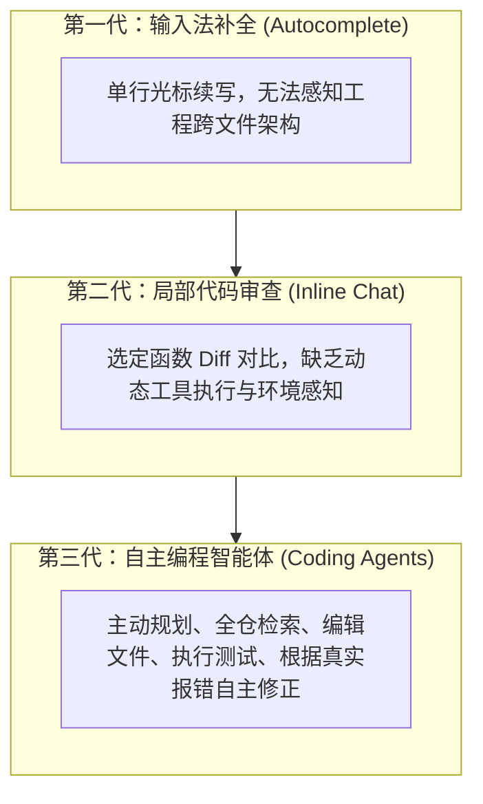
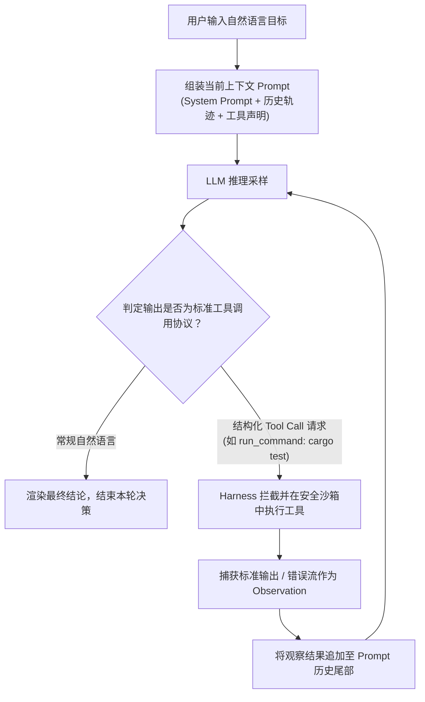
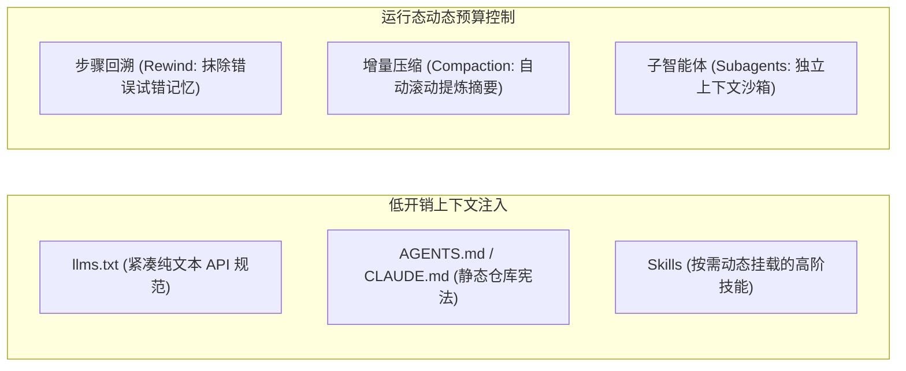

# 07 智能体编程范式（Agentic Coding）

> MIT 6.NULL · 现代软件工程工具链与开发者素养 · 官方讲义核心内容

## TL;DR

- **自回归采样与工具增强循环**：编程智能体通过 200 行工具调度架构（Harness）将 LLM 的下一个 Token 概率生成与本地沙箱执行绑定，构建状态感知的自主闭环。
- **稀缺物理资产与上下文治理**：依托步骤回溯（Rewind）、动态摘要压缩（Compaction）、`llms.txt` 标准与按需技能（Skills），最大化利用有限注意力窗口。
- **解耦协作与多智能体拓扑**：基于模型上下文协议（MCP）打破外部工具接入壁垒，配合 Git Worktrees 与隔离子智能体（Subagents）实现高并发任务解耦。
- **批判性工程审查底线**：警惕调试螺旋陷阱与代码验证不对称性，始终坚持测试驱动（TDD）与第一性原理审查，守住系统的健壮性防线。

---

## 1. 软件工程的范式转移：从代码生成到自主智能体

自 2021 年起，以 GitHub Copilot 为代表的辅助工具标志着基于大语言模型（LLM）的“第一代”与“第二代”辅助编码形态的普及。这些系统主要聚焦于光标位置的行内自回归续写（Autocomplete）或受限代码块的行内对话重构（Inline Chat）。

在 2026 年的现代软件工程实践中，开发范式迎来了质的跃迁——**智能体编程（Agentic Coding）**。

编程智能体被赋予了主动感知运行态与操纵外部计算环境的实体工具（Tools）。它不再只是被动的文本生成器，而是一个能够穿梭于终端编译器、测试套件与代码树之间，自主推进长程工程任务的系统级协作者。

---

## 2. 智能体物理基础：概率采样与 200 行调度器

理解智能体的工程边界，必须摒弃对其拟人化的迷信，回归计算科学的本质底层。

### 条件概率采样模型

现代大语言模型（LLM）在数学上本质是一个基于海量语料训练的高维统计概率生成器。在给定前置提示词上下文序列 $x$ 的条件下，模型预测后续补全词元 $y$ 的自回归概率分布：

$$\hat{y} \sim \pi_\theta(\cdot \mid x)$$

每一个生成的 Token 均是在此概率空间中的随机采样。由于模型本身受到物理内存与显存算力的刚性约束，其能够同时摄入与生成的 Token 总量受到固定大小的 **上下文窗口（Context Window）** 的严格限制。

### 极简 Agent Harness 核心循环

驱动智能体执行复杂工程操作的运行时宿主（Agent Harness），其核心调度状态机极其简洁，在概念上仅需约 200 行代码即可形式化表达：

在工程实现中，Harness 首先通过标准协议（如 OpenAI Function Calling 规范或 Anthropic Tool-use 格式）将本地可用的工具集（如读写文件、Shell 执行、网页检索）序列化为严格的 JSON Schema，并作为系统提示词的前置约束注入上下文。当大语言模型在多轮推理中判定需要获取额外物理信息或执行副作用变更时，它不会直接生成面向人类的自然语言回答，而是生成一段结构化的函数调用负载，包含目标工具标识与精准的输入实参。

Harness 负责拦截该请求，并担当至关重要的安全防御边界。在默认模式下，任何具备高风险破坏性的操作（如覆盖未暂存源码、在生产数据库执行迁移、向外部公网发送凭据）均会被 Harness 的用户确认网关（Confirmation Gates）挂起，由人类工程师审阅无误后方可下发执行。工具在受控子进程或隔离容器中执行完毕后，操作系统返回的标准输出（stdout）、错误流（stderr）以及进程退出状态码，被包装为标准的 Observation 消息节点，无缝追加至上下文数组的最末端。

这一架构的精髓在于 **将物理现实世界的执行反馈作为确定性条件变量，重新闭环注入自回归生成链**。当模型由于逻辑笔误导致单元测试崩溃时，真实的崩溃调用栈被 Harness 捕获并回填，迫使模型在下一轮推理采样中计算出调用编辑工具修正代码的高置信度决策。这种基于环境反馈循环驱动的状态转移，构成了现代软件工程中从“静态代码补全”跃迁至“自主排错修复”的全部机理。

---

## 3. 人机协同架构：工程经理与实习生心智模型

在工业级团队中，与智能体协同的最佳认知范式是将其视作一名 **“技术广博、手速极快、不知疲倦，但缺乏全局架构定力且极易过度工程化的初级实习生”**。

### 验收驱动与测试前置（TDD）

智能体的高效落地极度依赖于清晰、确定且可自动判定的验收契约：

::: definition [智能体驱动的 TDD 闭环]
1. **契约制定**：工程师依据领域模型，率先编写出严苛断言的边界测试用例（Failing Tests），或由工程师主导审查智能体生成的测试套件；
2. **规则锚定**：明确向智能体限定操作边界：“在保持 `tests/` 目录绝对不可变的前提下，重构 `src/` 内部实现，直至 `pytest` 全绿通过”；
3. **自主收敛**：智能体在受控沙箱中利用红绿灯反馈自主试错，彻底解放工程师编写样板代码的繁琐心智。
:::

---

## 4. 上下文窗口的精细化物理治理

上下文窗口是智能体执行长程任务中最昂贵、最易衰退的物理资源。随着多轮交互与海量文件读取，上下文膨胀不仅导致 API 延迟与调用费用线性暴增，更会诱发大模型深层注意力的“大海捞针（Needle-in-a-Haystack）”衰减效应。

现代智能体体系衍生出了严密的层次化上下文治理手段：

### 1. 结构化规范与按需挂载

- **`/llms.txt` 协议**：开源生态逐渐普及的标准化端点，为 LLM 提供剥离了一切 HTML/CSS 装饰的高信息密度 Markdown API 全景摘要；
- **`AGENTS.md` 规则约束**：持久化于仓库根目录的架构指南，在冷启动时显式注入代码风格、静态门禁指令与严禁触碰的边界禁区；
- **按需技能（Skills）**：克服静态规则对常驻上下文的挤占，智能体平时仅维系极薄的技能元数据索引，当且仅当识别到特定任务时，才动态将复杂执行流程载入内存。

### 2. 层次化任务解耦：子智能体（Subagents）与模型上下文协议（MCP）

- **子智能体（Subagents）架构**：主智能体负责顶层架构拆解，将广域文件检索或第三方文档调研委派给子智能体。子智能体在其私有的独立沙箱中翻阅数百个文件，最终仅向主干返回高度凝练的结论摘要，捍卫了主会话上下文的纯净度；
- **模型上下文协议（Model Context Protocol, MCP）**：由开源社区与前沿实验室联合制定的标准化通信协议。通过将外部数据源（如 GitHub、Notion、Postgres）标准化为具备独立权限隔离的 MCP Server，智能体能够以即插即用的方式获取外部世界的统一感知与调用能力。

---

## 5. 风险防线：智能体时代的批判性工程审查

AI 智能体极大放大了生产力，但也前所未有地放大了潜在技术债务的积累速度。

::: pitfall [调试螺旋（Debugging Spirals）与认知陷阱]
当智能体遭遇深层系统架构冲突或环境异常时，往往倾向于在局部打补丁。方案 A 失败引发新异常，便追加方案 B；经过多轮盲目修补，原有简洁的模块结构被支离破碎的样板代码所吞噬。更危险的是模型表现出的“谄媚性（Gaslighting）”——顺着人类的误导性提示给出看似合理实则荒谬的伪论证。
**工程应对红线**：一旦观察到两轮以上的连续局部修补失败，立即果断按下中断键，利用 `git reset --hard` 回滚至干净基线，回归第一性原理人工切断恶性循环。
:::

### 验证不对称性（Verification Asymmetry）

在软件工程中，**阅读、理解并严密验证一段生成代码的正确性，往往远比人工手写这段代码困难得多**。

生成的代码往往具备完美的排版与流畅的变量命名，极易麻痹开发者的警惕性，而在隐蔽的并发锁粒度、分布式事务边界以及极端网络时延容错等深水区留下隐患。

坚实的计算机科学基本功——算法时间复杂度分析、操作系统内存与调度机理、网络传输协议以及严苛的自动化测试套件，永远是抵御自动化缺陷渗透的终极防线。

---

## 我的理解

::: insight [从搬砖工匠到系统编排者的角色跃迁]
智能体编程的兴起，标志着软件工程师的核心职责正在经历半个世纪以来最深远的重构。过去的程序员花费大量心智与精力在记忆语法细节、调试环境配置与机械地编写胶水代码上；而在智能体时代，代码生成的边际成本已经趋近于零。

但这绝不意味着基础工程素养的贬值。相反，软件工程师的角色正加速向“系统架构师与苛刻审查官”演进：你必须具备极高维度的系统建模能力，才能向智能体给出准确无误的架构分解；你必须具备敏锐的白盒洞察力，才能在瞬间识破 AI 幻觉生成的脆弱逻辑。在这个人机共生的新时代，工具链与底层理论不再是束缚手脚的教条，而是每一位工程师指挥由无数智能体构成的算力军团时，手中最锋利的权杖。
:::
