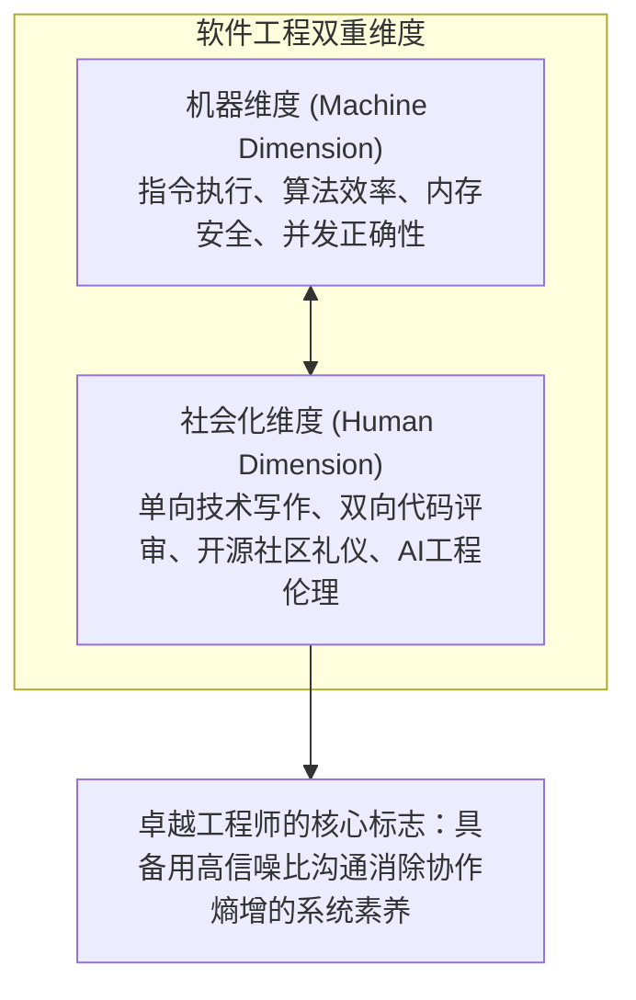
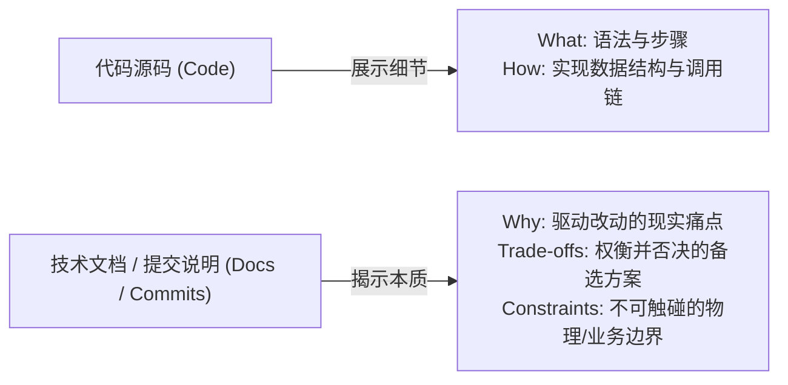
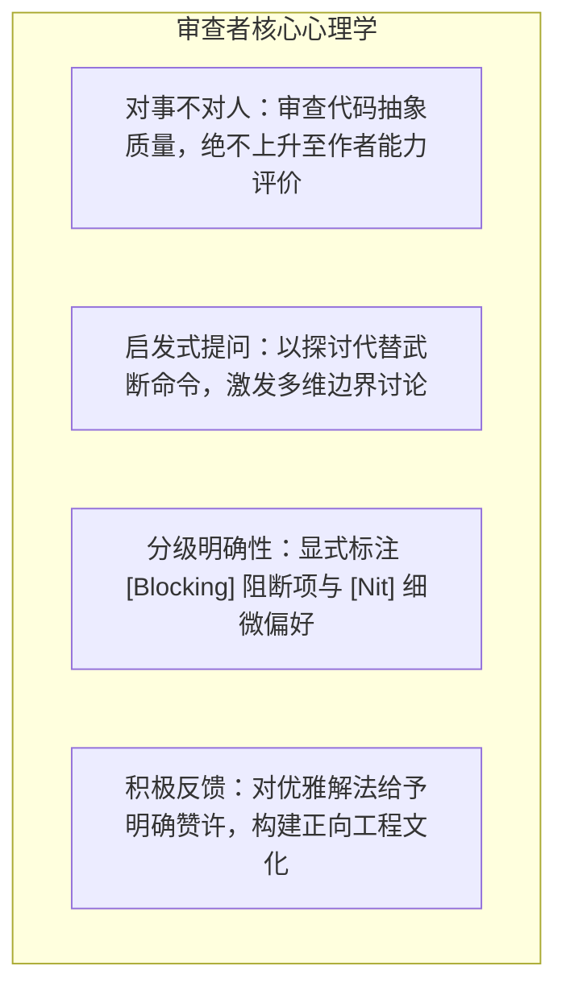

# 08 超越代码：协作沟通与开源礼仪（Beyond the Code）

> MIT 6.NULL · 现代软件工程工具链与开发者素养 · 官方讲义核心内容

## TL;DR

- **单向技术写作捕获核心动机**：代码呈现“做什么”与“怎么做”，技术写作的核心在于捕捉不可逆的决策动机（Why），防范知识随人员流动隐性流失。
- **高信噪比开源协作契约**：理解维护者精力超载现实，通过最小可复现用例（MRE）与严谨 Commit 规范降低协作摩擦，遵循责任自负准则。
- **建设性双向代码审查艺术**：对事不对人，明确区分阻断性缺陷与非阻塞建议，利用提问启发思考，将审查构筑为团队集体进化的通道。
- **AI 协同时代的伦理与责任**：坦诚披露生成式工具参与边界，严禁将未消化的代码转嫁给他人审查，捍卫学习过程与工程诚信。

---

## 1. 软件工程的社会学维度

在高等计算机科学教育中，课程体系往往聚焦于算法时间复杂度、系统并发原语与编程语言语义等纯粹技术维度。然而，真实的工业软件开发绝非独立极客的单打独斗，而是成百上千名处于不同时区、具备相异技术背景的工程师共同维系的复杂社会化系统。

代码在机器层面的正确执行仅是工程的基线准入条件。更具决定性的挑战在于：**如何确保系统在跨越数年时间跨度、历经数轮团队交接之后，依然能够被人类顺畅阅读、安全重构与稳健演进**。



卓越工程师的核心素养，在于不仅能与编译器顺畅对话，更能通过精湛的技术沟通消解团队协同中的熵增。

---

## 2. 单向技术沟通哲学：记录“为什么（Why）”而非“做什么（What）”

在软件开发中，大量的交流属于 **异步单向沟通（One-way Communication）**：未来的接手者、六个月后的自己乃至异国开源维护者在阅读你的文字时，你无法实时提供背景补充。

单向写作的根本原则在于：**代码本身已经完整物化了“做什么（What）”与“怎么做（How）”，技术写作的核心使命是捕捉并传达“为什么这么做（Why）”**。



### 真正具备工程价值的注释分类

::: definition [高信息密度代码注释的七大正交维度]
1. **带时效边界的待办项（To-do 引导）**：杜绝无上下文的空洞占位，明确注明推迟重构的量化边界（如：“`// 待办优化: 当前 O(N^2) 嵌套循环在批次大小小于 50 时无感知，若聚合服务升级需改用哈希索引`”）；
2. **算法源流与永久溯源（References）**：当代码实现了论文算法、特定 RFC 规范或三方库特异行为时，附上权威的永久链接（Permalinks），并明确提示工程实现与原文理论的偏差；
3. **正确性逻辑断言（Correctness Arguments）**：针对涉及复杂并发无锁或位运算的隐蔽逻辑，给出数学或时序层面的严密证明；
4. **耗时试错沉淀（Hard-learned Lessons）**：若开发者耗费数小时排查才发现此处必须插入特定的防御性指令，务必写明因由，防止后续维护者误判为冗余代码而草率剔除；
5. **魔法常数的物理依据**：阐明特定超时时长、缓冲区上限的选取依据（源于硬件限制、压测经验还是暂定妥协）；
6. **架构承重墙提示（Load-bearing Choices）**：标明某些看似不经意的语法细节对全局正确性的刚性支撑（如：“`必须使用 BTreeSet 而非 HashSet，因为底层协议帧序列化依赖强字典序`”）；
7. **“为什么不”决策树（Why Nots）**：明确记录团队为何故意避开了那个最显而易见的常规解法，遏制未来开发者盲目重构导致缺陷回归。
:::

### 倒金字塔漏斗型 README

工程项目的 README 充当了产品架构的第一入口，应当遵循认知负荷递增的漏斗模型：
- **首屏秒级判断**：一句话明确项目核心定位，辅以一段 5 秒钟的控制台动态演示（GIF / SVG），协助读者在 10 秒内判定是否匹配其诉求；
- **先呈现收益再呈现成本**：在展示繁琐的环境依赖安装前，优先呈现两行最惊艳的核心调用示例，建立心理确定性；
- **渐进深度暴露**：自使用示例向下，逐步展开架构全景、高级配置与贡献指南。

### 生产级 Git Commit 规范结构

Commit 记录是系统演进的永久黑匣子。高信噪比的提交说明必须能够回答故障复盘时的核心困惑：

```text
fix(engine): 修复高并发下连接池耗尽导致的死锁

Problem:
在每秒并发超过 5000 次请求时，Worker 线程在获取副连接前未释放主连接，
触发典型的哲学家就餐死锁，导致 Kubernetes 存活探针连续超时重启。

Solution:
重构连接分配逻辑，引入统一的全局连接排序申请契约，
消除循环等待条件；并为获取连接添加 200ms 的硬性超时防护。

Implications:
瞬时并发峰值时少量非关键查询可能会被快速失败（Fast-fail），
调用端需捕获 ConnectionTimeout 并实施退避重试。
```

---

## 3. 开源生态协同：维护者视角与信噪比法则

在开源社区中，资源分配存在极度严峻的倒金字塔现实：一个明星项目往往服务数十万名活跃用户，吸引数百名外部代码贡献者，而背后的核心维护者（Maintainers）通常仅有屈指可数的数人，且多为无偿利用业余精力运转。

维护者的心智带宽处于长期透支状态。衡量一名工程师开源素养的核心标准，是其交互是否具备极高的 **信噪比（Signal-to-Noise Ratio）**。

### 缺陷报告的专业素养

- **严禁无实质信息的复制粘贴**：避免不加排版地将整屏终端调用栈无脑丢入 Issue，应提炼出操作系统版本、关键环境变量与隔离配置；
- **最小可复现用例（MRE）的价值**：提供一段自洽、无外部私有依赖、能在新沙箱中 100% 触发异常的精炼脚本；
- **负责任的安全披露准则（Responsible Disclosure）**：严禁在公共讨论区公开零日（Zero-day）安全漏洞细节，必须通过项目 `SECURITY.md` 约定的私密加密渠道进行负责任通告，给予维护者充足的修复与发版缓冲期。

### Pull Request 的责任自负契约

::: pitfall [PR 盲目扩张与维护负担转嫁]
初学者在提交代码合并请求时，常将多项互不相干的格式化重构与特性逻辑混杂在同一个庞大补丁中。
**维护者的核心顾虑在于“长期维护负担”**：点击 Merge 按钮意味着维护者在未来的生命周期中必须为这部分代码负责。若贡献者无法自证该代码的架构必要性与质量自洽性，维护者完全有权予以关闭。
:::

工程最佳准则：
- 严格遵循 `CONTRIBUTING.md` 的分支与测试门禁；
- 保持单一 PR 职责原子化，利用 `git add -p` 拆解逻辑；
- 始终以“减轻维护者长效心智负担”为首要原则自省。

---

## 4. 双向代码评审（Code Review）的工程艺术

代码审查不是资深工程师对初级成员的单向特权规训，而是整个工程团队集体演进、消除知识孤岛与抵御生产事故的核心防御工事。



### 审查意见的行动力与边界

- **提供明确可执行的替代方案**：避免使用“这里写得不好”等含糊评语，应给出具有明确落脚点的工程建议（例如：“`建议将此处散落的四个全局配置整合为只读的 Config 结构体，便于后续实施单元测试 Mock`”）；
- **尊重审阅边界**：区分系统架构原则与个人语法偏好，避免在非关键排版细节上无休止消耗团队精力和阻碍交付进度。

---

## 5. 提问的智慧与技术认知对齐

在技术团队内部或向社区求助时，提出一个高质量的问题不仅能以最快速度获得有效反馈，更能促使提问者自身理清问题的底层脉络：

1. **显式表达既有认知**：在提问前率先阐明自己所做的假设与验证过程（“`根据我的理解，此处应当在接收到 SIGTERM 后触发退出回调，但日志显示进程直接崩溃，我的理解是否存在偏差？`”）；
2. **尽量收敛为具象假说**：避免使用“数据库为什么这么慢”等宏观宏大问题，收敛为聚焦于特定索引失效或长事务锁争用的具象疑问；
3. **坦诚认知边界**：面对不理解的概念果断承认盲区并求证，展现技术诚信与职业成熟度。

---

## 6. AI 时代的开发者礼仪与工程伦理

随着大规模语言模型深度渗透软件工程全流程，AI 生成代码的泛滥对传统开源生态与团队协作带来了前所未有的信誉挑战。

::: pitfall [“AI 垃圾 PR 污染”与工程道德底线]
借助 AI 工具，任何人都能在数秒内生成看似逻辑严密的大型补丁并批量分发至各个知名开源仓库。这种未经贡献者本人深度消化的代码，本质上是将沉重的验证成本恶意转嫁给维护者，构成对开源公地悲剧式的滥用。
:::

现代软件工程师必须严格恪守以下专业伦理准则：
- **透明度披露义务**：在提交包含大模型生成的代码、文档或测试时，显式注明 AI 辅助的边界与范围；
- **100% 责任兜底**：**贡献者必须对所提交的每一行逻辑拥有完全的解释力与终极责任**，严禁提交自己无法完全推导与复算的“黑盒生成物”；
- **学习初心防护**：在技术成长期，警惕过早依赖 AI 生成完整答案而绕过痛苦却必要的深度摸索阶段，避免陷入能力虚胖与基础素养空心化。

---

## 我的理解

::: insight [代码是写给人看的，附带能在机器上运行]
计算机科学先驱 Harold Abelson 在《SICP》中曾留下不朽名言：“Programs must be written for people to read, and only incidentally for machines to execute.”（程序必须是写给人读的，只是顺便能在机器上执行）。

回顾整套软件工程工具链——从编译器对抽象语法的严格约束，到 Git 对每一次历史演进的心智固化，再到代码评审中的理性辩论——其终极归宿从来不是冷冰冰的晶体管状态切换，而是人类心智在面对庞大复杂度时的协同建构。代码终将随业务迭代而被抹去重构，但在此过程中沉淀下的技术文档深度、严密的理性思维习惯以及尊重他人时间的职业操守，才是一名工程师能够跨越技术周期迭代、历久弥新的恒久资产。
:::
