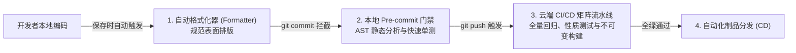
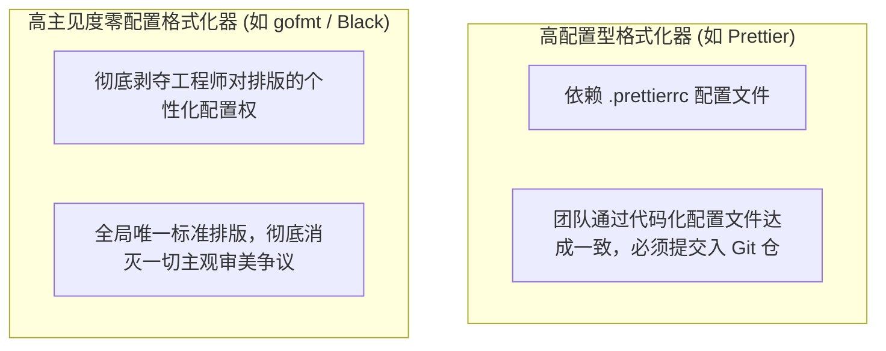
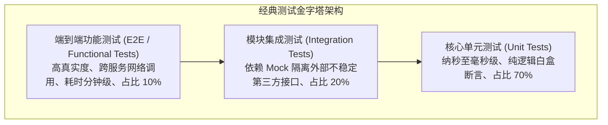

# 09 代码质量工程：检查、测试与 CI/CD（Code Quality）

> MIT 6.NULL · 现代软件工程工具链与开发者素养 · 官方讲义核心内容

## TL;DR

- **语法格式化消除无谓琐碎内耗**：高主见度自动格式化器（gofmt、Black、Prettier）将编码风格固化为不可争议的机械标准，消除团队自行车棚效应。
- **抽象语法树级深层静态拦截**：Linters 与 Semgrep 穿透表面排版，在 AST 层面识别隐蔽反模式、资源泄漏与高危系统调用漏洞。
- **全层级质量验证与性质测试**：结合单元、集成测试与性质驱动测试（Property-based Testing），以随机不变量轰炸发现极端崩溃用例，防范古德哈特度量陷阱。
- **多层防御网与自动化持续集成**：利用 Pre-commit 客户端钩子防范未检查脏提交，依托 GitHub Actions 矩阵流水线构建跨平台不可变发布闭环。

---

## 1. 软件工程的质量防线：让机器守护机器

在复杂软件系统的持续演化过程中，代码质量如果过度依赖工程师的自觉性与肉眼审查，系统熵增将随着功能扩展呈现不可逆的指数级蔓延。人类注意力是极其宝贵却极易疲劳的心智资源，让资深架构师在代码评审中耗费精力纠缠于引号风格、缩进对齐与悬空导入，是对智力资源的巨大浪费。

现代软件工程质量体系的核心法则在于：**凡是能够被形式化定义并在编译前进行判定的规则，必须全部交由确定性的自动化工具链强制收敛**。



质量工程不是阻碍交付节奏的官僚枷锁，而是赋予团队以极高置信度快速迭代的底层安全气囊。

---

## 2. 代码自动格式化：终结自行车棚效应（Bikeshedding）

在管理学中，**自行车棚效应（Bikeshedding / Parkinson's Law of Triviality）** 揭示了一个令人沮丧的组织心理学现象：团队在讨论极其深奥复杂的核心架构时往往寥寥数语，却因为排版风格毫无门槛，而在单双引号、空格缩进或换行大括号上爆发长达数天的口水争论。

代码格式化器（Formatters）从工程基础设施层面彻底消解了这一沟通泥潭：



通过将格式化工具深度集成至开发环境（利用 `.editorconfig` 规范与 IDE 的“保存时格式化 Format on Save”），开发者在书写代码时可以保持思维连贯与击键自由，文件在保存入盘的毫秒瞬间被算法自动重排为严整的工业级标准排版。

---

## 3. 静态代码分析（Linting）与语义匹配（Semgrep）

如果说格式化工具负责规范代码的“表面外貌”，那么静态分析器（Linters）则负责穿透语法表象，深入探测代码内在的“逻辑缺陷与安全漏洞”。

### 抽象语法树（AST）级拓扑分析

Linters 并不真正加载运行程序，而是由词法分析器与语法分析器将源码文本编译为在内存中结构化的抽象语法树（Abstract Syntax Tree, AST）。分析引擎沿着树状拓扑节点执行静态检查：
- **无用代码与死分支检测**：排查未被读取的局部变量、无法到达的条件分支与陈旧废弃的导入声明；
- **并发与作用域陷阱**：在编译前识别 Python 中可变对象作为默认形参引发的全局状态污染、JavaScript 中异步事件循环未等待 Promise 导致的游离执行等高频缺陷；
- **极速工程重构**：以 Rust 编写的现代化工具（如 Python 生态的 `Ruff`、Rust 的 `Clippy`）彻底取代了过往缓慢的 Python/Node 原生实现，将百万行工程的静态巡检压缩至数十毫秒以内。

### 跨语言语义模式匹配：`Semgrep`

当团队需要推行定制化的内部架构约束与安全基线时，通用的 Linter 规则往往难以灵活适配。`Semgrep` 提供了基于 AST 语法层面的声明式语义匹配引擎：

```console
# 精准捕获所有隐蔽的无防护 Shell 命令执行风险
$ semgrep -l python -e 'subprocess.Popen(..., shell=True, ...)'
```

与易被换行符、注释与形参重排所欺骗的传统正则匹配不同，Semgrep 能够深层理解变量赋值链条、函数重命名与参数默认值，以声明式的极简规则在全代码库实施无死角的安全扫描。

---

## 4. 测试金字塔与性质驱动测试（Property-based Testing）

软件测试是量化验证系统是否忠实履行规格契约的根本手段。工业界通常基于投资回报率与执行时延，构建稳固的 **测试金字塔（Testing Pyramid）**：



### 性质驱动测试（Property-based Testing）突破思维盲区

传统基于具体测试样例（Example-based Testing）的测试依赖人类的穷举能力，开发者天然倾向于编写符合直觉的常规用例，从而系统性漏掉边界异样输入。

源自函数式编程思想的 **性质驱动测试（如 Python 的 `Hypothesis`、Rust 的 `proptest`）** 彻底重构了测试验证范式：

::: definition [性质测试与用例收缩（Shrinking）机制]
工程师不再手工编造具体的测试实参，而是向测试框架声明该被测函数必须永久成立的数学不变量（Invariants，例如反序列化后对象必须与原始对象在逻辑上深层相等、排序后的数组必须维持单调非减）。测试框架根据定义的类型生成器在随机状态空间中构造数十万组包含溢出值、极端畸变字符的恶劣输入对代码实施压力测试。一旦捕获引发断言失败的输入，框架会自动激活**用例收缩算法（Shrinking）**，将包含成千上万字节的复杂反例逐步剔除无关干扰项，最终输出引发故障的最小核心反例，直接命中系统漏洞根因。
:::

### 警惕度量异化：古德哈特定律（Goodhart's Law）

代码覆盖率（Code Coverage）是量化测试套件触达了多少源码行号与逻辑分支的客观度量。然而，将覆盖率指标视作绝对考核标准的团队往往会陷入古德哈特定律的陷阱：当覆盖率百分比变成绩效目标时，开发者为了达标便会编写大量仅执行调用却没有任何实质断言逻辑的伪测试。高覆盖率绝不代表零缺陷，专注于验证核心领域不变量的健壮性才是测试工程的灵魂。

---

## 5. 本地防线与自动化 CI/CD 流水线

为了避免未经校验的坏代码渗入主干，工程架构设立了本地与云端两道互补的不可逆防线。

### 本地第一道防线：Git Pre-commit 钩子

依托 `pre-commit` 框架，在代码仓库配置 `.pre-commit-config.yaml`。每当开发者在本地触发 `git commit` 时，Git 客户端钩子自动捕获本次暂存区所涉及的差异文件，在提交动作完成前就地调度格式化工具与轻量静态语法检查。只要发现违规代码未达标，提交动作被强行熔断回滚，将质量问题在开发者本地终端即刻闭环扼杀。

### 云端第二道防线：GitHub Actions 持续集成

即使有团队成员使用 `--no-verify` 参数绕过了本地的 Git 预检钩子，部署在云端代码托管平台的持续集成（Continuous Integration, CI）流水线构成了系统防线的终极铁壁。

持续集成服务通过声明式的 YAML 工作流定义（如 GitHub Actions 的 `.github/workflows/ci.yml`），在独立的纯净临时虚拟执行环境中全自动复现构建与测试流程。其核心架构围绕事件触发器（Events）、执行作业（Jobs）与步骤序列（Steps）组织。通过引入矩阵执行策略（Matrix Strategy），CI 服务能够并发派发数十个构建任务，在 Ubuntu Linux、macOS 与 Windows 等异构操作系统，搭配不同语言运行时版本的排列组合下，验证代码的跨平台一致性：

```yaml
name: Continuous Integration
on:
  push:
    branches: [main]
  pull_request:

jobs:
  quality-check:
    runs-on: ${{ matrix.os }}
    strategy:
      matrix:
        os: [ubuntu-latest, macos-latest]
        python-version: ["3.11", "3.12"]
    steps:
      - uses: actions/checkout@v4
      - name: Set up Python
        uses: actions/setup-python@v5
        with:
          python-version: ${{ matrix.python-version }}
      - name: Run Ruff Static Checks
        run: uv run ruff check .
      - name: Run Unit & Property Tests
        run: uv run pytest --cov=src
```

在云端持续集成环境中，所有质量防护工具均以非侵入的“只读检查模式（Check-only）”运行，例如 `ruff check` 与 `pytest`。若发现任何格式偏差、未处理的警告或断言失败，该步骤将立即抛出非零退出码，触发 GitHub Actions 将当前 Pull Request 标记为红叉阻断状态（Failed Check），并在代码合并入口强制施加分支保护规则（Branch Protection Rules），从机制上彻底杜绝将破坏性缺陷合入主干（main 分支）的可能性。配合持续部署（CD）工作流，在全部检查全绿通过且版本 Tag 被合入后，云端可自动将制品镜像打包并推送至容器镜像仓库，实现高信任度的自动化发布闭环。

在持续集成环境中，所有质量工具均以非侵入的只读检查模式（Check-only）运行。通过跨操作系统与多运行时版本的矩阵并行构建，确保每一次特性合入主干前，均通过了全平台、全依赖组合的绝对一致性验收。

---

## 6. 统一工程入口：任务运行器（Command Runners）

随着项目质量基建日益繁复，要求团队成员逐字记忆各类底层工具的复杂长参数（如 `uv run ruff check --fix` 或 `cargo test --all-features`）会引发显著的使用阻抗。

通过引入统一的现代任务运行器 **`just`（由 `justfile` 声明）**，将所有工程流水线统一抽象为标准的命令门面：

```justfile
# 统一工程质量任务调度门面
set shell := ["bash", "-c"]

# 运行自动化格式化
format:
    uv run ruff format
    uv run ruff check --fix

# 运行全量静态类型推导
typecheck:
    uv run mypy src/

# 运行带覆盖率采样的单元测试套件
test:
    uv run pytest --cov=src --cov-report=term-missing
```

新加入团队的工程师仅需在终端敲入 `just test` 或 `just format`，底层纷繁复杂的参数绑定与环境配置被完全封装隐藏，大幅提升了研发效能的标准化程度。

---

## 7. 附篇：文本处理瑞士军刀——正则表达式（Regex）的计算边界

正则表达式是贯穿于文本检索、日志解析、Linter 模式提取与测试过滤的基础能力。

### 语法核心构件

- **字符类与锚点**：`\d`（数字）、`\w`（词元字符）、`\b`（单词物理边界）、`^`/`$`（行首/行尾定位）；
- **量词与贪婪性**：`*`（零至多次）、`+`（一至多次）、`?`（惰性匹配限定）；
- **捕获组与反向引用**：利用 `(pattern)` 抽取子树，在后续替换中使用 `$1` 或 `\1` 实施精确置换。

### 理论极限：为什么正则无法解析任意嵌套语法？

::: pitfall [正则表达式的形式语言极限]
在理论计算机科学（Automata Theory）的乔姆斯基谱系中，经典正则表达式严格对应于 **正则语言（Regular Languages）**，其物理实现依托于无状态内存的确定有限状态自动机（DFA）。
由于有限状态机缺乏维护无限调用深度的**下推堆栈（Pushdown Stack）**，根据泵引理（Pumping Lemma），经典正则表达式从数学原理上根本无法判定类似 $\{a^n b^n \mid n \ge 0\}$ 的对称嵌套结构。试图使用正则表达式去解析任意深度的 HTML 标签嵌套、JSON 数据结构或配对圆括号，必然会陷入语法解析失败与灾难性回溯的泥潭。对于结构化层级语言，应当坚决使用上下文无关文法（CFG）的专用 AST 语法分析器。
:::

---

## 我的理解

::: insight [自动化契约驱动的工程自由]
纵观本课程全部九讲的知识图谱，代码质量工程实际上是整套现代软件工程工具链的收敛终章与集大成者。从第一讲中单个终端里的标准流与退出状态码，到第五讲中 Git 不可变的哈希快照，再到第九讲中通过 Pre-commit 与 CI/CD 自动化缝合的质量门禁，其背后贯穿着一条清晰的思想主线：**将主观的人为规范转化为客观的机器契约，用不可逆的物理工具捍卫系统的演进秩序**。

很多初学者容易将严格的格式化工具、静态检查与持续集成视作繁复的束缚，但事实恰恰相反——真正的工程自由源于确定性的边界。正是因为有了毫秒级响应的代码格式化器，开发者才能彻底摆脱对琐碎语法的焦虑，专注于核心业务建模；正是因为有了全覆盖的自动化测试网与 CI 护城河，团队才能以极高频次信心百倍地重构核心架构。通过把重复的机械劳动全部交还给机器，我们才真正拥有了探索更宏大技术世界的创造力自由。
:::
