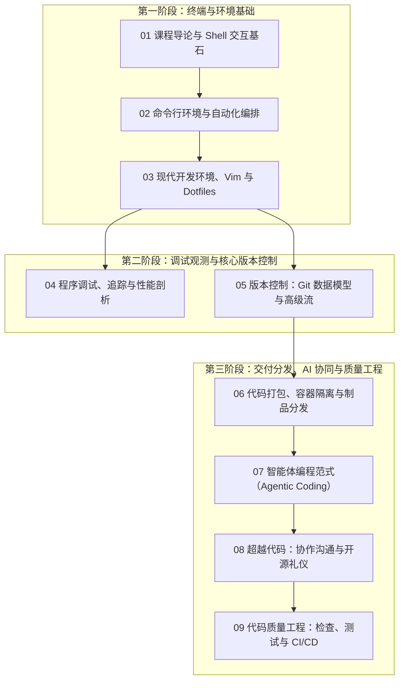

# 现代软件工程工具链与开发者素养（The Missing Semester 2026）

> MIT 6.NULL · The Missing Semester of Your CS Education (IAP 2026) · 主讲团队：Anish Athalye, Jon Gjengset, Jose Javier Gonzalez Ortiz · 官方网站：[missing.csail.mit.edu](https://missing.csail.mit.edu/)

## TL;DR

- **填补大学计算机教育盲区**：系统讲授大学课程往往略过却在工业界每时每刻依赖的现代开发工具链、命令行生态与自动化技能。
- **经典工具与前沿范式融合**：2026 重磅重构版不仅深入剖析 Shell、Git 数据模型、系统级调试与环境配置，更全面引入**智能体编程（Agentic Coding）**、代码打包分发与现代 CI/CD 质量工程。
- **结构化编排与实战交付**：全课程分为 9 大核心主题模块，配套完整的视频课堂逐字稿精翻与高密度工程实战笔记。

---

## 课程描述

### 先修课程

- **先修门槛**：**无任何前置课程门槛**。
- **适用对象**：无论你是刚开始学习编程的新手，还是已经在写复杂项目的资深开发者，本课程都能消除你在工具链上的认知盲区与摩擦损耗。
- **学习建议**：建议配合一台具备 POSIX 环境的计算机（Linux、macOS 或 Windows 下的 WSL2），在阅读每篇笔记时打开终端同步敲击命令并运行测试。

### 官方课程描述

**官方中文翻译**：

> “大学的计算机科学课程通常将重点放在理论计算、算法数据结构、操作系统和机器学习等宏观知识上。然而，有一门关键课程却普遍缺失——即如何高效运用现代计算机本身的工具体系。学生们往往只能在日复一日的自摸索中痛苦碰壁，花费数小时甚至数天做着本可以一行命令自动化的重复劳动。
> 
> 《计算机科学中缺失的学期》（The Missing Semester of Your CS Education）正是为了弥补这一鸿沟而生。在 2026 年 1 月的全新独立活动期（IAP）重构版中，我们不仅彻底翻新了命令行环境、Vim 模式编辑、Git 底层模型与系统性能剖析，还首次正式将 **Agentic Coding（智能体编程）**、代码制品分发（Packaging & Shipping）以及全生命周期代码质量工程纳入核心教学体系。我们希望通过这一系列讲座，帮助你成为一位行云流水、自信优雅的现代软件工程师。”

**官方英文原文（MIT IAP 2026 Syllabus）**：

> *"Classes teach you all about computer science, from operating systems and machine learning to programming languages and theory. But there is one critical topic that's rarely covered: the tools of the trade. Students are left to figure out the command line, editors, version control systems, and build automation on their own—spending hours on repetitive tasks that could take seconds. The Missing Semester is an MIT class designed to fix that. The completely updated 2026 iteration expands the core toolset to include modern practices such as packaging and shipping code, code quality automation, and agentic AI-assisted coding."*

### 培养目标

- **终端与环境掌控力**：理解 Shell 的解析与求值模型，熟练运用管道、重定向、环境变量、作业控制、信号与 SSH 远程作业，构建高效可复用的开发流。
- **编辑与自动化生产力**：掌握 Vim 模式编辑的“语言化语法”，熟练编排 Dotfiles、终端复用器（Tmux）与现代编辑器工具链。
- **深度调试与逆向洞察**：掌握系统调用追踪（`strace`/`dtruss`）、动态追踪（`eBPF`/`bpftrace`）、可逆调试（`rr`）、内存审查器（ASan/Valgrind）与性能火焰图分析。
- **版本控制与数据拓扑**：透过命令行表象理解 Git 基于内容寻址的有向无环图（DAG）底层对象模型，从原理层面精通高级重写、Rebase 与团队协同。
- **现代制品交付与 AI 协同**：掌握虚拟环境、容器化封装（Docker）、语义化版本发布，建立现代 **Agentic Coding** 智能体开发心智模型，掌握 Prompt 架构、上下文工程与 AI 生成代码的防御性审查。

### 参考书籍与资源

- **官方课程主页**：[missing.csail.mit.edu/2026/](https://missing.csail.mit.edu/2026/)
- **官方配套视频**：MIT CSAIL 官方 YouTube 频讲堂（主讲：Anish Athalye、Jon Gjengset、Jose Javier Gonzalez Ortiz）。
- **经典参考专著**：
  - Brian W. Kernighan & Rob Pike. *The UNIX Programming Environment*, Prentice Hall.
  - Scott Chacon & Ben Straub. *Pro Git* (2nd Edition), Apress (开源免费).
  - Brendan Gregg. *Systems Performance: Enterprise and the Cloud* (2nd Edition), Addison-Wesley.

---

## 课程内容全景

本课程采用全新的结构化编排，系统划分并覆盖现代软件工程的 9 大关键技能维度：

### 结构化编排讲义清单

1. [01 课程导论与 Shell 交互基石（Course Overview & Shell）](./01-course-shell.md)：课程定位与动机、Unix 哲学、标准 I/O 重定向、管道串联、文件系统导航与基本命令行指令。
2. [02 命令行环境与自动化编排（Command-line Environment）](./02-command-line-environment.md)：参数解析与通配扩展（Globbing）、标准流与管道并行机理、环境变量生命周期、进程状态与 POSIX 信号、SSH 远程作业。
3. [03 现代开发环境、Vim 与 Dotfiles 自动化（Development Environment & Tools）](./03-dev-environment-and-tools.md)：Vim 模式编辑语言体系（动作、动词与修饰符）、自定义键映射与配置哲学、Dotfiles 版本化管理与环境一键重现。
4. [04 程序调试、追踪与性能剖析（Debugging and Profiling）](./04-debugging-and-profiling.md)：科学排错假设法、可逆调试器（Record-Replay Debugging / rr）、系统调用拦截（strace）、eBPF 动态内核探测、内存 Sanitizers 与 CPU/内存火焰图。
5. [05 版本控制：Git 数据模型与高级工作流（Version Control & Git）](./05-version-control-and-git.md)：Git 内部内容寻址数据库（Blob、Tree、Commit、Tag）、DAG 历史图谱模型、分支合并与交互式 Rebase、代码暂存与状态恢复。
6. [06 代码打包、容器隔离与制品分发（Packaging & Shipping Code）](./06-packaging-and-shipping-code.md)：多语言依赖地狱与虚拟环境、可重现构建（Reproducible Builds）、Docker 容器镜像轻量封装、语义化版本（SemVer）与发布流水线。
7. [07 智能体编程范式（Agentic Coding）](./07-agentic-coding.md)：大语言模型工作机理与 Token 窗口、AI 协同编码（Copilot / 交互式助手）、自主智能体（Agent）工作流、上下文注入、安全性隐私防线与工程批判性审查。
8. [08 超越代码：协作沟通与开源礼仪（Beyond the Code）](./08-beyond-the-code.md)：单向技术写作（Commit 规范、PR 描述、RFC 文档）、双向代码评审（Code Review）艺术、开源社区协作生态与 AI 生成内容的交互礼仪。
9. [09 代码质量工程：检查、测试与 CI/CD（Code Quality）](./09-code-quality.md)：代码格式化器（Formatters）、静态语法检查器（Linters）、单元测试与模糊测试（Fuzzing）、Pre-commit 门禁、GitHub Actions 自动化集成流水线。

---

## 官方视频课堂实录（Transcripts）

本课程配备经过精心人工对齐的逐字稿实录库，真实复刻 MIT 讲师的现场讲解、命令行演练与即兴问答：

- **英文原版实录**：位于 `transcripts/en/`，提供原汁原味的课堂英文听力与技术词汇对照。
- **精翻中译实录**：位于 `transcripts/zh/`，对口语化表达进行了通顺典雅的书面化润色，保留讲者情感与幽默细节。

---

## 官方资源与学习支持

- **MIT 官方课程主页**：[missing.csail.mit.edu/2026/](https://missing.csail.mit.edu/2026/)
- **MIT CSAIL 官方 YouTube 频道**：[@MissingSemester](https://www.youtube.com/@MissingSemester)
- **代码与课件仓库**：[github.com/missing-semester/missing-semester](https://github.com/missing-semester/missing-semester)
