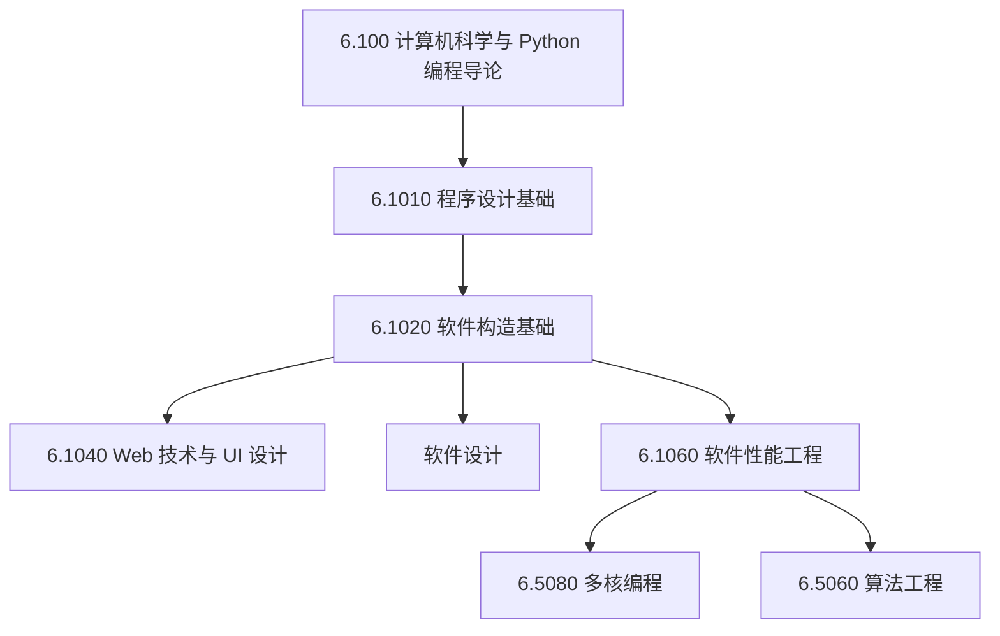

# 编程与软件工程

## TL;DR

- **工程能力进阶闭环**：建立从计算思维与 Python 编程导论，到中型程序设计、软件规格契约、现代 Web 架构，直至底层并发与极端性能调优的完整工程链条。
- **涵盖 MIT 软件核心体系**：纳入 6.100（计算导论）、6.1010（程序设计基础）、6.1020（软件构造基础）、6.1040（Web 技术与设计）、6.1060（软件性能工程）、6.5080（多核编程）等关键课程。
- **渐进式学习路线**：推荐以 6.100 作为编程与计算思维起点，经由 6.1010/6.1020 建立规格与抽象屏障，再进阶至性能工程与大规模并发系统实践。

## 课程体系与学习路径

软件工程（Software Engineering）与程序设计不仅要求掌握具体的编程语言，更要求具备管理系统复杂度、编写高可靠代码以及应对底层并发与性能瓶颈的系统化方法。本知识库梳理的课程体系覆盖了从初学入门到工业级软件工程的核心脉络：

### 编程与软件工程课程清单

| 课程模块 | 课程编号与名称 | 核心主题与工程方法 | 学习定位与阶段建议 |
| :--- | :--- | :--- | :--- |
| **工程工具链与素养** | [现代软件工程工具链与开发者素养（2026 版）](./engineering_toolchain/) | 现代 Shell 自动化、Vim 模式编辑、系统级调试分析、Git 底层数据模型、Docker 打包、Agentic Coding 智能体协作与 CI/CD 质量工程 | **贯穿始终（全阶段工程基石）**：弥补大学教育中工具链与工程实践盲区，掌握现代开发必备武器库 |
| **计算思维导论** | [6.100 计算机科学与 Python 编程导论](./6100_introduction_to_computer_science_and_programming/) | Python 3 基础、环境模型图、蒙特卡洛模拟、图搜索（BFS/DFS/Dijkstra）、动态规划与 OOP 仿真 | **第一阶段（零基础/入门）**：建立严谨计算心智模型与数据抽象能力 |
| **程序设计进阶** | [6.1010 程序设计基础](./61010_fundamentals_of_programming/) | 地道 Pythonic 范式、递归展开模型、高阶闭包、状态空间搜索、测试驱动开发（TDD） | **第二阶段（代码能力强化）**：突破语法表层，掌握管理中型程序复杂度的方法 |
| **软件构造基石** | [6.1020 软件构造基础](./element_of_software_construction/) | 行为规格（Spec）、抽象数据类型（ADT）、表示不变式（RI）、防御性检查、并发与线程安全 | **第三阶段（软件工程核心）**：从“写可运行代码”转变为“写安全可靠、易懂易改的代码” |
| **交互与 Web 架构** | [6.1040 Web 技术与 UI 设计](./designftw/) | 前端组件化、状态管理、人机交互设计原则、全栈通信协议与交互式系统架构 | **第四阶段（应用开发）**：设计现代交互体验与高可用 Web 服务架构 |
| **架构与抽象** | [软件设计](./software_design/) | 概念设计、解耦法则、依赖倒置、模块化重构与复杂业务系统建模 | **第四阶段（系统设计）**：掌握宏观架构模式与长期可维护性设计原则 |
| **性能工程** | [6.1060 软件性能工程](./software_performance_engineer/) | 硬件架构亲和性、位运算加速、编译器优化、向量化（SIMD）、缓存利用率与性能分析工具 | **第五阶段（极致优化）**：软硬协同榨干硬件潜能，实现数量级性能提升 |
| **并发系统** | [6.5080 多核编程](./multicore_programming/) | 互斥锁、无锁数据结构、事务内存、ABA 问题、内存一致性模型与工作窃取调度 | **第五阶段（高阶并发）**：掌握多核多线程环境下的安全高并发算法设计 |
| **算法工程化** | [6.5060 算法工程](./algorithm_engineer/) | 缓存无关算法、外部存储模型（I/O 复杂度）、并行图计算框架与算法工程实测分析 | **第五阶段（高阶算法）**：弥合理论算法界与真实硬件瓶颈之间的工程鸿沟 |

## 软件工程的核心能力跃迁

1. **从代码片段到抽象屏障**：从 6.100 与 6.1010 开始，学习者由基本的控制流和函数抽象，逐步过渡到 6.1020 的抽象数据类型（ADT）与表示独立性。模块的正确性不再依赖外部调用者的自觉，而是由不变式和精确规格守护。
2. **从单机确定性到并发与异步**：在现代硬件上，软件构造必然直面并发竞争、死锁与内存一致性挑战。通过 6.1020 与 6.5080，建立从消息传递到原子同步原语的完整思维框架。
3. **从理论复杂度到机器感知性能**：大 $O$ 阶数无法完全决定程序速度。6.1060 与 6.5060 将软件视角拉入硬件微架构深处——缓存局部性、分支预测、内存对齐与向量化指令，构成了高吞吐低延迟工程的决定性分水岭。

## 我的理解

::: insight 软件工程的本质是控制复杂度与抵御熵增
优秀的工程师不仅追求“让代码跑起来”，更致力于“让系统在长期演化中保持健壮、自证正确且可被人类心智推演”。从 6.100 的计算思维启蒙，到 6.1020 严格的规格驱动开发，再到 6.1060 的硬件亲和调优，这一路线展示了从“编写脚本”到“掌控大型工业软件系统”的蜕变路径。
:::
