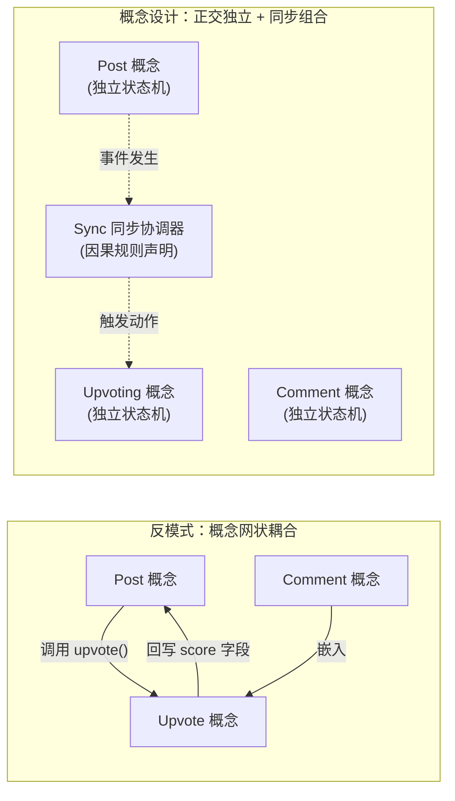

# 概念设计与状态同步机制

## TL;DR

- 概念（Concept）是具有独立目的（Purpose）、运行原理（Principle）、内部状态（State）和操作集合（Actions）的最小可复用行为单元。
- 概念之间严格保持正交独立，禁止直接相互依赖、引用对方数据结构或直接调用对方方法。
- 概念组合通过因果同步（Sync）实现：外部机制监听某个概念的动作发生，并在满足条件时触发其他概念的后续动作。
- 概念设计将软件设计从“数据库与 API 拼接”提升到“用户心智模型与行为契约”的高度，能有效杜绝由于耦合产生的蔓延式复杂度。

## 核心主动唤醒问题

1. **什么是概念（Concept）？它与传统的面向对象“类（Class）”或“微服务”有何根本区别？**
   - 概念直接对齐用户的心智模型，是一个完整的行为协议（拥有独立的 Purpose 和 Principle），而不是单纯的代码组织单元或网络部署边界。
2. **为什么概念之间严禁互相直接引用与调用？**
   - 直接调用会导致概念间产生隐式假设与强耦合；通过将概念保持为独立状态机，单个概念可以在不同的软件产品中零修改复用（例如 `Upvoting` 可以同时复用于帖子、评论或商品）。
3. **当多个概念需要协同完成一项复杂业务时，正确的组合范式是什么？**
   - 使用显式的同步（Sync）规则，在概念外部声明“当概念 A 执行动作 X 时，查询状态并触发概念 B 执行动作 Y”。

## 什么是概念设计？

传统软件工程常常直接从技术实现出发：设计数据库 Schema、定义 RESTful/GraphQL API、编写控制器与服务层代码。这种做法容易混淆“**软件向用户承诺的行为**”与“**软件底层的存储实现**”。

::: definition 概念（Concept）
概念是一个连贯、可复用，并且能够被**独立理解、独立设计、独立实现和独立解释**的行为单元。它直接映射用户的心理模型（Mental Model），向用户提供自洽的价值闭环。
:::

例如：Hacker News 或 Reddit 核心功能由若干通用概念组合而成：
- `Post [User, Item]`：内容的发布与展示；
- `Comment [User, Item]`：对任意条目的树状讨论；
- `Upvoting [User, Item]`：通过投票累积热度；
- `Bookmark [User, Item]`：个人收藏与快速索引。

这些概念本身并不包含对方的任何逻辑：`Upvoting` 完全不知道被投票的是一篇论文、一辆二手车还是一条评论；`Comment` 也完全不知道自己是否支持点赞。

## 概念的五要素模型

在 Daniel Jackson 的《The Essence of Software》体系中，一个完备的概念由五项要素定义：

| 要素 | 核心职责 | 工程思考提问 | 示例（Upvoting [User, Item]） |
| :--- | :--- | :--- | :--- |
| **Name** | 概念命名与类型参数 | 这是什么能力？依赖哪些抽象对象？ | `Upvoting [User, Item]` |
| **Purpose** | 存在的唯一根本理由 | 解决什么实际摩擦？满足什么核心需求？ | 根据群体共识对内容进行权重排序 |
| **Principle** | 核心机制与因果假设 | 为什么这个设计能兑现上述目的？ | 通过累加独立用户的赞同票，使高质量内容浮出 |
| **State** | 概念必须记住的最小状态 | 概念内部维护的数据结构与不变量 | 记录集合：`(user, item)` 的已投票映射表 |
| **Actions** | 改变或观察状态的动作契约 | 外部能对该概念发起的唯一合法操作 | `upvote(user, item)`, `unvote(user, item)` |

::: insight 为什么必须先写 Principle？
许多项目在需求评审时往往只罗列 API 或字段，却从未写出 Principle。**Principle 解释了软件功能在现实世界中如何达成预期结果**。如果找不到一段简洁因果链说明“为什么用户执行操作后能满足目的”，说明这个概念本身在逻辑上就是脆弱或多余的。
:::

## 概念的独立性与正交原则

概念设计的核心铁律是：**概念之间互不感知、互不依赖**。

在传统面向对象或过程式架构中，开发者往往顺手在 `Post` 类中定义点赞计数，或者让 `Comment` 服务直接注入 `UserService` 与 `VoteService`。这种看似快捷的做法，会导致模块之间交织成错综复杂的网状依赖网：任何一个概念的数据结构变更，都会沿调用链传导，导致大面积测试失效和意料之外的副作用。

正交设计要求我们将每个概念视为完全自给自足的状态机。如下示意图展示了两种设计哲学的根本差异：



如果让 `Post` 的表结构中内嵌 `upvote_count`，并在发布帖子或删除帖子时直接硬编码增删点赞记录，就发生了实质性的概念耦合。一旦后续产品需要为评论（`Comment`）或用户简介（`UserProfile`）增加点赞支持，开发者就不得不重写一套类似逻辑，或者通过深层继承与猴子补丁来强行拼凑，原有代码就会迅速退化为补丁满天飞的脆弱架构。只有坚持状态与动作的正交性，概念才能在不同系统间自由迁移。

## 组合与同步机制 (Sync)

当概念互不感知时，如何实现“当用户删除帖子时，自动清理与该帖子关联的投票和评论”？

答案是 **Sync（同步）**：

::: definition 同步（Sync）
同步是独立概念之间的因果连接胶水。它以声明式或事件驱动的方式定义：“**当概念 A 的 Action 成功发生后，若满足前置状态条件，则触发概念 B 的 Action**”。
:::

### 同步范式示例

```typescript
// 伪代码：声明式概念同步
sync DeleteCascade {
  when Post.delete(post: PostId) {
    // 观察到 Post 概念发生 delete 动作
    // 触发关联概念的状态清理
    Upvoting.clearVotesForItem(item: post);
    Comment.removeCommentsForTarget(target: post);
  }
}
```

通过将跨业务因果全部收敛在 Sync 层：
1. **概念保持极度纯粹**：每个概念可以在单元测试中被彻底验证，没有任何外部 Mock 依赖；
2. **业务流程一目了然**：所有跨模块联动都在 Sync 规则表中显式可见，而不是分散在几十个 Service 的深层嵌套中；
3. **支持热插拔与灰度**：移除某个功能（例如暂时关闭投票）只需注销对应 Sync 规则，无需改动核心业务数据模型。

## 常见反模式与失败模式

::: pitfall 陷阱一：上帝概念（God Concepts）
最常见的错误是将用户管理、权限校验、日志记录、业务数据全部揉在一个“概念”中（例如 `UserManager`）。权限和身份认证应该是独立的正交概念（如 `Authentication [User]`、`AccessControl [Subject, Action, Object]`），通过 Sync 与具体业务概念挂钩。
:::

::: pitfall 陷阱二：内部状态泄漏为外部接口
允许外部系统直接根据概念内部的表结构或私有字段编写 SQL 联查，会彻底破坏概念的封装性与不变式维护。外部访问必须严格通过概念暴露的 Actions 进行。
:::
