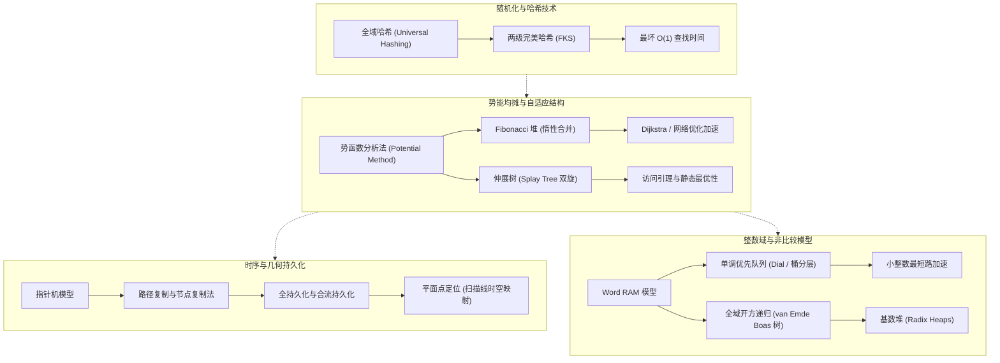

# 6.5210 / 6.854 高级算法（Advanced Algorithms）

## TL;DR

- **算法边界的系统性突破**：超越经典比较模型与最坏情况分析，探索利用字级并行、势能均摊、随机化与几何对偶性突破经典复杂度下界。
- **核心数据结构模块**：系统涵盖全域与完美哈希、Fibonacci 堆、持久化数据结构、伸展树（Splay Tree）、单调优先队列与 van Emde Boas 树。
- **理论深度与研究导向**：直面计算机科学理论经典论文，聚焦势能分析法（Potential Method）、路径复制与节点复制机制，以及动态最优性等未解问题。

## 课程介绍

### 先修课程

- [6.1220 算法的设计与分析（Design and Analysis of Algorithms）](../61220_design_and_analysis_of_algos/index.md)：熟练掌握渐近符号、分治法、动态规划、贪心策略及经典图论算法。
- [6.1200 计算机科学数学（Mathematics for Computer Science）](../61200_maths_for_cs/index.md)：离散数学、图论、计数原理、递归方程求解与数论基础。
- 概率统计与随机过程（MIT 6.041 / 18.600）：掌握条件概率、期望线性性、马尔可夫不等式与切诺夫界。

### 官方对课程描述的翻译

高效算法的需求几乎出现在计算机科学的每一个分支领域中。不过，不同领域需要解决的问题类型、“高效”算法的定义，甚至底层的计算模型本身，都可能有很大的差异。本课程被设计为一门算法方向的综合性高级研究生课程，旨在系统概览一些最强大的算法设计技术以及关键的计算模型。课程的核心目标是帮助学生跨越本科基础算法的门槛，达到能够直接阅读、理解并推进算法顶级理论会议与期刊（如 STOC, FOCS, SODA, JACM）研究论文的专业水平。

课程的四大理论支柱涵盖：
1. **打破传统计算模型**：超越比较模型的 $\Omega(n \log n)$ 理论下界，利用 Word RAM 字级并行性与整数键域特性设计亚对数级数据结构。
2. **均摊分析与自适应性**：借助势能函数量化连续操作序列的平摊代价，使数据结构无需维护严苛的显式结构平衡即可获得最优均摊界。
3. **随机化与哈希技术**：通过 2-全域哈希族与两级哈希表以 $O(1)$ 期望或最坏情况时间消除碰撞，摆脱对输入分布的依赖。
4. **几何与持久化范式**：利用时空转换与节点复制技术实现多版本数据结构的时间旅行与高效平面点定位。

### 参考书籍

**经典教材**：
- Thomas H. Cormen, Charles E. Leiserson, Ronald L. Rivest, Clifford Stein. *Introduction to Algorithms* (CLRS, 4th Edition). MIT Press.
- Robert E. Tarjan. *Data Structures and Network Algorithms*. SIAM, 1983.
- Ravindra K. Ahuja, Thomas L. Magnanti, James B. Orlin. *Network Flows: Theory, Algorithms, and Applications*. Prentice Hall, 1993.
- Rajeev Motwani, Prabhakar Raghavan. *Randomized Algorithms*. Cambridge University Press, 1995.

**领域里程碑论文**：
- Carter, J. L., & Wegman, M. N. (1979). *Universal classes of hash functions*. JCSS.
- Fredman, M. L., Komlós, J., & Szemerédi, E. (1984). *Storing a sparse table with $O(1)$ worst case access time*. JACM (FKS 两级哈希).
- Fredman, M. L., & Tarjan, R. E. (1987). *Fibonacci heaps and their uses in improved network optimization algorithms*. JACM.
- Sleator, D. D., & Tarjan, R. E. (1985). *Self-adjusting binary search trees*. JACM (伸展树).
- Driscoll, J. R., Sarnak, N., Sleator, D. D., & Tarjan, R. E. (1989). *Making data structures persistent*. JCSS.
- van Emde Boas, P. (1977). *Preserving order in a forest in less than logarithmic time and linear space*. Information Processing Letters.

## 课程知识体系

### 模块全景架构

本课程围绕高级算法设计与理论分析的核心范式展开，系统突破本科基础算法以最坏情况比较模型为主的传统视角。课程知识体系分为四大核心模块：

- **模块一：随机化与哈希技术（Randomization & Hashing）**
  从传统的确定性查找转向分布无关的随机化保证。通过从紧凑的 2-全域哈希族中随机选择映射函数，算法以极小的描述代价保证任意输入集合两两碰撞概率不超过 $1/n$；更进一步，Fredman、Komlós 与 Szemerédi 提出的 FKS 两级哈希利用空间与碰撞期望的精妙平衡，以线性空间达成了最坏情况 $O(1)$ 的字典查询时间。
- **模块二：势能均摊与自适应结构（Amortization & Self-Adjusting Structures）**
  超越单步操作的最坏情况分析，借助物理学势函数（Potential Method）精准度量连续操作序列的全局能量流动。Fibonacci 堆采用惰性合并与级联剪切机制，使关键的 `Decrease-Key` 操作均摊时间降至 $O(1)$，直接驱动了网络优化与最短路算法的渐近突破；伸展树（Splay Tree）通过优雅的双旋转机制，在不存储任何显式平衡因子的前提下自适应拟合访问局部性，达成了动态最优性领域的重要里程碑。
- **模块三：时序与几何持久化（Temporal & Geometric Persistence）**
  打破数据结构“当前版本覆盖历史版本”的单向性。在指针机模型下，系统对比胖节点法、路径复制与节点复制法，以平摊 $O(1)$ 的额外空间开销实现全持久化与合流持久化。将持久化树与几何扫描线（Plane Sweep）结合，可将动态历史查询升维为静态二维平面点定位，在对数时间内完成垂直射线射击与多边形包含判定。
- **模块四：整数域与非比较模型（Integer Domain & Word RAM）**
  突破基于元素间相对大小比较的 $\Omega(n \log n)$ 理论下界，直接挖掘 RAM 模型的字级并行能力（Word RAM）与整数键值的位级代数特性。单调优先队列利用键值非减的单调性约束，配合两级多层桶与惰性字典树，将小整数边权最短路径问题推进至近线性时间；van Emde Boas 树通过对全域位宽的开方递归分解，达成了前驱后继查询的 $O(\log\log U)$ 理论极限，基数堆则将其精髓进一步应用于动态图算法。

各模块之间的理论演进与依赖逻辑如下所示：

上述模块体现了高阶算法研究的双重主线：一方面通过精巧的数学势函数与随机化消除最坏情况的结构退化；另一方面通过深度拟合底层机器字长与存储层次，打破比较模型的渐近壁垒。

### 讲义全景清单

| 讲义 | 核心主题与算法 | 讲义链接 | 关键机制与核心理论收益 |
| :--- | :--- | :--- | :--- |
| **Lec 01** | 全域哈希与完美哈希 | [lec1.md](./lec1.md) | 2-universal 哈希族、二次探测、FKS 两级哈希；实现最坏 $O(1)$ 查找 |
| **Lec 02** | Fibonacci 堆与均摊分析 | [lec2.md](./lec2.md) | 惰性合并、级联剪切（Cascading Cut）、势能法；`Decrease-Key` 均摊 $O(1)$ |
| **Lec 03** | 持久化数据结构与平面点定位 | [lec3.md](./lec3.md) | 路径复制、胖节点（Fat Nodes）、节点复制法；历史版本 $O(\log n)$ 点定位 |
| **Lec 04** | 伸展树与自调整二叉树 | [lec4.md](./lec4.md) | 双旋转机制（zig-zig, zig-zag）、访问引理；均摊 $O(\log n)$ 且自适应热点 |
| **Lec 05** | 单调优先队列：Dial 与多级桶 | [lec5.md](./lec5.md) | 单调性原理、两级桶、Denardo-Fox 惰性字典树；小整数边权下 Dijkstra 加速 |
| **Lec 06** | 整数优先队列：vEB 树与基数堆 | [lec6.md](./lec6.md) | 宇宙规模开方递归、Min/Max 隔离、基数堆；整数域下 $O(\log\log U)$ 检索 |

## 官方资源

- [MIT 6.5210 官方课程主页](https://6.5210.csail.mit.edu/)
- [MIT 6.854 CSAIL 课程归档（David Karger）](https://courses.csail.mit.edu/6.854/)
- [MIT 6.854 Spring 2016 课程主页（Ankur Moitra）](https://people.csail.mit.edu/moitra/854.html)
- [MIT OpenCourseWare 算法相关高阶理论归档](https://ocw.mit.edu/)
