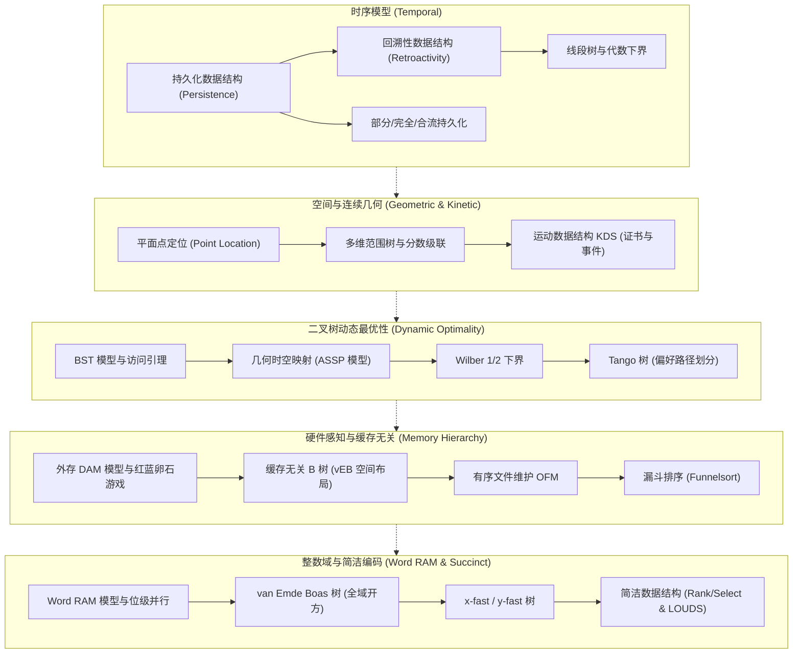

# 6.5230 高级数据结构（Advanced Data Structures）

## TL;DR

- **数据结构的理论前沿**：系统探讨超越传统比较模型的高阶数据结构设计范式与计算复杂度下界理论，涵盖时序、几何、动态最优、存储层级、整数模型与简洁数据结构等核心方向。
- **严密的分析工具集**：核心分析工具聚焦指针机模型、势函数摊还分析、信息论极限、单元探测下界（Cell Probe）以及跨多存储层级几何等价性。
- **理论最优到体系结构映射**：系统建立从理论最优性（如动态最优性猜想、Tango 树、vEB 树、Jacobson 简洁表示）到现代工业级存储感知的坚实理论桥梁。

## 课程介绍

### 先修课程

- [6.1210 算法导论（Introduction to Algorithms）](../61210_introduction_to_algorithms/index.md)：熟练掌握平衡二叉树、二叉堆、哈希表、渐近复杂度分析与图遍历。
- [6.1220 算法的设计与分析（Design and Analysis of Algorithms）](../61220_design_and_analysis_of_algos/index.md)：均摊势能分析、高级动态规划、分治策略与理论下界分析。
- [6.1200 计算机科学数学（Mathematics for Computer Science）](../61200_maths_for_cs/index.md)：组合计数、生成函数、概率期望与马尔可夫不等式。

### 官方对课程描述的翻译

数据结构在现代计算机科学与算法工程中扮演着决定性角色。面对海量数据规模与现代复杂存储体系，传统的“对数时间”与“线性空间”已无法满足前沿计算需求。MIT 6.5230（原 6.851）由 Erik Demaine 教授主讲，定位为数据结构方向的高级综合性研究生课程，系统讲授数据结构领域的经典成果与前沿开放问题。

课程的六大核心理论支柱：
1. **时序数据结构（Temporal Data Structures）**：持久化（高效保存历史版本且跨版本查询）与回溯性（允许向历史时间线插入或修改操作并向未来传播影响）。
2. **几何与运动数据结构（Geometric & Kinetic Data Structures）**：高维点定位与正交范围查询，运用扫描线降维与分数级联技术；针对连续运动物体建立基于证书（Certificate）的离散事件驱动维护机制。
3. **动态最优性（Dynamic Optimality）**：探索在线二叉搜索树是否能在常数因子内匹敌离线最优 BST，建立树形满足点集（ASSP）几何对偶模型与 Wilber 下界。
4. **存储层级与缓存无关算法（Memory Hierarchy & Cache-Oblivious）**：摆脱平坦 RAM 假设，无需硬编码硬件参数 $M$ 和 $B$ 即可在多级 Cache 与外存间自适应达到理论最优 I/O 复杂度。
5. **整数模型与前驱搜索（Integer Data Structures）**：在 Transdichotomous Word RAM 模型下突破比较模型的 $\Omega(\log n)$ 下界，借助宇宙开方递归构建 vEB 树与 x-fast / y-fast 树。
6. **简洁数据结构（Succinct Data Structures）**：将存储压缩至信息论最优极限 $\mathrm{OPT} + o(\mathrm{OPT})$ 比特，运用 Jacobson 分块与四俄国人查表实现常数时间的 $\mathrm{Rank}/\mathrm{Select}$。

### 参考书籍

**经典教材**：
- Thomas H. Cormen, Charles E. Leiserson, Ronald L. Rivest, Clifford Stein. *Introduction to Algorithms* (4th Edition). MIT Press, 2022.
- Gonzalo Navarro. *Compact Data Structures: A Practical Approach*. Cambridge University Press, 2016.
- Mark de Berg, Otfried Cheong, Marc van Kreveld, Mark Overmars. *Computational Geometry: Algorithms and Applications* (3rd Edition). Springer, 2008.
- Robert E. Tarjan. *Data Structures and Network Algorithms*. SIAM, 1983.

## 课程知识体系

### 模块全景架构

本课程全面解构高级数据结构的前沿理论与工程实践体系，构建了从时序版本演进到多层存储感知、从连续几何空间到紧凑离散编码的完整知识闭环。课程知识体系由六大相互关联的理论支柱构成：

- **模块一：时序数据结构（Temporal Data Structures）**
  在指针机模型下探索版本控制的数学极限。部分持久化仅允许在最新版本上更新并查询任意历史版本；完全持久化允许在任意历史版本上衍生分支，形成版本演化树；合流持久化则支持不同版本历史的合并。回溯性数据结构进一步将时间轴由被动记录升级为主动交互，允许向过去的任意时间点插入或删除操作，并将因果影响沿着时间拓扑自动向未来传播。
- **模块二：空间几何与连续运动（Geometric & Kinetic Data Structures）**
  超越一维线性键域，面向高维连续空间与时间演化。平面点定位通过扫描线（Plane Sweep）技术将二维静态空间降维映射为时序树的动态更新；多维正交范围树结合分数级联（Fractional Cascading）技术，通过预先建立跨层级的指引指针，消除了高维检索中累加的对数因子；运动数据结构（KDS）摆脱定周期离散采样的低效性，建立基于几何不变量证书（Certificates）的事件驱动更新范式。
- **模块三：二叉搜索树动态最优性（Dynamic Optimality）**
  探索在线二叉搜索树在理论上的终极性能极限：是否存在一个在线算法，能在常数因子内匹敌离线最优 BST？通过将二叉树访问序列映射为二维几何平面中的点集，并建立树形满足点集（Arborally Satisfied Point Sets, ASSP）等价模型，理论界推导出了 Wilber 1（交错下界）与 Wilber 2（漏斗下界），并催生了偏好路径划分架构的 Tango 树，达成了首个非平凡的 $O(\log\log n)$ 竞争比。
- **模块四：存储层级与缓存无关模型（Memory Hierarchy & Cache-Oblivious）**
  针对现代硬件深层次存储架构（L1/L2/L3 Cache、主存、NVMe 与分布式外存）的物理现实，颠覆传统的平坦 RAM 假定。在无需硬编码各层硬件参数（缓存容量 $M$ 与块大小 $B$）的前提下，通过 van Emde Boas 空间填充递归布局、有序文件维护（OFM）和漏斗排序（Funnelsort），在任意复杂的未知存储层次体系中同时达成渐近最优的 I/O 数据传输代价。
- **模块五：整数模型与前驱搜索（Integer Data Structures & Word RAM）**
  突破基于元素间相对大小比较的 $\Omega(\log n)$ 下界，直接利用底层机器字长（Word RAM）的位级并行计算能力。van Emde Boas 树通过对全域位宽的开方分治递归，将前驱后继查询加速至 $O(\log\log U)$；x-fast 树利用层级哈希表与树高二分将检索转化为位前缀匹配，y-fast 树则通过结合平衡二叉树与两级间接寻址，以严格的线性空间达成最优时空复杂度。
- **模块六：简洁数据结构（Succinct Data Structures）**
  探索信息论极限下的存储压缩与零解压高效检索。在不损失常数时间导航能力的前提下，将数据结构占用空间压缩至理论熵极限 $\mathrm{OPT} + o(\mathrm{OPT})$ 比特。以 Jacobson 位向量为核心，通过大块划分、小块偏置与四俄国人查表法实现常数时间的 $\mathrm{Rank}$ 与 $\mathrm{Select}$ 原语，利用 LOUDS 层序一元编码仅需 $2n + o(n)$ 比特即可紧凑表达并遍历任意静态树。

各核心模块之间的逻辑演进与理论映射关系如下图所示：

上述模块系统展示了高阶数据结构的统一设计思想：通过精巧的数学映射将因果依赖、几何拓扑与硬件约束转化为可高效维护的离散代数结构。

### 讲义全景清单

| 讲次 | 核心主题与算法 | 讲义链接 | 关键技术机制与理论收益 |
| :--- | :--- | :--- | :--- |
| **Lec 01** | 时序数据结构：持久化 | [lec1.md](./lec1.md) | 指针机模型、修改日志、回指针、版本树括号化、函数式路径复制 |
| **Lec 02** | 回溯性数据结构 | [lec2.md](./lec2.md) | 部分/完全回溯、可交换与可逆操作、线段树、代数与单元探测下界 |
| **Lec 03** | 几何数据结构：点定位与分数级联 | [lec3.md](./lec3.md) | 平面点定位、垂直射线射击、扫描线降维、多维嵌套范围树、分数级联 |
| **Lec 04** | 三维范围搜索与运动数据结构 | [lec4.md](./lec4.md) | 射线刺穿查询、单侧到双侧分叉、KDS 四大准则（响应/局部/紧凑/高效） |
| **Lec 05** | 动态最优性：二叉搜索树的几何视角 | [lec5.md](./lec5.md) | BST 模型、伸展树双旋、二维时空点集映射与树形满足性（ASSP）、贪心算法 |
| **Lec 06** | 动态最优性：Wilber 下界与 Tango 树 | [lec6.md](./lec6.md) | 独立矩形下界、Wilber 1/2 下界、偏好路径划分、首个 $O(\log\log n)$-竞争比 |
| **Lec 07** | 存储层级与缓存无关 B 树 | [lec7.md](./lec7.md) | DAM 外存模型、缓存无关假定、静态 vEB 空间填充递归布局、OFM 间接寻址 |
| **Lec 08** | 有序文件维护与缓存无关优先队列 | [lec8.md](./lec8.md) | 概念二叉树、深度浮动密度阈值窗口、Dietz-Sleator 列表标号、多层双缓冲 |
| **Lec 09** | 惰性漏斗排序与正交二维范围搜索 | [lec9.md](./lec9.md) | $K$-漏斗递归合并器、惰性排序下界达成、分发扫描批量几何检索 |
| **Lec 11** | 整数数据结构：vEB、x-fast 与 y-fast | [lec11.md](./lec11.md) | Word RAM 模型、vEB 宇宙规模开方递归、x-fast 树高二分、y-fast 间接寻址 |
| **Lec 17** | 简洁数据结构：Rank/Select 与 LOUDS | [lec17.md](./lec17.md) | Jacobson 大小块/四俄国人查表、卡特兰数下界、LOUDS 层序一元度数树导航 |
| **Lec 22** | 内存模型的历史演进 | [lec22.md](./lec22.md) | Floyd 两级模型、Hong-Kung 卵石游戏、Aggarwal-Vitter DAM、缓存无关思想革命 |

## 官方资源

- [MIT 6.851 官方课程主页（Erik Demaine）](https://courses.csail.mit.edu/6.851/spring21/lectures/)
- [MIT 6.851 官方讲义与视频归档](https://courses.csail.mit.edu/6.851/)
- [MIT CSAIL 理论计算机科学研究组](https://theory.csail.mit.edu/)
- [MIT OpenCourseWare 高级数据结构课程归档](https://ocw.mit.edu/)
