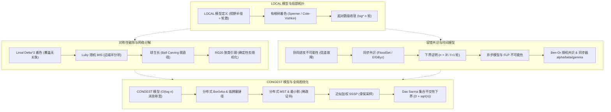

# 6.5250 分布式算法（Distributed Algorithms）

## TL;DR

- **分布式理论的三大核心模型**：深入研究分布式计算的理论基石，系统覆盖 LOCAL 局部分布式模型、CONGEST 带宽受限模型以及异步容错消息传递系统。
- **对称性破除与全局图优化**：涵盖局部网络着色、最大独立集（MIS）、网络分解与去随机化引擎，以及全局最小生成树（MST）、最小割与加权最短路近似算法。
- **不可逾越的理论边界与证明**：重点聚焦于用组合技术与信息论推导严格的轮复杂度上界、下界及不可能结果（如 Linial 着色下界、FLP 不可能性、拜占庭 $n > 3f$ 与 Peleg-Rubinovich 带宽下界）。

## 课程介绍

### 先修课程

- [6.1220 算法的设计与分析（Design and Analysis of Algorithms）](../61220_design_and_analysis_of_algos/index.md)：熟练掌握基础图论算法、贪心策略、动态规划与渐近复杂度分析。
- [6.1200 计算机科学数学（Mathematics for Computer Science）](../61200_maths_for_cs/index.md)：图论结构、组合计数、递归关系与离散概率基础。
- 概率与随机算法：熟练掌握条件概率、期望线性性、马尔可夫不等式、切诺夫界与联合界。
- 计算理论与自动机（MIT 6.045）：熟悉状态机形式化模型、不可区分性论证与计算复杂性基础。

### 官方对课程描述的翻译

分布式算法是现代众多计算系统与基础设施的理论核心，包括有线与无线通信网络、大规模集群计算、多核并发系统、分布式数据库与去中心化协调协议。MIT 6.5250（由 Mohsen Ghaffari 教授主讲）定位为分布式计算理论方向的高级研究生课程，旨在帮助学习者建立关于分布式环境下的通信、协调、局部性与容错原理的深厚理论根基，并掌握严格分析分布式轮复杂度与证明理论下确界的技术方法。

课程的四大理论支柱涵盖：
1. **LOCAL 局部分布式计算与对称性破除**：刻画输出对局部拓扑依赖半径的本质极限，运用确定性掷币（Cole-Vishkin）、覆盖无关族与缺陷着色解决图着色与最大独立集（MIS）问题。
2. **网络分解与分布式去随机化**：以球生长（Ball Carving）和 Rozhoň-Ghaffari（RG20）确定性聚类引理为引擎，实现将任意局部图算法从随机化到确定性多项式对数轮的通用转换。
3. **容错与同步/异步共识理论**：系统分析可靠信道与不可靠信道下的共识协议（FloodSet、EIG），严格证明拜占庭 $n > 3f$ 六边形拼接几何下界、网络连通度要求以及异步环境下的 FLP 不可能性定理。
4. **CONGEST 带宽瓶颈与全局图优化**：在每轮 $O(\log n)$ 位受限带宽下，基于低拥塞捷径（Low-Congestion Shortcuts）求解分布式 MST、Min-Cut 与近似最短路，并借助两方通信复杂度归约证明 $\tilde\Omega(D+\sqrt n)$ 截面瓶颈下界。

### 参考书籍

**经典教材与学术专著**：
- Nancy A. Lynch. *Distributed Algorithms*. Morgan Kaufmann, 1996.（经典权威教材，全面覆盖同步/异步共识、网络搜索与同步器体系）
- Hagit Attiya, Jennifer Welch. *Distributed Computing: Fundamentals, Simulations, and Advanced Topics* (2nd Edition). Wiley, 2004.（强调时间模型、并发系统模拟与形式化规约）
- Maurice Herlihy, Nir Shavit. *The Art of Multiprocessor Programming*. Morgan Kaufmann, 2008.（多核与共享内存并发算法核心基础）
- Rachid Guerraoui, Michal Kapalka. *Principles of Transactional Memory*. Morgan & Claypool, 2010.
- Shlomi Dolev. *Self-Stabilization*. MIT Press, 2000.
- Dilsun Kaynar, Nancy Lynch, Roberto Segala, Frits Vaandrager. *The Theory of Timed I/O Automata* (2nd Edition), 2010.

## 课程知识体系

### 模块全景架构

本课程系统构建了分布式计算理论的四层认知进阶模型，完整揭示了从局部邻域拓扑到全网带宽瓶颈、从无故障同步推进到对抗性拜占庭容错的演进逻辑：

- **模块一：同步原语与 LOCAL 模型**
  建立分布式计算的形式化语义。LOCAL 模型不设消息大小限制，使“算法运行轮数”完全等价于节点输出对周围邻域的“观察依赖半径”。以有根树 3-着色为例，展示利用单轮比特位压缩实现 $\log^* n$ 超对数级收敛的局部奇迹。
- **模块二：局部分布式图算法与对称性破除**
  研究在高度对称的拓扑中如何打破僵局。利用覆盖无关族实现 Linial $O(\Delta^2)$ 着色，运用 Luby 随机算法与“单手击杀”期望边减半证明快速求解 MIS。更进一步，以弱/强直径网络分解作为通用归约器，通过 RG20 聚类引理实现里程碑式的分布式去随机化。
- **模块三：容错共识与异步不可能性**
  从良性环境过渡至不可靠现实。严格证明信道不可靠导致协同进攻不可解；在节点崩溃与拜占庭作恶模型下推导 $f+1$ 轮与 $n > 3f$ 的不可逾越几何界；剖析异步系统中的 FLP 不可能性定理（双值性与鞍点震荡），并用 Ben-Or 随机硬币打破僵局。
- **模块四：CONGEST 模型与全局图优化**
  引入每条边每轮 $O(\log n)$ 比特的刚性带宽约束。通过小分量本地聚合与大分量全局 BFS 流水线协同求解分布式 MST；利用连通度稀疏证书与边收缩计算近似最小割；借助限跳 Bellman-Ford 与骨架采样打破加权图跳数壁垒，并基于集合不交性（Set Disjointness）证明 $\tilde\Omega(D+\sqrt n)$ 截面下界。

各模块之间的演进与理论映射关系如下图所示：

上述体系清晰表明：分布式计算理论不是零散算法的拼盘，而是一套紧密交织的数学大厦——局部视野与全局带宽互为对偶，容错共识与去随机化交相辉映。

### 讲义全景清单

| 讲次 | 核心主题与算法 | 讲义链接 | 核心机制与理论收益 |
| :--- | :--- | :--- | :--- |
| **Lec 01** | LOCAL 模型与有根树着色 | [lec1.md](./lec1.md) | 局部性数学刻画、$\log^*$ 迭代对数、Sperner 家族、单轮指数颜色压缩 |
| **Lec 02** | 泛洪、BFS 树、广播与 Bellman-Ford | [lec2.md](./lec2.md) | CONGEST 模型通信约束、流水线广播、散发-聚合范式、分布式最短路 |
| **Lec 03** | 一般图的确定性着色 | [lec3.md](./lec3.md) | Linial 算法、覆盖无关族显式构造、分桶并行缩减、Kuhn 缺陷着色 |
| **Lec 04** | 着色下界与拓扑不可区分性 | [lec4.md](./lec4.md) | 有向路径 3-着色 $\Omega(\log^* n)$ 下界、Ramsey 论证、高围长图局部不可区分性 |
| **Lec 05** | 最大独立集 MIS 与 Luby 算法 | [lec5.md](./lec5.md) | MIS 到着色归约、Luby 随机算法、单手击杀期望边减半严格分析 |
| **Lec 06** | 网络分解：定义与随机化构造 | [lec6.md](./lec6.md) | 弱/强直径分解、簇间分离性、几何分布球生长（Ball Carving）无记忆性 |
| **Lec 07** | 网络分解：确定性构造与 RG20 | [lec7.md](./lec7.md) | RG20 突破、聚类引理、逐比特前缀消界机制、分布式通用去随机化 |
| **Lec 08** | 容错同步共识算法 | [lec8.md](./lec8.md) | 协同进攻不可能性、FloodSet 停止容错、EIGByz 指数信息收集树递归多数表决 |
| **Lec 09** | 容错同步共识下界 | [lec9.md](./lec9.md) | 拜占庭 $n > 3f$ 六边形拼接几何反证、连通度 $\ge 2f+1$、$f+1$ 轮下界 |
| **Lec 10** | 异步共识：FLP 不可能性与 Ben-Or | [lec10.md](./lec10.md) | 异步时序、双值配置与临界步菱形引理、Ben-Or 随机硬币打破鞍点僵局 |
| **Lec 11** | 同步器：模型转换与簇分解 | [lec11.md](./lec11.md) | GlobSynch 规范、安全推进抽象、$\alpha/\beta/\gamma$ 同步器时间-通信权衡 |
| **Lec 12** | 最小生成树 MST 算法 | [lec12.md](./lec12.md) | 分布式 Borůvka、大小分量双速调度、低拥塞捷径（Shortcuts）与 $\tilde O(D+\sqrt n)$ 界 |
| **Lec 13** | 最小割 Min-Cut 近似算法 | [lec13.md](./lec13.md) | 连通度稀疏证书、加权生成森林迭代、边收缩、$(2+\varepsilon)$-近似割 |
| **Lec 14** | 全局问题下界：MST、Min-Cut 与最短路 | [lec14.md](./lec14.md) | Peleg-Rubinovich 高速路构造、两方通信复杂度归约、集合不交性 $\tilde\Omega(D+\sqrt n)$ 紧界 |
| **Lec 15** | 最短路径算法 I：加权最短路近似 | [lec15.md](./lec15.md) | 跳数直径与拓扑直径脱钩、限跳 Bellman-Ford、$\sqrt n$ 骨架采样、$(1+o(1))$-近似 |
| **Lec 16** | 最短路径算法 II：路由表与生成子图 | [lec16.md](./lec16.md) | 骨架图压缩、Baswana-Sen 稀疏生成子图（Spanner）、紧凑路由表构造 |

## 进阶前沿专题（论文研读）

- **专题 1：全连通网络中的路由**
  - Lenzen & Wattenhofer, STOC 2011 · [Routing in the Complete Network](https://dl.acm.org/doi/10.1145/1993636.1993639)
  - Lenzen, PODC 2013 · [Optimal Routing in the Complete Network](https://dl.acm.org/doi/10.1145/2484239.2501983)
- **专题 2：线性素描与动态图连通性**
  - Ahn, Guha, McGregor, SODA 2012 / PODS 2012 · [Dynamic Graph Streams via Linear Sketching](https://people.cs.umass.edu/~mcgregor/papers/12-dynamic.pdf)
  - Kapron, King, Mountjoy, SODA 2013 · [Dynamic Graph Connectivity in Polylogarithmic Worst Case Time](https://epubs.siam.org/doi/10.1137/1.9781611973105.81)
- **专题 3：局部计算算法 (LCAs)**
  - Nguyen & Onak, FOCS 2008 · [Constant-Time Approximation Algorithms for Maximum Matching and Other Problems](https://ieeexplore.ieee.org/abstract/document/4690966/)
  - Rubinfeld, Tamir, Vardi, Xie, ITCS 2011 · [Fast Local Computation Algorithms](https://arxiv.org/abs/1104.1377)
  - Ghaffari, FOCS 2022 · [Derandomizing Local Computation Algorithms](https://arxiv.org/abs/2210.01104)
- **专题 4：图粉碎与局部复杂度格局**
  - Barenboim, Elkin, Pettie, Schneider, FOCS 2012 · [The Locality of Distributed Symmetry Breaking](https://ieeexplore.ieee.org/abstract/document/6375310)
  - Ghaffari, SODA 2016 · [An Improved Distributed Algorithm for Maximal Independent Set](https://epubs.siam.org/doi/10.1137/1.9781611974331.ch20)
  - Chang, Kopelowitz, Pettie, FOCS 2016 · [An Exponential Separation between Randomized and Deterministic Complexity in the LOCAL Model](https://ieeexplore.ieee.org/document/7782976)
  - Chang & Pettie, FOCS 2017 · [A Hierarchy of Lower Bounds for Sublinear Additive Spanners](https://arxiv.org/abs/1704.06297)
- **专题 5：分布式 Lovász Local Lemma**
  - Moser & Tardos, JACM 2010 · [A Algorithmic Proof of the General Lovász Local Lemma](https://dl.acm.org/doi/abs/10.1145/1667053.1667060)
  - Chung, Pettie, Su, PODC 2014 · [Distributed Algorithms for the Lovász Local Lemma and Graph Coloring](https://dl.acm.org/doi/10.1145/2611462.2611465)
- **专题 6：拟团分解与局部舍入**
  - Halldorsson, Maus, Kuhn, Tonoyan, STOC 2021 · [Fast and Simple Distributed Coloring through Almost Clique Decomposition](https://dl.acm.org/doi/10.1145/3406325.3451089)
  - Ghaffari & Kuhn, FOCS 2021 · [Local Rounding](https://ieeexplore.ieee.org/stamp/stamp.jsp?arnumber=9719807)
  - Faour, Ghaffari, Grunau, Kuhn, Rozhon, SODA 2023 · [Distributed Lovász Local Lemma and MIS](https://arxiv.org/abs/2209.11651)

## 官方资源

- [MIT 6.5250 官方课程主页（Mohsen Ghaffari）](https://people.csail.mit.edu/ghaffari/DA25/)
- [分布式图算法（Distributed Graph Algorithms, DGA）讲义草稿](https://people.csail.mit.edu/ghaffari/)
- [MIT CSAIL 分布式计算与理论研究组](https://theory.csail.mit.edu/)
- [MIT OpenCourseWare 分布式系统与算法理论归档](https://ocw.mit.edu/)
