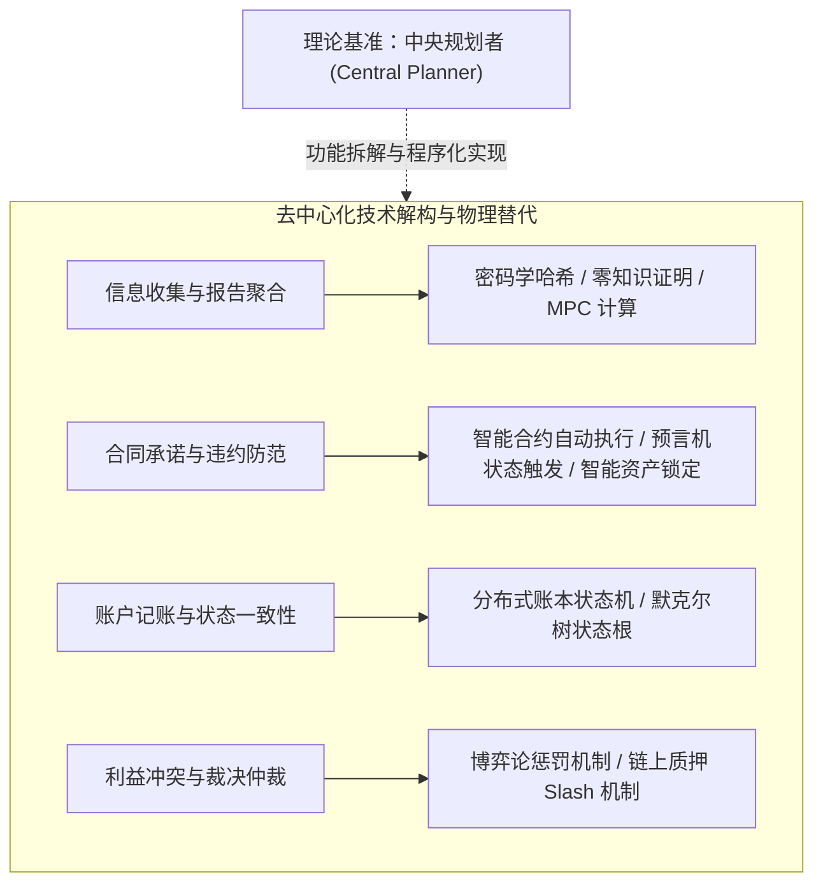
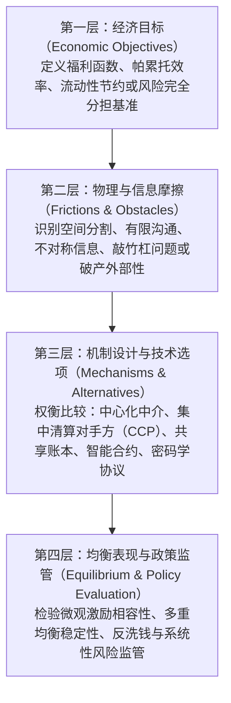

# Lec 1 课程导论与经济学-计算机科学联合分析框架（Introduction to the Class）

> **授课教师**：Robert M. Townsend（MIT 经济学系 Killian 讲席教授）  
> **核心文献**：Robert M. Townsend & Nicolas X. Zhang (2023), *"Technologies That Replace a 'Central Planner'"*, *AEA Papers and Proceedings*, 113: 257–262.

## TL;DR

- 课程建立微观经济学契约理论、机制设计与理论计算机科学的联合分析框架，评估去中心化技术在金融中的真实效用。
- 经济学中的“中央规划者”仅是刻画帕累托最优资源配置的理论基准，并非现实中必须存在的全权物理垄断实体。
- 身份认证、密码承诺、自动执行与共识算法是可拆解解耦的技术模块，可由代码、分布式网络或受信任托管方灵活重组。
- 传统遗留金融系统充斥割裂的私有数据库与层层清算摩擦，去中心化技术提供了重构结算层与消除市场失灵的新路径。

## 计算机科学与经济学工具箱的融合

在主流语境中，计算机科学界与经济学界对新兴金融技术的讨论长期处于两套独立的话语体系。计算机领域偏重底层通信协议、算力成本、数据结构与系统吞吐量；而经济学界则偏重信息结构、博弈激励、均衡存在性与社会福利最优化。

本课程的核心目标是将两门学科的概念与工具置于同一分析平面：

| 维度 | 计算机科学工具箱（CS Toolbox） | 经济学工具箱（Economics Toolbox） | 联合分析的底层经济学问题 |
|---|---|---|---|
| **核心客体** | 加密货币、代币化资产（Tokens）、智能合约、跨链平台、离线状态通道 | 跨期契约、内生货币、状态依存证券、金融中介、双边与多边交易机制 | 谁在何时持有资产的所有权与使用权？资产如何跨越时间与状态转移？ |
| **理论基石** | 状态机复制、拜占庭容错、图论与网络流算法、密码学困难度假设 | 阿罗-德布鲁一般均衡、机制设计与启示原理、动态博弈、逆向选择与道德风险 | 经济主体是否有真实意愿揭示私有信息？协议的执行是否具备纳什均衡稳定性？ |
| **解决的问题** | 数据一致性（Consistency）、双花防护（Double-spending）、抗审查、网络分区容忍 | 帕累托最优配置、解决搭便车、消除银行挤兑、平滑特质与系统性风险冲击 | 现有遗留系统的市场失灵根源是什么？去中心化协议能否改善配置效率？ |

::: definition 计算机与经济学联合分析视角
去中心化金融技术（包括分布式账本、智能合约与密码学机制）不是凭空创造经济价值的“炼金术”，而是一组**降低信息传递、承诺履约与多方协调摩擦的计算技术工具**。评价技术优劣的标准，不是其概念的新颖度，而是其在特定信息不对称与激励约束下，能否逼近经济学理论上的社会最优资源配置。
:::

## 替代“中央规划者”的技术逻辑

在福利经济学与一般均衡理论中，**中央规划者（Central Planner）**是一个不可或缺的分析工具：规划者汇总所有参与者的效用函数、生产函数与资源禀赋，在资源约束与技术约束下求解拉格朗日最优化问题，从而导出帕累托最优（Pareto Optimum）边界。

然而，在传统经济学争论中，中央规划者常常被误解为现实中必须设立的“中央集权政府”或“中心化结算垄断银行”。Townsend & Zhang (2023) 明确指出：

1. **理论基准 vs 现实实体**：中央规划者只是描述“给定信息与资源约束下最优配置长什么样”的参照物；
2. **功能的去中心化实现**：中央规划者的各项核心功能，可以通过计算机代码、密码学承诺与分布式账本在无中央权威的环境下被精确切分并逐一实现：



::: theorem 规划者抽象定理（Townsend & Zhang 2023 核心思想）
任何依赖中央规划者实施的受约束有效配置（Constrained-Efficient Allocation），只要其信息与激励约束能够在算法上形式化表达，就可以通过由预先验证的开源代码、链上密码学抵押托管（Escrow）以及去中心化状态机组成的协议来去中心化实现，而无需赋予任何单一节点自由裁量权或寻租垄断权力。
:::

## 解构技术标签：不要把不同技术捆绑为一体

去中心化金融领域的常见误区是“概念捆绑”，即把区块链、代币、智能合约与共识算法看作必须同时存在的不可分割整体。Townsend 教授强调必须彻底解构这些模块：

```text
传统认知模式（强行绑定）：
[ 去中心化金融 ] ===> 必须有公开区块链 + 必须发代币 + 必须有 PoW/PoS 挖矿共识

Townsend 解构视角（模块化自由组合）：
1. 身份认证与消息防篡改  --> 非对称加密公私钥签名（无需区块链即可运行）
2. 合同逻辑与条件触发    --> 确定性代码与状态机（可在单机服务器、TEE 或链上运行）
3. 资金清算承诺          --> 链上原生托管锁定（Escrow）或传统受信任第三方托管账户
4. 状态历史全局共识      --> 仅当多方存在拜占庭恶意篡改风险且缺乏受信任中介时才需要共识算法
```

::: example
- **情境 A（多机构银行间结算）**：参与行之间具备现实法律约束与已识别身份，只需共享只读副本与基于阈值签名的状态机代码（无需 PoW 挖矿与原生加密代币）；
- **情境 B（跨期供应链信用抵销）**：企业间存在由商业发票形成的环形欠款链，只需一个执行最大流算法的计算节点与多方数据加密证明，即可无现金注销债务，完全不需要公开代币发行。
:::

## 贯穿全课的四层分析方法论

为了在后续 10 讲中对各类复杂应用（社区货币、跨期债务、代币化、多边结算、金融网络、拍卖）展开严格推演，课程确立了“四层递进分析法”：



1. **经济目标层**：明确系统要达成的目标。例如：跨期消费平滑、违约损失最小化、零流动性占用下的支付清算；
2. **现实摩擦层**：现实中哪些障碍阻碍了有效交易？是交易双方无法建立信任（交易对手风险）？还是交易对手无法获知全网网络结构（信息孤岛）？亦或是清算时间差导致了交割失败（结算风险）？
3. **技术选项层**：针对具体摩擦选择最小足量技术。如果受信任的托管行成本极低且监管完备，共识算法带来的高昂能耗与低吞吐量是否仍然合理？
4. **均衡评估层**：参与人在机制下是否具有策略性操纵激励？机制是否会因策略互补性陷入挤兑或协调失灵的坏均衡？

## 后续讲座的问题链与全景脉络

Townsend 教授在第一讲预告了贯穿全学期的理论逻辑演进线索：

1. **数据库、货币与信息瓶颈（第 2–3 讲）**：
   - 从复式记账法到比特币 UTXO 与以太坊账户模型，数据库如何表达“货币”？
   - 当市场出现空间分割时，即使所有市场存在统一出清价格，局部双边信息为何依然无法保证帕累托有效交易？（Ostroy-Starr 不可能性定理）。
2. **跨期承诺、可编程资产与流动性网络（第 4–7 讲）**：
   - 跨时间和地点的私人债务发行如何充当高流速货币？为何缺乏全网协调会导致自发市场崩溃？
   - 代币化与原子结算消除了传统 T+2/T+1 的交易失败（Trade Fails），但为何会在做市商撮合中诱发严重的“敲竹杠”（Hold-up）与议价暴露风险？
   - 面对巨额逾期商业信用网络，图论与网络流算法（MTCS）如何在不注入外部现金的前提下实现环形债务抵销？
   - 在随机金融网络中，中央银行的紧急流动性应当注入哪个节点，才能最大化全社会的风险分担价值？
3. **微观激励、隐私计算与前沿算法博弈（第 8–11 讲）**：
   - 计算机科学的“拜占庭容错协议”与经济学的“激励相容机制设计”有何根本哲学分歧？
   - 现代密码学原语（公私钥、哈希、ZKP、MPC、同态加密）如何帮助金融主体在完全保密私有估值与现金流的前提下，实现高效拍卖与跨机构风险池？
   - 在计算不可行（PPAD-complete）的纳什均衡现实约束下，粗相关均衡（CCE）与在线学习算法如何赋能去中心化交易所（如 SPEEDEX）实现毫秒级抗 MEV 出清？

## 我的理解与洞见

::: insight
传统对区块链的讨论往往陷入“极端去中心化无政府主义”与“传统中心化金融万能论”的二元对立。Townsend 教授的框架给出了极具穿透力的经济学裁决：**去中心化不是信仰，而是一种特定的信息与契约组织架构**。

在古典阿罗-德布鲁范式中，市场需要一个看不见的“瓦尔拉斯拍卖官”汇总全市场超额需求并报出出清价格。传统金融用大型垄断商业银行、中央证券存托机构（CSD）和中心化对手方（CCP）充当这个拍卖官与记账员，但这带来了寻租垄断、数据壁垒与单点故障风险。去中心化技术的实质，是用确定性执行的代码与共享账本，将“拍卖官”的职能还原为无需信任主体的公共协议。理解这一点的关键在于：**凡是可以用数学形式化定义和链上验证的契约关系，都可以剥离中心化中介的自由裁量权；凡是依赖链外主观裁量与不完全契约的环节，单纯上链无法消除经济摩擦**。
:::

## 常见认知误区与概念混淆

::: pitfall
- **混淆“资产所有权”与“数据库记账”**：区块链上的代币不是一个物理实体存放在钱包中，而是去中心化账本状态树上的一串键值映射。持有私钥仅仅代表拥有签署状态转移交易的数学授权，并不代表脱离了账本共识规则的物理占有。
- **误以为“代码即法律”能完全消灭欺诈**：智能合约只能确保链上状态转移严格按照代码逻辑执行（Syntactic Correctness），无法保证输入数据的真实性（预言机问题，Oracle Problem），更无法自动解决信息不对称带来的逆向选择与道德风险。机制设计仍然必须满足参与者的激励相容约束（Incentive Compatibility）。
- **误将“无许可共识”视作所有场景的最优解**：无许可共识（如 PoW/PoS）是以巨大的计算冗余、高交易延迟与终局性概率确认（Probabilistic Finality）为代价换取抗审查性。在大多数需要高频清算、强法律管辖与已识别对手方的机构金融场景中，无需引入高能耗的去中心化共识算法，基于状态机与确定性签名的私有/联盟架构更为经济。
:::

## 核心参考文献与材料链接

- **必读文献**：Robert M. Townsend and Nicolas X. Zhang (2023), [“Technologies That Replace a ‘Central Planner.’”](https://www.aeaweb.org/articles?id=10.1257/pandp.20231031) *AEA Papers and Proceedings*, 113: 257–262.
- **推荐参考书**：Robert M. Townsend (2020), [*Distributed Ledgers: Design and Regulation of Financial Systems*](https://direct.mit.edu/books/oa-monograph/4932/Distributed-LedgersDesign-and-Regulation-of), MIT Press.
- **组织理论背景**：Jacky Mallett (2009), [“Limits on the Communication of Knowledge in Human Organisations”](https://cosmosandtaxis.org/wp-content/uploads/2014/05/sieo_2_2009_mallett.pdf), *Studies in Emergent Order*, 2: 1–18.
- **官方公开课视频**：[MIT OCW Lecture 1 on YouTube](https://www.youtube.com/watch?v=n4rlqluNA-Q)
