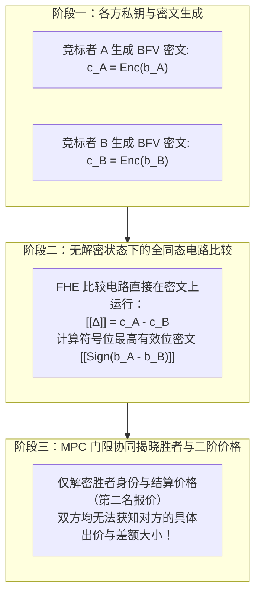
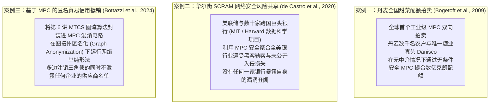

# Lec 10 加密金融基础设施设计：拍卖、保险与暗池（Designs of Financial Infrastructure Utilizing Encryption）

> **授课教师**：Robert M. Townsend（MIT 经济学系 Killian 讲席教授）  
> **长标题**：无拍卖官拍卖、混合信贷与保险机制、密码学在区块链金融基础设施中的落地实现（Auctions, Hybrid Credit and Insurance, and Implementation of Cryptography on the Blockchain）  
> **核心文献**：Peter Bogetoft et al. (2009), *"Secure Multiparty Computation Goes Live"*; Leo de Castro et al. (2020), *"SCRAM: A Platform for Securely Measuring Cyber Risk"*; Bottazzi, Ngo and Tsutsumi (2024), *"Multilateral Trade Credit Set-off in MPC via Graph Anonymization and Network Simplex"*.

## TL;DR

- 传统金融中介拍卖官（如场外 BWIC 交易员）存在严重的敲竹杠、抬价虚构与泄露报价流等道德风险。
- 基于格密码学 BFV 方案与 MPC，可在完全隐藏各买家真实出价的前提下，数学确定性选出最高出价者并结算维克里二阶价格。
- 在金融机构流动性救助与信用保险中，公开理赔历史会引发掠夺性做空；密码学状态承诺可在隐藏困境的同时维系动态激励。
- 丹麦甜菜拍卖与 SCRAM 网络安全互助实证表明，密码学机制设计已能够支撑国家级高价值商业资产的无中介安全出清。

## 传统中心化拍卖的内生道德风险

拍卖（Auctions）是金融市场发现公允价格、配置稀缺资产的最核心机制。然而在华尔街现实中，绝大多数拍卖依赖中心化的**拍卖官（Auctioneer）**或经纪商中介（如抵押贷款拍卖经理 Trade Auction Manager、场外债券竞争性询价 BWIC 系统）。

中心化拍卖官的存在滋生了极其猖獗的**代理人寻租与操纵行为**：

```mermaid
sequenceDiagram
    autonumber
    actor A as 竞标买家 A (真实估值 $100)
    participant Broker as 中心化经纪拍卖官 (Broker)
    actor B as 竞标买家 B (真实估值 $80)

    A->>Broker: 提交密封买单: $95
    B->>Broker: 提交密封买单: $75
    Note over Broker: 道德风险爆发：拍卖官私下扣留底牌并违规串通！
    Broker->>B: 私下致电: "伙计，A 出了 $95，你只要加到 $96，东西就是你的"
    B->>Broker: 被迫抬高报价至 $96
    Broker->>A: 再次致电: "B 出了 $96，你愿不愿加到 $97？"
    Note over A,B,Broker: 拍卖官通过泄露暗池订单流操纵价格，吞噬买卖双方全部剩余
```

- **BWIC 询价暗箱**：在抵押支持证券（MBS）与企业债场外电话询价中，做市商常常通过虚构“存在另一个更高出价者”的假象，逼迫真实买家单边加价（Bid Shading）；
- **P2P 平台欺诈与挑选性资产证券化（Cream-skimming）**：中介平台利用信息优势，将劣质资产打包给普通投资者竞标，而将优质资产截留在内部关联账户中。

## 突破中心化中介：“无拍卖官拍卖”的数学实现

Townsend 教授指出，借助现代密码学中的**全同态加密（FHE）与多方安全计算（MPC）**，我们可以在完全不需要任何拍卖官的前提下，运行数学上无懈可击的**维克里第二价格拍卖（Vickrey Second-Price Auction）**。



### 基于格密码学（BFV 方案）的密文比较算法

在标准的 BFV（Brakerski, 2012; Fan & Vercauteren, 2012）环同态加密体制中：
- 计算定义在割圆多项式商环 $R_q = \mathbb{Z}_q[x] / (f(x))$ 上，其中 $f(x) = x^n + 1$ 为 $n$ 次不可约多项式；
- 全局公开参数包括随机均匀采样的多项式 $a \in R_q$；
- 参与主体 $i \in \{A, B\}$ 生成各自的公钥私钥对：
  $$pk_i = ([-(a \cdot s_i + e_i)]_q, a), \quad sk_i = s_i$$
  其中 $s_i$ 为私钥多项式，$e_i \leftarrow \chi$ 为从离散高斯分布中抽取的微小误差噪声项（保证 LWE 格问题的计算困难度）。

#### 密文比较机制设计

1. **同态减法**：合约节点或各方直接对密文执行环加法，得到差值密文 $[[b_A - b_B]]$；
2. **符号提取与二阶价格结算**：
   - 比较电路提取差值的符号比特：若 $b_A \ge b_B$，则指示变量 $I_{A > B} = 1$；
   - 根据维克里规则，胜者为 $A$，但其支付的价格严格设定为落败者 $B$ 的报价 $b_B$；
   - **信息论隐私保障**：全网最终仅解密获得胜者公钥标识与成交价格，**买家 A 的真实出价底牌 $b_A$ 从始至终从未被解密揭晓**，彻底杜绝了任何拍卖官或对手方的事后敲竹杠可能。

## 混合信贷与互助保险：隐私历史与动态激励

除了静态拍卖，金融基础设施中另一大支柱是**风险共担与流动性救助网络**（如银行间互助流动性支持池、大宗商品供应链应收账款保险）。

### 救助中的公开性悖论（The Opacity Dilemma in Financial Bailouts）

当一家金融机构或做市商遭遇偶发性流动性干涸（Cash Flow Shock）时，系统应当向其提供应急授信。然而在现实中：
- **若历史完全公开**：如果智能合约将某家做市商的理赔申请与亏损历史公开上链，全市场的投机资本与空头基金将立即获知该做市商脆弱度激增，从而发起协同掠夺性做空（Predatory Trading），将其逼入绝境；
- **若历史完全保密**：若理赔记录不被任何追踪，该做市商将在未来每一次稍有风吹草动时恶意谎报受灾，引发严重的道德风险与保费池被掏空。

### 汤森-张机制：密码学动态状态承诺

Townsend & Zhang (2020) 提出了结合零知识承诺的动态保险机制：

::: definition 隐私状态递归承诺机制（Townsend & Zhang, 2020）
1. **私有历史的密码学哈希链**：主体 $i$ 的历史理赔与汇报序列 $h_t^i = (q_1^i, q_2^i, \dots, q_t^i)$ 不公开发布在链上，而是以叶子节点形式折叠进状态哈希承诺中：
   $$C_t^i = H(C_{t-1}^i \parallel q_t^i \parallel \text{Salt}_t^i)$$
2. **零知识资格证明**：当主体在 $t+1$ 期再次遭遇流动性冲击时，它向智能合约提交一份 zk-SNARK 证明：
   - 证明：“我当前持有的承诺 $C_t^i$ 是合法推演生成的”；
   - 证明：“根据既定的动态契约罚则，我的历史累计索赔次数未超过风险阈值 $K$，因此我有权获得当期救助金 $B$”；
3. **完美隐私与动态激励相容**：全网和竞争对手仅看到一份合法的 ZK 证明并自动释放资金，**完全无法获知该机构究竟是第 1 次还是第 $K$ 次申请救助，亦无法反推其历史受灾的具体金额**，在完美隐藏机构脆弱性的同时，保持了跨期惩罚的微观激励相容性。
:::

## 全球生产级密码学金融基础设施案例

Townsend 教授在第 10 讲详细剖析了近年来全球计算机科学界与金融界落地的三大硬核工程典范：



### 1. 丹麦甜菜配额拍卖（Bogetoft et al., 2009）
- **背景**：欧盟削减甜菜补贴，丹麦全国 1200 名农户急需在彼此之间转让生产配额。但由于当地存在唯一的垄断收购巨头 Danisco，农户极度恐惧自己的真实种植成本底牌被 Danisco 窥探后遭到压价收购；
- **实现**：计算机科学家利用基于沙米尔秘密共享的无条件安全 MPC 协议，由丹麦农户协会、Danisco 与学术机构各持一台服务器。全网盲目汇总数千张供需曲线，自动计算出瓦尔拉斯市场出清价格并撮合成功，开创了无中介商业拍卖先河。

### 2. SCRAM 网络安全风险池（de Castro et al., 2020, HDSR）
- **痛点**：全美大型金融机构每年遭受数百次网络攻击与勒索软件勒索，各家银行急需统计全行业的总体损失分布以精确厘定网络安全保险费率；但任何一家大行如果主动公开自己被黑客勒索了 5000 万美元，次日其股价将遭遇崩盘性暴跌并遭受监管重罚；
- **破局**：麻省理工学院研发的 SCRAM 平台利用门限加密与同态求和，数十家华尔街银行在本地向协议输入各自真实的损失数据，最终系统仅输出全美银行业的宏观聚合损失概率密度函数（PDF），单家银行的隐私得到了密码学绝对保护。

## 我的理解与洞见

::: insight
传统金融体系之所以必须设立数量庞大、费用高昂的受信任中介（如投行、托管行、评级机构、拍卖行），**其本质原因在于传统人类社会缺乏‘不信任彼此但能够共同计算’的数学工具**。为了达成合作，大家不得不共同指定一个‘德高望重’的第三方，把所有身家底牌毫无保留地交到他手上，并祈祷他恪尽职守不作恶。

但历史无数次证明：**拥有绝对信息特权的中介，最终必然走向绝对的腐败与寻租**（如 2008 年次贷危机中评级机构的操纵、场外交易员对客户订单流的暗中抢跑 Front-running）。

**第 10 讲展示的加密金融基础设施，代表了人类金融文明组织形态的根本范式转移**：
利用现代加密学（FHE、MPC、ZKP），我们第一次能够将‘中介机构’从一个由贪婪人类掌控的物理实体，**降维为一个纯粹由不可侵犯数学定律守护的‘密码学盲盒’**。

参与者将私密数据投入盲盒，盲盒在漆黑的数学虚空中严格依据预设的帕累托最优算法完成计算，最终只吐出对各方皆有效率的博弈结算结果，而参与者的商业机密自始至终未曾走出自身的防火墙。**这是人类克服背叛与猜忌、在算法信任基准上构建宏观金融基础设施的终极形态**。
:::

## 常见认知误区与概念混淆

::: pitfall
- **误以为暗池（Dark Pools）就是黑市或洗钱工具**：合规金融暗池的唯一目的是避免大型机构在公开订单簿上挂出巨额买单时引发全市场的抢跑与价格滑点（Market Impact）。加密暗池并非逃避反洗钱监管，而是在满足资金来源合规证明的前提下，保护真实交易者的合法商业意图不被高频量化掠夺。
- **误将“多方安全计算（MPC）”视作单一计算机算法**：MPC 是一整套庞大的协议族体系。基于混淆电路（Garbled Circuits）的协议偏重布尔逻辑门评估，通信轮数极少但带宽消耗巨大；基于秘密共享（Secret Sharing）的协议在算术加减法上速度极快，但在乘法门处理时需要节点间频繁网络往返交互。金融工程设计者必须根据网络延迟与计算密集度进行精细的技术选型。
:::

## 核心参考文献与材料链接

- **MPC 商业落地开山之作**：Peter Bogetoft, Dan Lund Christensen, Ivan Damgård et al. (2009), [“Secure Multiparty Computation Goes Live”](https://eprint.iacr.org/2008/068.pdf), *Financial Cryptography and Data Security*, Springer.
- **华尔街网络安全互助实证**：Leo de Castro et al. (2020), [“SCRAM: A Platform for Securely Measuring Cyber Risk”](https://hdsr.mitpress.mit.edu/pub/gylaxji4/release/6), *Harvard Data Science Review*, 2(3).
- **隐私图流多边抵销**：Bottazzi, Ngo and Tsutsumi (2024), “Multilateral Trade Credit Set-off in MPC via Graph Anonymization and Network Simplex”, *Cryptology ePrint Archive*.
- **全同态加密前沿在智能合约中的综述**：Chatzigiannis, Townsend et al., “SoK: Fully-homomorphic encryption in smart contracts”, *Working Paper*.
- **官方公开课视频**：[MIT OCW Lecture 10 on YouTube](https://www.youtube.com/watch?v=Fj4yX8n5Tss)
