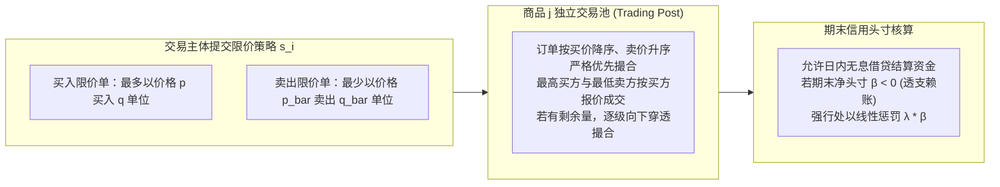
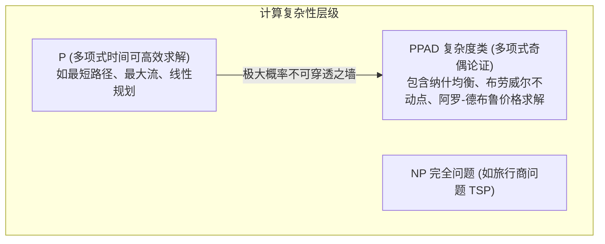
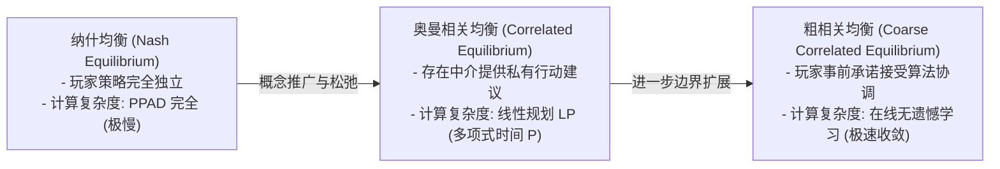
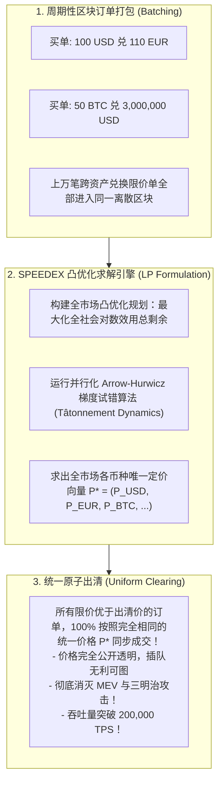

# Lec 11 算法博弈论与市场机制实现（Market Mechanisms and Alternative Equilibria）

> **特邀主讲**：Samuel Bruce（MIT 经济学系算法博弈论学者）  
> **联合授课**：Robert M. Townsend（MIT 经济学系 Killian 讲席教授）  
> **长标题**：通过计算可行算法实现瓦尔拉斯结果：从纳什均衡到相关均衡与粗相关均衡（Achieving Walrasian Outcomes with Computationally Feasible Algorithms, from Nash to Correlated Equilibria to Coarse Correlated Equilibria）  
> **核心文献**：Pradeep Dubey (1982), *"Price-Quantity Strategic Market Games"*; Constantinos Daskalakis, Paul W. Goldberg, and Christos H. Papadimitriou (2009), *"The Complexity of Computing a Nash Equilibrium"*; Geoffrey Ramseyer, Ashish Goel, and David Mazières (2023), *"SPEEDEX: A Scalable, Parallelizable, and Economically Efficient Decentralized Exchange"*.

## TL;DR

- 杜贝（Dubey, 1982）限价单策略市场博弈证明：只要每个交易池保持活跃竞价，非合作纳什均衡将完全收敛至瓦尔拉斯竞争均衡。
- 达斯卡拉基斯等人（DGP, 2009）证明求解纳什均衡属于 PPAD 完全问题，在计算复杂度上不可行，区块链无法实时求出精确纳什出清。
- 奥曼相关均衡（CE）与粗相关均衡（CCE）可借助线性规划与在线“无遗憾学习算法”（No-Regret Learning）在多项式时间内快速求解。
- 斯坦福 SPEEDEX 去中心化交易所将全市场订单打包为周期性凸优化规划，利用梯度试错法实现毫秒级批量统一出清，彻底消除了 MEV 抢跑。

## 杜贝（Dubey, 1982）限价单策略市场博弈

在微观经济学传统中，瓦尔拉斯竞争均衡（Competitive Equilibrium）往往被假定为一个外生“拍卖官”神秘宣布价格的过程。而在计算机科学与现实金融工程中，市场必须由具体的**出清算法与指令机制（Market Mechanics）**构建。

普拉迪普·杜贝（Pradeep Dubey, 1982, Econometrica）提出了将瓦尔拉斯均衡完全内生化的**限价单策略市场博弈（Price-Quantity Strategic Market Game）**。

### 博弈的形式化数学模型

设市场 $E$ 包含 $N$ 个参与者 $i \in \{1, \dots, N\}$ 与 $k$ 种商品。主体 $i$ 拥有初始禀赋 $a^i \in \mathbb{R}_+^k$ 与效用函数 $u^i(x^i)$。

1. **策略空间（Strategy Space）**：主体 $i$ 提交的策略为一个四元组向量：
   $$s^i = \{p^i, q^i, \bar{p}^i, \bar{q}^i\}, \quad \text{满足 } \bar{q}_j^i \le a_j^i \quad \forall j \in \{1, \dots, k\}$$
   含义为：“对于商品 $j$，若价格不高于 $p_j^i$，我愿买入最多 $q_j^i$ 单位；若价格不低于 $\bar{p}_j^i$，我愿卖出最多 $\bar{q}_j^i$ 单位”。
2. **撮合与清算规则**：每个商品 $j$ 设有独立的交易池。最高报价的买家与最低报价的卖家率先匹配；买家在交易过程中可以使用日内无息授信资金垫付，但若在交易周期结束时该交易者的净资金头寸 $\beta^i < 0$（即发生无抵押赤字），系统将对其施加惩罚 $\lambda \cdot \beta^i$，其中惩罚系数 $\lambda > 0$。

::: theorem 杜贝非合作均衡与瓦尔拉斯均衡等价定理（Dubey, 1982）
在博弈 $\Gamma(E, \lambda)$ 中，定义一个纳什均衡为：
- **活跃的（Active）**：每个商品的交易池中至少存在 2 位活跃买家与 2 位活跃卖家（排除垄断死锁）；
- **紧凑的（Tight）**：所有活跃交易者报出的出清价格彼此完全相等。
**定理**：对于任意市场环境 $E$ 与足够大的惩罚系数 $\lambda$，**该机制的所有紧凑活跃纳什均衡，在配置与价格上与经典瓦尔拉斯竞争均衡（Competitive Equilibrium）完全重合**！并且每一个紧凑活跃纳什均衡都是**强纳什均衡（Strong Equilibrium）**，即对任意有限规模子群体的合谋偏离均具有免疫性。
:::

## 理论落地的计算天花板：纳什均衡求解的 PPAD 完全性

杜贝机制从理论上证明了限价单撮合可以达到帕累托最优，但当区块链工程师试图在智能合约中编程求解这一均衡时，遭遇了理论计算机科学的铁律红线：**纳什均衡在计算上是不可行的（Computationally Intractable）**！

### DGP（2009）里程碑定理

康斯坦丁诺斯·达斯卡拉基斯、戈德堡与帕帕迪米特里乌（Daskalakis, Goldberg, Papadimitriou, 2009, SIAM J. Comput.；获计算机理论顶会最佳论文与奈望林纳奖）：

::: theorem 纳什均衡计算复杂性定理（DGP, 2009; Chen, Deng & Teng, 2009）
在一般有限博弈中（即便是只有 2 名玩家的普通双人非零和博弈，或在一般阿罗-德布鲁市场中寻找出清价格）：
- **求解精确或近似纳什均衡的问题是 PPAD 完全的（PPAD-complete）**；
- 除非 $\text{P} = \text{PPAD}$（计算机科学界普遍认为绝不可能），**不存在任何多项式时间算法能够在多项式步数内求出纳什均衡**；
- 求解复杂度随参与人数与资产种类呈指数级暴涨。
:::

**对区块链与金融设计的致命含义**：公共区块链的区块出块时间只有数十毫秒至十几秒（如以太坊 12 秒、Solana 400 毫秒）。如果去中心化交易所（DEX）试图通过算法在链上寻找全局纳什均衡出清价格，整个区块链网络将因巨大的计算负荷瞬间陷入死机崩溃！

## 破局利器：奥曼相关均衡与粗相关均衡

既然纳什均衡在计算上不可行，是否存在既具备优良经济学性质、又能在计算机上高效求解的**替代性均衡概念（Alternative Equilibria）**？

算法博弈论给出的答案是：**转向由罗伯特·奥曼（Robert Aumann, 诺贝尔经济学奖得主）开创的相关均衡体系**。

### 1. 奥曼相关均衡（Correlated Equilibrium, CE, 1974）

奥曼设想存在一个可信的中介或预言机算法，按照全网联合概率分布 $\mu(s) = \mu(s_1, \dots, s_n)$ 抽取一个策略组合，并**私下分别向每位参与者 $i$ 建议其应当执行的具体行动 $s_i$**：

::: definition 相关均衡判定条件
分布 $\mu$ 构成一个相关均衡，当且仅当：对于每一位收到行动建议 $s_i$ 的局中人，在结合贝叶斯后验概率推测其他玩家行动的前提下，**听从建议 $s_i$ 所获得的期望效用，绝不低于单边违抗建议改选其他任意策略 $s'_i$ 的效用**：
$$\sum_{s_{-i}} \mu(s_i, s_{-i}) \Big[ u_i(s_i, s_{-i}) - u_i(s'_i, s_{-i}) \Big] \ge 0 \quad \forall i, \forall s_i, s'_i \in S_i$$
:::

::: theorem 相关均衡的多项式可解性（Papadimitriou & Roughgarden, 2008）
在上述定义中，变量是概率值 $\mu(s)$，所有约束条件关于 $\mu(s)$ **全部是严格线性的**！  
因此，求解全网社会福利最优的相关均衡，可以直接转化为**经典线性规划（Linear Programming, LP）**问题。利用单纯形法或内点法，计算机可以在**多项式时间（Polynomial Time $\mathcal{O}(n^c)$）**内极速求出全局最优解！
:::

### 2. 粗相关均衡（Coarse Correlated Equilibrium, CCE）与无遗憾学习

粗相关均衡（Hannan, 1957; Moulin & Vial, 1978）对协调机制做了进一步的现实松弛：
- **规则**：参与者在**中介抽取具体策略之前**，决定是否授权加入该协调机制。一旦承诺加入，就必须严格服从算法分配的结果；若拒绝加入，则依靠自身经验打游击。

::: definition 粗相关均衡形式化条件
$$\sum_{s \in S} \mu(s) u_i(s) \ge \sum_{s \in S} \mu(s) u_i(s'_i, s_{-i}) \quad \forall i, \forall s'_i \in S_i$$
:::

### 惊人的算法联系：无遗憾动态学习（No-Regret Learning）

粗相关均衡在现代 AI 与高频交易中具有神圣地位，源于其与**在线凸优化与机器学习算法的内生等价性**：

::: theorem 遗憾最小化收敛定理（Freund & Schapire, 1999; Roughgarden, 2016）
若全市场中的每一位交易节点各自运行一个**无外部遗憾学习算法（No-Regret Algorithm，如乘法权重更新 Multiplicative Weights Update / Hedge 算法 / 遗憾匹配 Regret Matching）**：
- 节点无需知道对手的效用函数与策略矩阵，仅根据历史盈亏更新自身报价权重；
- 在博弈重复进行 $T$ 轮后，全市场的**历史实证联合策略分布 $\bar{\mu}_T = \frac{1}{T} \sum_{t=1}^T s^{(t)}$ 将以 $\mathcal{O}(1/\sqrt{T})$ 的惊人速度严格收敛到该博弈的一个粗相关均衡（CCE）**！
:::

## 斯坦福 SPEEDEX 去中心化交易所架构

特邀主讲 Samuel Bruce 在最后将全课理论推向实战前沿，深度拆解了发表在计算机网络顶级会议 NSDI 2023 上的去中心化交易所架构——**SPEEDEX（Ramseyer, Goel & Mazières, Stanford）**。

传统去中心化交易所（如 Uniswap、币安订单簿）在区块链上运行时饱受两大顽疾折磨：
1. **抢跑与 MEV 掠夺**：连续撮合机制导致矿工与套利机器人通过在内存池（Mempool）中观察普通人订单，利用高 Gas 费插队（Front-running）与三明治夹击（Sandwich Attack），每年掠夺数十亿美元用户资产；
2. **状态竞争与吞吐量瓶颈**：所有交易必须按单线顺序逐笔执行，极易引发底层虚拟机锁死。

### SPEEDEX 的核心机制优势

1. **批量拍卖（Frequent Batch Auctions）**：将连续时间离散化，每一个区块内的成千上万笔限价单被视为同一时间到达的集合，杜绝微秒级的物理网络延迟内卷；
2. **凸规划与瓦尔拉斯试错法（Tâtonnement）**：将出清价格求解转化为严格的凸优化凸对偶规划，利用现代 GPU/CPU 多核并行运行阿罗-赫维茨梯度试错法，在数十毫秒内收敛到全市场统一出清价格向量 $P^*$；
3. **MEV 物理清零**：在同一批次中，所有同向与跨币种交易**均以完全相同的出清价格成交**。攻击者即便付出百万美元 Gas 费把自己的交易排在区块第一位，其成交价格与排在最后一位的散户完全一样，抢跑套利利润在数学上直接降为零！

## 我的理解与洞见

::: insight
传统经济学理论与现代工程实践之间，往往横亘着一条难以逾越的鸿沟：理论家们沉醉于阿罗-德布鲁完全市场与纳什均衡那如同水晶宫般璀璨优美的数学性质；而一线软件工程师在构建真实高频撮合引擎时，却由于算法不可行（PPAD-complete）不得不全盘抛弃理论，退回到简陋、粗糙且漏洞百出的启发式经验规则（如饱受 MEV 侵害的连续双向拍卖）。

**第 11 讲所展示的算法博弈论综合，代表了当代理论经济学与计算机科学最壮丽的握手**。

它清醒地告诉我们：如果一个优雅的经济学概念在现实物理世界中需要算力运行一万年才能求出结果，那它对于制度设计就毫无用处。**相关均衡（CE）、粗相关均衡（CCE）与无遗憾学习（No-Regret Learning）的出现，是我们在‘经济学效率’与‘计算可行性’之间找到的最优帕累托折衷**。

斯坦福 SPEEDEX 的诞生证明：当我们不再死磕无法求解的纳什均衡，转而利用凸优化、周期性批处理拍卖与算法博弈论对冲机制时，我们不仅没有损失市场效率，反而一举攻克了困扰区块链长达十年的‘MEV 抢跑’世界难题。**算法博弈论不仅是在分析市场，它正在直接成为构建未来万亿美元级数字金融市场的钢筋与混凝土**。
:::

## 常见认知误区与概念混淆

::: pitfall
- **误将“粗相关均衡”视作妥协凑合的劣等均衡**：部分传统博弈论学者认为纳什均衡才是“真正理性”的均衡，粗相关均衡范围太大。但在现实多主体动态市场中，人类和高频算法恰恰是通过局部经验试错（在线学习）在行动。实证研究表明，由于粗相关均衡允许更丰富的宏观信号协调，其能够实现的社会总福利（Social Welfare）往往显著**高于**孤立隔绝的纯策略纳什均衡。
- **误以为批量拍卖会严重损害高频交易体验**：许多量化交易员抱怨批处理拍卖（如 500 毫秒一次拍卖）牺牲了即时性。但芝加哥大学布斯商学院布德里什（Eric Budish）等人的权威研究表明，纳什式的连续高频撮合实际上是在激励千亿资本浪费在争夺微秒延迟的纯粹耗散性“军备竞赛”上；而毫秒级批处理拍卖在消灭 MEV 和买卖滑点上的收益，百倍于其带来的微弱时间延迟。
:::

## 核心参考文献与材料链接

- **限价单策略博弈奠基**：Pradeep Dubey (1982), [“Price-Quantity Strategic Market Games”](https://www.jstor.org/stable/1912532), *Econometrica*, 50(1): 111–126.
- **纳什计算复杂度里程碑**：Constantinos Daskalakis, Paul W. Goldberg, and Christos H. Papadimitriou (2009), [“The Complexity of Computing a Nash Equilibrium”](https://epubs.siam.org/doi/10.1137/070699652), *SIAM Journal on Computing*, 39(1): 195–259.
- **相关均衡开创性论文**：Robert J. Aumann (1974), [“Subjectivity and Correlation in Randomized Strategies”](https://www.sciencedirect.com/science/article/abs/pii/0304406874900378), *Journal of Mathematical Economics*, 1(1): 67–96.
- **SPEEDEX 生产级去中心化交易所**：Geoffrey Ramseyer, Ashish Goel, and David Mazières (2023), [“SPEEDEX: A Scalable, Parallelizable, and Economically Efficient Decentralized Exchange”](https://www.usenix.org/system/files/nsdi23-ramseyer.pdf), *20th USENIX NSDI*.
- **官方公开课视频**：[MIT OCW Lecture 11 on YouTube](https://www.youtube.com/watch?v=Fj4yX8n5Tss)
