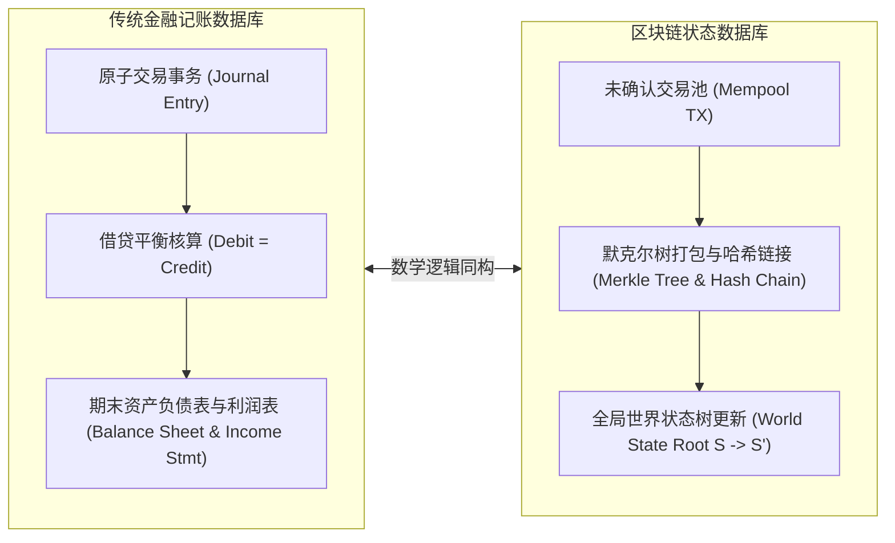
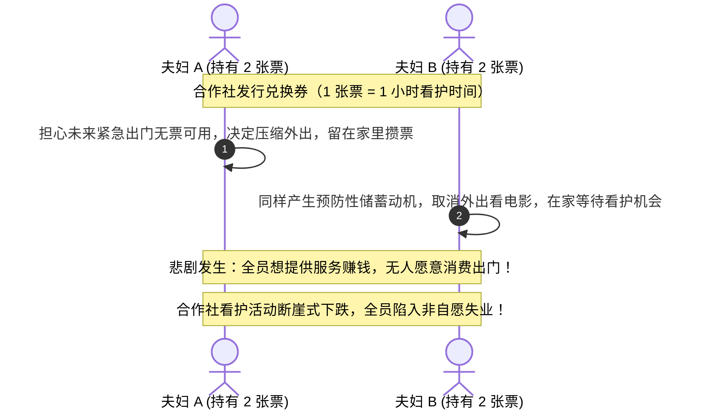
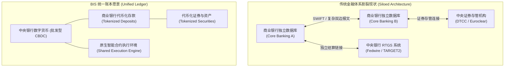

# Lec 2 区块链作为数据库与货币的本质（Blockchain as a Database）

> **授课教师**：Robert M. Townsend（MIT 经济学系 Killian 讲席教授）  
> **长标题**：分布式账本与财务账户的统一数据库视角、货币的不同界定以及宏观社区视角（A Unified View of Distributed Ledgers and Financial Accounts as Databases, Distinct Views of Money, the Larger Community Perspective）

## TL;DR

- 区块链本质上是一种由密码学哈希链接、通过状态转移规则确定性更新的特殊分布式事务数据库。
- 传统企业复式记账与区块链账本在底层同构，二者均将经济活动解构为原子级借贷或状态转移事务。
- 从个体视角看，货币是资产与价值储藏手段；但从帕乔利复式记账与社区视角看，货币是持有人对社区生产的索取权与负债。
- 国会山保姆合作社案例揭示了流动性短缺如何诱发自发性衰退，而现代央行“统一账本”试图解决遗留系统的严重割裂。

## 区块链与财务账户的统一数据库视角

无论技术外壳多么复杂，任何用于记录、检索与维护信息的数据结构都可以被抽象为**数据库（Database）**。在这一基准定义下，现代商业银行的集中式核心账务系统、企业的复式记账账本，以及去中心化区块链，在逻辑功能上完全等价：它们都是**交易事务（Transactions）的有序状态记录器**。



### 区块链状态机的形式化表述

以比特币（UTXO 模型）与以太坊（Account 模型）为例，区块链可以严格形式化为一个确定性有限状态自动机：

$$S_{t+1} = \text{APPLY}(S_t, B_{t+1})$$

其中 $S_t$ 表示在区块高度 $t$ 时的全网世界状态（State），$B_{t+1}$ 是通过网络验证并达成共识的新区块，包含交易列表 $\{TX_1, TX_2, \dots, TX_k\}$。

::: definition 默克尔树（Merkle Tree）与紧凑状态验证
默克尔树是一种基于哈希算法的平衡二叉树。叶子节点存储单笔交易的密码学哈希 $H(TX_i)$，非叶子节点存储其左右子节点哈希的级联哈希 $H(\text{Left} \parallel \text{Right})$，树根即为**默克尔根（Merkle Root）**。  
默克尔树的核心经济价值在于**轻客户端验证**：任何轻节点无需下载完整账本（数百吉字节），仅凭包含 $O(\log_2 N)$ 个哈希的默克尔证明（Merkle Proof），即可在对数复杂度内以极高可信度验证某笔特定交易是否被打包进特定区块。
:::

### 传统复式记账法（Double-Entry Bookkeeping）

在现代企业会计理论中（如 Samphantharak & Townsend, 2009 专著《Households as Corporate Firms》），企业或家庭的所有微观经济活动都可以表示为会计分录。每一笔交易均满足会计恒等式：

$$\Delta \text{Assets} = \Delta \text{Liabilities} + \Delta \text{Equity}$$

Townsend 教授在泰国乡村长期追踪调查项目（Townsend Thai Monthly Survey）中，通过采集村民之间逐笔现金、谷物、劳动力借贷的分录明细，在实验室中重构了村民的日度复式账本。研究发现，如果将每户家庭看作一个网络节点，所有交易合并起来便构成了一个天然的分布式账本原型。

## 传统复式记账法与帕乔利的“社区负债观”

卢卡·帕乔利（Luca Pacioli）在 1494 年出版的《算术、几何、比例及比例性比例集成》中正式系统化了现代复式记账法。Townsend 教授挖掘出了记账法背后深刻的历史哲学根源：

```text
古代算术的局限性：
文艺复兴之前的欧洲数学体系中，“负数”（Negative Numbers）被视为不可思议甚至荒谬的异端概念。
问题：如何在账簿中记录“欠别人 10 个金币”而不用负数？
帕乔利的解决方案：分立两列——借方（Debit，来自拉丁语 debere，意为“欠款/产生义务”）与贷方（Credit，来自拉丁语 credere，意为“信任/赋予权利”）。
```

更重要的是，帕乔利从社区（Community）视角定义了记账关系：
- **个体主义视角（Individual Perspective）**：我手中的货币是我的“资产”（Asset），代表我积累的财富与购买力；
- **社区整体视角（Community Perspective）**：我手中持有的货币，实际上是**社区对我的负债，同时也是我对社区未来产出的索取权与再流通义务**。一个人卖出货物获得了货币，意味着他已经为社区贡献了产品，他有义务在未来将这笔货币重新花费出去，购买社区其他成员的劳动产出，从而让整个社会的经济循环运转起来。

::: theorem 货币两重性权衡定理（Bech & Garratt, 2003; Goldstein et al., 2023）
在任何支付系统中，货币的**价值储藏职能（Store of Value）**与**交易媒介职能（Medium of Exchange）**存在内生张力：
- 当个体过度偏好货币的价值储藏功能时，流动性被窖藏（Hoarding），交易流速下降，导致实体经济陷入流动性枯竭；
- 只有当制度设计对过度储藏施加隐性持有成本（如流通滞期费 Demurrage）或保障充裕再循环时，交易媒介职能才能被最大化释放。
:::

## 货币的多维定义与流速矩阵

在古典宏观经济学中，货币常常被视作单一的外生外汇供给总量（如 M1、M2）。然而在微观现实中，能够充当交换媒介的物品往往是高度异质化且多维共存的。

Townsend 教授提出了**基于交易矩阵的内生货币定义**：

::: definition 流速与多维货币定义（Lim & Townsend, 1998）
在一个包含 $L$ 种商品与资产的经济体中，定义物品 $j$ 在时间区间 $\Delta t$ 内的流通速度（Velocity）为：
$$V_j = \frac{\text{在该区间内物品 } j \text{ 作为支付对价交易的总金额}}{\text{经济体中物品 } j \text{ 的现存总存量}} = \frac{\sum_{i \neq k} \text{Flow}_{ik}^j}{\text{Stock}^j}$$
**货币并不是某种先验给定的特殊法定物体，而是在交易矩阵中频繁出现（出现在最多交易对中）且流速 $V_j$ 显著高于其他一般资产的流动性媒介**。
:::

在印度半干旱热带乡村（ICRISAT 调研数据）与泰国乡村中，现实流通的不仅有法定泰铢或卢比：
- **谷物（Grain）**：由于生产周期与全员必需，在收获季节充当跨家庭高流速交易媒介；
- **私人欠条（IOUs）**：在紧密熟人网络中充当抵押背书货币；
- **法定现金（Cash）**：主要用于跨村庄和与城市大商户的外部清算。

## 货币政策与流动性陷阱：国会山保姆合作社危机

为了说明货币不足如何导致纯粹由支付工具短缺引发的经济大萧条，Townsend 教授深入分析了著名的**国会山保姆合作社危机（Capitol Hill Baby-Sitting Co-op Crisis）**（Sweeney & Sweeney, 1977; Krugman, 1998）：



### 经济学机制分解

1. **初始制度**：150 对国会工作人员夫妇组成互助社，免去雇佣外部保姆的昂贵开销。合作社发放纸质优惠券（Scrip），每张票对应 1 小时看护时间。保姆看护后直接收取被看护家庭的票券；
2. **制度摩擦**：合作社为了管理日常开支，向会员收取以票券计价的会费，并沉淀在管理账上，导致**全网流通中的票券总量大幅萎缩**；
3. **微观博弈**：每对夫妇为了应对突发紧急看护需求，都有维持一个“安全票券缓冲池”（如至少持有多于 10 张票）的预防性储蓄动机。随着票券总额缩水，绝大多数夫妇的储蓄低于安全线；
4. **宏观后果**：每对夫妇都拼命想通过给别人看孩子来“赚取票券”，却极力避免自己外出消费。然而，**一户的外出消费恰恰是另一户提供劳动赚取票券的唯一来源**。整个合作社迅速陷入了严重的“凯恩斯主义流动性陷阱”（Liquidity Trap），真实产出近乎归零；
5. **政策解药**：合作社最终通过向每户无偿增发票券（类似央行量化宽松或直升机撒钱），使得流通性恢复，交易立即复苏。但随后又因过度超发导致票券贬值（夫妇过度频繁外出导致保姆短缺）。

## 社区互助信用与中立结算层

国会山案例在现代非洲和欧洲催生了大量的**社区包容性货币（Community Inclusion Currencies, CICs）**与**互助信用网络（Mutual Credit Networks）**：

- **肯尼亚 Sarafu 网络**：针对内罗毕贫民窟小微商户缺乏法定先令流动性的困境，通过链上发行抵押未来生产的数字代币（Sarafu）。商户承诺接受代币购买面包、水与日用品，从而将商品流转锁定在本地生态中，有效抵御了全国性现金紧缩冲击；
- **撒丁岛 Sardex 货币**：意大利中小企业间自发形成的无息商业清算网络。企业间以 Sardex 计价彼此记账，不提取法定欧元利息，有效盘活了闲置产能。

::: definition 中立结算层（Neutral Settlement Layer, Fleischman & Dini, 2024）
当经济体中并存多种本地社区货币、商业承兑欠条与法定中央银行货币时，各系统容易沦为互相割裂的流动性孤岛。中立结算层是一个**无利益偏向的跨系统互操作协议**：它不发行自身的主权法币，而是维护一个拓扑图账本，为不同计价单位的本地债务凭证提供原子跨系统兑换与路由清算。
:::

## 分布式系统的 CAP 定理与央行统一账本愿景

### 理论计算机科学边界：CAP 定理

在评估区块链能否完全取代传统金融数据库时，必须直面理论计算机科学中的根本物理约束：

::: theorem CAP 定理（Eric Brewer, 2000; Seth Gilbert & Nancy Lynch, 2002）
在任何跨越网络分区的分布式数据存储系统中，**强一致性（Consistency）**、**可用性（Availability）**与**分区容忍性（Partition Tolerance）**三者不可兼得，至多只能同时满足其中两项：
- **CP 系统**：发生网络断联（网络分区）时，为了确保账本数据绝对一致，拒绝部分读写请求，牺牲可用性（传统分布式金融数据库、严格防双花的联盟链）；
- **AP 系统**：发生网络断联时，允许各分区独立继续响应读写，但账本状态可能短暂分叉，依赖事后最终一致性（如 DynamoDB、DNS）；
- 比特币 PoW 并不是完美的 CP，它通过中本聪最长链规则（Nakamoto Consensus）在概率意义上实现“最终一致性”，付出了极高的确认延迟与能耗代价。
:::

### 传统遗留系统的碎片化困境与 BIS 统一账本

国际清算银行（BIS）总经理奥古斯汀·卡斯滕斯（Agustín Carstens, 2023）在报告《未来的货币系统：从愿景到现实》中直言，现有全球金融体系陷入了极其高昂的“孤岛碎片化”（Fragmentation）：



- **遗留系统的弊端**：资产与资金存放在网络边缘的各家私有数据库中，资产所有权的交割依赖脱节的第三方报文网络（如 SWIFT），资金通过央行实时全额结算系统（RTGS），证券通过存管清算所（CSD/CCP）。消息在复杂的多边链路中来回穿梭，导致极高的对账成本、在途资金占用与违约敞口；
- **统一账本（Unified Ledger）方案**：将央行储备货币、商业银行代币化存款与金融资产汇聚到同一个**可编程共享账本平台**上，利用原子智能合约实现无缝、无时滞、无信用风险的瞬间结算。

## 我的理解与洞见

::: insight
许多人将区块链误解为与传统会计学对立的颠覆性产物，但从深层经济学结构看，**区块链恰恰是文艺复兴时期卢卡·帕乔利复式记账法在密码学与分布式计算维度的终极演进**。

传统复式记账法通过“资产 = 负债 + 所有者权益”在单个企业内部消除了单边假账可能；但跨企业的账目核对依然依赖脆弱的纸质凭证、审计抽查和中心化中介背书。而区块链通过公私钥签名、不可篡改的区块哈希链，以及全网一致性共识，将传统“企业内部的双边复式记账”一举跃升为**“全网多边共享的确定性记账网络”**。

在这一网络中，货币不再是一张张脱离交易关系的静止纸币，而是记账网络中的流通令牌。国会山保姆合作社的困境证明：货币体系的核心不在于其是否有昂贵的实物抵押，而在于其**流动性规则能否确保商品交易的顺畅循环**。当未来资产被全面代币化并纳入统一账本时，困扰全球经济数百年的“流动性摩擦”有望首次在系统底层被代码化求解。
:::

## 常见认知误区与概念混淆

::: pitfall
- **误将“代币总量恒定”视作理想货币制度**：受比特币 2100 万枚硬上限影响，部分加密支持者认为绝对通缩模型是终极货币设计。但国会山保姆合作社与宏观货币史反复证明，经济规模与交易需求是动态扩张的，机械固定的货币供应在需求冲击下极易诱发严重的流动性囤积与紧缩螺旋，毁灭实体交换。
- **混淆“信息存储”与“经济信任”**：区块链可以保证存入的数据未被篡改（Garbage In, Immutable Garbage Out），但无法保证录入时的数据是真实的。例如在乡村记账中，如果农户虚构一笔不存在的谷物交易并签名上链，区块链本身无法识破这一谎言。防范虚假信息必须依靠第 8 讲探讨的“机制设计与经济学激励”。
- **忽略分布式数据库的性能取舍**：传统关系型数据库（如 PostgreSQL）每秒可轻松处理数万笔 ACID 事务，而公链（如比特币每秒 7 笔、以太坊每秒 15-30 笔）为了抗审查与拜占庭容错付出了巨大的性能代价。对于绝大多数不涉及去中心化对抗的内部记账，盲目使用公链是不计成本的工程倒退。
:::

## 核心参考文献与材料链接

- **经典理论文献**：Joan Sweeney and Richard James Sweeney (1977), [“Monetary Theory and the Great Capitol Hill Baby-Sitting Co-op Crisis”](https://wayback.archive-it.org/5456/20240920170145/http://www.eecs.harvard.edu/cs286r/courses/fall09/papers/coop.pdf), *Journal of Money, Credit and Banking*, 9(1): 86–89.
- **诺奖通俗解读**：Paul Krugman (1998), [“Baby-Sitting the Economy”](https://slate.com/business/1998/08/baby-sitting-the-economy.html), *Slate*.
- **央行前沿展望**：Agustín Carstens (2023), [“The future monetary system: from vision to reality”](https://www.bis.org/speeches/sp230222.pdf), Bank for International Settlements (BIS).
- **多维货币测度**：Robert M. Townsend and N. Lim (1998), “General Equilibrium Models of Financial Systems: Theory and Measurement in Village Economies”, Cambridge University Press.
- **官方公开课视频**：[MIT OCW Lecture 2 on YouTube](https://www.youtube.com/watch?v=077X13f41V8)
